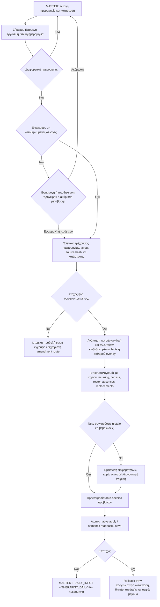
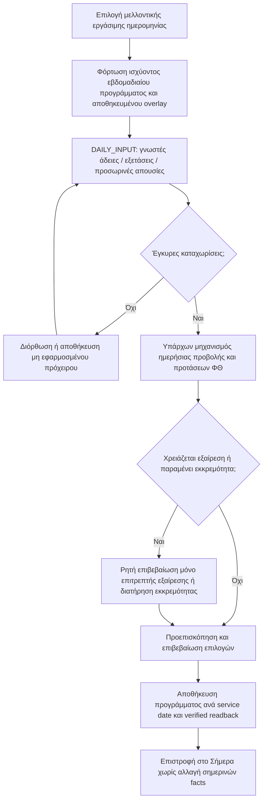
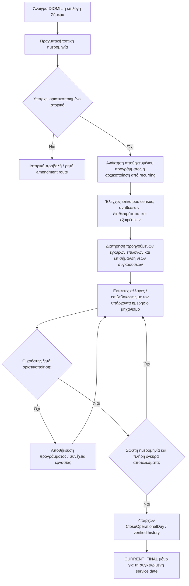

# DIOMIL | ΕΝΙΑΙΟΣ ΟΔΗΓΟΣ ΑΚΡΙΒΟΥΣ ΣΥΝΕΧΕΙΑΣ

> **ΕΝΕΡΓΗ ΟΔΗΓΙΑ ΧΕΙΡΙΣΤΗ 22/11/2026, §4.105:** Πρώτα πλήρως λειτουργικό πραγματικό Excel με **όλες** τις συμφωνημένες βασικές δυνατότητες. Μόνο τα **έξι ρητά αναβλητέα** του §4.104 εξαιρούνται, με την αρχική σειρά τους. **Επιταχύνουμε χωρίς άσκοπες επαναλήψεις και ενημερώνουμε τον ίδιο οδηγό μετά από κάθε πραγματική εργασία.** Software CI ≠ native/clinical acceptance.

> **ΕΝΕΡΓΗ ΣΥΝΕΧΕΙΑ 17/11/2026:** Ιδιωτικό R4: 846 εβδομαδιαίες προτάσεις, 818 χωρίς σήμανση patient conflict, 28 HOLD_CONFLICT, 29 εκκρεμή ωράρια Ψυχολογίας, 106 μη επιβεβαιωμένες ταυτότητες. Οι έξι ασάφειες διευκρινίστηκαν. Βλέπε §4.36. Native DEMO PENDING.

> **ΤΕΛΕΥΤΑΙΟ VERIFIED CLOUD CHECKPOINT 17/11/2026:** GitHub Actions [43980917796](https://github.com/diomil73/EKA-REHAB-TIMETABLE/actions/runs/43980917796), code SHA `14d095367845cbf0c60aacf84d63c07bd303e899`: **2.040/2.040 Python pytest Windows και 2.040/2.040 Linux, 4/4 jobs SUCCESS**. Δύο νέες μικρές ενισχύσεις της πηγαίας ασφάλειας (6 fictional-only tests συνολικά), §4.7. Αφορά GitHub cloud code, **όχι** το PC, native XLSM ή κλινική αποδοχή. Η ρητή παύση προσωπικού PC στην §4.6 παραμένει σε ισχύ.


> **ΜΟΝΑΔΙΚΟ ΚΕΝΤΡΙΚΟ ΑΡΧΕΙΟ.** Αν ο χρήστης γράψει «Βρες το αρχείο-οδηγό DIOMIL και συνέχισε ακριβώς εκεί που μείναμε», βρες αυτό το αρχείο στον **τρέχοντα** κλάδο GitHub, διάβασέ το ολόκληρο και συνέχισε από το **Κεφάλαιο 4**. Μη βασιστείς σε παλιές περιλήψεις ή ζητήσεις επανάληψη όσων ήδη αποδείχθηκαν. Τα παλιά checkpoints είναι ιστορικά, όχι ανταγωνιστικές οδηγίες.
>
> **Τέσσερα κεφάλαια μέσα στο ΙΔΙΟ αρχείο:** 1. Πού μείναμε και πραγματικά αποδεικτικά, 2. Επιχειρησιακοί κανόνες και υπάρχουσες αποδεκτές λειτουργίες, 3. Αρχιτεκτονική/ασφαλής μέθοδος, 4. Ακριβή επόμενα βήματα, κριτήρια demo και ενημέρωση οδηγού.
>
> **Snapshot σύνταξης: 17/11/2026.** Επαληθευμένο HEAD *πριν* τον παρόντα οδηγό: `38250856ad2e98f70d1aa64253b449422efef250`. GitHub Actions [43971761025](https://github.com/diomil73/EKA-REHAB-TIMETABLE/actions/runs/43971761025): **4/4 success**. Το νέο commit του οδηγού θα έχει νεότερο SHA. Σε κάθε επανεκκίνηση ανακτούμε **live HEAD**, δεν αντιμετωπίζουμε αυτόν τον αριθμό ως μόνιμα τελευταίο.
>
> **Διαβάζουμε προσεκτικά τους ισχυρισμούς.** Source/CI GREEN ≠ πραγματικό native XLSM ≠ κλινική έγκριση ≠ operator acceptance. Ποτέ ονόματα/IDs/στοιχεία ασθενών στο δημόσιο GitHub.

---

# ΚΕΦΑΛΑΙΟ 1. ΤΡΕΧΟΝ ΣΗΜΕΙΟ, ΠΡΑΓΜΑΤΙΚΑ ΑΡΧΕΙΑ, ΚΑΤΑΣΤΑΣΗ ΚΑΙ ΑΠΟΔΕΙΞΕΙΣ

## 1.1 Ποιο έργο, ποιος κλάδος, ποιος στόχος

- Repository: [`diomil73/EKA-REHAB-TIMETABLE`](https://github.com/diomil73/EKA-REHAB-TIMETABLE).
- Ενεργός authoritative branch: **`work/afternoon-medical-scope-20261115`**. Όχι αυτόματη επιστροφή σε `main`, `feature/outpatient-scheduling` ή `work/history-statistics-rebuild`, που εμφανίζονται σε ιστορικές αναφορές.
- Στόχος χρήστη: **ένα χωριστό, ιδιωτικό, πλήρως δοκιμαζόμενο Excel/VBA DEMO που χρησιμοποιεί πραγματικούς ασθενείς και ακριβές εγκεκριμένο τρέχον πρόγραμμα**, για καθημερινή πρακτική αξιολόγηση. Το υπάρχον παραγωγικό χειροκίνητο πρόγραμμα δεν αντικαθίσταται/τροποποιείται. Synthetic fixtures επιτρέπονται για τεχνικά tests, **όχι για αξιολόγηση από τον χρήστη**.
- Εργαζόμαστε αυτόνομα, χωρίς να ρωτάμε «οκ;» μετά από κάθε commit/command. Σταματάμε μόνο για πραγματική ανθρώπινη κλινική απόφαση, μη προσβάσιμο ιδιωτικό αρχείο ή μη διαθέσιμο Windows Excel/COM. Κάθε ουσιαστικό βήμα καταγράφεται στον παρόντα **μοναδικό** οδηγό.
- Οι παλαιές `Documentation/CURRENT_HANDOFF.md`, `PROJECT_STATUS.md`, `ONBOARDING.md` παραμένουν ζωντανές *θύρες* αλλά **αυτό το αρχείο** είναι η πρώτη ανάγνωση και κατέχει την ακριβή ενιαία συνέχεια. Το [PROJECT_DELIVERY_MASTER_REPORT_20261115.md](PROJECT_DELIVERY_MASTER_REPORT_20261115.md) διατηρεί αναλυτικό ιστορικό και αποδεικτικά, όχι ξεχωριστό start point.

## 1.2 Πραγματικό checkpoint, όχι υποθέσεις

| Έλεγχος | Τεκμηριωμένο αποτέλεσμα |
|---|---|
| Τεχνική πηγή | Commit [3825085](https://github.com/diomil73/EKA-REHAB-TIMETABLE/commit/38250856ad2e98f70d1aa64253b449422efef250), Actions [43971761025](https://github.com/diomil73/EKA-REHAB-TIMETABLE/actions/runs/43971761025), **4/4 GREEN** |
| Πλήρη Python tests | [Actions 43971456352](https://github.com/diomil73/EKA-REHAB-TIMETABLE/actions/runs/43971456352): **2.031 pytest Windows και 2.031 Linux**, fictional/synthetic source regression |
| Πραγματικά XLSX | Τα δύο συνημμένα της προηγούμενης συνομιλίας **ανοίχτηκαν πραγματικά μόνο για ανάγνωση**. SHA πριν/μετά unchanged. Δεν σημαίνει ότι τα ίδια bytes θα είναι σε κάθε μελλοντικό runtime |
| Πρόγραμμα / review | **106/106** patient source-row/name/context reviews ταιριάζουν, **764** προτεινόμενες ΔΕ–ΠΑ εβδομαδιαίες εγγραφές, **0** source-cell provenance mismatches στον ανεξάρτητο έλεγχο |
| PatientID | **0/106 εγκεκριμένα**, **33** παλιά IDs ως *μη εγκεκριμένες* προτάσεις |
| Εκκρεμότητες review | **61** εγγραφές προς έλεγχο, **11** καταγεγραμμένες επικαλύψεις αλλά **15** conflict groups από πλήρη ανεξάρτητο scan: 11 cross-specialty + **4 επιπλέον διπλές Λογοθεραπείες με ίδιο source cell/day/time** |
| F / U / V | **5 F** (30' ανακλινόμενο), **19 U** (ιστορικό απογευματινό), **0 V** (πισίνα δεν εμφανίζεται στο συγκεκριμένο snapshot) |
| Outpatients | Βοηθητικό φύλλο `Εξωτερικοί Ασθενείς` με **10 συμπληρωμένες σειρές** αλλά **όχι** εγκεκριμένη schema πηγή `PATIENTS` + `OUTPATIENT_SCHEDULE`· δεν αποδεικνύει 10 συνεδρίες |
| Native πραγματικό demo | **ΔΕΝ ΕΧΕΙ ΔΗΜΙΟΥΡΓΗΘΕΙ** και δεν έχει γίνει operator acceptance. Δεν έχει γίνει τοπικό real-data COM seed ούτε πλήρης Save/Close/Reopen |
| Προστασία | Original manual/review, παγωμένες H2-H10 αποδείξεις, immutable `Rehab_Center_System_v27_1.xlsm`, existing MASTER renderer: αμετάβλητα |

Τα 764 proposed entries ανά ειδικότητα: **ΦΘ 471, Εργοθεραπεία 154, Λογοθεραπεία 34, Ψυχολογία 34, ΕΦΑ 29, Ρομποτική 25, Ανακλινόμενο 17**. Υπάρχουν 108 source B text rows, αλλά **2** δεν είναι review ασθενείς και δεν περιέχουν C:V treatments· **30** context cells στον πίνακα review λείπουν. Οι 17 εβδομαδιαίες υποψήφιες για ανακλινόμενο **δεν αποτελούν εγκεκριμένη μοντελοποίηση** των 5 αρχικών F.

## 1.3 Ονόματα των πραγματικών συνημμένων, προέλευση και πρόσβαση

- ΠΡΑΓΜΑΤΙΚΟ manual filename: **`ΠΡΟΓΡΑΜΜΑΤΑ  ΘΕΡΑΠΕΙΩΝ ΑΣΘΕΝΩΝ 10-11-26 .xlsx`**. Υπάρχουν **δύο κενά** μεταξύ των δύο πρώτων λέξεων και **ένα κενό πριν από `.xlsx`**. Αυτό εξήγησε το `MANUAL_NAME_MATCH=False` και `MANUAL_FILES_FOUND=0` του ακριβούς τοπικού filename filter. Το αρχείο ήταν σωστό· το όνομα που είχαμε γράψει αρχικά ήταν ανεπαίσθητα διαφορετικό.
- Identity proposal: **`DIOMIL_ΕΛΕΓΧΟΣ_ΤΑΥΤΟΤΗΤΩΝ_ΠΡΟΤΑΣΕΙΣ_20261112.xlsx`**. `ΠΡΟΤΑΣΕΙΣ` **δεν** σημαίνει `review_confirmed`.
- Ημερομηνία 10/11/2026 είναι **ιστορικό snapshot**. Χρειάζεται επαλήθευση ή νέο εγκεκριμένο current manual για την εβδομάδα πραγματικού demo.
- **Αναλυτικό, προστατευμένο από στοιχεία ασθενών τεκμήριο:** [`Documentation/REAL_SOURCE_UPLOADED_PAIR_READONLY_AUDIT_20261117.md`](REAL_SOURCE_UPLOADED_PAIR_READONLY_AUDIT_20261117.md). Προέλευση raw counts, ειδικών, exclusions και συμφωνίας. Δεν δημοσιεύουμε τα αρχικά XLSX/PatientIDs/private paths/hashes.
- Τα actual attachments είχαν ανοίξει σε προηγούμενο conversation/runtime. Αν τώρα δεν είναι διαθέσιμα, βρες πρώτα τα ίδια conversation/Project/Library attachments μόνο όταν χρειάζονται για **νέα** δουλειά. Μη λες «δεν διαβάστηκαν ποτέ» και μην επαναλαμβάνεις το ίδιο source audit από συνήθεια.

## 1.4 Γιατί εμφανίστηκε άσκοπη επανάληψη στο παρελθόν

- Ο τοπικός Windows Git checkout ήταν **155 commits πίσω**. Ο χρήστης ολοκλήρωσε με `git fetch origin` και `git merge --ff-only` έως `3b47567`. Τα δύο audit scripts επαληθεύτηκαν `Test-Path=True`. Το μεμονωμένο `else` error ήταν σφάλμα τμηματικής PowerShell επικόλλησης και δεν εμπόδισε το fast-forward.
- Η επόμενη αναζήτηση με λανθασμένο ακριβές όνομα βρήκε 0 manual και 1 proposal. Ο `SAFETY STOP` πέτυχε, αλλά έπειτα ο χρήστης εκτέλεσε επιπλέον γραμμές με **κενό `$p`**. Τα `argparse: --programme expected one argument` **δεν** είναι αποτυχίες κλινικών δεδομένων, επειδή κανένα script δεν άνοιξε πηγή.
- **Μετέπειτα** ο χρήστης ανέβασε τα δύο XLSX και ο ανεξάρτητος read-only έλεγχος ολοκληρώθηκε. Δεν χρειάζεται ξανά η ίδια διάγνωση.
- Εντοπίστηκαν **4 πραγματικά duplicate same-source Λογοθεραπεία groups** πέρα από τις 11 cross-specialty conflicts. Μπήκαν **2 fictional-only regression tests**: `Tests/test_trial_weekly_projection.py::test_same_speech_therapy_source_slot_cannot_be_imported_twice` και `Tests/test_trial_admission_gate.py::test_identical_speech_therapy_proposals_fail_without_overlap_sheet_rows`. Το ίδιο το πραγματικό review **δεν** διορθώθηκε.

## 1.5 Κρίσιμα commits και στάθμη απόδειξης

1. [`58ceeec`](https://github.com/diomil73/EKA-REHAB-TIMETABLE/commit/58ceeec5f5a019e27bb9701145378dbb9d7c400f): ανεξάρτητος έλεγχος αληθινών ανεβασμένων αρχείων, read-only report.
2. [`3272528`](https://github.com/diomil73/EKA-REHAB-TIMETABLE/commit/327252826541bfc0dc8863d280672844d100f037): 4 επιπλέον source-duplicate Λογοθεραπείας.
3. [`6669489`](https://github.com/diomil73/EKA-REHAB-TIMETABLE/commit/6669489d28945808fcac38f288c8950e7fb55b40): 2 new synthetic safety tests και 2.031 cross-platform green.
4. [`3825085`](https://github.com/diomil73/EKA-REHAB-TIMETABLE/commit/38250856ad2e98f70d1aa64253b449422efef250): παραδοτέο real-read-only checkpoint και πράσινο 4/4 CI.
5. Το **commit του παρόντος οδηγού** είναι νεότερο. Σε κάθε resume επαλήθευσε live `HEAD` πριν συμπεράνεις κατάσταση.

**Τέσσερις διαφορετικές ενδείξεις, μην τις αναμειγνύεις:** (α) `SOURCE/CI GREEN`, (β) `NATIVE ACCEPTED` μόνο σε συγκεκριμένο frozen preview, (γ) `REAL SOURCE READ-ONLY GREEN` για provenance χωρίς approval, (δ) `REAL NATIVE DEMO ACCEPTED` μετά από current private data, Windows Excel/COM, 1:1 ΔΕ–ΠΑ, workflows, Save/Close/Reopen και υπογραφή χειριστή. **Το (δ) παραμένει PENDING**.

---


# ΚΕΦΑΛΑΙΟ 2. ΚΛΕΙΔΩΜΕΝΟΙ ΚΑΝΟΝΕΣ, ΥΠΑΡΧΟΥΣΕΣ ΛΕΙΤΟΥΡΓΙΕΣ ΚΑΙ ΟΡΙΑ

## 2.1 Πρόγραμμα, ημέρες, βασικό επιχειρησιακό μοντέλο

- Η θεραπευτική εβδομάδα είναι **μόνο Δευτέρα έως Παρασκευή**. Δεν υπάρχουν ραντεβού/θεραπείες Σαββάτου–Κυριακής. Αυτός ο κανόνας είναι ρητά επιβεβαιωμένος από τον χρήστη.
- Το χειροκίνητο αρχικό πρόγραμμα είναι η βάση του **recurring εβδομαδιαίου σχεδίου** και δεν αντικαθίσταται από ημερήσιες εξαιρέσεις. Απουσία ασθενούς, απουσία θεραπευτή, ακύρωση, αντικατάσταση είναι **ημερήσιο operational overlay**. Δεν καταστρέφουν ούτε μεταλλάσσουν τα αρχικά recurring assignments.
- Στο **A:V source import** ειδικά, όταν υπάρχει **ώρα** θεραπείας αλλά το αντίστοιχο πεδίο ημερών είναι **κενό**, θεωρούμε **ΔΕ–ΠΑ** ακριβώς. Αυτό είναι local source-import `implicit_daily=True`· **όχι** γενική αλλαγή default όλων των parsers. Όταν **δεν υπάρχει ώρα**, δεν δημιουργείται slot. Ημέρες/provider/κείμενο χωρίς ώρα απαιτούν ξεχωριστό review.
- Οι διαφορετικές ώρες στις διαφορετικές μέρες πρέπει να διατηρούνται ως διακριτές πηγαίες εβδομαδιαίες τοποθετήσεις. Απαγορεύεται να μετατραπούν πολλές πραγματικές ώρες σε μία γενική σταθερή ώρα ή να εξαφανιστεί η πληροφορία του αρχικού source cell.
- **Πρωτότυπο πρόγραμμα `ΠΡΟΓΡΑΜΜΑ` A:V:**

| Στήλη | Πηγαία σημασία | Στη νέα εισαγωγή |
|---|---|---|
| A | Κλινική / πηγαίο context | Δεν συμπληρώνεται από την προηγούμενη σειρά χωρίς ανεξάρτητη έγκριση |
| B | Ονοματεπώνυμο ασθενούς | Όχι authoritative PatientID |
| C, D, E | Φυσικοθεραπεία: ώρα, ημέρες, θεραπευτής | Ακριβής ΦΘ recurrence/provider |
| F | Ανακλινόμενο, ώρα | ΦΘ-σχετικό **30 λεπτών**, μη αυτόματη αυθαίρετη ημέρα/provider |
| G, H, I | Εργοθεραπεία: ώρα, ημέρες, θεραπευτής | Ακριβής διατήρηση ημερών/ωρών |
| J, K, L | Λογοθεραπεία: ώρα, ημέρες, θεραπευτής | Διπλά ίδια source-cell slots απορρίπτονται |
| M, N, O | Ψυχολογία: ώρα, ημέρες, θεραπευτής | Ακριβής διατήρηση |
| P, Q | ΕΦΑ: ώρες, ημέρες | Δεσμεύσεις μόνο με πραγματική ώρα |
| R, S, T | Ρομποτική: ώρα, ημέρες, θεραπευτής | Μόνο εγκεκριμένοι πάροχοι/ικανότητες |
| U | Παλαιό απογευματινό | Ιστορικό **όχι** αυτόματο νέο πρωινό/απογευματινό |
| V | Πισίνα | Πρωινή ειδικότητα, μόνο με εγκεκριμένα στοιχεία |

- **F/U/V source gate:** Το F χρειάζεται εγκεκριμένη συσχέτιση ημερών/provider/capacity και σύνδεση με ΦΘ, το U ρητή πολιτική για ιστορικό απόγευμα, το V πλήρη ημέρα/ώρα/provider. Η σημερινή `prepare_real_data_practice_demo.py` κάνει **hard stop** όταν υπάρχει οποιοδήποτε F/U/V. Άρα ακόμη και μια ανθρώπινη έγκριση δεν αρκεί χωρίς κατάλληλη verified εισαγωγική λειτουργία ή εγκεκριμένη ρητή διαδικασία. Απαγορεύεται σιωπηλή παράλειψη/σβήσιμο πεδίων. **V=0** σε αυτό το snapshot **δεν** σημαίνει κατάργηση της πισίνας από το Diomil.
- Πηγή λεπτομερειών: [TRIAL_SOURCE_SCHEMA_AND_IMPORT_DESIGN_20261115.md](TRIAL_SOURCE_SCHEMA_AND_IMPORT_DESIGN_20261115.md), [REAL_MANUAL_PROGRAM_COLUMNS_AUTHORITATIVE_20261110.md](REAL_MANUAL_PROGRAM_COLUMNS_AUTHORITATIVE_20261110.md), [SYSTEM_RULES.md](SYSTEM_RULES.md), [DECISIONS.md](DECISIONS.md).

## 2.2 Ασθενείς, ταυτότητες, εξωτερικοί και capacity

- `PatientID`: **αμετάβλητο εσωτερικό identity key**, δεν μεταβάλλεται όταν αλλάζει κλινική/θάλαμος/ιατρός/θεραπευτής. Ούτε όνομα ούτε παλιό προτεινόμενο ID αρκεί για αυτόματη εξουσιοδότηση. `HospitalMRN`: ξεχωριστό προαιρετικό νοσοκομειακό αναγνωριστικό. Κάθε πραγματική καταχώριση/αντιστοίχιση επιβεβαιώνεται ιδιωτικά από εξουσιοδοτημένο χειριστή.
- Εσωτερικοί και εξωτερικοί είναι πλήρεις κατηγορίες ασθενών. Ο εξωτερικός δεσμεύει πραγματικό capacity/therapist workload και συμμετέχει σε daily replacements, ιστορικό και scheduling. Δεν είναι dummy ή μόνο διακοσμητικό κείμενο.
- Ο ίδιος ακριβής ασθενής/ημέρα/ώρα δεν μπορεί να κρατά δύο ασύμβατες θεραπείες, ενώ το ίδιο source-cell/day/time δεν δημιουργεί δύο πραγματικές συνεδρίες. Shared therapist slots θέλουν **ξεχωριστή εγκεκριμένη ακριβή membership** όλων των PatientIDs· δεν επιτρέπεται να θεωρηθεί αυθαίρετα «ομαδική» η σύγκρουση.
- Το επιχειρησιακό outpatient registry είναι `PATIENTS` με πραγματικό `PatientType`, ενώ recurring ραντεβού αποθηκεύονται σε `OUTPATIENT_SCHEDULE`, όχι στο απλό βοηθητικό παλιό φύλλο και όχι μόνο στο ημερήσιο κελί οθόνης. Εμφάνιση εξωτερικών με ανοιχτό μπλε περιορίζεται στους συμφωνημένους operational πίνακες `THERAPIST_DAILY`, όχι αυτομάτως σε ολόκληρη την εφαρμογή.
- `Infectious` είναι ανεξάρτητο πραγματικό operational δεδομένο. Δεν το συμπεραίνουμε από χρώμα, θάλαμο ή όνομα. Με ίσο workload/time availability μπορεί να χρησιμοποιηθεί ως tie-breaker ισόρροπης κατανομής. Ρομποτική θεραπεία ανατίθεται μόνο σε provider με αντίστοιχη πραγματική capability.
- **Φοιτητές** ξεχωριστοί από θεραπευτές. Ενεργός φοιτητής έως **5** ημερήσια patient/timeslots: στα 4/5 μπορεί να δεχτεί ακόμη ένα, στα 5/5 **όχι** έκτο. Μετά την τοποθέτηση αλλάζει η προβολή του ιστορικού με `φοιτητής 1` κ.ο.κ., διατηρώντας όμως εσωτερικά την κανονική ταυτότητα.
- **Replacement preferences:** πρώτα χαμηλότερο effective ημερήσιο φορτίο, έπειτα άμεση διαθεσιμότητα την επιθυμητή ώρα, έπειτα εναλλακτική κοινή ελεύθερη ώρα. Κατειλημμένο ζητούμενο slot δεν αποκλείει συνολικά υποψήφιο εάν υπάρχει άλλη κατάλληλη κοινή ώρα. Προτιμάται κοντινή συνεδρία ΦΘ/ανακλινόμενο, ελαχιστοποιώντας αναμονές χωρίς παράβαση hard constraints. Η 13:00 είναι χαμηλή soft preference, **όχι** απαγορευμένη ώρα.
- Ημερήσια απουσία ασθενούς απελευθερώνει το συγκεκριμένο occupied slot. Απουσία θεραπευτή ενεργοποιεί διαχείριση χωρίς απώλεια αρχικού recurring. Τα replaced sessions εμφανίζουν αρχικό ασθενή (ήπια πλάγια, **χωρίς** διαγραφή) και νέα ανάθεση/ώρα. Η διαγραφή χρησιμοποιείται για συνεδρίες που **δεν θα γίνουν**, όχι επιβεβαιωμένη αντικατάσταση.
- Πηγή λεπτομερειών: [SYSTEM_RULES.md](SYSTEM_RULES.md), [DECISIONS.md](DECISIONS.md), [DEMO_LIFECYCLE_AND_ROSTER_REQUIREMENTS_20261112.md](DEMO_LIFECYCLE_AND_ROSTER_REQUIREMENTS_20261112.md).

## 2.3 MASTER, Excel UI, Save/History και lifecycle

- Ο χρήστης δουλεύει κυρίως από το **MASTER**, με γνώριμα ελληνικά κουμπιά, φόρμες, ελεγχόμενη πλοήγηση. Τεχνικά IDs, ακατέργαστα sheets, row numbers και internal codes δεν ανήκουν σε κανονικό user-facing UI. Όπου έχουν γίνει αποδεκτά, τα gridlines, headings και tabs είναι κρυμμένα, η πλοήγηση μέσω κουμπιών· δεν πρέπει να αλλάζει αδιακρίτως όλο το VBA project.
- Ο υπάρχων `PatientProgramMasterRender.RefreshMasterPatientProgram` **λειτουργεί** για την κανονική καταχώριση και εμφανίζει την πολυγραμμική σύνθεση θεραπείας με ώρα, ημέρα, θεραπευτή στα canonical MASTER cells. **Μην ξαναγράψεις τον επιβεβαιωμένο renderer** για να διορθώσεις ξεχωριστή αρχική bulk-seed διαδρομή. Οι θεραπευτικές ειδικότητες περιλαμβάνουν ΦΘ, Ρομποτικό, Πισίνα, Ανακλινόμενο, Εργο, Λογο, ΕΦΑ, Ψυχολόγο, Απογευματινό και Κατάσταση.
- Εξιτήριο εσωτερικού και λήξη εξωτερικού είναι **date-effective γεγονότα**, όχι ημερήσια απουσία. Πρέπει να σταματούν οι μελλοντικές τοποθετήσεις, να κρατούνται οι προηγούμενες και η ακέραιη προσωπική ιστορία. `DEMO_ACTIVE_CENSUS` source path υπάρχει, αλλά το υπάρχον MASTER **δεν** κάνει ακόμη πλήρες αυτόματο live census refresh σε όλες τις in-session exit paths.
- `Κλείσιμο ημέρας` οδηγεί σε authoritative history μόνο όταν όλες οι συνεδρίες έχουν τελικό operational outcome. Η διορθωμένη κλειστή ημέρα είναι immutable version chain, παλιά version `SUPERSEDED`, νέα `CURRENT_FINAL`. Τα ιστορικά report πρέπει να μετρούν μόνο την authoritative version.
- Η πραγματική εργάσιμη μέρα θεραπευτή χρειάζεται ανεξάρτητο source. Μη μετράς «0 appointments» ως απουσία. Synthetic attendance δοκιμές H8 δεν αποτελούν κλινικά παρουσιολόγια.
- Μόνιμη αλλαγή recurring therapy απαιτεί stable `AssignmentID`, future effective-dated event, native transaction/readback και audit. Αλλαγές της ημέρας είναι ξεχωριστές.

## 2.4 Τι έχει ήδη δουλέψει πραγματικά ανά workstream

Οι παλαιότερες **operator-accepted** δοκιμές δεν ξανατρέχουν αυτόματα και τα αποδεκτά binary smokes παραμένουν FROZEN.

| Περιοχή | Πραγματική στάθμη |
|---|---|
| Core ημερήσια, απουσίες, αντικατάσταση, restore | Υπάρχουν σημαντικές source/native λειτουργίες και ιστορικά accepted paths. **Δεν** έχει γίνει ακόμη συνδυαστική πραγματική demo αποδοχή |
| H2 | `Z` native close-day/durable history **accepted/frozen** |
| H3 | `AB` native same-session correction, v1→v2, `CURRENT_FINAL` **accepted/frozen** |
| H4–H6 | Native scoped therapist/patient reports, history και contextual Save Day έχουν documented proofs |
| H7 | `BF` integrated toolbar, RefreshAll, patient/therapist reports, previous screen navigation **user accepted** για καταγεγραμμένο scope |
| H8 | `BL` patient/therapist dashboards UI **user accepted** στο συγκεκριμένο scope. `BO` 25 ημέρες **synthetic history evidence** |
| H9 | SOURCE/read-only therapist attendance/working-day contracts, **όχι** πραγματικό authoritative attendance writer ή πλήρες native chart |
| H10 | `CC` μέρος therapist charts/management visuals και native read-only/write-reopen/synthetic 179 recurring AssignmentIDs. Δεν υπάρχει πλήρης αποδοχή όλων των περιόδων/management export/permanent change event |
| Outpatient | Βασικό CREATE native green, αλλά edits/conflicts/workload έχουν επιμέρους limits. Real current outsider schedule source **pending** |
| Patients/therapists/students registry | Source validation, preview, μερικές native proofs· πλήρης ενιαία λειτουργική εγγραφή δεν έχει operator acceptance |
| Permanent recurring changes / global optimizer / 15ήμερη αξιολόγηση / broad protection | Αρκετά source/design/partial pieces. **Όχι** πλήρως εγκεκριμένο end-to-end |
| REAL-DATA ενιαίο DEMO | **ΜΟΝΟ** current code/synthetic CI και ιστορικό real-source read-only audit. **ΚΑΝΕΝΑ** real native COM build/operator acceptance |

**Αναλυτικό μητρώο/πρωτογενή τεκμήρια**: [PROJECT_DELIVERY_MASTER_REPORT_20261115.md](PROJECT_DELIVERY_MASTER_REPORT_20261115.md), [INTEGRATED_TEST_BASELINE_MATRIX_20261115.md](INTEGRATED_TEST_BASELINE_MATRIX_20261115.md), [CURRENT_HANDOFF.md](CURRENT_HANDOFF.md), `CHECKPOINT_H*`, `H10_*`. Ο παρών οδηγός κατευθύνει τη συνέχεια, οι παλιές αναφορές αποδεικνύουν το αντίστοιχο scope.

---


# ΚΕΦΑΛΑΙΟ 3. ΤΕΧΝΙΚΟΣ ΧΑΡΤΗΣ, ΑΣΦΑΛΗΣ ΜΕΘΟΔΟΣ ΚΑΙ ΑΝΤΙΜΕΤΩΠΙΣΗ ΠΡΟΒΛΗΜΑΤΩΝ

## 3.1 Υποχρεωτικός τρόπος εργασίας σε κάθε επανεκκίνηση

1. Αρχίζουμε από **αυτό το μοναδικό αρχείο**, διαβάζοντας και τα τέσσερα κεφάλαια. Ελέγχουμε μέσω GitHub connector το LIVE HEAD του `work/afternoon-medical-scope-20261115`, τα πρόσφατα commits και την τελική έκβαση των Actions. Δεν αντιμετωπίζουμε παλιό SHA ως σημερινό.
2. Συγκρίνουμε τη νέα εργασία με το Κεφάλαιο 1 (αποδεδειγμένα DONE, PENDING, BLOCKED). Δεν ξανακάνουμε την ίδια πραγματική σάρωση 106/764 χωρίς αλλαγμένη πηγή ή νέο λόγο. Τα ιστορικά H2–H10 checkpoints είναι παγωμένα τεκμήρια, όχι προγράμματα επανάληψης.
3. Εξετάζουμε ownership Python/VBA/Excel και τους κλειδωμένους κανόνες πριν αγγίξουμε κώδικα. Μικρά scoped commits, fictional-only regressions και αυστηρά αποδεικτικά για κάθε ελάττωμα. Δεν ξαναγράφουμε αποδεδειγμένα λειτουργικά MASTER/Daily/History στοιχεία εξαιτίας ελλείμματος στον χωριστό real-data initial import.
4. Τρέχουμε στο GitHub τα σχετικά tests και τα πλήρη Actions Windows + Linux μετά από αλλαγή κώδικα. Καταγράφουμε ακριβώς SHA, run ID, green/fail, αριθμό tests. Ακόμη και 2.031 πράσινα tests ΔΕΝ αποδεικνύουν native Excel ή πραγματική κλινική αποδοχή.
5. Πραγματικά patient workbooks, MRN, names, room/doctor, εμπιστευτικές διαδρομές, hashes πραγματικών patient files και κλινικά δεδομένα **ΠΟΤΕ** σε public GitHub/CI/issue/pytest fixtures. Εργαζόμαστε μόνο με aggregate non-identifying metrics δημόσια.
6. Native XLSM γράφεται αποκλειστικά με εγκεκριμένη Windows Excel/COM εκτέλεση σε νέο μοναδικό ιδιωτικό output, ποτέ με openpyxl save του πραγματικού XLSM. Original source/read-only SHA, preserved VBA, native Save/Close/Reopen, independent persisted readback και αποδεικτική operator επιβεβαίωση. Αποτυχημένο XLSM candidate παγώνει, δεν επισκευάζεται/επαναχρησιμοποιείται επιτόπου.
7. Ο assistant **προχωρά αυτόνομα** σε ασφαλή source/code/docs/CI εργασία χωρίς να περιμένει επαναλαμβανόμενα «ΟΚ». Αν απαιτείται πραγματική κλινική έγκριση, ιδιωτικό αρχείο που δεν είναι προσβάσιμο, ή Windows Excel/COM operator step, εξηγεί το *ένα* συγκεκριμένο εμπόδιο και προσφέρει προστατευμένη τοπική διαδικασία.
8. Στην ίδια εργασία ενημερώνουμε **αυτόν τον οδηγό** με νέα πράγματι verified στοιχεία και μία ακριβή επόμενη ενέργεια. Στα `CURRENT_HANDOFF`, `PROJECT_STATUS`, `ONBOARDING` αφήνουμε μικρούς δείκτες προς εδώ, χωρίς να δημιουργούμε τέσσερις ασυγχρόνιστες ενεργές οδηγίες. Οι παλιές παραδόσεις δεν διαγράφονται/αλλάζουν αναδρομικά.

## 3.2 Ακριβή paths υλοποίησης / αποδεικτικών

| Αρχείο | Χρήση |
|---|---|
| `Documentation/REAL_SOURCE_UPLOADED_PAIR_READONLY_AUDIT_20261117.md` | Πρωτογενές aggregate πραγματικό source/review proof: 106, 764, 61, **15**, F=5 U=19 V=0, 0 confirmed |
| `Documentation/REAL_DATA_DEMO_ACCEPTANCE_AND_FULL_HANDOFF_20261116.md` | Υποχρεωτική πλήρης 1:1 parity και πρακτική αποδοχή |
| `Documentation/REAL_DATA_DEMO_OPERATOR_CLI_20261116.md` | Exact authorized private preflight/JSON/native CLI; παλιά blocks χωρίς `--outpatients` ΔΕΝ είναι πλήρες native build |
| `Documentation/PRACTICE_DEMO_NATIVE_SEED_RUNBOOK_20261115.md` | Native seed/check/independent readback |
| `Documentation/DECISIONS.md`, `SYSTEM_RULES.md`, `TRIAL_SOURCE_SCHEMA_AND_IMPORT_DESIGN_20261115.md` | Κλειδωμένα μοντέλα/ημερολογιακή/κλινική σημασιολογία |
| `Documentation/PROJECT_DELIVERY_MASTER_REPORT_20261115.md`, `INTEGRATED_TEST_BASELINE_MATRIX_20261115.md` | Ιστορικό workstreams, ερμηνεία βαθμίδων GREEN |
| `Documentation/IMPLEMENTATION_MAP.md`, `H10_VBA_OWNERSHIP_AND_WRITE_SURFACE_MAP_20261115.md` | Ownership και κίνδυνοι COM/VBA |
| `Python/tools/audit_real_manual_specials.py` / `rehab_excel/trial_special_fields_audit.py` | READ-ONLY F/U/V; exit 0 = κενά, 3 = special review, 2 = failed/schema; **κανένα δεν εγκρίνει import** |
| `Python/tools/audit_trial_source_alignment.py` / `rehab_excel/trial_source_alignment.py` | READ-ONLY source-row/name/cell provenance; GREEN ≠ confirmed PatientID |
| `Python/tools/audit_real_outpatient_source.py` / `trial_private_outpatient_audit.py` | Εγκεκριμένο ξεχωριστό `PATIENTS` + `OUTPATIENT_SCHEDULE`, όχι auxiliary 10 rows |
| `Python/rehab_excel/trial_identity_review.py` / `trial_admission_gate.py` | UNCONFIRMED proposals, explicit approvals, duplicate/overlap and held-source fail-closed |
| `Python/rehab_excel/trial_demo_source_reconciliation.py` / `trial_demo_source_projection.py` / `trial_import_plan.py` | Exact weekday/time/provider/provenance/read-only source hash projection |
| `Python/rehab_excel/trial_patient_registry_projection.py` / `trial_private_outpatient_projection.py` | Explicit real patient clinical identity/type and separately approved outpatients |
| `Python/tools/prepare_real_data_practice_demo.py` / `trial_demo_native_seed.py` | Full read-only preflight by default; `--build` only after all approvals, fresh eligible macro XLSM, native COM/readback |
| `Tests/test_trial_weekly_projection.py` / `test_trial_admission_gate.py` | Νέα synthetic tests `6669489` για identical-source speech duplicates, even with empty overlap sheet |

## 3.3 Αν ξαναδούμε γνωστά σφάλματα

- `can't open file ... audit_*.py`: παλιό τοπικό checkout, διορθώθηκε με fast-forward έως `3b47567` και επιβεβαιώθηκαν δύο `Test-Path=True`. Δεν είναι clinical fault.
- `else not recognized`: PowerShell split if/else στην κονσόλα· εκτέλεση ενιαίου block, όχι μεμονωμένου else.
- `MANUAL_NAME_MATCH=False` ή 0 exact-name matches: πραγματικό manual έχει **διπλό κενό μετά ΠΡΟΓΡΑΜΜΑΤΑ και κενό πριν .xlsx**. Δεν μετονομάζουμε την πηγή, χρησιμοποιούμε file-picker/verified path.
- `argparse --programme expected one argument`: κενό PowerShell `$p` μετά από επιτυχή SAFETY STOP· δεν έγινε source read. Ατομικό fail-closed block.
- `11 overlaps`: μόνο worksheet, **15 συγκρούσεις πραγματικά** στον πλήρη ανεξάρτητο έλεγχο (4 duplicate speech). Μη δημιουργήσεις κρυφή αυτόματη deduplication.
- `33 suggested PatientIDs`: προτάσεις, **0 confirmed**, όχι 33 εγκεκριμένοι.
- `F=5/U=19/V=0`: ειδικά, δεν παραλείπονται ούτε μηδενίζονται για να παρακαμφθούν οι κόφτες. Το V=0 μόνο για αυτό το snapshot.
- `10 auxiliary outpatient rows`: όχι 10 verified outpatients ούτε sessions· χρειάζεται source `PATIENTS` + `OUTPATIENT_SCHEDULE`.
- Existing MASTER canonical multi-line renderer `PatientProgramMasterRender.RefreshMasterPatientProgram` είναι ήδη λειτουργικός. Το χωριστό initial bulk seed **δεν** αποτελεί απόδειξη renderer defect.
- `CI GREEN`: όχι native XLSM, COM, κλινικό review ή πραγματική operator approval.

---

# ΚΕΦΑΛΑΙΟ 4. ΑΚΡΙΒΗΣ ΣΥΝΕΧΕΙΑ, STOP/GO, ΑΠΟΣΤΑΣΗ ΑΠΟ DEMO

## 4.1 Η αμέσως επόμενη εργασία

**Όχι ξανά το ίδιο 106/764 audit.** Το επόμενο χρήσιμο παραδοτέο είναι μία ασφαλής **ιδιωτική διαδικασία/νέο review copy**, όπου παραμένουν ρητά UNCONFIRMED μέχρι κλινική έγκριση:

1. Και οι **106** identity decisions, συμπεριλαμβανομένων των **33** proposed old IDs, με μοναδικό stable PatientID και σωστή πηγαία γραμμή.
2. Και οι **61** rows του `ΕΓΓΡΑΦΕΣ_ΠΡΟΣ_ΕΛΕΓΧΟ`, οι **15** independent conflict groups (11 mixed specialties + 4 identical-source ΛΟΓΟΘΕΡΑΠΕΙΑ), οι **30** missing context rows, και κάθε source cell/year-week ambiguity.
3. Οι **5 F** ανακλινόμενες ώρες με approved 30-minute recurrence/day/provider/overlap mapping και οι **19 U** ιστορικές απογευματινές με explicit disposition. Καμία αθόρυβη παράλειψη. V=0 only for historical snapshot.
4. Η επικαιρότητα του manual της **10/11/2026** για την εβδομάδα που θα δοκιμαστεί. Αν υπάρχει νεότερο τρέχον, νέα version-bound συμφωνία χωρίς να καταστραφεί η ιστορική απόδειξη.
5. Εξωτερικοί ασθενείς από **ξεχωριστή πραγματικά εγκεκριμένη** πηγή με τα υπαρκτά canonical `PATIENTS`/`OUTPATIENT_SCHEDULE` headers, ελεγμένη read-only. Δεν κατασκευάζουμε πρόγραμμα από τις 10 auxiliary γραμμές.

**Πρακτική σειρά για τον assistant:** πρώτα εξετάζει αν υπάρχει στον κώδικα ασφαλής μη-κλινικός operator-review workflow που χρειάζεται μόνο βελτίωση (π.χ. νέα διαγνωστική αναφορά ή private new-copy checklist). Γράφει με synthetic tests και CI, χωρίς ασθενείς σε Git. Ύστερα ζητά μόνο το απολύτως απαραίτητο sign-off από εξουσιοδοτημένο χειριστή/κλινικό.

## 4.2 Μετά τις εγκρίσεις: η υποχρεωτική αλυσίδα

1. Ένα πραγματικά **current** manual snapshot + approved per-patient `review_confirmed.xlsx`, αποφάσεις για ΟΛΑ τα source holds/overlaps/F/U/V, clinical facts (type/infectious/room/doctor/MRN μόνο όταν είναι γνωστά και εγκεκριμένα).
2. Ιδιωτικό `clinical_approvals.json` σύμφωνα με το strict schema του [operator CLI](REAL_DATA_DEMO_OPERATOR_CLI_20261116.md) και επαληθευμένο **κενό αλλά πλήρες VBA** `eligible_empty_shell.xlsm`. `Rehab_Center_System_v27_1.xlsm` immutable, frozen H8/H10 proofs δεν είναι άδεια seed targets.
3. Εγκεκριμένο ξεχωριστό outpatient XLSX, strict READ-ONLY `audit_real_outpatient_source.py`. Έπειτα `Python/tools/prepare_real_data_practice_demo.py` **ΧΩΡΙΣ --build**, με `--programme --review --shell --clinical-approvals --outpatients`, same SHA files and source parity. Nonzero = STOP. Προσοχή: στο τρέχον CLI populated F/U/V προκαλούν safety stop. Οποιαδήποτε εγκεκριμένη νέα semantics/εξαίρεση απαιτεί τεκμηριωμένο, ελεγμένο **code change** με source provenance· όχι απόκρυψη πηγαίων κελιών.
4. ΜΟΝΟ τότε authorized native Windows Excel/COM `--build --output <PRIVATE_NEW_UNIQUE_DEMO>.xlsm` έξω από Git με νέο μη υπάρχον όνομα, Save/Close/Reopen, independent readback, source hashes + VBA preservation. Αν αποτύχει: freeze το συγκεκριμένο candidate και νέο όνομα μετά από διάγνωση· ποτέ overwrite.
5. Πλήρης **ΔΕ–ΠΑ** αντιπαραβολή ασθενή/ειδικότητας/ημέρας/ώρας/παρόχου με το ακριβώς ίδιο εγκεκριμένο manual, MASTER + weekly + therapist daily. Δοκιμές σε απομονωμένο αντίγραφο: νέος/εξιτήριο/λήξη, απουσία ασθενούς, απουσία θεραπευτή, replacement, θεραπευτής/φοιτητής, αποθήκευση/κλείσιμο/διόρθωση ημέρας, history/stats, rollback/reset, προστασία φύλλων, Save/Close/Reopen. Καταγραφή ανά σενάριο PASSED / FAILED / NOT TESTED με πραγματική operator απόδειξη.
6. Μόνον εφόσον παραπάνω gates πράγματι περάσουν, ονομάζουμε το πραγματικό δοκιμαστικό Excel **παραδομένο/αποδεκτό**, χωρίς να ισχυριζόμαστε ότι έγινε η τελική έκδοση εφαρμογής.

## 4.3 STOP/GO οδηγός

| Result | Ερμηνεία | Ενέργεια |
|---|---|---|
| 106/764 source matched, SHA stable | ΠΡΑΓΜΑΤΙΚΟ READ-ONLY SOURCE GREEN | Ναι στο ιδιωτικό review, ΟΧΙ στην εισαγωγή |
| 0/106 confirmed IDs | Ταυτοποίηση ΟΧΙ approved | STOP native |
| 61 holds / 15 conflicts / F 5 U 19 | Κλινικά source decisions εκκρεμούν | STOP native, ειδική per-row έγκριση |
| Auxiliary outpatients only | Όχι canonical standalone approved source | STOP complete demo |
| Preflight returns nonzero | Safety gate failed | Μη γράψεις Excel, κράτα aggregate error |
| 2.031 Windows/Linux pytest green | Source regression evidence | Δεν είναι native acceptance |
| Native COM output + independent reopen | Private **candidate** verified | Ακολουθεί πραγματικό 1:1 και UI testing |
| User full workflow/site proof | Operator-accepted DEMO scope | Μόνο τότε final scoped delivery |

## 4.4 Πόσο απέχουμε από το DEMO

**Δεν υπάρχει έντιμο μοναδικό ποσοστό** καθώς διαφορετικά gates έχουν διαφορετικό βάρος και άνθρωπο-εξαρτώμενα κλινικά approvals. Σε **οκτώ ονομαστικά milestones** έχουν πράγματι κλείσει **δύο**: (1) source/fictional code regressions και (2) read-only αντιστοίχιση των δύο παλαιών πραγματικών XLSX. Απομένουν **έξι ουσιαστικές πύλες**: (3) βεβαιωμένο current source, (4) PatientID confirmations, (5) 61 holds/15 collisions/F/U, (6) εγκεκριμένη outpatient+clinical data+clean shell, (7) native COM XLSM/save/reopen και (8) πλήρης Mon–Fri operator acceptance.

Το «2 από 8» είναι **αριθμός milestones, όχι 25% ολοκλήρωσης εργασίας**. Πολύς μηχανισμός Excel είναι ήδη μερικώς/native αποδεδειγμένος, αλλά το λειτουργικό ενιαίο **real-data DEMO παραμένει ουσιαστικά μακριά από αποδοχή**, κυρίως λόγω μη επιβεβαιωμένων πραγματικών ταυτοτήτων/θεραπειών και επειδή η πραγματική native ενοποίηση δεν εκτελέστηκε. Ακριβής ημερομηνία ή ποσοστό χωρίς κλινικές εγκρίσεις και πραγματικό Windows COM proof θα ήταν εικασία.

## 4.5 Όταν ξαναπεί ο χρήστης «βρες το αρχείο-οδηγό»

**ΜΟΝΑΔΙΚΗ ΟΡΘΗ ΑΠΑΝΤΗΣΗ ΕΝΕΡΓΕΙΑΣ:** Άνοιξε `Documentation/DIOMIL_MASTER_CONTINUITY_GUIDE.md` στο GitHub branch, διάβασε **όλα** τα κεφάλαια, επιβεβαίωσε νεότερο HEAD/CI/real evidence, εξήγησε συνοπτικά τελευταίο πραγματικό DONE και ελάχιστο πραγματικό NEXT, προχώρα στο μη-κλινικό engineering χωρίς να ρωτάς συνεχώς «οκ». **ΜΗΝ** αναζητήσεις τέσσερα άλλα ενεργά αρχεία ή αρχίσεις από την αρχή.

Στην ίδια εργασία ενημέρωσε αυτό το ένα αρχείο και πρόσθεσε μικρούς pointers, όχι τέσσερα ανεξάρτητα status narratives. **Δεν** δημοσιεύουμε πραγματικά κλινικά δεδομένα, δεν παρακάμπτουμε STOP για να «βγει demo», δεν αγγίζουμε frozen XLSM. Το παλιό `3825085` και οι 2.031 tests είναι pre-guide verified baseline και όχι υποχρεωτικά το σημερινό HEAD.

**Τελικός κανόνας:** Δεν ξαναψάχνουμε όσα έχουν αποδειχθεί, δεν εφευρίσκουμε clinical approvals, δεν ονομάζουμε demo πραγματικό πριν ολοκληρωθεί native/user acceptance.


## 4.6 ΡΗΤΗ ΠΑΥΣΗ ΟΛΩΝ ΤΩΝ PC-DEPENDENT ΔΟΚΙΜΩΝ — 17/11/2026

**ΝΕΑ ΟΔΗΓΙΑ ΧΡΗΣΤΗ:** «Κράτα αυτά τα τεστ που χρειάζονται το PC μου για το τέλος, θα μιλάμε από κινητή συσκευή μέχρι να επανέλθω στο PC. Όταν επιστρέψω, θα ενημερώσω». **ΜΗΝ ζητάς τώρα ούτε PowerShell commands, ούτε τοπικό git pull, ούτε χειρισμό native Excel, screenshots ή ιδιωτικές εγγραφές.** Επανενεργοποίησε το παρακάτω checklist αποκλειστικά όταν ο χρήστης πει ότι επέστρεψε στο PC. Αυτός ο κανόνας ισχύει για όλες τις επόμενες συνομιλίες, μέχρι νέα ρητή οδηγία.

**ΤΙ ΜΠΟΡΕΙ ΝΑ ΓΙΝΕΤΑΙ ΑΥΤΟΝΟΜΑ ΕΝΩ Ο ΧΡΗΣΤΗΣ ΕΙΝΑΙ ΣΕ ΚΙΝΗΤΟ:** GitHub connector read/write, review των πραγματικών code paths, μικρές source-only διορθώσεις, **fictional** unit/regression tests, GitHub-hosted CI Windows/Linux, μη ταυτοποιητική επεξεργασία των ήδη εγκεκριμένων aggregate ευρημάτων, ενημέρωση του ενός αυτού οδηγού με commits/αποδείξεις. Hosted Windows runner ≠ προσωπικό PC του χειριστή· test success ≠ operator COM proof. Μην προγραμματίζεις εργασία στο προσωπικό PC και μην υποσχεθείς background delivery.

**Επιβεβαιωμένο νέο cloud code checkpoint:**
- Commit [6d6b831](https://github.com/diomil73/EKA-REHAB-TIMETABLE/commit/6d6b831433534c7421db60e0f1110d4a528723dc) προσθέτει **3 fictional-only regressions** σε §Tests/test_trial_admission_gate.py§: ίδιο source speech slot με αναπαραστάσεις ώρας §11:30§/§11.30§, cross-specialty ίδιος ασθενής/ώρα με κενό overlap tab, και αρνητικό control διαφορετικών ασθενών στην ίδια ώρα χωρίς ίδιο provider.
- GitHub Actions [43978249084](https://github.com/diomil73/EKA-REHAB-TIMETABLE/actions/runs/43978249084) στο ακριβές SHA **4/4 jobs SUCCESS**. Full tests: **2.034 passed Windows**, **2.034 passed Ubuntu**. Τα τελευταία tests πέρασαν· **δεν** έχει πραγματοποιηθεί native Excel/clinical confirmation.
- Ο προηγούμενος οδηγός και τα πέντε γνωστά σημεία εισόδου συνδέονται με το ένα canonical αρχείο από commit §fe289b1§. Μην ξαναδημιουργήσεις τέσσερις χωριστούς οδηγούς.

**ΕΝΙΑΙΟ BACKLOG ΓΙΑ ΟΤΑΝ ΕΠΙΣΤΡΕΨΕΙ Ο ΧΡΗΣΤΗΣ ΣΤΟ PC (όχι προς εκτέλεση τώρα):**
1. Επαλήθευση/ασφαλής fast-forward του συγκεκριμένου local branch, μόνο μετά από status check· ποτέ force/reset/clean ή απώλεια τοπικών αλλαγών. Δεν είναι απαραίτητο να επαναληφθούν οι παλιοί έλεγχοι αν το PC ήδη συγχρονίστηκε.
2. Επιλογή εγκεκριμένου **τρέχοντος**, όχι αυτόματα του 10/11 historical, manual A:V και κλινικά εγκεκριμένης review copy. Διατήρηση προτάσεων ξεχωριστά από confirmed IDs, χωρίς private data σε Git.
3. Εξουσιοδοτημένη κλινική εξέταση 106 IDs, 61 holds, **15** conflict groups (11 + 4), 5 F και 19 U, ιστορικό V=0, 30 context gaps· καμία σιωπηλή απώλεια. Ιδιωτικό review copy, όχι overwriting originals. Η κλινική απόφαση **δεν** γίνεται αυτόματα από assistant.
4. Ξεχωριστή αξιόπιστη outpatient πηγή §PATIENTS§ + §OUTPATIENT_SCHEDULE§, όχι η auxiliary 10-row λίστα, πλήρες §clinical_approvals.json§ και πραγματικά καθαρό eligible Excel/VBA shell. Και τα τρία παραμένουν ανοιχτά.
5. Μόνο εφόσον όλα τα παραπάνω εγκριθούν: read-only authoritative §prepare_real_data_practice_demo.py§ preflight με §--outpatients§. Οποιοδήποτε safety stop σημαίνει **καμία** νέα native εγγραφή, όχι παράκαμψη.
6. ΜΟΝΟ σε full preflight GREEN: δημιουργία **νέου, μοναδικού και ιδιωτικού** §*_DEMO_*.xlsm§ σε Windows Excel/COM, native Save/Close/Reopen, independent reader/hash, μετά πλήρη σύγκριση ΔΕ–ΠΑ και δοκιμή των διαδρομών admissions/exit/absence/replacement/registries/history/protection/reset. Frozen baseline και παλιά πράσινα/fail artifacts αμετάβλητα.

**ΑΚΡΙΒΕΣ ΣΗΜΕΙΟ ΣΥΝΕΧΕΙΑΣ ΚΑΤΑ ΤΟ MOBILE-ONLY MODE:** Μετά τα 2.034 cloud tests, συνεχίζουμε μόνο με ασφαλείς μη-κλινικές source-code εργασίες και ανάλυση του private review workflow/15 collisions, χωρίς απαίτηση πρόσβασης σε τοπικό PC. **Το πρώτο πραγματικό Windows Excel/COM και user acceptance μεταφέρονται στο τέλος, όταν ο χρήστης επιστρέψει και το δηλώσει ο ίδιος.**


## 4.7 Νέος cloud-only κύκλος ασφάλειας review και εβδομαδιαίων PatientIDs — 17/11/2026

**Αίτημα χρήστη:** «Συνέχισε ... με όποια τέστ δεν χρειάζεται να είναι στο pc μου». Πραγματοποιήθηκαν αποκλειστικά αλλαγές κώδικα και fictional-only tests στο GitHub. Καμία τοπική εντολή, πραγματικό patient data, Windows Excel/COM, αλλαγή MASTER ή αποδοχή DEMO. Τα tests εκτελέστηκαν σε **GitHub-hosted** Windows/Linux runners, όχι στον προσωπικό υπολογιστή.

**Πρώτο commit:** [194bb419](https://github.com/diomil73/EKA-REHAB-TIMETABLE/commit/194bb419ee4210c73fa9e12b7a1a4ebc535dc4ba), αρχείο `trial_admission_gate.py` και `test_trial_admission_gate.py`.
- Ξεχωριστή αυστηρή επιβεβαίωση **κάθε** παραπομπής original A:V cell στο εγκεκριμένο source row, την ειδικότητα και την υποχρεωτική source clock-column. Λανθασμένη γραμμή/στήλη, απουσία clock-column και διπλά references δεν γίνονται admissible.
- Επιλογή ακριβώς του clock cell ως source provenance ανεξάρτητα από τη σειρά στην οποία δίνονται οι έγκυρες παραπομπές. Δεν επανερμηνεύεται η ώρα ή η ειδικότητα.
- Μοναδική φυσική source row ανά ασθενή παγκοσμίως στο πρωτότυπο A:V, ανεξάρτητα από διαφορετικό clinic label. Μη ακέραιη, Boolean ή μη αριθμητική source row απορρίπτεται fail-closed.
- **4 νέες test functions** με αποκλειστικά φανταστικά ονόματα/IDs, περιλαμβάνουν αρνητικά και θετικά controls και read-only input bytes.
- GitHub [Actions 43980491249](https://github.com/diomil73/EKA-REHAB-TIMETABLE/actions/runs/43980491249) **4/4 SUCCESS**, **2.038 passed Windows**, **2.038 passed Linux**.

**Δεύτερο commit:** [14d09536](https://github.com/diomil73/EKA-REHAB-TIMETABLE/commit/14d095367845cbf0c60aacf84d63c07bd303e899), αρχεία `trial_weekly_projection.py` / `test_trial_weekly_projection.py`.
- Επιβεβαιωμένες ταυτότητες που διαφέρουν μόνο σε πεζά/κεφαλαία δεν αντιμετωπίζονται ως διαφορετικά PatientIDs. Μη-text/unhashable ID απορρίπτεται με ελεγχόμενο `TrialWeeklyProjectionError`, όχι ανεξέλεγκτο `TypeError`.
- **2 νέα fictional-only tests**. Τελικό GitHub [Actions 43980917796](https://github.com/diomil73/EKA-REHAB-TIMETABLE/actions/runs/43980917796) στο ακριβές SHA: **2.040 passed Windows και 2.040 passed Linux, 4/4 jobs SUCCESS**. 24 pytest warnings ανά λειτουργικό, **0 test failures**. Κανένα εγκεκριμένο προηγούμενο native binary δεν μεταβλήθηκε.

**Διατήρηση ορίων:** Οι πραγματικές 106 identities **0 confirmed**, 61 source holds, 15 collision groups (11 + 4), F=5/U=19/V=0, 30 context gaps, source freshness/outpatient canonical source, private clinical approvals, clean XLSM και operator native DEMO **όλα παραμένουν εκκρεμή**. Δεν επαναλάβαμε το αληθινό 106/764 source scan και δεν δημοσιεύσαμε private identifiers ή hashes. Οι συγκεκριμένες source αλλαγές αποτρέπουν λανθασμένη **μελλοντική** admission σε ανεξάρτητες συναρτήσεις, δεν αποδεικνύουν ότι το τρέχον review είναι έγκυρο.

**Συνέχεια αποκλειστικά από κινητό:** Κρατάμε όλα τα steps με προσωπικό PC ως τελικό backlog της §4.6. Για επόμενα remote tests εξετάζουμε αν το source-only private review workflow διατηρεί τα 61/15/F/U holds αμετάβλητα και τα explicit identity decisions χωρίς προεπιλεγμένες εγκρίσεις. Οποιαδήποτε νέα πραγματική κλινική απόφαση ανήκει σε εξουσιοδοτημένο operator, όχι σε cloud tests.


## 4.8 Νέος cloud-only κύκλος διατήρησης εκκρεμοτήτων και κάλυψης ολόκληρης πηγής — 17/11/2026

**Αίτημα χρήστη:** «Πάμε», συνέχεια της §4.7 χωρίς προσωπικό PC. Δύο μικρά source-only commits, 12 επιπλέον αποκλειστικά fictional pytest cases. Δεν ανοίχθηκε/τροποποιήθηκε πραγματικό XLSX, XLSM, MASTER ή VBA. Δεν πραγματοποιήθηκε η ιδιωτική κλινική έγκριση.

**Commit [c800100](https://github.com/diomil73/EKA-REHAB-TIMETABLE/commit/c800100a105728b15141ea9a4c4434d68d2878dd):** `Python/rehab_excel/trial_admission_gate.py` και `Tests/test_trial_admission_gate.py`.
- Το προηγούμενο data_only=True μπορούσε να μετατρέψει τύπο χωρίς cached value σε κενό. Ο έλεγχος τώρα διαβάζει τα raw cells και δεν αποδέχεται formula ή Excel error ως κλινικό approval, θεραπεία, shared-slot approval ή διαγραφή hold/overlap. Formula-only hold/overlap rows μετρώνται ακόμη και χωρίς εμφανιζόμενη τιμή. Το περιεχόμενο του unsafe cell δεν εμφανίζεται στα blockers.
- Οι εβδομαδιαίες προτάσεις συνδέονται μόνο με literal ρητά confirmed PatientIDs (όχι απλώς συμπληρωμένο ID), ώστε οι unconfirmed προσμετρώνται ως unadmitted. Η προεπιλεγμένη repr του admission result αποκρύπτει τα admitted entries.
- 6 νέα tests (formula-only hold, formula-only overlap, formula-generated confirmation, unconfirmed-ID weekly row, Excel error shared decision, positive result privacy). [Actions 44019556251](https://github.com/diomil73/EKA-REHAB-TIMETABLE/actions/runs/44019556251): **2.046 passed Linux (28 warnings), 2.046 Windows (26 warnings), 4/4 jobs SUCCESS**.

**Commit [bd2e818](https://github.com/diomil73/EKA-REHAB-TIMETABLE/commit/bd2e818a65e0286c6bd5ac0e80f374863aae2cde):** `Python/rehab_excel/trial_demo_source_reconciliation.py` και `Tests/test_trial_patient_registry_projection.py`.
- Προηγουμένως η ανεξάρτητη πηγαία ανακατασκευή εξέταζε μόνο source rows που είχαν εμφανιστεί στο review. Τώρα σαρώνεται ολόκληρη η αρχική A:V worksheet: κάθε μη κενή C:V γραμμή απαιτεί παρουσία στην εγκεκριμένη review scope. Ορφανή πληροφορία ημέρας/provider, ολόκληρη παραλειφθείσα θεραπευτική γραμμή και formula/error cells στην C:V απαιτούν ρητή ανεξάρτητη αντιμετώπιση. Δεν αγνοούνται ούτε ερμηνεύονται ως χρονικές τιμές. Γραμμή με κείμενο μόνο A:B και χωρίς C:V δεν δημιουργεί νέο ασθενή/θεραπεία αυτόματα. Αυτό είναι τεχνικό scope check για θεραπείες, όχι κλινική πιστοποίηση ότι κάθε A:B-only row αποτελεί σημείωση.
- 6 νέα pytest cases (omitted patient with therapy, orphan weekday, 3 raw formula/error variants on reviewed/unreviewed rows, nontherapy text positive control), με updated source hash ώστε να αποδεικνύεται η ίδια η business validation και όχι stale-hash rejection.
- [Actions 44019769454](https://github.com/diomil73/EKA-REHAB-TIMETABLE/actions/runs/44019769454): **2.052 passed Linux (22 warnings), 2.052 passed Windows (24 warnings), 4/4 jobs SUCCESS**. Οι warnings δεν ισοδυναμούν με failures, αλλά δεν ισχυριζόμαστε ότι εξαλείφθηκαν ή ελέγχθηκαν όλες οι αιτίες τους.

**Εκκρεμότητες πραγματικών δεδομένων αμετάβλητες:** 106 ασθενείς/764 προτάσεις, 0 confirmed PatientIDs, 61 holds, 15 collision groups, F=5/U=19/V=0, 30 context gaps, freshness, outpatient source, clinical approvals, clean macro shell, native real-data Excel/COM build και operator acceptance. Δεν έγινε νέα πραγματική σάρωση. Η πολιτική raw formula/error χρειάζεται διαφανή κλινικά εγκεκριμένη αντιμετώπιση, όχι αυτόματη διόρθωση/μετατροπή στο αρχικό Excel. Δεν ισχυριζόμαστε μετρήσεις formula/error στο πραγματικό workbook.

**Επόμενο cloud-only βήμα:** ελέγχουμε τις άκρες της χωριστής outpatient source και την ενοποίηση inpatient/outpatient (ασθενής, weekday, ώρα, treatment/provider και capacity conflicts), με φανταστικά tests. Έπειτα εξετάζουμε ιδιωτικό review-copy workflow με αμετάβλητες unresolved γραμμές και μη προεπιλεγμένες εγκρίσεις. Όλο το PC backlog της §4.6 παραμένει αναβλημένο μέχρι δήλωση επιστροφής του χρήστη στο PC.


## 4.9 Κοινό πρόγραμμα εσωτερικών/εξωτερικών: έλεγχος συγκρούσεων — 17/11/2026

Συνέχεια της cloud-only εργασίας §4.8, χωρίς προσωπικό PC. Commit [7358787](https://github.com/diomil73/EKA-REHAB-TIMETABLE/commit/7358787c1e2058ee8ab81f43f57f3ca1f7d2012d), τέσσερα source/test αρχεία (trial_private_outpatient_audit.py, trial_demo_source_projection.py και τα αντίστοιχα test_trial_private_outpatient_audit.py / test_trial_private_outpatient_projection.py). **9 νέα fictional tests**.

- Η χωριστή πηγή εξωτερικών ελέγχει πλέον ίδια PatientID/ημέρα/ώρα ακόμη και όταν οι ειδικότητες διαφέρουν. Διατηρείται και ο προηγούμενος duplicate-same-specialty έλεγχος. Ίδια ώρα σε διαφορετικές ημέρες δεν απορρίπτεται από αυτόν τον κανόνα.
- Η ενοποίηση των δύο πηγών ελέγχει ίδιο provider label/weekday/start-time σε inpatient-outpatient ή outpatient-outpatient εγγραφές, χωρίς σιωπηλή προσθήκη νέου μέλους σε κοινή ανάθεση. Ο ήδη εγκεκριμένος inpatient-only shared slot δεν επηρεάζεται όταν δεν διασταυρώνεται με outpatient. Τα διαφορετικά slots παραμένουν πλήρη, και το storage των εξωτερικών δεν συγχέεται με το inpatient weekly storage.
- **Όριο:** στην παρούσα real-data bulk merge διαδρομή δεν έχει υλοποιηθεί input για ρητή έγκριση outpatient/shared membership. Μια τέτοια σύγκρουση σταματά το candidate και παραπέμπεται για ανεξάρτητη έγκριση και ασφαλή υποστήριξη, δεν αποτελεί νέο καθολικό ban στις νόμιμες διπλοκρατήσεις. Δεν αλλάχτηκε ο υφιστάμενος operational double-booking μηχανισμός. Provider σύγκριση με trim/casefold των labels της πηγής μόνο· όχι τεκμήριο επίλυσης aliases, διαφοροποιημένων IDs, διάρκειας ή πλήρους capacity/availability. Δεν εικάζεται θεραπευτής όταν λείπει. Οι έλεγχοι εδώ αφορούν ίδιο start-time, όχι ολοκληρωμένη ανάλυση διαστημάτων.
- [Actions 44020691900](https://github.com/diomil73/EKA-REHAB-TIMETABLE/actions/runs/44020691900): **2.061 passed Linux (27 warnings), 2.061 passed Windows (24 warnings), 4/4 jobs SUCCESS**. Cloud runners, όχι τοπικό Excel/COM. Κανένα πραγματικό αρχείο ή πληροφορία ασθενή δεν χρησιμοποιήθηκε/τροποποιήθηκε σε αυτόν τον κύκλο.

**Επόμενο cloud-only βήμα:** έλεγχος του private review-copy workflow: όλες οι εκκρεμότητες και οι προτάσεις διατηρούνται σε ξεχωριστό αντίγραφο χωρίς αυτόματη επιβεβαίωση ή απώλεια εγγραφών. Διερεύνηση ρητών shared-slot approvals για την κοινή πηγή και canonical provider identity/capacity με βάση τις ήδη εγκεκριμένες συμβάσεις, χωρίς εκ των προτέρων έγκριση. F/U/V, 106 ταυτότητες (0 confirmed), 61 holds, 15 conflict groups, 30 context gaps, canonical outpatient source, clinical approvals, clean native shell και operator acceptance παραμένουν εκκρεμή. PC backlog §4.6 αναβλημένο.


## 4.10 Ιδιωτική συγκεντρωτική λίστα εκκρεμοτήτων — 17/11/2026

Συνέχεια mobile-only §4.9, commit [26f3f18](https://github.com/diomil73/EKA-REHAB-TIMETABLE/commit/26f3f1874ce47cf56c7280ed3223086ea68dbe06). Νέα αρχεία `Python/rehab_excel/trial_review_checklist.py`, `Python/tools/prepare_trial_review_checklist.py`, `Tests/test_trial_review_checklist.py`. 8 νέα fictional-only tests.

- Χρησιμοποιούμε το υπάρχον review (και τις ήδη παραχθείσες προτάσεις G:H), δεν επαναλαμβάνουμε identity matching. Επιλέχθηκε **νέο ανεξάρτητο companion XLSX**, όχι επανεγγραφή ή διακόσμηση του review, ώστε τα δύο input workbooks να διατηρούνται byte-for-byte. Μόνο σταθερές κατηγορίες, ονόματα φύλλων, διευθύνσεις/αριθμοί γραμμών, κωδικοί λόγου, κατάσταση ΕΚΚΡΕΜΕΙ και κενές σημειώσεις χειριστή. Δεν αντιγράφονται ονόματα, PatientIDs, ώρες ή αρχικές κλινικές τιμές. Η ιδιωτική καρτέλα ΟΔΗΓΙΕΣ δεσμεύει τα input SHA256 τοπικά, ποτέ στο Git ή stdout. Οι διευθύνσεις/metadata παραμένουν ιδιωτικά.
- Αναγνωρίζονται unconfirmed ή επαναλαμβανόμενες confirmed identities, ελλιπές context, source-link discrepancies, όλα τα υπάρχοντα holds/overlap rows (ακόμη και formula-only), ανεξάρτητες ομάδες ίδιας πηγής/ημέρας/κανονικοποιημένης ώρας με ίδια ή διαφορετική ειδικότητα, non-proposed/invalid weekly rows, περιεχόμενο F/U/V, raw formula/error και θεραπευτικές γραμμές που λείπουν από review. Οι ήδη καταγεγραμμένες και οι ανεξάρτητες συγκρούσεις είναι χωριστές κατηγορίες, όχι αθροιστικά μοναδικά περιστατικά.
- Ασφάλεια: distinct XLSX paths εκτός Git, exclusive creation, προστασία υφιστάμενου/ανταγωνιστικού output, check SHA256 πριν/μετά και ακριβές readback όλων των γραμμών. Σε failure δεν υπάρχει εγκεκριμένο αποτέλεσμα. CLI εκτυπώνει μόνο κατηγορία/πλήθος.
- **Όριο:** Η λίστα είναι διαγνωστική, όχι πλήρες admission preflight, not clinical approval, όχι αλλαγή σε review ID/hold/slot ακόμη κι αν ο χειριστής γράψει σημείωση. Δεν επιλύει F/U/V, shared-provider approvals, capacity, durations ή πραγματικά source data και δεν ανοίγει κανένα native gate. Δεν εκτελέστηκε στα δύο πραγματικά αρχεία: οι προηγούμενες 106/61/15/30/5/19 μετρήσεις δεν είναι νέο αποτέλεσμα checklist.
- Όταν επιστρέψει ο χρήστης στο PC, με εγκεκριμένα private paths, μόνο τότε `python Python/tools/prepare_trial_review_checklist.py --programme "<private original.xlsx>" --review "<private review.xlsx>" --output "<new private checklist.xlsx>"`. Κανένα private input/output στο Git checkout. Μην ζητήσεις την εντολή τώρα. Η λίστα αφορά συγκεκριμένο snapshot: αν αλλάξουν δεδομένα, απαιτείται νέα έκδοση και νέα λίστα, όχι overwrite.

**CI:** [Actions 44044323627](https://github.com/diomil73/EKA-REHAB-TIMETABLE/actions/runs/44044323627), exact code SHA: **2.069 passed Linux (23 warnings)**, 2069 passed, 27 warnings in 21.80s. 4/4 jobs SUCCESS. Δεν χρησιμοποιήθηκε πραγματικό αρχείο ασθενών ή native Excel/COM. 

**Επόμενο cloud-only βήμα:** μελέτη explicit shared-slot approvals για το κοινό inlet και των canonical provider/capacity contracts. Να μη διαγραφούν οι ήδη εγκεκριμένες εξαιρέσεις και να μην επινοηθούν aliases, διαθέσιμες ώρες ή θεραπευτικές διάρκειες. Όλοι οι πραγματικοί κλινικοί και native PC φραγμοί §4.6 παραμένουν σε ισχύ.


## 4.11 Κοινός κανόνας ταυτότητας θεραπευτή και δυναμικότητας — 17/11/2026

Mobile-only συνέχεια §4.10. Commit [1b34311](https://github.com/diomil73/EKA-REHAB-TIMETABLE/commit/1b34311b5a4331cb7bb773031848f15d5f12553d), τέσσερα τροποποιημένα source/test αρχεία και νέο `Python/rehab_excel/trial_provider_capacity.py`. 9 νέα fictional-only pytest cases.

- Επαναχρησιμοποίηση του ήδη εγκατεστημένου `rehab_core.recurring_conflicts._provider_key` τόσο στο inpatient trial admission/explicit shared-slot approvals όσο και στο mixed source merge. Ελληνικοί τόνοι, πεζά/κεφαλαία, τελείες, κενά, τελικό σίγμα σύμφωνα με τον υπάρχοντα κώδικα. Το πραγματικό label παραμένει αμετάβλητο στα source rows. Ίδιο κανονικοποιημένο κλειδί απαιτεί έγκριση ακριβούς membership στην inpatient admission· διπλή έγκριση με διαφορετική γραφή απορρίπτεται. Mixed/outpatient collision εξακολουθεί να απαιτεί ανεξάρτητη explicit approval και δεν περνά σιωπηλά. Δεν αποτελεί επίλυση aliases ή αντιστοίχιση canonical registry IDs.
- Νέα καθαρή read-only διαγνωστική `audit_trial_provider_capacity(projection, approved_limits=...)`: δέχεται ρητά εγκεκριμένα διαθέσιμα **πλήθη slots ανά provider label και weekday**, όχι legacy 6/5 fallback. Επαναχρησιμοποιεί `validate_recurring_timeslot_capacity`, μετράει διαφορετικές ώρες/ημέρα και όχι ασθενείς (δύο εγκεκριμένοι ασθενείς στο ίδιο ρολόι = μία κατειλημμένη ώρα). Ξεχωρίζει missing limits, υπέρβαση, ρητά μηδενικό όριο, και μη ανατεθειμένες θεραπείες. Απορρίπτει Boolean/αρνητικά/μη επιτρεπτή ημέρα/διπλά canonical limits. Μόνο συνολικά μεγέθη, χωρίς κλινικά values. Δεν αποδίδει υποχρεωτικά provider σε optional unassigned therapy.
- **Σημαντικό όριο:** το νέο capacity audit είναι ανεξάρτητο Python diagnostic, όχι ακόμη ενσωματωμένο σε native build ή CLI preflight, και ο caller πρέπει να παρέχει εγκεκριμένα πραγματικά όρια ανά θεραπευτή/ημέρα. Δεν είναι απόδειξη πραγματικής διαθεσιμότητας σε κάθε ακριβή ώρα, διάρκειας θεραπείας, attendance/leadership/effective overrides, clinician roster ID mapping, ή εξουσιοδότηση υπέρβασης. Δεν αλλάζουν οι υφιστάμενοι operational capacity/exception rules. Δεν υλοποιήθηκε ακόμη διαδρομή ρητής outpatient/mixed shared-slot approval στο bulk workflow.
- [Actions 44067635285](https://github.com/diomil73/EKA-REHAB-TIMETABLE/actions/runs/44067635285), exact code SHA: **2.078 passed Linux (28 warnings)**. 2078 passed, 29 warnings in 28.29s 4/4 jobs SUCCESS. Κανένα πραγματικό XLSX/XLSM, VBA ή MASTER δεν τροποποιήθηκε.

**Επόμενο ουσιαστικό cloud-only βήμα:** ενιαίος έλεγχος εισαγωγής με εγκεκριμένο snapshot provider capacities/available clock slots και exact mixed-group decisions, με αυστηρή δέσμευση στα inputs και χωρίς νέο clinical default. Εξετάζουμε υπάρχουσες authoritative sources πριν προσθέσουμε νέο schema. Το §4.6 PC backlog παραμένει· 106 IDs, 61 holds, 15 collisions, F/U/V, πραγματική outpatient πηγή, κλινική έγκριση, clean native shell και operator acceptance εκκρεμούν. Μην μετατρέπεις green fictional test counts σε DEMO completion percentage.


## 4.12 Ενσωμάτωση διαθέσιμων ωρών και κοινών εγκρίσεων στο preflight/DEMO — 17/11/2026

Ρητή επιβεβαίωση χρήστη: δύο ασθενείς στον ίδιο θεραπευτή/ώρα με συμπληρωματικές ημέρες Δε-Τε-Πα και Τρ-Πε καταλαμβάνουν **μία θέση στο εβδομαδιαίο πρόγραμμα**, όχι δύο. Παραμένουν διαφορετικοί ασθενείς στο μητρώο, χωρίς ταυτόχρονη θεραπεία και χωρίς shared exception. Δύο ασθενείς την ίδια ημέρα/ώρα είναι ξεχωριστή περίπτωση και χρειάζονται ρητή έγκριση. Η λογική του υφιστάμενου operational scheduler δεν αντικαθίσταται. Mobile-only.

- Commit [42861e3](https://github.com/diomil73/EKA-REHAB-TIMETABLE/commit/42861e35f3a74abc204ab90a28bea8c74810d1dc), 10 νέα fictional pytest cases. Επεκτάθηκε η source-only `merge_trial_demo_outpatients`: ρητή exact-membership έγκριση μόνο για πραγματική κοινή ομάδα με συμμετοχή εξωτερικού ασθενούς. Stale, ελλιπής (π.χ. παλιό ζεύγος + νέο μέλος) ή περιττή έγκριση απορρίπτεται. Ήδη ελεγμένες inpatient-only ομάδες παραμένουν ως είχαν. Χρησιμοποιείται η υπάρχουσα κανονικοποίηση provider label.
- Νέο `trial_provider_schedule.py`: ιδιωτικό snapshot ρητά εγκεκριμένων **ακριβών ωρών ανά θεραπευτή/ημέρα**, και explicit mixed/outpatient shared membership. Επαναχρησιμοποιεί `audit_trial_provider_capacity` και τον operational distinct-time κανόνα. Δεν θεωρεί δύο complementary weekdays διπλοκράτηση. Ακόμη και αν χωρά αριθμητικά μια νέα ώρα, εκτός εγκεκριμένου clock set δεν περνά. Missing availability για named provider απορρίπτεται. Οι optional unassigned therapies παραμένουν τέτοιες.
- Συνδέθηκε το ίδιο gate στην `prepare_real_data_practice_demo.py` και στην `seed_trial_demo_workbook` πριν από οποιαδήποτε native write. Νέα παράμετρος `--provider-schedule` για το ιδιωτικό εγκεκριμένο snapshot. Τεχνική επιλογή: χωριστό JSON, όχι αλλαγή καθιερωμένων XLSM, κλινικών sheets ή operational UI· δεν υπάρχει επιβεβαιωμένη πηγή ακριβών availability clocks για το συγκεκριμένο πραγματικό DEMO. Ίδια source hashes programme/review/shell/outpatients δένουν την έγκριση με τη συγκεκριμένη έκδοση, ελέγχεται το JSON hash πριν/μετά, και επαναλαμβάνεται gate στον native seeder. Αν αλλάξει approval JSON μέσα στο native build, δεν δηλώνεται αποδεκτό αποτέλεσμα. Χωρίς provider snapshot το read-only CLI δίνει **PARTIAL READ-ONLY SOURCE CHECK**, όχι πλήρες GREEN· native build σταματά. Προσοχή: exit 0 σε partial diagnostics σημαίνει επιτυχία ελέγχου μόνο, όχι πλήρη άδεια.
- **Όρια:** Μόνο source-bound bulk admission approval. Δεν γράφει νέο operational exception event, δεν αλλάζει/επαληθεύει το υπάρχον VBA double-booking, την επίσημη operational capacity config, τις effective-day overrides, τις διάρκειες ή την πραγματική provider ID αντιστοίχιση. Ο αριθμός εγκεκριμένων ωρών πρέπει να προκύψει από εξουσιοδοτημένο πραγματικό πρόγραμμα, όχι από τα δεδομένα ασθενών ούτε από την επιθυμία να χωρέσουν. Δεν ελέγχθηκαν τα πραγματικά αρχεία και δεν δημιουργήθηκε πραγματικό availability JSON ή DEMO. Όλα τα πραγματικά F/U/V, identity/holds, current source, outpatient source και clinical/PC acceptance gates εξακολουθούν να ισχύουν. 
- [Actions 44070526343](https://github.com/diomil73/EKA-REHAB-TIMETABLE/actions/runs/44070526343): **2.088 passed Linux (25 warnings)**. 2088 passed, 29 warnings in 19.02s. 4/4 jobs SUCCESS.

**Operator:** Η αναθεωρημένη μορφή τεχνικού input/εντολής είναι στην αρχή του `Documentation/REAL_DATA_DEMO_OPERATOR_CLI_20261116.md`. Δεν ζητείται χρήση του PC ή συμπλήρωση από κινητό. Επόμενο remote βήμα: περιορισμένη εξέταση των πραγματικών ανοιχτών φραγμών, ιδίως F (30 λεπτά, PT-linked) και V/U scope με επαναχρησιμοποίηση των υπαρχουσών συμβάσεων. Προτεραιότητα πρακτικό DEMO και όχι νέες παράλληλες υποδομές/αέναοι έλεγχοι. 


## 4.13 Ιστορικό απογευματινό U: ρητή διατήρηση εκτός εισαγωγής — 17/11/2026

Commit [40c5811](https://github.com/diomil73/EKA-REHAB-TIMETABLE/commit/40c5811eff399b88d6f2c4748783f8d07514946d), 7 νέα fictional tests. Εφαρμόστηκε η προϋπάρχουσα οδηγία: U παραμένει ιστορικό περιεχόμενο στο αμετάβλητο πρωτότυπο, **ποτέ** μεταφορά σε πρωινή ΦΘ ή νέο PM slot. Στο ιδιωτικό review προστίθεται χωριστό φύλλο `ΕΓΚΡΙΣΕΙΣ_ΠΕΔΙΟΥ_U` με ακριβή headers `SourceCell, ProgrammeSHA256, Decision` και literal `ACKNOWLEDGED_NOT_IMPORTED` για κάθε πραγματικά συμπληρωμένο U. Απόφαση εξουσιοδοτημένου χειριστή, όχι auto-fill. Δεσμεύεται στο ακριβές SHA256 του ιδιωτικού πρωτοτύπου και πλήρες σύνολο διευθύνσεων, απορρίπτονται missing/extra/stale/duplicate/unsafe/formula/orphan. Τα U παραμένουν στην πηγή, όχι στη νέα εβδομαδιαία προβολή. Δεν αποτελεί αυτόματη διαγραφή παλιών hold rows ή έγκριση ταυτοτήτων. Η CLI και η ανεξάρτητη source reconciliation ελέγχουν τη διάθεση U. Η προηγούμενη καθολική απαγόρευση U αίρεται ΜΟΝΟ όταν ολοκληρωθεί αυτή η ρητή αναγνώριση. F/V παραμένουν blockers. Δεν εγκαταστάθηκε/ελέγχθηκε native PM UI ή κενό PM sheet στο πραγματικό DEMO. Το υπάρχον separate afternoon contract παραμένει.

[Actions 44086028522](https://github.com/diomil73/EKA-REHAB-TIMETABLE/actions/runs/44086028522) exact code SHA: **2.095 passed Linux (27 warnings), 2.095 passed Windows (28 warnings), 4/4 jobs SUCCESS**. Δεν χρησιμοποιήθηκε πραγματικό XLSX/XLSM, ούτε δημιουργήθηκε πραγματική έγκριση για τα 19 U. Δεν τροποποιήθηκαν MASTER, VBA και operational scheduler.

**Επόμενο cloud-only βήμα:** ολοκλήρωση explicit F/V source mapping, με το υπάρχον 30λεπτο Ανακλινόμενο και morning pool/operating-hours contracts, χωρίς εικασία ημέρας, θεραπευτή, διάρκειας άλλης θεραπείας ή χωρητικότητας. Native έλεγχος μη κληρονόμησης παλιών PM records σε καθαρό shell και νέων blank PM fields. Προτεραιότητα άρση πραγματικών blockers, όχι πρόσθετες παράλληλες υποδομές. PC backlog §4.6 αμετάβλητο. Ρητό αίτημα χρήστη: ο κεντρικός οδηγός και οι αντίστοιχες πρακτικές οδηγίες να ενημερώνονται σε κάθε ολοκληρωμένο στάδιο, με επαληθευμένα αποτελέσματα, εκκρεμότητες και ακριβές επόμενο βήμα, ώστε να συνεχίζει νέα συνομιλία χωρίς επανάληψη.


## 4.14 Εγκεκριμένη εισαγωγή Ανακλινόμενου F / Πισίνας V — 17/11/2026

Commit [1aa9a06](https://github.com/diomil73/EKA-REHAB-TIMETABLE/commit/1aa9a066e948315a81cf77aec0fa365b6f27c86f), 8 επιπλέον fictional pytest cases. Οριστική υπενθύμιση: δεν αλλάζουμε υφιστάμενο MASTER/VBA ή solver. Το `trial_demo_planner_mirror.py` πλέον περιλαμβάνει τις ήδη καθορισμένες στήλες `Ανακλινόμενο_Ώρα / Ανακλινόμενο_Ημέρες` και `Πισίνα_Ώρα / Πισίνα_Ημέρες`, χωρίς provider column. Ο υφιστάμενος native writer και renderer/independent readback τις καταναλώνουν. Η `trial_source_alignment.py` πλέον γνωρίζει την ΠΙΣΙΝΑ με αποκλειστικό source V. Η απόδοση των απλών εγγραφών έχει ώρα πάνω και ημέρες κάτω. Δεν εγκαταστάθηκε νέο UI.

- Ιδιωτικό review, χωριστό φύλλο `ΕΓΚΡΙΣΕΙΣ_ΠΕΔΙΩΝ_FV` με ακριβή headers `SourceCell, ProgrammeSHA256, Weekdays, Decision`. Για κάθε και μόνο συμπληρωμένο F και V ακριβής διεύθυνση, SHA256 ολόκληρου αμετάβλητου programme, εγκεκριμένες canonical ημέρες χωρισμένες με παύλα (π.χ. ΔΕ-ΤΕ-ΠΑ), literal `APPROVED_MORNING_SERVICE_SLOT`. Η απόφαση δηλώνει ότι εξουσιοδοτημένος χειριστής επιβεβαίωσε πραγματικές ώρες λειτουργίας, χωρητικότητα υπηρεσίας, πλήρη συμβατότητα intervals και τυχόν κλινική σύνδεση με ΦΘ. Δεν γίνεται auto-approval, εκχώρηση ονόματος PT, ούτε εφαρμογή implicit weekdays στα F/V. Η ώρα προέρχεται αποκλειστικά από το αρχικό κελί. Formula/error/orphan/stale/duplicate/surplus/missing approvals και ΣΚ απορρίπτονται. Η αυστηρή ισότητα του ανασυσταθέντος προγράμματος με το ανεξάρτητα εγκεκριμένο weekly review συνεχίζει να εφαρμόζεται.
- `verify_morning_special_scope` + `preview_source_weekdays` + source reconciliation + CLI gate. F διατηρεί τη γνωστή διάρκεια 30 λεπτών ως κανόνα προελέγχου: ελέγχεται ότι δεν υπερβαίνει το τέλος ημέρας και ότι δεν ξεκινά άλλη πρωινή θεραπεία του ίδιου ασθενούς μέσα στο 30λεπτο. Δεν υποτίθεται διάρκεια άλλων ειδικοτήτων ή της πισίνας. Η σαφής έγκριση της υπηρεσίας είναι αναγκαία για πραγματικά πλήρη intervals, operating hours, resource capacity και ΦΘ adjacency. Δεν δημιουργήθηκε νέος γενικός duration/capacity solver, ούτε ενσωματώθηκε εδώ η operational service-hours configuration. Το U παραμένει εκτός αυτόματης εισαγωγής (§4.13).
- **Εκκρεμότητες/όρια**: οι 5 πραγματικές F εγγραφές και 17 προτάσεις δεν εγκρίθηκαν, το πραγματικό V ήταν κενό στο ιστορικό snapshot. Καμία πραγματική κλινική ή resource έγκριση/μεταβολή, κανένα XLSM. Native readback/visual/functional acceptance και resource constraints ακόμη απαιτούνται. Το γνωστό 30min δεν γράφεται ως νέο duration field στο υπάρχον weekly schema. Προηγούμενα hold/overlap rows δεν αποσύρονται αυτόματα. Standalone special audit παραμένει inventory, όχι αποτέλεσμα admission.

**CI** [Actions 44101704459](https://github.com/diomil73/EKA-REHAB-TIMETABLE/actions/runs/44101704459): 2.103 passed Linux (25 warnings); 2103 passed, 25 warnings in 28.61s. 4/4 jobs SUCCESS.

**Επόμενο συγκεκριμένο cloud-only βήμα:** αποτροπή κληρονόμησης παλιών `AFTERNOON_PHYSIO_SLOTS` ή λοιπών afternoon state σε clean shell και εγγύηση κενής ανεξάρτητης PM πηγής, με επαναχρησιμοποίηση του υπάρχοντος schema / installer contract. Κατόπιν συγκέντρωση ελάχιστου ιδιωτικού operator checklist για πραγματικά approvals, όχι νέα επαναλαμβανόμενα diagnostics ούτε synthetic DEMO. PC backlog §4.6 παραμένει έως ρητή επιστροφή του χρήστη.


## 4.15 Κενή ανεξάρτητη απογευματινή πηγή στο DEMO — 17/11/2026

Commit [94db7c4](https://github.com/diomil73/EKA-REHAB-TIMETABLE/commit/94db7c48640c6701dabf9a08bc00e83c735e857c), 10 νέα συνθετικά tests. Ο native seeder επαναχρησιμοποιεί το υπάρχον `AFTERNOON_PHYSIO_SLOTS` (PatientID, Treatment, Weekday, StartTime, Therapist). Καθαρό shell: επιτρέπεται απουσία φύλλου ή ακριβές header-only veryHidden φύλλο. Παλιό περιεχόμενο σε οποιαδήποτε θέση, raw formula/error, αλλοιωμένα headers, πρόσθετη επικεφαλίδα ή λάθος ορατότητα προκαλούν STOP, όχι καθαρισμό. Μόνο στο νέο staged DEMO δημιουργείται το κενό φύλλο αν λείπει. Ανεξάρτητη raw readback απαιτεί το κενό φύλλο, σωστά headers και veryHidden. Ούτε U ούτε πρωινή ΦΘ αντιγράφονται στο PM. Δεν άλλαξαν MASTER, VBA ή scheduler.
[Actions 44102691014](https://github.com/diomil73/EKA-REHAB-TIMETABLE/actions/runs/44102691014): **2.113 passed Linux (27 warnings), 2.113 passed Windows (28 warnings), 4/4 jobs SUCCESS**. Native πραγματικό Excel/COM δεν εκτελέστηκε. Το PM storage initialization δεν εγκαθιστά writable PM UI, δεν ολοκληρώνει την persistence/medical deferral/replacement/history λειτουργικότητα του PM. Η υπάρχουσα read-only ένδειξη και validated pure contracts δεν ισοδυναμούν με end-to-end PM.


## 4.16 ΕΝΙΑΙΑ ΤΕΛΙΚΗ ΠΡΟΕΤΟΙΜΑΣΙΑ ΠΡΑΓΜΑΤΙΚΟΥ DEMO — 17/11/2026

**CURRENT RESUME / GO-NO-GO.** Ο χρήστης ζήτησε να ολοκληρωθεί τώρα μόνο το πρώτο στάδιο, η προετοιμασία. Ο παρών οδηγός αποτελεί το ένα σημείο συνέχειας. Η cloud προετοιμασία των οδηγιών ολοκληρώθηκε· ΟΧΙ οι πραγματικές εγκρίσεις, η κατασκευή ή η αποδοχή. **STOP για PC actions μέχρι ρητή επιστροφή του χρήστη (§4.6).** Δεν χρειάζεται νέος ατέρμονος κύκλος συνθετικών tests ή νέα παράλληλη αναφορά. Ακριβής επόμενη ενέργεια τότε: επιλογή εγκεκριμένων πραγματικών πηγών και ασφαλής συγχρονισμός, όχι αυτόματα build. Οι προηγούμενες ενότητες με blanket F/U/V stop έχουν αντικατασταθεί από §§4.13–4.15 για τις ρητά εγκεκριμένες περιπτώσεις. Το 2.113/2.113 είναι code regression evidence, όχι ποσοστό ολοκλήρωσης.

### Α. Έξι ιδιωτικά inputs (όλα διαφορετικά, εκτός Git)

| Input | Απαραίτητη προϋπόθεση | Κατάσταση τώρα |
| --- | --- | --- |
| 1. programme XLSX | Πραγματικό, τρέχον και εγκεκριμένο A:V, αμετάβλητο πρωτότυπο | Ιστορικό 10/11 ελέγχθηκε read-only, όχι επιβεβαίωση τρέχοντος |
| 2. review XLSX | Νέα ιδιωτική εγκεκριμένη αναθεώρηση του αντίστοιχου review, ίδιο source snapshot, πλήρως επιβεβαιωμένες ταυτότητες και εβδομαδιαίες εγγραφές | Εκκρεμεί |
| 3. clinical approvals JSON | Ακριβής clinic/source_row, πραγματική ταξινόμηση και λοιπά κλινικά δεδομένα | Εκκρεμεί |
| 4. outpatients XLSX | Χωριστή εγκεκριμένη canonical PATIENTS + OUTPATIENT_SCHEDULE | Εκκρεμεί· ο βοηθητικός 10-row πίνακας δεν αρκεί |
| 5. eligible empty shell XLSM | Πραγματικό συμβατό Excel/VBA, μηδέν κλινικά/legacy history/PM δεδομένα· πλήρης βασική εφαρμογή | Εκκρεμεί· όχι το παλιό populated v27_1 ή frozen H2–H10 |
| 6. provider schedule JSON | Εγκεκριμένες ακριβείς διαθέσιμες ώρες, πραγματικά όρια και ακριβείς κοινές αναθέσεις, δεμένο με τελικές εκδόσεις programme/review/shell/outpatients | Εκκρεμεί, δημιουργείται τελευταίο μετά το κλείδωμα των 4 inputs |

Τοπικά, εξουσιοδοτημένα αρχεία, ποτέ Git/CI/chat με patient rows, names, IDs, clinic values, ιδιωτικές διαδρομές ή source hashes. Χρησιμοποιούμε selection πλήρους πραγματικής διαδρομής, όχι brittle filename search. Το γνωστό ιστορικό αρχείο έχει διπλό κενό μετά το ΠΡΟΓΡΑΜΜΑΤΑ και κενό πριν από .xlsx (§1.3). Δεν χρειάζεται μετονομασία ούτε νέα αναζήτηση του ήδη γνωστού ζεύγους, αλλά επιβεβαίωση τρέχουσας πηγής.

### Β. Μία ουσιαστική ιδιωτική διαδικασία έγκρισης

1. Διατήρησε αρχικό programme και αρχικό review suggestions αμετάβλητα. Φτιάξε μία νέα αναθεώρηση review σε ιδιωτική θέση. Εφόσον οι πηγές είναι διαθέσιμες και έχει επιλεγεί η πραγματική έκδοση, ο ήδη διαθέσιμος `prepare_trial_review_checklist.py --programme ... --review ... --output ...` δημιουργεί νέα ιδιωτική companion checklist (όχι approval). Μην ξανατρέχεις για ίδιο snapshot αν υπάρχει ήδη ελεγμένο checklist. Αν αλλάξει snapshot, ανανέωσε το review/αποδείξεις. Το ιστορικό baseline: 106 review patients, 764 προτεινόμενες placements, 0 confirmed IDs, 33 old-ID suggestions, 61 holds, 15 same-patient collision groups (11 + 4 πρόσθετα), 30 context gaps, 5 F / 17 προτάσεις, 19 U, V=0. Οι κατηγορίες ενδέχεται να επικαλύπτονται· όχι άθροισμα μοναδικών προβλημάτων. Αυτοί ΔΕΝ είναι στόχοι που πρέπει να επιβληθούν στο νέο τρέχον snapshot.
2. Επιβεβαίωσε κάθε πραγματικό PatientID στο φύλλο ΑΣΘΕΝΕΙΣ (στήλες E/F: explicit ID + `CONFIRMED`). Πραγματικά μοναδικό ID, ίδιο source row/clinic/name/context. Οι προτάσεις G/H δεν είναι επιβεβαίωση. Μην συμπληρώνεις A κενό από προηγούμενη γραμμή. Όλα τα πραγματικά θεραπευτικά source rows πρέπει να καλύπτονται. Οι εγγραφές της inpatient πηγής οφείλουν να ανήκουν στο inpatient πρόγραμμα· αν η κλινική επιβεβαίωση δείχνει διαφορετικό scope, απαιτείται ορθή εγκεκριμένη οργάνωση της πηγής, όχι ψευδής ταξινόμηση.
3. Επανεξέτασε κάθε hold/overlap με ακριβή αρχική τιμή και κλινική απόφαση. Ο ίδιος ασθενής δεν κάνει δύο θεραπείες ταυτόχρονα. Δεν απορρίπτουμε έγκυρη θεραπεία για να περάσει το test. Καμία σιωπηλή διαγραφή ή dedup. Αν η ίδια η αρχική πηγή περιέχει πραγματική ασυνέπεια, ζητείται νέα εξουσιοδοτημένη διορθωμένη έκδοση ως νέα πηγή, διατηρώντας το πρωτότυπο και νέο hash· δεν επιτρέπεται απλή αλλαγή ώρας στο review. Κράτα σε ξεχωριστό ιδιωτικό αρχείο τις αποφάσεις και το πλήρες ιστορικό των holds/overlaps· τα ενεργά sheets ΕΓΓΡΑΦΕΣ_ΠΡΟΣ_ΕΛΕΓΧΟ και ΕΠΙΚΑΛΥΨΕΙΣ στη νέα approved revision must have no populated data rows **μόνο αφού** έχουν πραγματικά επιλυθεί. Η gate μετρά οποιαδήποτε ενεργή data row, όχι ένα status flag. Η weekly ΩΡΕΣ_ΑΝΑ_ΗΜΕΡΑ διατηρεί ακριβή original ώρα/day/provider/reference, μία placement ανά weekday, literal `PROPOSED_EXACT_SOURCE` (τεχνικός marker, όχι μόνος του clinical approval). Blank clock=no booking; blank day=ΔΕ–ΠΑ μόνο για τα συνηθισμένα A:V time/day fields. Καμία θεραπεία ΣΚ. Ο provider στις G/H weekly στήλες: απαιτούμενος για ΦΘ/Ρομποτικό στη G, optional name στη H για τις άλλες ειδικότητες εφόσον υπάρχει στο source. F/V χωρίς επινοημένο όνομα.
4. Ειδικές θεραπείες: F/V approved days και πραγματική υπηρεσία/interval/capacity από εξουσιοδοτημένο άνθρωπο. Ίδια source ώρα, F 30 λεπτά και ΦΘ-linked, V πρωινό, καμία εικασία ημερών. Φύλλο ΕΓΚΡΙΣΕΙΣ_ΠΕΔΙΩΝ_FV: SourceCell / ProgrammeSHA256 / Weekdays / Decision, μία γραμμή ανά populated F/V, ακριβές literal `APPROVED_MORNING_SERVICE_SLOT`. Επαρκές scope δεν αποτελεί αυτόματη επίλυση πλήρους interval/resource solver. U: ΕΓΚΡΙΣΕΙΣ_ΠΕΔΙΟΥ_U, SourceCell / ProgrammeSHA256 / Decision, literal `ACKNOWLEDGED_NOT_IMPORTED` για κάθε U, ποτέ αυτόματη νέα PM θεραπεία. Βλέπε §§4.13–4.14. Κανένα άδειασμα αρχικών U/F/V.
5. Ακριβής κοινή ανάθεση εσωτερικών μόνο: ΕΓΚΡΙΣΕΙΣ_ΚΟΙΝΩΝ_SLOTS με Therapist / Weekday / StartTime / PatientIDs / Decision, exact membership IDs χωρισμένα με |, literal `APPROVED_SHARED`. Mixed/outpatient groups στο provider JSON, όχι duplicate approval διαδρομή. Καμία υπόθεση γενικής άδειας διπλοκράτησης. Δε-Τε-Πα και Τρ-Πε στην ίδια ώρα είναι **ένα weekly timeslot**, όχι ταυτόχρονη κράτηση. Ξεχωριστή ίδιας ημέρας distinct-time capacity και ακριβές availability clock gate. Επιβεβαίωσε effective roster identities, actual διαθέσιμες ώρες, approved exceptions. No invented aliases/availability.
6. Clinical JSON schema `diomil-private-clinical-approvals-v1`, root `schema,records`. Ένα record ανά ακριβές clinic/source_row με patient_type (INPATIENT ή OUTPATIENT, πραγματική εγκεκριμένη ταξινόμηση), infectious (JSON true/false μόνο με κλινική επιβεβαίωση), optional room/responsible_doctor/hospital_mrn/status (εγκεκριμένο κείμενο ή null, όχι φανταστικές τιμές). Το inpatient bridge απαιτεί inpatient rows. Χωριστή εξωτερική πηγή πραγματικών PATIENTS και OUTPATIENT_SCHEDULE, με approved PatientType, πραγματική θεραπεία/ώρα/ημέρες/θεραπευτή, χωρίς άγνωστα populated metadata ή duplicate IDs. Πρώτα ολοκλήρωσε και επιβεβαίωσε τη δομή/πηγή και το καθαρό VBA shell, τελευταίο το provider schedule JSON `diomil-private-provider-schedule-v1` με hashes τελικών inputs, `availability`/ `shared_slots` όπως στο runbook. Ούτε clinical JSON ούτε provider JSON να χρησιμοποιούνται σαν auto-generated κλινική έγκριση. Current-program και approval sign-off εκτός repo.

### Γ. Σειρά ενεργειών όταν επιστρέψει ρητά στο PC

- Μία ασφαλής fast-forward ενημέρωση branch, μόνο με καθαρό tracked state, διατήρηση τοπικής εργασίας/αρχείων. Εάν έχει ήδη συγχρονιστεί, δεν χρειάζεται ξανά. Καταγεγραμμένη πλήρης green CI στο source commit 94db7c4· δεν απαιτείται επανάληψη όλων των historical tests για να αρχίσει η ιδιωτική προετοιμασία. Αν το τοπικό περιβάλλον/κώδικας έχει διαφορετική έκδοση ή σφάλμα, τότε μόνο στοχευμένος έλεγχος.
- Επιλογή εγκεκριμένων inputs Α, διαδικασία Β, ένα read-only checklist αν χρειάζεται. Για την ενημερωμένη εκτελέσιμη ακολουθία δες **την πρώτη ενότητα του υπάρχοντος `Documentation/REAL_DATA_DEMO_OPERATOR_CLI_20261116.md`**, όχι τα archived commands. Standalone diagnostics μόνο όταν απαντούν σε συγκεκριμένο blocker, όχι υποχρεωτικά επανάληψη όλων.
- Μία πλήρης read-only εντολή `prepare_real_data_practice_demo.py` με **όλα τα έξι inputs**, χωρίς --build. Μόνο exit 0 ΚΑΙ explicit READ-ONLY PREFLIGHT GREEN ΚΑΙ ανεξάρτητη πραγματική έγκριση επιτρέπουν το επόμενο στάδιο. PARTIAL, missing files ή safety stop = όχι build. Δεν αποδέχεται unconfirmed προτάσεις με αλλαγή filename.
- Με τα ίδια αμετάβλητα inputs, ρητή έναρξη δεύτερου σταδίου, νέο μοναδικό private *_DEMO_*.xlsm, native COM save/close/reopen και independent readback, ποτέ overwrite. Freeze οποιοδήποτε πραγματικό failed/uncertain artifact και επόμενη διάγνωση στο συγκεκριμένο blocker. Το αρχικό manual χρησιμοποιείται παράλληλα και παραμένει authoritative.
- Τρίτο στάδιο: πλήρης ΔΕ–ΠΑ 1:1 private parity όλων των θεραπευτικών εγγραφών/κλινικών facts/εξωτερικών, γνωστή μορφοποίηση MASTER (ώρα πάνω, ημέρες κάτω, όπου προβλέπεται provider), μηδέν PM initial appointments και ξεχωριστή source namespace. Πραγματικές ενέργειες patient registration/edit, recurring changes, approved shared slots, daily absence/replacement, temporary exit/return, medical deferral, final discharge/transfer, staff/student lifecycle, daily close, restore, history/stats/management και protection/reopen. Να ελέγχονται ακριβείς αλλαγές και μη επηρεαζόμενα records· όχι επαναφορά αρχείου με overwrite. Τα ακόμη read-only ή pure PM edit/conflict/medical-scope εργαλεία δεν αποτελούν writable native workflow και χρειάζονται ολοκλήρωση/επαλήθευση όπου λείπουν πριν χαρακτηριστεί πλήρες. Αν κάτι δεν υποστηρίζεται ακόμη από την εφαρμογή, καταγράφεται ως μη υλοποιημένο, όχι operator pass. DEMO candidate verified ≠ πλήρης αποδοχή/production.

**STOP τώρα.** Ολοκληρώθηκε η συγκεντρωτική τεχνική προετοιμασία οδηγιών. Δεν εγκρίθηκαν πραγματικοί ασθενείς, δεν υπάρχει ακόμη νέο πραγματικό XLSM, δεν δωρίσαμε τεχνητά κλινικά δεδομένα. Ο επόμενος operator κύκλος είναι PC-only όταν ενημερώσει. Νέα cloud source εργασία μόνο για συγκεκριμένη ουσιαστική λειτουργικότητα, όχι εκ νέου αναζήτηση/επαναλαμβανόμενα tests χωρίς λόγο.

## 4.17 Επιστροφή χειριστή στο PC — 17/11/2026

**CURRENT RESUME:** Ο χρήστης δήλωσε ρητά «Επέστρεψα στο PC». Η προσωρινή παύση του §4.6 έληξε. Αυτό επιτρέπει τις τοπικές ενέργειες προετοιμασίας, ΟΧΙ αυτόματη κλινική έγκριση ή native build. Τελευταίο επαληθευμένο pre-return HEAD `449032a5aa6d73108598dfca8203402e2715d8cf`, Actions [44103624549](https://github.com/diomil73/EKA-REHAB-TIMETABLE/actions/runs/44103624549) 4/4 GREEN. Τελευταίο code checkpoint `94db7c4`, 2.113 pytest ανά OS (§4.15). Οι §§4.13–4.16 υπερισχύουν παλαιότερων οδηγιών (ιδίως blanket F/U/V stop και παλαιά πενταμερή inputs). Καμία σημερινή τοπική εκτέλεση δεν έχει ακόμη επιβεβαιωθεί.

**Επόμενη μία ενέργεια:** ασφαλής συγχρονισμός του local branch με clean tracked state, `git fetch origin` και `git merge --ff-only` μόνο, χωρίς force/reset/clean. Κατόπιν, επιλογή του εγκεκριμένου τρέχοντος programme XLSX και του αντίστοιχου proposal review (ή ιστορικού ζεύγους μόνο για προετοιμασία, όχι ως αυτόματα τρέχον), και μία εκτέλεση `prepare_trial_review_checklist.py --programme ... --review ... --output ...` σε νέο ιδιωτικό αρχείο εκτός Git, εφόσον δεν υπάρχει ήδη checklist για το ίδιο αμετάβλητο ζεύγος. Χρησιμοποίησε file picker, όχι αναζήτηση ακριβούς ονόματος. Το checklist περιέχει μόνο locators και generic reasons, καθώς και private input hashes· δεν είναι approved review. Στείλε μόνο aggregate CLI counts/exit code, ποτέ workbook/ονόματα/IDs/ιδιωτικές διαδρομές/hashes. Έπειτα ιδιωτική review/clinical/provider/source προετοιμασία κατά §4.16. Μην ξανατρέξεις τα 2.113 tests χωρίς συγκεκριμένο τοπικό πρόβλημα. Μην εκτελέσεις full preflight πριν υπάρξουν έξι εγκεκριμένα inputs· μη χρησιμοποιήσεις --build σε αυτή τη φάση. Το πλήρες native real DEMO και η λειτουργική αποδοχή εξακολουθούν να εκκρεμούν.

## 4.18 Τοπικός συγχρονισμός επιβεβαιώθηκε — 17/11/2026

Ο χειριστής επέστρεψε το πραγματικό αποτέλεσμα `COMMIT: 7d15049` και `CHECKLIST TOOL: True`. Ο ασφαλής συγχρονισμός και η παρουσία του `Python/tools/prepare_trial_review_checklist.py` έχουν αποδειχθεί στο PC. **Δεν επαναλαμβάνουμε Git pull ούτε τα 2.113 tests για να τρέξει το ήδη διαθέσιμο εργαλείο.** Επόμενο: μία ιδιωτική δημιουργία companion checklist με δύο Windows file pickers (εγκεκριμένο programme και αντίστοιχο review, ιστορικό ζεύγος μόνο ως προετοιμασία), νέο αποκλειστικό output στον εγκεκριμένο ιδιωτικό φάκελο του review με timestamp. Η ακύρωση σταματά ολόκληρο το block. Το εργαλείο ελέγχει distinct XLSX/εκτός Git/source hashes και independent readback. Στέλνονται μόνο κατηγορίες/aggregate counts/exit code. Δεν αποτελεί approved review, δεν αλλάζει πηγές, δεν έχει ακόμη εκτελεστεί σε αυτό το checkpoint. Εάν υπάρχει ήδη checklist για τα ίδια ακριβώς snapshots, χρησιμοποιείται εκείνο. Το τρέχον πρόγραμμα και οι έξι εγκεκριμένες πηγές εξακολουθούν να εκκρεμούν. Καμία native δημιουργία ακόμη.

## 4.19 Ιδιωτική λίστα εκκρεμοτήτων, ανεξάρτητη ανάκτηση — 17/11/2026

Ο τοπικός χειριστής ανέφερε `SAFETY STOP: checklist failed (TrialReviewChecklistError). EXIT_CODE=2`. Η CLI εμφανίζει μόνο την κλάση, άρα η ακριβής τοπική αιτία **δεν αποδείχθηκε** και η τοπική εκτέλεση δεν χαρακτηρίζεται GREEN. Τα δύο πραγματικά, ήδη ανεβασμένα XLSX βρέθηκαν στην ιδιωτική συνομιλία/runtime. Ελέγχθηκαν τα απαιτούμενα headers· συμφωνούν. Το review δεν έχει worksheet XML dimension metadata, ενώ περιέχει τα δεδομένα του· αυτό ΔΕΝ αποδεικνύεται αιτία του local stop. Ανεξάρτητη ιδιωτική ανάγνωση OOXML και εφαρμογή των ίδιων κανόνων inventory (όχι εκτέλεση του repository CLI) παρήγαγε νέο `DIOMIL_CHECKLIST_20261117.xlsx` με 271 task rows. Δημιουργία XLSX με artifact_tool, επαναφόρτωση και ακριβής επαλήθευση όλων των task rows/headers/μεταδεδομένων, total 271, hashes και των δύο αρχικών unchanged. Το αρχείο δίνεται ιδιωτικά στον χειριστή, **δεν** προστίθεται στο Git, περιέχει locators/γενικούς λόγους και private source digests, όχι clinical values. Counts: IDENTITY 106, HOLD 61, CONTEXT 30, F_RECLINING 5, U_AFTERNOON 19, REPORTED_OVERLAP 11, SAME_SPECIALTY 4, CROSS_SPECIALTY 11, WEEKLY 22 (NON_PROPOSED_STATE), SOURCE_LINK 2 (TREATMENT_ROW_NOT_IN_REVIEW), V_POOL 0. Οι κατηγορίες επικαλύπτονται. Ο αριθμός 271 δεν είναι μοναδικοί ασθενείς ή επιβεβαιωμένα λάθη. Καμία ταυτότητα/θεραπεία δεν εγκρίθηκε ούτε διορθώθηκε. Η πηγή 10/11 παραμένει ιστορική έως ρητή έγκριση επικαιρότητας.

**Επόμενο:** χρησιμοποιούμε τη δημιουργημένη ιδιωτική checklist για review της συγκεκριμένης πηγής, όχι άλλη ίδια επιλογή/αναδημιουργία από τον χειριστή. Να παραμένουν εκτός Git τα workbook/hash/ονόματα/IDs. Αν αλλάξει source ή απαιτείται εκ νέου το συγκεκριμένο CLI, τότε στοχευμένη διάγνωση με allowlisted μη ταυτοποιητικούς reason codes και privacy-preserving tests, όχι blanket bypass. Οι 6 εγκεκριμένες πηγές του §4.16, current-program sign-off, full native preflight, build και operator acceptance εξακολουθούν να εκκρεμούν.

## 4.20 Χρήση ιδιωτικής checklist — διευκρίνιση εκκρεμοτήτων

Rechecked the actual private checklist against both already uploaded inputs: its two stored SHA bindings match the input bytes. All 22 WEEKLY rows are `HOLD_CONFLICT` and are already members of the independent collision groups; do not ask the operator to resolve those a second time. The 2 SOURCE_LINK tasks refer to source rows with populated C:V fields but no explicit B value; do not infer a patient identity or classify them as actual patients without checking the source layout/context. This is read-only evidence, not clinical resolution. Operator keeps the checklist privately as a reference; no need to manually complete 271 rows. First establish whether the historical 10/11 snapshot is the intended isolated trial basis or whether a newer matched pair is required. Reuse actual evidence and group overlapping tasks; ask only the essential clinical decisions. No input modifications, approvals or native build.

## 4.21 Επιλογή πραγματικού αρχικού snapshot και σταδιακή ενημέρωση — 17/11/2026

**ΑΠΟΦΑΣΗ ΧΡΗΣΤΗ:** Το ήδη εξετασμένο A:V πρόγραμμα της 10/11/2026 είναι η επιλεγμένη αρχική βάση του απομονωμένου πραγματικού DEMO. Δεν ζητάμε νεότερα προγράμματα ή νέο χωρισμό τους σε στήλες. Ο χρήστης θέλει να ενημερώνει και να διορθώνει σταδιακά το πρόγραμμα στη δουλειά, μέσα στο λειτουργικό DEMO, χωρίς να χρειάζεται πλήρης επικαιροποίηση του ιστορικού snapshot εκ των προτέρων. Αυτή η απόφαση επιλύει την εκκρεμότητα **επιλογής snapshot για το trial**, όχι την τρέχουσα κλινική εγκυρότητα, ατομικές ταυτοποιήσεις, F/V/U, διαθέσιμες ώρες, shared assignments ή την αποδοχή λειτουργικής εισαγωγής. Διατηρείται το πρωτότυπο. Δεν χρησιμοποιείται το ιστορικό DEMO σαν τρέχον πρόγραμμα περίθαλψης.

Νέος ανεξάρτητος read-only έλεγχος των ίδιων ήδη διαθέσιμων XLSX: οι 61 hold rows ταξινομούνται σε 29 NO_TIME, 11 NO_EXPLICIT_DAY, 16 UNRECOGNIZED_TIME, 4 UNRECOGNIZED_DAY, 1 DUPLICATE_DAY. Οι 764 weekly rows έχουν 742 PROPOSED_EXACT_SOURCE και 22 HOLD_CONFLICT. Τα 2 SOURCE_LINK αφορούν πραγματικά populated C:V χωρίς B: μία σειρά με H:I/J:K:L και μία με G, όχι αυτομάτως νέους ασθενείς. Δεν αλλάχτηκε κανένα αρχείο. Επόμενη τεχνική εργασία: εφάρμοσε/έλεγξε τον ήδη συμφωνημένο κανόνα populated clock + blank weekday = ΔΕ–ΠΑ στα 11 σχετικά holds εφόσον είναι κανονική θεραπεία και όχι ειδικό πεδίο, με ακριβή πηγή και χωρίς αυτόματη έγκριση. Ξεχώρισε τα υπόλοιπα τεχνικά parse προβλήματα από πραγματικές αμφισημίες. Μην αναθέσεις τον χειριστή να συμπληρώσει 271 tasks ούτε ζήτησε επαναληπτικό audit. Τα 6 inputs και οι fail-closed rules της πλήρους εισαγωγής εξακολουθούν να ισχύουν. Αν χρειάζεται μερική, διορθώσιμη πρώτη δοκιμή, σχεδίασε ρητά χωριστό scope, με πλήρες ledger των μη εισαγόμενων κρατήσεων και πραγματικά επιβεβαιωμένη επιλεξιμότητα αυτών που εισάγονται· δεν υποστηρίζεται ακόμη από τον full builder. Μην χαλαρώσεις full gate ή παρουσιάσεις pending entries ως ενεργές θεραπείες. Καμία native εισαγωγή/κλινική έγκριση σε αυτό το checkpoint.

## 4.22 Κριτήριο έναρξης πραγματικής παράλληλης δοκιμής — 17/11/2026

Ο χρήστης διευκρίνισε: «όταν συγχρονιστεί με το τρέχον της εργασίας να μπορώ να το δοκιμάζω». Αρχική βάση του απομονωμένου DEMO παραμένει το 10/11 (§4.21). Μετά την ασφαλή εισαγωγή/δημιουργία του ιδιωτικού XLSM, ο χειριστής θα το επικαιροποιεί σταδιακά με τις ήδη υποστηριζόμενες λειτουργίες (εισαγωγή/έξοδος, αλλαγές recurring προγράμματος, θεραπευτές και ώρες), όχι με αυθαίρετες αλλαγές στα κρυφά source sheets. Η κατάσταση «έτοιμο για πραγματική παράλληλη δοκιμή» απαιτεί συμφωνία των ενεργών ασθενών, εβδομαδιαίων αναθέσεων ΔΕ–ΠΑ, σχετικών πραγματικών capacity/availability και ημερήσιων εξαιρέσεων με το τρέχον πρόγραμμα εργασίας για τη συγκρινόμενη ημέρα. Δεν θεωρούμε το ιστορικό snapshot τρέχουσα πραγματικότητα. Τυχόν μη υλοποιημένες διαδρομές ή αποκλίσεις μένουν ρητά εκκρεμείς, δεν αποκρύπτονται. Η παραγωγική τρέχουσα διαδικασία παραμένει authoritative· το DEMO είναι ανεξάρτητο, για παράλληλη σύγκριση συμπεριφοράς, όχι ανάληψη πραγματικών κλινικών αποφάσεων. Δεν έχει ακόμη δημιουργηθεί πραγματικό XLSM ούτε αποδειχθεί ο συγχρονισμός με το πρόγραμμα της εργασίας. Επόμενο engineering: §4.21, τεχνικός διαχωρισμός επιλύσιμων source holds από αμφίσημα/κλινικά, χωρίς νέο κύκλο γενικών audits.

## 4.23 Έναρξη πραγματικού UI review και τεχνική αναθεώρηση επιλεγμένου snapshot — 17/11/2026

Ο χρήστης ζήτησε να ξεκινήσει η δοκιμή πραγματικής λειτουργίας, σχεδιασμού, θέσης κουμπιών κλπ. **Μην αναβάλλεις το UI feedback μέχρι την πλήρη clinical migration.** Προαιρετική συγκεκριμένη πρώτη οθόνη: αποκλειστικό byte-exact ιδιωτικό αντίγραφο του ήδη γνωστού native `Excel/previews/UNIFIED_H10_DEMO_THERAPIST_20261110_CC.xlsm` με `Python/tools/prepare_native_probe_copy.py --source ... --output ...`, σε νέο τοπικό φάκελο εκτός Git. Μόνο οπτικός/πλοηγικός έλεγχος MASTER και υπάρχουσας σχεδίασης, όχι real-data DEMO, όχι καθαρό shell, όχι απόδειξη ότι όλα τα νεότερα modules έχουν ενσωματωθεί. Frozen CC αμετάβλητο. Μην ζητάς screenshots με patient-identifying στοιχεία ή επανάληψη όλων των historical tests· ζητάμε συγκεκριμένα UI observations, ιδίως θέση/ορατότητα κουμπιών, παλαιά μορφοποίηση MASTER και πλοήγηση. Native copy/open δεν έχει ακόμη πραγματοποιηθεί στο PC και καμία κλινική ενέργεια δεν εξουσιοδοτείται από αυτό.

**Πραγματική τεχνική πρόοδος ιδιωτικής προετοιμασίας:** Ανεξάρτητη OOXML ανάγνωση των ήδη ανεβασμένων 10/11 programme + proposal review: όλα τα 11 `NO_EXPLICIT_DAY` (10 Εργοθεραπεία, 1 Ψυχολογία) έχουν όντως έγκυρη αρχική ώρα, κενή ημέρα, συνδεδεμένη ταυτότητα source row και υπάρχον optional provider. Με τον ήδη εγκεκριμένο κανόνα ώρα+κενή ημέρα=ΔΕ–ΠΑ δημιουργήθηκαν 55 τεχνικές προτάσεις, 0 νέες same-patient exact-start συγκρούσεις είτε μεταξύ τους είτε με τις 764 υπάρχουσες. Έξι από αυτές συμμετέχουν σε κοινό provider/day/time group βάσει canonical provider normalization, και θέλουν exact membership approval. Οι 29 NO_TIME (Ψυχολογία) είναι όντως blank clocks με day/provider metadata· δεν δημιουργήθηκε καμία συνεδρία, δεν διαγράφηκαν, χρειάζονται ρητή disposition. Οι 16 UNRECOGNIZED_TIME παραμένουν μη αναγνώσιμες με τον αυστηρό clock parser, 4 UNRECOGNIZED_DAY και 1 DUPLICATE_DAY ανεπίλυτα. Καμία επέμβαση στα 15 παλαιά conflict groups.

Δημιουργήθηκε ιδιωτικό `DIOMIL_REVIEW_TECHNICAL_DRAFT_20261117.xlsx` (artifact_tool, νέο αρχείο εκτός Git), με 7 φύλλα: αρχική δομή review, 819 weekly proposal rows (764 original exact preserved +55), 50 active hold rows (οι 11 day proposals μεταφέρθηκαν στο ξεχωριστό audit `ΤΕΧΝΙΚΕΣ_ΠΡΟΤΑΣΕΙΣ` με original rows και αιτιολογία, όχι σιωπηλή διαγραφή), 11 παλιές overlap rows, νέο `ΚΟΙΝΑ_SLOTS_ΠΡΟΣ_ΕΛΕΓΧΟ` με 6 προτάσεις. Οι 106 patient review rows και E/F/G/H values είναι ακριβώς αμετάβλητα, 0 confirmed IDs. Independent exact value readback και για τα 7 φύλλα, 819/50/6, πρωτότυπα SHA unchanged. Το draft ΔΕΝ είναι εγκεκριμένο review, δεν έχει περάσει full CLI και δεν είναι native demo. Μη δημοσιεύσεις κανένα ιδιωτικό αρχείο/τιμές/hashes στο GitHub. Προχωράμε τεχνικά από αυτό το draft, χωρίς να ζητάμε νέο source inventory. Για πραγματική εισαγωγή εξακολουθούν να απαιτούνται εγκεκριμένες ταυτότητες/clinical fields, αποφάσεις των άλλων holds και conflicts, F/V/U, outpatient/provider source, καθαρό shell, full preflight, native COM και πραγματική αποδοχή. Οι ενέργειες UI copy είναι ανεξάρτητος πρόωρος οπτικός έλεγχος, όχι υποκατάστατο του ζητούμενου πραγματικού demo.

## 4.24 Πρώτη παρατήρηση χειριστή στο πραγματικό Excel UI — 17/11/2026

Ο χρήστης άνοιξε το απομονωμένο UI αντίγραφο της προγενέστερης CC έκδοσης και αναφέρει ότι όλα μοιάζουν στη θέση τους. Αυτό είναι θετικό **οπτικό feedback**, όχι ολοκληρωμένο acceptance κουμπιών/λειτουργιών. Δύο συγκεκριμένα ευρήματα MASTER: τα κελιά «Θάλαμος» και «Ασθενής» έγιναν κίτρινα όπως η επισήμανση λοιμωδών (δεν έχει ακόμη αποσαφηνιστεί αν αφορά headers, όλη τη στήλη ή συγκεκριμένες γραμμές)· δεν εμφανίζονται οι ιατροί, πιθανώς λόγω παλαιότερης έκδοσης ή απουσίας δεδομένων. Source inspection: `master_visual_style.py` έχει χωριστά identity header/body χρώματα και εφαρμόζει κίτρινο B:C μόνο βάσει infectious flag· `master_projection_writer.py` αντιγράφει μορφοποίηση B:C από την πρώτη γραμμή template και μετά εφαρμόζει κίτρινο στους λοιμώδεις, πιθανή κληρονόμηση χρωματισμού εάν το template είναι ήδη κίτρινο. Αυτό είναι συγκεκριμένος υποψήφιος μηχανισμός, **όχι αποδεδειγμένη αιτία** της παρατήρησης. Επίσης `_render_patient_identity` εμφανίζει `ResponsibleDoctor` όταν υπάρχει, δεύτερη γραμμή με κόκκινο σταυρό, και το schema επιτρέπει legacy χωρίς doctor. Να εξακριβωθεί η πραγματική native συμπεριφορά και στα δύο κριτήρια στο νέο candidate: ουδέτερο identity header/noninfectious σώμα, κίτρινη επισήμανση μόνο κατά τον κανόνα λοιμωδών, σωστός εγκεκριμένος ιατρός στην καθιερωμένη δεύτερη γραμμή, χωρίς αυθαίρετη κλινική συμπλήρωση ή νέα διάταξη. Καμία διόρθωση VBA/Excel δεν εκτελέστηκε τώρα. Ο χειριστής κρατά το `DIOMIL_REVIEW_TECHNICAL_DRAFT_20261117.xlsx` ιδιωτικά μαζί με τα δύο αρχικά αρχεία, δεν είναι το λειτουργικό DEMO, δεν απαιτεί χειροκίνητη συμπλήρωση τώρα. Επόμενο engineering: προετοιμασία από το επιλεγμένο snapshot και scope πραγματικών κλινικών εγκρίσεων, όχι νέα γενική UI ανακατασκευή ή επαναληπτικά diagnostics. Το πλήρες native πραγματικό DEMO παραμένει PENDING.

## 4.25 Επιβεβαίωση μοναδικού οδηγού και συνέχεια — 17/11/2026

Ρητή επαναβεβαίωση χρήστη: ο παρών οδηγός διαβάζεται στην έναρξη κάθε συνομιλίας και συμπληρώνεται συνεχώς και ανελλιπώς, στην ίδια εργασία με κάθε ουσιαστική αλλαγή, απόφαση, απόδειξη, αποτυχία και ακριβές επόμενο βήμα. Ενεργός κλάδος `work/afternoon-medical-scope-20261115`, όχι ο ιστορικός feature branch. Οι νεότερες §§4.21–4.24 υπερισχύουν των παλαιών resume σημείων. Στη νέα συνομιλία δεν ανακτήθηκε το ιδιωτικό technical draft μέσω αναζήτησης αρχείων· αυτό δεν αναιρεί την προηγούμενη δημιουργία/επαλήθευσή του. Επόμενο: συνέχιση από το ίδιο ιδιωτικό draft όταν καταστεί προσβάσιμο, παράλληλα με ασφαλή στοχευμένη source εργασία όπου είναι εφικτή. Δεν έγινε τώρα νέα επεξεργασία ιδιωτικών δεδομένων, αλλαγή κώδικα ή native δοκιμή. Καμία επανάληψη source inventory, κανένα νέο synthetic DEMO, καμία δημοσίευση ιδιωτικών δεδομένων. Πραγματικό native DEMO PENDING.

## 4.26 Επαναφορά πρόσβασης στα τέσσερα ιδιωτικά αρχεία — 17/11/2026

Ο χειριστής ανέβασε ξανά το επιλεγμένο αρχικό programme, το αρχικό identity proposal, το companion checklist και το technical draft. Και τα τέσσερα είναι προσβάσιμα στο παρόν runtime: επιτυχής ανάγνωση OOXML workbook metadata και ZIP integrity, αντίστοιχα 74, 5, 2 και 7 φύλλα. Αυτό επιλύει το εμπόδιο πρόσβασης της §4.25· δεν είναι νέος έλεγχος κλινικού περιεχομένου ή έγκριση. Δεν άλλαξε κανένα workbook. Επόμενο: στοχευμένη τεχνική επεξεργασία των υπολειπόμενων holds από το υπάρχον draft με αναφορά στο αρχικό programme, διαχωρισμός ασφαλώς αναγνώσιμων τιμών από πραγματικές αμφισημίες· διατήρηση όλων των αρχικών και μη εγκεκριμένων εγγραφών. Όχι νέο γενικό audit και όχι νέα αίτηση αποστολής όσο τα αρχεία είναι προσβάσιμα. Πραγματικό native DEMO παραμένει PENDING.

## 4.27 Στοχευμένη ταξινόμηση 50 ενεργών holds — 17/11/2026

Στο παρόν runtime επαληθεύτηκε πράγματι ZIP integrity και workbook metadata των τεσσάρων ιδιωτικών XLSX (74/5/2/7 φύλλα). Στο υπάρχον technical draft διαβάστηκε το φύλλο ΕΓΓΡΑΦΕΣ_ΠΡΟΣ_ΕΛΕΓΧΟ: 50 data rows, 29 NO_TIME, 16 UNRECOGNIZED_TIME, 4 UNRECOGNIZED_DAY, 1 DUPLICATE_DAY. Από τις 16 ώρες, 7 έχουν σαφή αριθμητική μορφή ώρας με ελληνικό τόνο ως διαχωριστικό, 8 είναι μόνο αστερίσκος (χωρίς ώρα), 1 περιέχει μη αριθμητικούς χαρακτήρες και παραμένει αμφίσημη. Σε 4 day holds υπάρχουν μη canonical συντομογραφίες ή πιθανή μετατόπιση πεδίων· το duplicate-day hold έχει δύο ώρες και επαναλαμβανόμενη ημέρα. Καμία αυτόματη κλινική ερμηνεία. Επόμενο ασφαλές engineering: εξέταση του υπάρχοντος source clock parser για στενή, δοκιμασμένη αναγνώριση του συγκεκριμένου διαχωριστικού, χωρίς γενική χαλάρωση, και έλεγχος των 7 έναντι original cell/provenance και συγκρούσεων πριν προστεθούν ως τεχνικές (όχι εγκεκριμένες) προτάσεις. Οι 8 αστερίσκοι, 29 blank clocks και λοιπές αμφισημίες παραμένουν στο ledger. Δεν δημιουργήθηκαν νέες κρατήσεις, δεν τροποποιήθηκαν αρχεία ούτε εκτελέστηκαν tests σε αυτό το στάδιο. Καμία ιδιωτική τιμή/ταυτότητα στο GitHub. Native DEMO PENDING.

## 4.28 Επαναχρησιμοποίηση υπάρχοντος μηχανισμού ώρας — 17/11/2026

Ο χρήστης επισήμανε ότι υπάρχει ήδη εργαλείο για τις διαφορετικές γραφές ώρας. Επιβεβαιώθηκε με ανάγνωση του ενεργού branch ότι `Python/rehab_core/programme_mapping.py::parse_clock` είναι ο κοινός parser που καλούν `split_weekly_cell`, `trial_source_weekday_projection.py` (μέσω `make_weekly_entries` και απευθείας F/V) και `weekly_slots_source.py`. Υποστηρίζει native Excel time/fractions, τελεία, άνω-κάτω τελεία, κόμμα, όχι ελληνικό τόνο ως separator. Δεν δημιουργούμε δεύτερο εργαλείο. Πριν από scoped διόρθωση ελέγχουμε τυχόν άλλους υφιστάμενους normalizers και tests ώστε να μην διπλασιαστεί λογική ή αλλάξει αποδεκτή συμπεριφορά. Η αναζήτηση default branch δεν επέστρεψε αποτελέσματα, άρα δεν έχει αποκλειστεί άλλος normalizer. Καμία αλλαγή κώδικα, ιδιωτικού draft ή νέα εκτέλεση tests σε αυτό το βήμα. Επόμενο: επαναχρησιμοποίηση/στενή επέκταση του υπάρχοντος μηχανισμού με regression tests και έλεγχο πηγαίας αντιστοίχισης. Native DEMO PENDING.

## 4.29 Ρητός κανόνας αυτόνομης συνέχειας — 17/11/2026

Ο χρήστης επαναβεβαίωσε: προχωράμε χωρίς να περιμένουμε «ΟΚ» ή νέα εντολή ανά ενδιάμεσο στάδιο. Ζητάμε παρέμβαση μόνο για αναγκαία ενέργεια στο τοπικό PC, πραγματική απόφαση του χειριστή ή αντικειμενικό blocker. Ενημερώνουμε τον μοναδικό οδηγό σε κάθε ουσιαστικό στάδιο, επαναχρησιμοποιούμε υπάρχοντα εργαλεία και αποφεύγουμε επαναληπτικές εργασίες. Αμέσως επόμενο τεχνικό βήμα §4.28: υφιστάμενος parser και συναφή tests, στενή διόρθωση μόνο εφόσον χρειάζεται. Η οδηγία αφορά την αυτόνομη εργασία κατά την ενεργή συνομιλία, όχι υπόσχεση εργασίας στο παρασκήνιο.

## 4.30 Στενή επέκταση υφιστάμενου parser ώρας — 17/11/2026

Επιβεβαιώθηκε με πραγματική OOXML read-only ανάγνωση του technical draft ότι και οι 7 υπό εξέταση εγγραφές έχουν διαχωριστικό U+0384, ώρα 1 ή 2 ψηφίων και λεπτά 2 ψηφίων. Και τα 4 ιδιωτικά XLSX πέρασαν ZIP integrity. Commit `c1a2fb0`: ο υπάρχων `rehab_core/programme_mapping.py::parse_clock` αναγνωρίζει μόνο την ακριβή μορφή 1–2 ASCII ψηφία + U+0384 + 2 ASCII ψηφία, μετατρέποντάς την σε colon format και επαναχρησιμοποιώντας τον έλεγχο ορίων. Commit `44c6fd6`: 11 parametrized synthetic cases στο υπάρχον `Tests/test_trial_source_weekday_projection.py`, 5 θετικές/6 αρνητικές, με διατήρηση ημερών/provider/source cell και fail-closed αμφισημίες. Δεν δημιουργήθηκε δεύτερος parser. Δεν έχει επιβεβαιωθεί εκτέλεση CI ή pytest για τα νέα commits, επομένως όχι GREEN. Δεν έχει ακόμη τροποποιηθεί το ιδιωτικό draft, ούτε εγκρίθηκε ή εισήχθη θεραπεία. Επόμενο: επιβεβαίωση test αποτελεσμάτων και έλεγχος των 7 έναντι ακριβούς original source/provenance/overlap και shared-slot membership πριν από νέα ιδιωτική αναθεώρηση. Καμία ιδιωτική τιμή στο δημόσιο repo. Native DEMO PENDING.

## 4.31 Πραγματική επαλήθευση επτά clock holds — 17/11/2026

Στο παρόν runtime έγινε στοχευμένη ανεξάρτητη OOXML read-only ανάγνωση του αρχικού programme και του technical draft. Και τα 7 U+0384 holds είναι Λογοθεραπεία, J/K/L, συμφωνούν στο source row/name και αρχική ώρα, έχουν canonical ημέρες και provider. Η ακριβής αριθμητική ερμηνεία δίνει 8 εβδομαδιαίες υποψήφιες συνεδρίες (μία εγγραφή δύο ημερών). Από αυτές 6 δεν έχουν νέα same-patient exact-start σύγκρουση, 2 συγκρούονται με υπάρχουσες προτάσεις. Δεν βρέθηκε νέα provider/day/exact-start σύγκρουση με ανεξάρτητη accent/case/punctuation normalization· όχι απόδειξη duration/capacity ή ταυτότητας provider. Δεν τροποποιήθηκε workbook και δεν εκτελέστηκε ακόμη πλήρης parser regression/CI. Επόμενο: ιδιωτική αναθεώρηση με διατήρηση source provenance, καταγραφή και των 8 ως τεχνικών υποψηφίων, 2 συγκρούσεις ρητά held χωρίς αυθαίρετη μετακίνηση, καμία αυτόματη clinical approval. Native DEMO PENDING.

## 4.32 Πραγματικό ιδιωτικό technical draft R2 — 17/11/2026

Δημιουργήθηκε και επαληθεύτηκε με artifact_tool και ανεξάρτητη OOXML readback το ιδιωτικό `DIOMIL_REVIEW_TECHNICAL_DRAFT_20261117_R2.xlsx`. Οι επτά αρχικές clock holds συνδέθηκαν με την ακριβή J/K/L πηγή και μεταφέρθηκαν στο audit. Προστέθηκαν 8 τεχνικές weekly προτάσεις: 6 χωρίς νέα same-patient exact-start σύγκρουση, 2 με σύγκρουση· σημάνθηκαν HOLD_CONFLICT και οι 2 αντίστοιχες προϋπάρχουσες εγγραφές. Σύνολο 827 weekly, 801 PROPOSED_EXACT_SOURCE, 26 HOLD_CONFLICT, 43 active source holds, 13 καταγεγραμμένες overlap rows, 18 audit rows, 6 προηγούμενα shared-slot review rows αμετάβλητα. Όλες οι 106 identity rows ακριβώς αμετάβλητες, καμία κλινική έγκριση. Και τα 4 inputs με unchanged SHA, ZIP integrity του R2 green. Full CLI/CI/native acceptance δεν εκτελέστηκε σε αυτό το στάδιο. Το R2 παραδόθηκε ιδιωτικά, όχι στο GitHub. Επόμενο: εξέταση 43 υπολειπόμενων holds και ειδικά των 4 day ambiguities/1 duplicate day, διαχωρισμός ασφαλών τεχνικών διορθώσεων από αναγκαίες αποφάσεις. Μην σταματάς για ΟΚ μετά από κάθε υποβήμα. Native DEMO PENDING.

## 4.33 Σημείο αναγκαίας απόφασης χειριστή — 17/11/2026

Ο χειριστής επιβεβαίωσε ότι κατέβασε το R2. Στο παρόν runtime διαβάστηκαν οι 43 ενεργές εγγραφές του R2, χωρίς αλλαγή αρχείου: 29 blank clocks, 8 αστερίσκοι Εργοθεραπείας, 1 αμφίσημη ώρα Λογοθεραπείας, 4 αμφίσημες ημέρες (δύο μη canonical γραφές και δύο πιθανές μετατοπίσεις provider/day), 1 επαναλαμβανόμενη ημέρα μεταξύ δύο ωρών. Δεν εικάζουμε κλινικές τιμές. Πρώτη αναγκαία ερώτηση προς χειριστή: πραγματική σημασία αστερίσκου στην Εργοθεραπεία και εάν η Ψυχολογία χωρίς ώρα δηλώνει θεραπεία χωρίς σταθερό ραντεβού ή μη προγραμματισμένη θεραπεία. Καμία αλλαγή workbook/parser, approval ή native build σε αυτό το στάδιο. Τα υπόλοιπα αμφίσημα rows παραμένουν προς επίλυση, όχι σιωπηλή παράλειψη.

## 4.34 Αποφάσεις χειριστή για αστερίσκο και Ψυχολογία — 17/11/2026

Ρητή απόφαση: ο αστερίσκος στην Εργοθεραπεία δεν αφορά το DIOMIL, αντιμετωπίζεται σαν να μην υπάρχει. Ψυχολογία χωρίς ώρα δηλώνει ουσιαστικά θεραπεία χωρίς σταθερό ωράριο στο snapshot· πιθανό νεότερο αρχείο ωραρίου θα μπορεί να προστεθεί αργότερα. Καμία δημιουργία timed slot χωρίς πραγματική ώρα. Μελλοντικά ώρες και ημέρες εισάγονται μόνο μέσω drop-down lists, όνομα προς το παρόν ελεύθερο κείμενο· ο χειριστής αναφέρει ότι στη ΦΘ και τις συναφείς θεραπείες δεν υπάρχουν τέτοια σημάδια. Η αγνόηση αστερίσκου είναι ειδική εγκεκριμένη Εργοθεραπεία legacy-source disposition, όχι γενική χαλάρωση parser. Να επαληθευτούν υπάρχοντα UI validation και import contracts πριν από αλλαγές.

Δημιουργήθηκε ιδιωτικό `DIOMIL_REVIEW_TECHNICAL_DRAFT_20261117_R3.xlsx` από R2 με artifact_tool. Οκτώ αστερίσκοι μεταφέρθηκαν από ενεργά holds στη νέα καρτέλα ΑΠΟΦΑΣΕΙΣ_ΧΕΙΡΙΣΤΗ, μαζί με 29 εγγραφές Ψυχολογίας που καταγράφονται ως εκκρεμές ωράριο χωρίς κράτηση και παραμένουν επίσης στα active holds μέχρι υποστήριξη της εισαγωγής/ωραρίου. Σύνολα 35 active holds (29 + 6), 37 ledger rows, 827 weekly proposals, 106 identities. Ανεξάρτητος OOXML έλεγχος ZIP integrity, exact nonempty cell values και των 5 ανέπαφων φύλλων (ΑΣΘΕΝΕΙΣ, ΩΡΕΣ_ΑΝΑ_ΗΜΕΡΑ, ΕΠΙΚΑΛΥΨΕΙΣ, ΤΕΧΝΙΚΕΣ_ΠΡΟΤΑΣΕΙΣ, ΚΟΙΝΑ_SLOTS_ΠΡΟΣ_ΕΛΕΓΧΟ), hashes όλων των εισόδων unchanged. Καμία νέα κλινική έγκριση, καμία native/CI ή αλλαγή parser/UI σε αυτό το στάδιο. Το R3 δεν είναι full preflight approved: ο αυστηρός source gate χρειάζεται ρητή source-bound υποστήριξη των dispositions. Επόμενο: στοχευμένη εξέταση των 6 λοιπών αμφισημιών και επαναχρησιμοποίηση υπάρχοντος validation/untimed treatment contract, όχι επανάληψη γενικού audit. Το R3 παραδίδεται ιδιωτικά, όχι στο δημόσιο GitHub.

## 4.35 Στοχευμένη επαλήθευση έξι υπολειπόμενων αμφισημιών — 17/11/2026

Ο χειριστής κατέβασε το R3. Αναγνώστηκαν ιδιωτικά τα έξι non-NO_TIME holds του R3 και τα αντίστοιχα αρχικά A:V κελιά με OOXML read-only. Δύο ασαφείς ομαδοποιήσεις ημερών, δύο πεδία ημερών με κείμενο που μοιάζει με όνομα (το ένα με κενό provider, το άλλο με διαφορετικό populated provider), μία επαναλαμβανόμενη ημέρα σε δύο διαφορετικές ώρες και μία ώρα με μη αριθμητικούς χαρακτήρες. Ζητήθηκε συγκεντρωτική επιβεβαίωση των έξι πραγματικών αμφισημιών από τον χειριστή· όχι αυτόματη ερμηνεία. Δεν δημοσιεύονται πραγματικές τιμές ή source-row locators στο public repo. Καμία αλλαγή workbook, έγκριση ή εκτέλεση CI. Επόμενο: εφαρμογή μόνο των ρητών αποφάσεων σε νέα ιδιωτική αναθεώρηση, exact source/overlap/provider checks, και ασφαλής source-bound υποστήριξη legacy dispositions της §4.34. Το ανεξάρτητο ωράριο Ψυχολογίας παραμένει προσθέσιμο αργότερα. Native DEMO PENDING.

## 4.36 Επίλυση έξι αμφισημιών και ιδιωτικό R4 — 17/11/2026

Ρητές αποφάσεις χειριστή: αφαίρεση περιττού παρενθετικού χαρακτήρα από ημέρες, μεταφορά ονόματος από πεδίο ημερών στο πεδίο ονόματος με κενές ημέρες=ΔΕ–ΠΑ, αντιμετάθεση πεδίων ονόματος/ημερών, διόρθωση μη αριθμητικής ώρας και προσθήκη ελλείποντος διαχωριστικού ημερών. Στην ΕΦΑ επιτρέπονται διαφορετικές ώρες και δύο διακριτές συνεδρίες την ίδια ημέρα: δεν ενδιαφέρει το DIOMIL ο χαρακτηρισμός ατομικής/ομαδικής. Δεν επιτρέπεται αυθαίρετη γενίκευση σε ταυτόχρονα slots. Διατηρείται η αρχική πηγή, οι διορθώσεις είναι στο ιδιωτικό ledger.

Δημιουργήθηκε `DIOMIL_REVIEW_TECHNICAL_DRAFT_20261117_R4.xlsx` με artifact_tool από R3. Προστέθηκαν 19 εβδομαδιαίες προτάσεις, σύνολο 846 (818 PROPOSED_EXACT_SOURCE, 28 HOLD_CONFLICT). Μία νέα ομάδα ίδιας ώρας ασθενούς, τέσσερις πρόσθετες γραμμές για έλεγχο κοινών slots θεραπευτών με ανεξάρτητη κανονικοποίηση ονόματος. Οι έξι source holds μεταφέρθηκαν στο ledger αποφάσεων (43 συνολικά entries), μόνο 29 ενεργές εγγραφές χωρίς ωράριο Ψυχολογίας. Επαληθεύτηκαν μέσω independent OOXML readback οι 846 weekly rows, οι 106 identity rows ακριβώς αμετάβλητες, ledger counts, ZIP integrity και SHA unchanged όλων των input XLSX. Δεν έγινε πλήρες CLI/CI, καμία native εισαγωγή ή έγκριση ταυτοτήτων. Το R4 παραδόθηκε ιδιωτικά. Επόμενο: έλεγχος existing gate για source-bound corrections, legacy dispositions και διαφορετικά start times της ίδιας ημέρας (η τρέχουσα parse_weekday_groups απορρίπτει επαναληπτική ημέρα), χωρίς γενική χαλάρωση ή αυθαίρετη αλλαγή αρχικού programme. Ομαδοποίηση εκκρεμών patient/provider conflicts για χειριστή. Δεν απαιτείται να συμπληρώσει τώρα ωράρια Ψυχολογίας.

## 4.37 Υποστήριξη διακριτών ωρών ΕΦΑ την ίδια ημέρα — 17/11/2026

Ο χειριστής επιβεβαίωσε ότι κατέβασε και είδε το R4. Source commits `e48b317`, `9a15393`: ο υπάρχων programme_mapping parser επιτρέπει επανάληψη weekday μεταξύ ρητά χωρισμένων ομάδων μόνο για ΕΦΑ και μόνο εφόσον το weekday/start_time είναι μοναδικό. Ίδια ημέρα μέσα στην ίδια ομάδα ή ίδια ώρα σε επαναλαμβανόμενη ημέρα εξακολουθούν να απορρίπτονται. Ο weekly_slots_source reader χρησιμοποιεί επιπλέον την ώρα ως μέρος του source duplicate key μόνο στην ΕΦΑ. Άλλες ειδικότητες διατηρούν προηγούμενη συμπεριφορά. Commits `b76ce53`, `92c814c`: 6 νέες fictional regression cases, συμπεριλαμβανομένου weekly reader roundtrip. Δεν επαληθεύτηκε ακόμη η εκτέλεση pytest/CI, όχι GREEN. Επιθεωρήθηκε επίσης το `trial_demo_planner_mirror.py`: για διαφορετικές ώρες/παρόχους ή πολλαπλές συνεδρίες ίδιας ημέρας δεν παράγει legacy mirror, το granular view παραμένει διαθέσιμο. Αυτό χρειάζεται στοχευμένη native MASTER bulk-seed parity εξέταση χωρίς αλλαγή του ήδη αποδεκτού operational renderer. Η source reconciliation ακόμη διαβάζει raw A:V χωρίς υποστήριξη των εγκεκριμένων ιδιωτικών corrections/dispositions του R4. Επόμενο: source-bound ιδιωτική correction/disposition διαδρομή και verification των νέων tests, ακολούθως MASTER parity και ομαδοποιημένες πραγματικές συγκρούσεις. Καμία αλλαγή ιδιωτικού workbook ή native δοκιμή. Native DEMO PENDING.

## 4.38 Ρητές legacy dispositions χωρίς τεχνητά slots — 17/11/2026

Commits `42245da`, `429139c`, `fa214f1`: επέκταση υφιστάμενων preview_source_weekdays, trial_special_fields_audit και independent reconciliation. Ιδιωτική καρτέλα ΕΓΚΡΙΣΕΙΣ_ΧΩΡΙΣ_ΩΡΑ με SourceCell / ProgrammeSHA256 / Decision, μόνο ακριβής παλιός αστερίσκος Εργοθεραπείας (IGNORE_OCCUPATIONAL_MARK) ή κενή ώρα Ψυχολογίας με ημέρα/πάροχο (PSYCHOLOGY_TIME_PENDING). Έλεγχος ακριβούς αρχικού hash, literal τιμών, scope, duplicate/unsafe/stale entries· χωρίς δημιουργία slot ή γενική ανοχή. Οι άλλες θεραπείες του ασθενούς παραμένουν. Commits `18c1b57`, `e13236a`: 13 πρόσθετες synthetic περιπτώσεις tests. Η ανάκτηση workflow runs και combined status για e13236a δεν επέστρεψε αποτελέσματα, άρα εκτέλεση CI/pytest δεν έχει επιβεβαιωθεί. R4 αμετάβλητο, η νέα καρτέλα δεν έχει ακόμη συμπληρωθεί, 29 ενεργά holds παραμένουν. Δεν έχει υλοποιηθεί native αποθήκευση/προβολή εκκρεμούς Ψυχολογίας στο MASTER ούτε η διαδρομή των 5 διορθωμένων source πεδίων. Επόμενο: ολοκλήρωση/επαλήθευση διορθωμένης πηγής και legacy decision ledger με διατήρηση πρωτοτύπου, ομαδοποίηση 28 HOLD_CONFLICT και λοιπών εγκρίσεων· CI verification και native parity. Καμία νέα κλινική έγκριση. Native DEMO PENDING.

## 4.39 Ιδιωτικό R5 με machine-readable dispositions — 17/11/2026

Δημιουργήθηκε πραγματικά το ιδιωτικό `DIOMIL_REVIEW_TECHNICAL_DRAFT_20261117_R5.xlsx` με artifact_tool από R4. Προστέθηκε αποκλειστικά το φύλλο ΕΓΚΡΙΣΕΙΣ_ΧΩΡΙΣ_ΩΡΑ με ακριβείς headers του §4.38 και 37 μοναδικές source-bound αποφάσεις (8 IGNORE_OCCUPATIONAL_MARK, 29 PSYCHOLOGY_TIME_PENDING). Επαληθεύτηκε το source coordinate/αρχική τιμή κάθε εγγραφής μέσω OOXML, το ακριβές hash binding ιδιωτικά, η ακεραιότητα ZIP, η ισότητα όλων των nonempty cell values των 8 προϋπαρχόντων φύλλων και η αμεταβλητότητα SHA όλων των input XLSX. 846 weekly, 106 identities, 29 active holds διατηρούνται: δεν αφαιρούνται μέχρι να υποστηρίζεται πλήρως η διαδρομή untimed metadata και admission. Καμία κλινική έγκριση πέρα από τις ήδη ρητές αποφάσεις χειριστή, κανένα πλήρες CLI/CI/native test. R5 παραδίδεται ιδιωτικά. Επόμενο: source-bound corrections και ομαδοποίηση πραγματικών overlaps/shared slots, όχι άλλη γενική επανεξέταση. Native DEMO PENDING.

## 4.40 Ανεξάρτητη ομαδοποίηση R5 — 17/11/2026

Ο χειριστής επιβεβαίωσε παραλαβή R5. Read-only OOXML grouping όλων των 846 weekly proposals: 18 patient/day/exact-start groups, 36 συμμετέχουσες γραμμές έναντι 28 HOLD_CONFLICT flags, 10 distinct source patients. 83 provider/day/exact-start groups με πάνω από έναν ασθενή μέσω ανεξάρτητης accent/case/alphanumeric normalization, όχι canonical provider validation ή capacity proof. Καμία αυθαίρετη αφαίρεση ή μετακίνηση. Επόμενο: ιδιωτική ομαδοποιημένη λίστα αποφάσεων, διάκριση πραγματικά ταυτόσημων διπλοεγγραφών από διακριτές θεραπείες, αναθεώρηση flags με exact membership και source-bound approvals. R5 δεν τροποποιήθηκε. Native DEMO PENDING.

## 4.41 Ιδιωτικό συγκεντρωτικό φύλλο αποφάσεων — 17/11/2026

Δημιουργήθηκε το ξεχωριστό ιδιωτικό DIOMIL_ΑΠΟΦΑΣΕΙΣ_ΕΠΙΚΑΛΥΨΕΩΝ_20261117.xlsx από read-only OOXML ανάγνωση R5, με artifact_tool, φύλλα ΟΔΗΓΙΕΣ, ΑΣΘΕΝΕΙΣ_ΕΠΙΚΑΛΥΨΕΙΣ (18 ομάδες, δύο εγγραφές ανά ομάδα, 4 ίδιας ειδικότητας), ΚΟΙΝΑ_SLOTS (83 ομάδες, ακριβή μέλη/πηγές). Κίτρινα πεδία και dropdown αποφάσεων. ZIP integrity και αριθμός γραμμών επαληθεύτηκαν, R5 SHA unchanged. Δεν εκτελέστηκε visual render/full value-by-value readback, καμία αυτόματη έγκριση. Ομαδοποίηση κοινών slots ενδεικτική, όχι provider registry/capacity verification. Παραδόθηκε ιδιωτικά, όχι στο repo. Ζητείται πρώτα επίλυση 18 patient collisions, όχι μαζική αποδοχή των 83 ομάδων. Παραμένουν οι υπόλοιπες gates του §4.39. Native DEMO PENDING.

## 4.42 Ιδιωτικό R6 μετά τις 18 αποφάσεις επικαλύψεων — 18/11/2026

Παρελήφθη το συμπληρωμένο ιδιωτικό φύλλο με 18 απαντήσεις. Ο χειριστής επιβεβαίωσε ρητά τη δεύτερη εκδοχή των δύο αντικρουόμενων εβδομαδιαίων διορθώσεων Εργοθεραπείας. Δημιουργήθηκε με artifact_tool το DIOMIL_REVIEW_TECHNICAL_DRAFT_20261118_R6.xlsx. Ελέγχθηκε ακριβής αντιστοίχιση των 18 ομάδων με R5 (ειδικότητες, source refs, ημέρα/ώρα), αφαιρέθηκαν 4 διπλές προτάσεις και 2 επιπλέον προτάσεις με επιλογή διατήρησης A, προστέθηκε 1 ημέρα, εφαρμόστηκαν οι ρητές αλλαγές εβδομαδιαίου προγράμματος. Σύνολο 841 rows: 823 PROPOSED_EXACT_SOURCE, 8 PROPOSED_OPERATOR_CORRECTION, 8 HOLD_APPROVED_COMBINED, 1 HOLD_CONFLICT, 1 HOLD_RESCHEDULE. Πέντε exact-start groups: τέσσερις ρητά επιτρεπόμενοι ΦΘ/Ρομποτικής με ίδιο provider (διατηρούνται και οι δύο εγγραφές, εκκρεμεί κώδικας admission/capacity), μία Λογοθεραπεία με εκκρεμή συνεννόηση. Νέα φύλλα ΑΠΟΦΑΣΕΙΣ_ΕΠΙΚΑΛΥΨΕΩΝ (23 audit rows), ΑΡΧΙΚΕΣ_ΑΠΑΝΤΗΣΕΙΣ (18 ακριβείς απαντήσεις), ΕΝΕΡΓΕΣ_ΕΠΙΚΑΛΥΨΕΙΣ (5 groups). Παλαιό ΕΠΙΚΑΛΥΨΕΙΣ διατηρείται ως ιστορικό, όχι τρέχον gate input. Επαληθεύτηκαν ZIP integrity, πλήρης ordered weekly-cell readback και αμεταβλητότητα SHA όλων των εισόδων. Δεν έγινε visual render, πλήρες pytest/CI, native Excel ή approval ταυτοτήτων/shared slots. Το R6 παραμένει τεχνικό draft: οι ρητές διορθώσεις δεν είναι αυτόματα αποδεκτές από υπάρχον admission και reconciliation. Επόμενο: source-bound correction ledger, ακριβής εξαίρεση συνδυασμού ΦΘ/Ρομποτικής χωρίς γενική άδεια επικάλυψης ή διπλή κατανάλωση capacity, επανυπολογισμός κοινών slots και έλεγχος tests. Καμία ιδιωτική τιμή στο repo. Native DEMO PENDING.

## 4.43 Ρητή εξαίρεση σε εβδομαδιαίο συνδυασμό ΦΘ/Ρομποτικής — 18/11/2026

Ο χειριστής επιβεβαίωσε ότι πρόκειται για εξαίρεση και υπενθύμισε τον ήδη υπάρχοντα μηχανισμό επιβεβαίωσης. Εξετάστηκαν double_booking_exception.py, apply_confirmed_double_booking.py, prepare_double_booking_review_ui.py, patient_schedule.py και trial_provider_capacity.py. Ο operational μηχανισμός ημερήσιας αντικατάστασης παραμένει αμετάβλητος: χαλαρώνει μόνο therapist occupancy, όχι patient collision. Ο υπάρχων weekly validator επεκτάθηκε στο commit 1cef01f με προαιρετικό confirmed_combined_slots exact frozenset pairs, default empty/strict. Μόνο δύο διαφορετικές εγγραφές ΦΘ/Ρομποτικό, ίδιος ασθενής/weekday/time, ίδιος μη κενός normalized provider και ακριβές confirmed pair επιτρέπονται. Stale/third/duplicate/wrong-specialty αποφάσεις απορρίπτονται. Commit 0048929 πρόσθεσε δύο synthetic tests με θετικές/αρνητικές περιπτώσεις. Δεν εκτελέστηκαν ακόμη. Ο υπάρχων capacity audit ήδη μετρά distinct provider/day/clock. **Δεν έχει συνδεθεί ακόμα** το optional confirmation με admission, plan, persisted weekly reader, native UI ή source-bound R6 ledger. Δεν υπάρχει νέα γενική άδεια ούτε ενεργοποίηση των 4 R6 συνδυασμών. Επόμενο: persistence exact approval μέσω existing confirmation pattern και propagation με fail-closed readback, επαλήθευση tests και daily/native parity. R6/operational αρχεία αμετάβλητα. Native DEMO PENDING.


## 4.44 Νέα δεσμευτική λειτουργική απαίτηση: παράλληλος προγραμματισμός σημερινής και μελλοντικών ημερών — 19/11/2026

Ο χειριστής περιγράφει τη φυσιολογική καθημερινότητα του κέντρου: πριν ολοκληρωθούν οι σημερινές θεραπείες, οργανώνεται το αύριο, με ήδη γνωστές άδειες θεραπευτών, προσωρινά εξιτήρια/απουσίες, εξετάσεις ασθενών και προγραμματισμένες αλλαγές. Η τρέχουσα ημέρα συνεχίζει να δέχεται έκτακτες διακομιδές, αλλαγές ώρας/θεραπευτή κ.λπ. Απαίτηση: σχεδιασμός, επιβεβαίωση και durable αποθήκευση μελλοντικής ημέρας, επάνοδος στη σημερινή χωρίς απώλεια, ανάκτηση του προετοιμασμένου προγράμματος όταν έρθει η ημέρα και διαχείριση μόνο των νέων έκτακτων αλλαγών. Αφορά πλήρη ωριαία προβολή όλων των ειδικοτήτων και θεραπευτών, διαχείριση προγραμματισμού ειδικά ΦΘ και συναφών κατά τους ήδη συμφωνημένους κανόνες.

### Υφιστάμενη βάση και πραγματικό κενό
Read-only source inspection του branch: models.py (Session.session_date, DailyAbsence.absence_date/covers, DailySessionCancellation.cancellation_date, ReplacementAssignment.replacement_date), daily_input_reader.py (ημερομηνία DAILY_INPUT!B2 και date-keyed changes), daily_input_sheet.py / preview_daily_input_sheet.py (target_date), build_finalized_day_snapshot_preview.py (service_date από B2), install_unified_day_save_ui.py (Save Day επιλέγει CloseOperationalDay ή StartClosedDayAmendment βάσει ημερομηνίας). CHECKPOINT_H6_MASTER_ONLY_SAVE_2026-11-03.md καταγράφει native proof same-day v1/v2 και MASTER-only save. Ο κεντρικός οδηγός §§2–4 περιγράφει recurring baseline, date-effective lifecycle και χωριστά ημερήσια overlays. Άρα υπάρχει date-aware αρχιτεκτονική, αλλά δεν αποδείχθηκε ακόμη πλήρης native εναλλαγή πολλών ανοικτών ημερών, διατήρηση όλων των draft/confirmed overlays ή σωστή επαναφόρτωση μετά από save/reopen. Το B2 μόνο δεν είναι έγκριση ασφαλούς date switching. Ιδίως το υπάρχον Save Day είναι finalization/amendment, όχι future draft save. Δεν αλλάζουμε παλαιά frozen proofs H2–H10.

### Προτεινόμενη UX (όχι ακόμη υλοποιημένα controls)
Στο ίδιο authoritative XLSM/MASTER, καθαρή ένδειξη επιλεγμένης ημερομηνίας και κατάστασης, Σήμερα / Αύριο / Άλλη ημέρα, χωρίς δεύτερο ανεξάρτητο workbook ή ανάγκη χειροκίνητης αλλαγής B2. Να εξεταστεί next-working-day shortcut για ΔΕ–ΠΑ και διακριτή literal calendar επιλογή. Όλες οι σχετικές προβολές και operations να ακολουθούν την επιλεγμένη service date. Αποθήκευση προετοιμασίας/προγράμματος χωριστά από Οριστικοποίηση ημέρας. Οι ακριβείς labels/placement θα συμφωνηθούν με βάση υπάρχον layout. Όχι αυτόματη καταγραφή attendance/history για μελλοντικό πρόγραμμα, ούτε υποχρεωτικό κλείσιμο σημερινής για πρόσβαση αύριο. Επιλεγμένη service date και πραγματική ημερομηνία καταγραφής δεν συγχέονται.

### Acceptance πριν το πρώτο λειτουργικό DEMO
Επαναχρησιμοποίηση υφιστάμενων operational actions/ledgers, όχι δεύτερη μηχανή ή νέα ανεξάρτητη πηγή. Προτεραιότητα στην επαλήθευση των date keys/persistence/readback και των action routes. Σε isolated synthetic native XLSM: (1) δύο ανοικτές ημερομηνίες, διαφορετικές απουσίες/αλλαγές/εγκεκριμένες αντικαταστάσεις, (2) Σήμερα→Αύριο→Σήμερα με ακριβή επαναφορά, χωρίς δεδομένα της άλλης ημέρας ή αλλαγή recurring baseline, (3) έκτακτη σημερινή αλλαγή μετά την έγκριση αυριανού χωρίς απώλεια αύριο, (4) save/reopen με τα δύο overlays και τις αποφάσεις ακριβώς intact, (5) οριστικοποίηση μόνο της σημερινής, χωρίς future attendance/finalization, (6) επόμενη πραγματική εργάσιμη ημέρα: ανάκτηση ήδη προετοιμασμένου προγράμματος, νέες έκτακτες αλλαγές, χωρίς stale assignments· επανέλεγχος επικαιροποιημένων date-effective census/recurring events και availability με ευδιάκριτη επισήμανση συγκρούσεων, όχι σιωπηλή εξαφάνιση προηγούμενων αποφάσεων ή αυτόματη γενίκευση εξαιρέσεων, (7) όλες οι σχετικές προβολές ημερομηνιακά συνεπείς, περιλαμβανομένων MASTER/DAILY_INPUT/THERAPIST_DAILY. Να διατηρούνται οι υφιστάμενες σημασιολογίες προσωρινών απουσιών vs πραγματικού εξιτηρίου· καμία αυθαίρετη κλινική υπόθεση. Όχι finalization μελλοντικής ημέρας μέσω συνήθους draft flow. Πρόκειται για υποχρεωτικό λειτουργικό acceptance criterion, όχι νέο αίτημα επανάληψης των frozen tests. Καμία αλλαγή κώδικα/workbook ούτε native δοκιμή σε αυτό το checkpoint. R6 και §§4.42–4.43 παραμένουν οι εκκρεμότητες εισαγωγής· νέο distinct date-navigation/persistence gate καταγράφεται για DEMO.

## 4.45 Πρώτη υλοποίηση και εκτελεσμένα focused tests παράλληλων ημερών — 19/11/2026

Ο χειριστής ζητά να αρχίσει αυτόνομα η εργασία/στοχευμένα tests όσο βρίσκεται μακριά από Windows PC. Στο ενεργό branch εξετάστηκαν prepare_daily_input_in_place.py, daily_input_reader.py, daily_input_sheet.py, daily_replacement_facts.py, daily_state.py, day_finalization.py, install_unified_day_save_ui.py, prepare_daily_change_restore_in_place.py, patch_native_restore_recovery.py και το ιστορικό RECOVERY_DAILY_CHANGE_RESTORE_2026-10-31.md. Επιβεβαιώθηκε: DAILY_INPUT!B2 μία ενεργή ημερομηνία, editable θεραπευτές A:F και ασθενείς A:E με δυναμικά row bounds, ημερομηνιακά change IDs, αντικαταστάσεις ήδη persistent date-aware, generalized ledger περιέχει view/audit fields και δεν αρκεί για lossless reconstruction ολόκληρων raw input rows (π.χ. χωριστό σχόλιο/από-έως/ημιτελή στοιχεία). Το υπάρχον prepare_daily_input_payload δεν επιτρέπει clean day χωρίς ειδική διαδρομή· δεν το χαλαρώνουμε αυθαίρετα. Η ιστορική restore patch έχει unscoped display iteration· χρειάζεται εξακρίβωση του canonical native module/schema πριν στοχευμένη ημερομηνιακή UI/restore αλλαγή.

Πραγματικά commits:
- 15e45d9: daily_state cancellation/replacement lookup με (session ID, service date), όχι μόνο ID. Υφιστάμενη προτεραιότητα cancellation/patient absence/replacement/therapist absence αμετάβλητη.
- 1418109: core build_finalized_day_snapshot απορρίπτει μελλοντικό service date ως προς την ημερομηνία του timezone-aware finalized_at. c166745: MASTER SaveOperationalDay dispatcher προειδοποιεί/σταματά για serviceDate > local VBA Date πριν close/amendment. Native installer/Excel δεν εκτελέστηκε.
- f6b1cfb: δύο synthetic regressions στο υπάρχον test_day_finalization.py: δύο ημερομηνίες, distinct confirmed replacements/cancellations, μετάβαση/late absence, σήμερα-only finalization, future rejection και αποδοχή την αντίστοιχη ημερομηνία.
- c2fc5d8: Python/rehab_excel/daily_input_day_switch.py pure open-day switch plan με immutable raw DAILY_INPUT grids (διατήρηση τύπων, ακριβών row positions, κενών/ημιτελών input, dynamic layout, expected active date, source/target not finalized). Current grid ενημερώνει μόνο τη δική του ημερομηνία, target grid ανακτάται ή αρχικοποιείται blank, other-date drafts αμετάβλητα. Δεν είναι δεύτερο scheduling/attendance/exception authority. No native storage or writer; caller πρέπει να επαληθεύει formulas/errors, exact history status/layout/source hash και να κάνει atomic transaction/readback. Δεν επιτρέπει ακόμη transition από/προς finalized day μέσω αυτού του open-only path.
- 9c2d9b9: Tests/test_daily_input_day_switch.py 13 synthetic cases, roundtrip με τρέχουσες/μελλοντικές αλλαγές, τρίτη ημέρα, stale/duplicate/layout/finalized/timestamp/invalid values.

**Πραγματική εκτέλεση:** direct git fetch στο test container απέτυχε DNS. Ανασυστάθηκαν προσωρινά τα συγκεκριμένα οκτώ Python source/test files από το connector, ελέγχθηκαν με git hash-object και ταυτίστηκαν ακριβώς με τα GitHub blob SHAs: models 91306a4, daily_state 5a3cfbc, daily_statistics c6878b06, day_finalization 2a7b29b, orphan_resolution 73b838c, test_day_finalization 54a35e4, daily_input_day_switch b6ea425, test_daily_input_day_switch 7b47ed2. Minimal empty package initializers στο isolated runtime, όχι πλήρες checkout. `python -m pytest test_day_finalization.py test_daily_input_day_switch.py -q`: **19 passed in 0.06s**, 6+13, source-only, όχι full suite/CI/native. Workflow runs/combined status για 9c2d9b9 επέστρεψαν κενά· no CI GREEN claim. Όλα fictional, κανένα real workbook τροποποιημένο.

**Επόμενο ακριβές engineering:** read-only capture/validation literal editable zones από actual DAILY_INPUT spec, immutable source-date archive μέσα στο ίδιο workbook (να εξεταστεί reuse υπάρχοντος ledger χωρίς loss semantics, όχι νέο ανεξάρτητο XLSM), verified exact-date archive load και transactional native apply/rollback. Συνδυασμός με υπάρχον date-keyed ACTIVE replacements/restore/ledger και projection rebuild για clean/changed dates, ημερομηνιακή συνέπεια MASTER/DAILY_INPUT/THERAPIST_DAILY, επιλογή/μετάβαση από finalized προς open day χωρίς ιστορική μετάλλαξη. Προτού χαρακτηριστεί native accepted, full focused regressions/CI, νέα isolated Windows synthetic workbook και end-to-end proof §4.44, όχι επανάληψη frozen tests. Ο χρήστης δεν απαιτείται να εκτελέσει κάτι τώρα. R6 admission/combined exception pending παραμένουν χωριστά. Native DEMO PENDING.


## 4.46 Διαγράμματα ροής παράλληλου ημερήσιου προγραμματισμού — 19/11/2026

Ο χειριστής ζήτησε τα αντίστοιχα πρακτικά flowcharts για τις §§4.44–4.45. Στον κεντρικό οδηγό, PROJECT_DELIVERY_MASTER_REPORT_20261115 και CURRENT_HANDOFF δεν βρέθηκαν ειδικά flowcharts για αυτό το νέο σενάριο. Τα ακόλουθα είναι **προτεινόμενα, δεσμευμένα με τα υπάρχοντα contracts διαγράμματα υλοποίησης/acceptance, όχι απόδειξη ολοκληρωμένης native λειτουργίας**. Η επιλογή ακριβούς μορφής controls, διαλόγων και storage schema μένει προς υλοποίηση/επαλήθευση. Μία authoritative εφαρμογή XLSM, όχι διαφορετικά workbook ανά ημέρα.

### A. Αλλαγή επιλεγμένης ημερομηνίας (MASTER)


Ο μηχανισμός open-only του §4.45 καλύπτει μόνο το pure plan για δύο μη οριστικοποιημένες ημερομηνίες. Η ιστορική προβολή/μετάβαση από κλειστή σε ανοικτή απαιτεί ξεχωριστό read-only/transaction route. Μη αποθηκευμένο ή ημιτελές input δεν εξισώνεται με εγκεκριμένη λειτουργική αλλαγή: πρέπει να διατηρηθούν τα raw editable δεδομένα και η τελευταία επιβεβαιωμένη effective κατάσταση, χωρίς αυτόματη ενεργοποίηση μη έγκυρης γραμμής. Αν αποτύχει validation ή persistence, δεν αλλάζει η ενεργή ημερομηνία. Καμία αυτόματη finalization στην εναλλαγή. Weekend shortcut: επόμενη εργάσιμη ΔΕ–ΠΑ, το ακριβές label/holiday behaviour μένει προς επιβεβαίωση.

### B. Προετοιμασία μελλοντικής ημέρας και εφαρμογή


Χρήση υπαρχόντων solver, capacity, recurring/patient conflict, double-booking confirmation και replacement facts με τις ήδη ισχύουσες δικλίδες, όχι νέος ανεξάρτητος scheduler. Η συνήθης αποθήκευση μελλοντικού προγράμματος δεν καταγράφει attendance, CURRENT_FINAL ή DAY_FINALIZED. Εκκρεμής μη επιλυμένη συνεδρία παραμένει εμφανής, όχι αυτόματα ακυρωμένη. Μελλοντικό μη παρατηρημένο no-show δεν δηλώνεται ως πραγματοποιημένο γεγονός. Οι μόνιμες αλλαγές και πραγματικά εξιτήρια έχουν χωριστή date-effective σημασιολογία.

### C. Έναρξη νέας πραγματικής ημέρας και οριστικοποίηση


Η πραγματική ημερομηνία ανοίγματος δεν ταυτίζεται με την επιλεγμένη ημερομηνία επεξεργασίας. Εκκρεμής προηγούμενη ημέρα δεν κλείνει αυτόματα κατά την αλλαγή ημέρας. Όλα τα μελλοντικά drafts και confirmed overlays παραμένουν ανεπηρέαστα. Μελλοντικό service date απορρίπτεται από τον ήδη προστεθέντα source guard (§4.45); επιβεβαίωση ολοκλήρωσης πραγματικής ημέρας εξακολουθεί να απαιτείται.

### D. Τεχνικό state/ownership και κρίσιμη συναλλαγή

- Recurring/registry/date-effective events: υφιστάμενη authoritative πηγή.
- Raw DAILY_INPUT ανά service date: αποθήκευση/ανάκτηση χωρίς απώλεια literal πεδίων και ακριβούς row identity. Δεν αντικαθιστά confirmed facts.
- Confirmed ημερήσια facts/approved exceptions: υφιστάμενα date-keyed ledgers ή στοχευμένη lossless επέκτασή τους. Καμία διπλή πηγή αλήθειας ή γενική έγκριση.
- Operational προβολές: παράγονται ξανά από την ενεργή ημερομηνία και την effective κατάσταση. Ποτέ authoritative αντίγραφο ωρών από rendered cells.
- Historical facts: immutable finalized snapshots και υπάρχουσα versioned amendment route.

Η αλλαγή ημερομηνίας απαιτεί atomic validation → prepare → apply → persisted readback → commit, αλλιώς rollback χωρίς απώλεια του outgoing draft. Restore row/selected/all περιορίζεται στην επιλεγμένη ημερομηνία και στα ακριβή change IDs. Απαιτούνται δοκιμές εναλλαγής clean/dirty, failure injection, save/reopen, σήμερα-only finalization, history read-only, επόμενη εργάσιμη, late αλλαγές σε census/provider, stale approvals, προστασία unresolved drafts και συμφωνία ημερομηνιών σε όλα τα operational views. Δεν πρέπει να δεσμευτεί πραγματικό slot από πρόχειρη μη επιβεβαιωμένη καταχώριση.

**Κατάσταση:** η παρούσα ενότητα προσθέτει μόνο τεκμηρίωση των ροών, όχι νέο code/test/native proof. Παραμένουν οι 19 πραγματικά εκτελεσμένοι focused source-only έλεγχοι του §4.45. Επόμενο engineering: read-only capture/store/readback raw DAILY_INPUT zones και διαχωρισμός draft/confirmed, με επαναχρησιμοποίηση των existing ledgers, πριν date navigation/UI. R6 import ξεχωριστά pending. Native DEMO PENDING.

## 4.47 Πρακτικές διαδρομές χειριστή και contextual επιλογές — 19/11/2026

Ο χειριστής διευκρίνισε ότι δεν αρκούν τα τεχνικά flowcharts: κάθε λειτουργία πρέπει να είναι ευδιάκριτη και προσβάσιμη από τη φυσική διαδρομή εργασίας, με τις σωστές επιλογές τη στιγμή της ανάγκης. Έλεγχος source: master_toolbar_vba.py έχει ήδη Απουσίες/Ακυρώσεις → DAILY_INPUT, Ημερήσιο πρόγραμμα → THERAPIST_DAILY, Μητρώο → ShowRegistrationMenu, BackToMaster και Save & Exit. daily_input_action_vba.py::ApplyDailyInputPreview ήδη εκτελεί validation, apply, refresh, ResolveDailyReplacementsInPlace όταν χρειάζεται, και GoToMaster στην επιτυχία. install_unified_day_save_ui.py::SaveOperationalDay είναι close/amendment dispatcher με νέο future-date guard, όχι draft save. Τα υπάρχοντα controls και παλαιά native proofs δεν ανακατασκευάζονται αυθαίρετα.

Προτεινόμενο operator routing contract (labels/θέσεις προς native UI επαλήθευση):
- MASTER: ευδιάκριτη επιλεγμένη service date και κατάσταση, Σήμερα / Αύριο ή Επόμενη εργάσιμη / ημερολόγιο. Κοινή ημερομηνία σε όλες τις operational οθόνες, επιστροφή MASTER χωρίς ακούσια αλλαγή της.
- Σήμερα ή μελλοντική ημέρα → Απουσίες/Ακυρώσεις → επιλογές θεραπευτή/ασθενούς, όλης ημέρας ή ώρας/διαστήματος σύμφωνα με υπάρχον input contract → Εφαρμογή & Συνέχεια → προτάσεις μόνο όταν απαιτούνται → επιλογή/επιβεβαίωση επιτρεπτής λύσης ή εκκρεμότητα → MASTER ίδιας ημερομηνίας. Έκτακτη διακομιδή ως προσωρινή απουσία μόνο όταν πράγματι προσωρινή, οριστικό εξιτήριο χωριστά.
- Σύγκρουση: επιτρεπτή εξαίρεση εμφανίζει συγκεκριμένη προειδοποίηση και ρητή επιβεβαίωση ή επιστροφή για άλλη λύση. Hard constraints δεν παρακάμπτονται. Χειροκίνητη αλλαγή ώρας/θεραπευτή να είναι προσβάσιμη από το σχετικό ημερήσιο context ακόμη χωρίς αρχική απουσία, με τους υπάρχοντες κανόνες· χρειάζεται επιβεβαίωση end-to-end δυνατότητας, όχι ισχυρισμός ότι υπάρχει ήδη για όλες τις θεραπείες.
- Επαναφορά συγκεκριμένης/επιλεγμένων/όλων των ημερήσιων αλλαγών μόνο της επιλεγμένης ημερομηνίας. Οι ήδη γνωστοί περιορισμοί restore ανά τύπο παραμένουν μέχρι verified υποστήριξη.
- Μητρώο → επεξεργασία μόνιμου προγράμματος/effective date για recurring αλλαγές και lifecycle, όχι ημερήσιο overlay. Αναφορές/ιστορικό προσβάσιμα από existing navigation χωρίς μετατροπή history σε editable draft.
- Αποθήκευση προγράμματος: durable draft και confirmed facts χωρίς history finalization. Οριστικοποίηση ημέρας: χωριστή, σαφής ενέργεια μέσω υπάρχοντος dispatcher, όχι για μελλοντική ημέρα. Σε ήδη οριστικοποιημένη ημερομηνία read-only history και σαφής, ξεχωριστή διορθωτική διαδρομή. Save & Exit διατηρεί την εργασία, δεν οριστικοποιεί από μόνο του. Οι ακριβείς νέες ετικέτες δεν έχουν οριστικοποιηθεί.
- Επιλογές εμφανίζονται όταν σχετίζονται με την κατάσταση εργασίας: όχι όλες ως κουμπιά στο MASTER, όχι τεχνικά IDs, κρυφά φύλλα, scripts ή χειροκίνητη πλοήγηση Excel. Pending draft, ανεφάρμοστη αλλαγή, επιβεβαιωμένο πρόγραμμα και ιστορικά οριστικό αποτέλεσμα έχουν διακριτή σημασιολογία. Αποτυχία οδηγεί σε κατανοητό μήνυμα και ασφαλή επιστροφή/rollback.

Acceptance: operator walk-through από την κεντρική οθόνη χωρίς terminal ή αλλαγή κρυφών κελιών, για τα σενάρια §§4.44–4.46, έλεγχο κάθε control binding/state/visibility/return route, σαφή ημερομηνία, αποθήκευση/ακύρωση/εξαίρεση/restore, late changes και save/reopen. Επιβεβαίωση πραγματικής λειτουργίας, όχι μόνο screenshots/παρουσία controls. Πρόκειται για UX specification, όχι νέα υλοποίηση ή native proof. Δεν τροποποιήθηκαν κώδικας ή workbook. Επόμενο engineering παραμένει §4.45–4.46 raw capture/archive/readback, date-bound native transaction και προβολές πριν εγκατάσταση των νέων controls. Native DEMO PENDING.

## 4.48 Literal DAILY_INPUT archive και source-bound date-switch preparation — 19/11/2026

Συνέχεια §§4.44–4.47 χωρίς νέα operator έγκριση. Επιθεωρήθηκαν daily_input_sheet.py (named-list validations PY_THERAPISTS/PY_PATIENTS, editable A:F/A:E, variable layout), daily_input_reader.py, application_contract.py (DAILY_CHANGE_LEDGER schema), finalized_day_snapshots.py και τα υπάρχοντα pure day-switch tests. Το existing ledger δεν διατηρεί χωριστά όλα τα literal form fields, σχόλια, incomplete rows ή αρχικούς τύπους· δεν είναι lossless draft store. Επιλέχθηκε νέο πολύ κρυφό, προστατευμένο βοηθητικό sheet DAILY_INPUT_DRAFTS μέσα στο ίδιο XLSM για raw forms μόνο, όχι δεύτερος scheduler, confirmed facts, capacity ή history authority. Η native δημιουργία του δεν έχει ακόμη εκτελεστεί. Το encoding δεν είναι encryption ή ανωνυμοποίηση.

Commits:
- f85d237, f7f9646, 8f8f5d2: daily_input_draft_archive.py. Capture μέσω πραγματικών named-list range boundaries, expected header/layout, canonical date parser callback, literal typed grid, partial fields και blanks. Reject formulas/errors, ambiguous ranges, unexpected populated rows, excessive bounds. Archive rows ServiceDate/Part/Parts/PayloadSHA256/Payload, typed JSON με date binding, base64 prefixed text chunks κάτω από Excel cell limit, complete chunk/digest checks, duplicate/wrong-date corruption rejection. Digest αφορά payload integrity, όχι authentication ή ανίχνευση διαγραφής ολόκληρου date record χωρίς expected membership. Native writer οφείλει να κάνει literal rehydration (όχι formula interpretation) και πλήρη independent expected-row readback.
- aac95af, 0bac49a: Tests/test_daily_input_draft_archive.py. Εκτελέστηκαν πράγματι **17 passed in 0.17s** σε isolated local Python runtime με ανακατασκευασμένα αρχεία και επιβεβαιωμένα git blob SHAs: daily_input_day_switch b6ea4253b3fb01f7e55f09bdded25f493be01524, daily_input_draft_archive 41d9016168e0b60053b91e44a427f40cef27afd2, test_daily_input_draft_archive 88441d116fcbcd87ea77fe57f576a1ce5a23caee. Συμπεριλαμβάνεται in-memory synthetic XLSX serialization/reopen του protected veryHidden archive, exact typed readback, formula/error rejection και corrupt chunk/date tests. Όχι native XLSM/COM, πλήρες checkout ή CI. Τα 19 προηγούμενα focused tests §4.45 δεν επαναλήφθηκαν.
- 4bb28b1: daily_input_switch_preparation.py, read-only XLSM input, existing _parse_date/read_finalized_day_snapshots/file_sha256, explicit first-install flag για absent archive (ποτέ ως recovery), protected veryHidden existing archive, expected selected date, source hash before/after, pure plan και expected archive rows. Όλες οι dates με ιστορικά snapshot rows, ακόμη superseded-only, απαγορεύονται στην open-only route. Δεν εφαρμόζει, δεν οριστικοποιεί, δεν γράφει αρχείο. Private result fields repr=False, όχι logging. 8c015e4: 7 πρόσθετα source-bound integration tests με synthetic VBA-free workbook fixtures, δεν εκτελέστηκαν στο παρόν runtime. Workflow runs/combined status για 8c015e4 κενά· CI unverified.

**Επόμενο ακριβές engineering:** verified native transaction (preflight source SHA/date/layout/expected full archive membership, protected/veryHidden storage provisioning only on explicit first install, literal row writes, persisted readback και rollback), διακριτή διατήρηση last-applied confirmed state vs raw draft, date-filtered change ledger/restore and reconstruction via existing scheduling/projection machinery. Κανένα UI date toggle πριν αποδειχθεί ότι η μετάβαση δεν αφήνει MASTER/THERAPIST_DAILY stale, δεν ενεργοποιεί incomplete draft, και δεν μεταβάλλει άλλη ημερομηνία. Να εκτελεστούν τα 7 integration tests και τα scoped regressions/CI, μετά native synthetic save/reopen και acceptance §§4.44–4.47. Απουσία native Excel/COM και πλήρους checkout στο παρόν runtime, όχι ανάγκη operator παρέμβασης ακόμη. Δεν τροποποιήθηκαν operational ή private πραγματικά αρχεία, R6 admission ανεξάρτητα pending. Native DEMO PENDING.

## 4.49 Κοινή ερμηνεία ημερήσιας φόρμας και διάκριση draft / εφαρμοσμένης κατάστασης — 19/11/2026

Συνέχεια §§4.44–4.48. Ο προγενέστερος κύκλος των 7 synthetic integration tests αναφέρθηκε επιτυχής σε isolated runtime με αποσπάσματα των dependencies· δεν ήταν πλήρες exact-source checkout ή native. Τα 7 tests παραμένουν προς πλήρη ανεξάρτητη CI επαλήθευση. Η canonical worksheet parsing λογική εξήχθη στο daily_input_reader.py χωρίς αλλαγή κανόνων (ccfbbb4), και επαναχρησιμοποιείται από interpret_daily_input_grid με ίδιο date, row geometry, validation και source change IDs (40dc16e). Test commit 20cc4df: parity ορατής/αρχειοθετημένης φόρμας, δεύτερη ημερομηνία, ελλιπές draft, clean/restore options.

Νέα commits 7b8a151 και d257330: daily_input_applied_state.py και Tests/test_daily_input_applied_state.py. Η verify_day_input απαιτεί ρητή τελευταία εφαρμοσμένη literal grid της ίδιας ημερομηνίας/layout, δεν ερμηνεύει το τρέχον ημιτελές draft ως εφαρμοσμένο, διασταυρώνει τα source changes με ACTIVE date-scoped DAILY_CHANGE_LEDGER (ChangeID, ChangeType, SubjectID, Subject, Reason, SourceRow) και διατηρεί βεβαιωμένη dirty ένδειξη με typed serialization. RESTORED και άλλες ημερομηνίες δεν αποτελούν ενεργές αλλαγές αυτής της ημέρας. Missing applied evidence, mismatch, duplicate, unsupported status/type, unsafe cells ή schema αποτυγχάνουν κλειστά. Το ledger δεν περιέχει όλα τα raw fields, άρα αυτή η αντιστοίχιση δεν πιστοποιεί αυτάρκως όλο το payload/χρονικό διάστημα και δεν είναι επιτρεπτό να ανακατασκευαστεί applied grid από το ledger ή από πρόχειρη φόρμα. Το applied evidence πρέπει να προέρχεται από επιτυχή verified native Apply/Restore και δεν υποκαθιστά το existing date-keyed replacement ledger. Καμία νέα κλινική έγκριση, workbook write ή ενεργοποίηση UI.

Πραγματική εκτέλεση σε isolated temporary Python runtime με empty package initializers και ανακατασκευασμένα ακριβή GitHub αρχεία, git hash-object ταυτίστηκε: daily_input_applied_state 256ff2651bee39e572ddd50de57879b0fc7d365c, test_daily_input_applied_state 6b4baa7b844b27c00c3edf0c78b25118cd7dc65a, application_contract 38d43ab067e43ee36836979a6010f6ffd525b0e5, daily_input_reader 19ca445de14c42751c6db674586e5afad1187c54, daily_input_day_switch b6ea4253b3fb01f7e55f09bdded25f493be01524, daily_input_draft_archive 41d9016168e0b60053b91e44a427f40cef27afd2, models 91306a46637eddfde178bf64ad43931b4666f699, test_daily_input_grid_parity e2140a385d76ab07b3e68191ac9f99cea269dacc. Command: python -m pytest test_daily_input_applied_state.py test_daily_input_grid_parity.py -q → **16 passed in 0.20s (12 νέα + 4 parity)**. PytestUnraisableExceptionWarning από ZipFile.__del__ / closed file σε συνθετικό Excel fixture, δεν απέτυχαν τα tests· όχι πλήρες checkout, remote CI ή native Excel, καμία πραγματική εγγραφή ασθενούς.

Επόμενο: η source-only verify_day_input δεν χρησιμοποιείται ακόμη από operational Apply/Restore/Refresh/CloseDay. Πρόσδεση applied evidence σε επιτυχή native συναλλαγή (με προστατευμένη ημερομηνιακή αποθήκευση, ελεγμένη αρχικοποίηση καθαρής νέας ημέρας και fail-closed για παλιές μη αποδείξιμες εγγραφές), source/target readback, διατήρηση applied state σε draft-only save, αποτροπή stale/dirty finalization και χρήση αποκλειστικά verified applied facts για rebuild προβολών. Έλεγχος όλες οι entrypoints και rollback πριν συνδεθούν τα κουμπιά. Native Excel και full regression παραμένουν pending. Τα R6 admission/exception gates παραμένουν ανεξάρτητα. Δεν απαιτείται ακόμη χειροκίνητη παρέμβαση.

## 4.50 Applied archive και ενιαία προετοιμασία date switch — 19/11/2026

Συνέχεια §§4.44–4.49. Επιλέχθηκε χωριστό protected veryHidden DAILY_INPUT_APPLIED μέσα στο ίδιο XLSM, διαφορετικό από DAILY_INPUT_DRAFTS, για την τελευταία επιτυχώς εφαρμοσμένη literal φόρμα. Δεν είναι τρίτος scheduler ή attendance authority, και η αποθήκευση δεν έχει ακόμη συνδεθεί σε native Apply/Restore. Τα περιεχόμενα διατηρούν την ίδια ιδιωτικότητα με το workbook, όχι κρυπτογράφηση.

- 4ae71ef: daily_input_applied_archive.py, κοινό typed codec με διακριτή role prefix/digest και headers, protected-sheet readback. plan_applied_archive_update απαιτεί exact previous record (None μόνο για ρητά νέο record), ημερομηνία μη finalized, ίδιο layout, post-apply ledger reconciliation, επιστρέφει πλήρη αναμενόμενη κατάσταση χωρίς write. Ο καλών οφείλει να έχει genuine successful Apply/Restore evidence, να μην προωθεί draft και να εντάξει write/readback στο ίδιο atomic native transaction με projections και facts. verify_applied_archive_readback συγκρίνει όλες τις ημερομηνίες, όχι μόνο αυτή που αλλάχτηκε. 8f3cb23: 14 focused cases συμπεριλαμβανομένου synthetic serialization/reopen.
- 94b31bc: daily_input_verified_switch.py::verify_switch_inputs συνδέει canonical pure switch plan με τα δύο archives και ACTIVE ledger, χωριστό applied_result για κάθε ημερομηνία, dirty draft ανεξάρτητο. Για υπάρχουσα ημερομηνία απαιτούνται και τα δύο records, όχι fallback σε κενό. Ρητή νέα target initialization μόνο όταν δεν υπάρχουν draft/applied/ledger (ακόμη RESTORED)/replacement records (ακόμη restored) και το incoming grid είναι κενό. verify_switch_storage_readback ελέγχει ορατή ημερομηνία και όλα τα raw fields, πλήρη draft και applied membership και protected/veryHidden state μετά τη συναλλαγή. b940957: 11 synthetic cases.
- 8998119: prepare_verified_open_day_switch/read_switch_source_context συνδέονται σε prepare_open_day_switch με source hash/history checks, canonical patient/settings/unified schedule/patient exits readers, date-specific materialization και existing replacement fact readers για source/target. Το αποτέλεσμα περιέχει verified inputs και contexts για downstream projection rebuild, όχι εφαρμογή. Δεν επιτρέπει archive auto-provisioning ή promotion παλιού draft χωρίς απόδειξη. ccc5cd8: 4 synthetic source-bound orchestration tests με mocked context reader (όχι end-to-end execution των πραγματικών registry/schedule/replacement readers).

**Πραγματικό focused run:** στο isolated /tmp/diomil_archive_test, οι 29 νέες δοκιμές εκτελέστηκαν επιτυχώς (29 passed, 3 warnings in 0.37s). Επανεκτέλεση όλων των εκεί πρόσφατων tests: **69 passed, 5 warnings in 0.52s**, όχι full checkout/full suite. Git hash-object για τέσσερα νέα/τελικά αρχεία συμφωνεί με GitHub: applied archive b1d0b82be1cb39d39f2995717c5b86a0a2220de6, tests b93d9acc95ad5b1c61285e1c43da7295c1fdff46, verified switch ab5817f8bedd5468433e8b639cfc7478b7d22933, tests c89c7d0786da62ddc961a66b5e80f68113bcc1db. Local harness has exact previously recorded core/archive/reader/test blobs, minimal package initializers and partial authoritative_commit/finalized_day_snapshots/day_finalization dependencies; 7 source-preparation and 4 new orchestration tests therefore not whole-checkout proof. Warnings are ZipFile.__del__ closed-file PytestUnraisableExceptionWarning from synthetic OOXML fixtures, not failed asserts. No real patient data touched, no actual workbook mutation, no native COM proof or CI claim.

**Επόμενο ακριβές βήμα:** ενσωμάτωση στο πραγματικό canonical native action chain (επιβεβαίωση actual installed modules/ledger schema, διότι το legacy daily_change_ledger_vba.py έχει άλλο schema από application_contract.py και η παλαιά patch διαδρομή δεν είναι αυτομάτως current). Provision applied archive only from clean synthetic builder or verifiably successful Apply/Restore. Verified source-bound switch must revalidate assignments/availability/approved exceptions (reader verifies base session identity, not all runtime conflicts), clear old-date overlays and rebuild MASTER/THERAPIST_DAILY and ledger for target including clean day, preserve draft separate from applied, validate exact target render and write both archives/visible grid within a single native transaction, save/reopen readback and rollback on failure. Only then enable date navigation controls and protect finalization from dirty draft. Tests §§4.44–4.47 and full real-source regression/native Excel remain pending. R6 import gates independent. Native DEMO PENDING.

## 4.51 Full-suite αποτέλεσμα και αποκατάσταση regression diagnostic — 19/11/2026

Ο χειριστής εκτέλεσε `python -m pytest Tests -q`: **2227 passed, 1 skipped, 1 failed, 59 warnings in 88.79s**. Η μοναδική αποτυχία ήταν `Tests/test_clear_programma_mapping.py::test_same_patient_slot_conflicts_block_cross_specialty`: ο validator σωστά απέρριπτε τη σύγκρουση, αλλά η νέα γενική εξαίρεση είχε χάσει το χρήσιμο/συμβατικό source-cell diagnostic `C12 and J12`. Δεν ήταν λειτουργική αποδοχή σύγκρουσης· ήταν regression στο μήνυμα σφάλματος. Διορθώθηκε στο commit `215b5720bfdb49dfe612d5e8ecf148834722bdbf`: το exception περιλαμβάνει ξανά τα ακριβή source cells, και διατηρεί σαφή περιγραφή overlap χωρίς confirmation. Τα 59 warnings περιλαμβάνουν γνωστά openpyxl ZipFile.__del__ warnings, ένα Data Validation extension warning και deprecated Alignment.copy warnings· δεν εξηγούν την αποτυχία. Επόμενο στον υπολογιστή: `git pull origin work/afternoon-medical-scope-20261115`, μετά targeted `python -m pytest Tests/test_clear_programma_mapping.py Tests/test_trial_source_weekday_projection.py Tests/test_trial_weekly_projection.py -q`, και κατόπιν full `python -m pytest Tests -q`. Καμία πραγματική εγγραφή/workbook δεν άλλαξε. Το combined-slot approval persistence και native DEMO παραμένουν pending.

## 4.52 Επιτυχής πλήρης σουίτα και προτίμηση αναφορών αρχείου — 19/11/2026

Ο χειριστής εκτέλεσε ξανά όλη τη σουίτα μετά το fix §4.51: **2228 passed, 1 skipped, 60 warnings in 101.07s**. Άρα μηδενικές αποτυχίες στο πλήρες `python -m pytest Tests -q`. Τα warnings δεν απέτρεψαν τα tests· κατηγορίες όπως ZipFile.__del__, openpyxl Data Validation extension και deprecated Alignment.copy έχουν ήδη καταγραφεί. Ο χειριστής ζήτησε όταν αναμένεται μεγάλο output αλλά χρειάζεται πλήρες αποτέλεσμα για διάγνωση, να προτιμάται εντολή που το γράφει σε `.txt`, ώστε να ανεβάζει το αρχείο αντί να αντιγράφει ολόκληρο το console output. Να εφαρμόζεται από εδώ και πέρα με `Tee-Object` ή redirection, διατηρώντας exit code και tail/summary. Η επιτυχής γενική σουίτα επιβεβαιώνει το τρέχον codebase, όχι native Excel/COM, real patient import, ούτε ολοκλήρωση των R6 admission/combined-exception gates. Επόμενο: συνέχιση υλοποίησης στο canonical native Apply/Restore/date-switch chain όπως §4.50, με focused test logs σε αρχεία όπου είναι μεγάλα. Δεν χρειάζεται άλλο test run τώρα.

## 4.53 Επαλήθευση του πραγματικού canonical Apply/Restore chain — 20/11/2026

Στοχευμένη ανάγνωση των εγκαταστατών και των VBA sources, όχι μόνο των pure helpers. Canonical chain: `daily_input_action_vba.py` εγκαθιστά `modDailyInputAction`; Apply καλεί `prepare_daily_input_in_place.py`, μετά `ApplyValidatedDailyInputPayload`, κατόπιν `RefreshOperationalViews`, και μόνο μετά ξεκινά resolver αναπληρώσεων. Το in-place payload έχει μόνο `CHANGE` και `PATCH` records· το VBA rollback αποθηκεύει SaveCopyAs, επαναφέρει patch target cells και το daily ledger, αλλά δεν έχει applied archive write/readback. Το actual canonical ledger installer είναι `daily_change_ledger_in_place_vba.py`, με schema 12 headers (`ChangeID, Date, ChangeType, SubjectID, Subject, FromText, ToText, Reason, SourceRow, Status, RestoredAt, DisplayRow`) και κάνει patch στο `modDailyInputAction`. Το `daily_input_applied_archive.py` είναι καθαρό Python storage contract/readback helper, όχι workbook writer ή installed VBA. Το `application_contract.py` σήμερα απαιτεί DAILY_CHANGE_LEDGER και OUTPATIENT_SCHEDULE, όχι DAILY_INPUT_APPLIED. Το `daily_input_verified_switch.py` είναι μόνο read-only preparation; `prepare_verified_open_day_switch` επαληθεύει inputs και επιστρέφει context, δεν εκτελεί native switch ή render rebuild.

**Σημαντικό sequencing finding:** η επιτυχής `ApplyValidatedDailyInputPayload` αποθηκεύει operational patches πριν το `RefreshOperationalViews`; αν το refresh αποτύχει, ο κώδικας εμφανίζει ότι οι αλλαγές αποθηκεύτηκαν αλλά η εικόνα δεν ενημερώθηκε. Οι replacement actions είναι επίσης μεταγενέστερο workflow. Επομένως δεν επιτρέπεται να προσθέσουμε πρόχειρα applied archive update μετά το Apply και να το χαρακτηρίσουμε atomic. Απαιτείται native transaction boundary που καλύπτει operational patches, canonical ledger, refreshed MASTER/THERAPIST_DAILY, replacement facts και applied archive, με κοινό rollback/readback. Δεν έγινε code write στο Apply chain σε αυτό το βήμα, επειδή θα έδινε ψευδή atomicity.

Επόμενη συγκεκριμένη εργασία: σχεδιασμός και tests για κοινό transaction orchestrator γύρω από το υπάρχον VBA apply engine, εντοπισμός ακριβούς restore backend contract και replacement transaction boundary, και μετά μόνο προσθήκη archive. Το ήδη πράσινο full suite (§4.52) ισχύει για το τρέχον codebase, αλλά δεν αποδεικνύει native atomicity. Καμία πραγματική workbook/ασθενής εγγραφή δεν τροποποιήθηκε. Ο χειριστής δεν χρειάζεται ενέργεια ακόμη.

## 4.54 Ακριβής διάκριση Apply, replacement και Restore transactions — 20/11/2026

Δεύτερος έλεγχος των πλήρων VBA blocks διόρθωσε/εξειδίκευσε το §4.53:

1. **Καταχώριση αρχικής ημερήσιας αλλαγής:** ο installer `install_daily_change_ledger` κάνει patch το `modDailyInputAction`. Το payload `CHANGE` αποθηκεύει εγγραφή στο `DAILY_CHANGE_LEDGER` μέσα στο `ApplyValidatedDailyInputPayload`, μαζί με τα `PATCH`. Το rollback του συγκεκριμένου Apply επαναφέρει τα patch cells και το ledger από το SaveCopyAs. Άρα το αρχικό Apply + ledger έχει τοπικό κοινό rollback.
2. **Refresh μετά το Apply:** το `ApplyValidatedDailyInputPayload` αποθηκεύει και διαγράφει το rollback πριν επιστρέψει. Έπειτα εκτελείται `RefreshOperationalViews`. Αν το refresh αποτύχει, το αρχικό Apply παραμένει αποθηκευμένο. Αυτό είναι επιβεβαιωμένο transaction gap.
3. **Αναπληρώσεις:** το `PersistReplacementPayload` δημιουργεί δικό του SaveCopyAs και rollback για replacement facts, suspensions και τελικά projection patches. Δεν περιλαμβάνει όμως την ήδη αποθηκευμένη αρχική ημερήσια αλλαγή, επειδή καλείται μεταγενέστερα. Αν η επίλυση αναπληρώσεων αποτύχει/ακυρωθεί, η αρχική ημερήσια αλλαγή παραμένει, ενώ η οθόνη δεν μπορεί να θεωρήσει όλη τη ροή ολοκληρωμένη. Το `review_required` μπορεί να ανοίξει double-booking review και να ξανακαλέσει `ApplyDailyInputPreview`, άρα θέλει ειδική μεταχείριση idempotency και όχι απλό outer wrapper.
4. **Restore ασθενούς/ακύρωσης:** το `ApplyDailyChangeRestorePayload` έχει δικό του SaveCopyAs, preflight, καθαρισμό source rows, patches και αλλαγή ledger status, και `RestoreDailyChangeTransaction` επαναφέρει DAILY_INPUT, DAILY_CHANGE_LEDGER, THERAPIST_DAILY και MASTER_SCHEDULE. Το `prepare_daily_change_restore_in_place.py` υποστηρίζει μόνο `patient_absence` και `session_cancellation`. Απουσία θεραπευτή απορρίπτεται ρητά επειδή απαιτεί συντονισμένο rollback των replacement facts.
5. **Restore αναπλήρωσης:** διαφορετικό backend (`restore_daily_replacement_facts.py`) φτιάχνει verified preview που περιλαμβάνει MASTER, daily projection, replacement facts, statistics και ledger, και το `daily_restore_in_session_vba.py` το συγχρονίζει in-session με rollback. Είναι ξεχωριστή διαδρομή από το restore των αλλαγών ασθενούς/ακύρωσης.
6. **Applied archive:** τα `daily_input_applied_archive.py` και `daily_input_verified_switch.py` παραμένουν helper/preparation contracts. Δεν έχουν συνδεθεί στον canonical Apply/Restore native persistence/readback. Το switch preparation απαιτεί ήδη υπάρχον applied archive και επαληθεύει input, ledger, replacements, finalized dates, αλλά δεν κάνει native date switch.

**Επόμενη υλοποίηση (στενό και ασφαλές scope):** πριν προστεθεί applied archive, να σχεδιαστεί ένα explicit top-level DAILY_INPUT operation state machine με φάσεις `PREPARED → INPUT_AND_LEDGER_COMMITTED → PROJECTIONS_VERIFIED → REPLACEMENTS_RESOLVED → APPLIED_ARCHIVE_VERIFIED → COMPLETE`, με `FAILED/ROLLED_BACK` και `PENDING_OPERATOR_DECISION` όπου απαιτείται. Να διατηρείται recovery evidence έως το τέλος της ροής, να είναι idempotent στα recursive review callbacks, και να μην ανακοινώνεται success/complete πριν επαληθευτούν όλα τα υποχρεωτικά στάδια. Οι υπάρχοντες local transactions παραμένουν ως inner guards, όχι ως απόδειξη end-to-end atomicity. Να οριστούν ρητά οι επιτρεπτές τελικές καταστάσεις όταν ο χειριστής επιλέγει manual review ή ακυρώνει την πρόταση.

**Σημείο που απαιτεί συμμετοχή χειριστή:** μετά την υλοποίηση και τα unit/source tests, χρειάζεται πραγματικό Windows + Excel native smoke σε φρέσκο αντίγραφο, με ελεγχόμενα synthetic data: (α) patient absence χωρίς replacement, (β) therapist absence με automatic replacement, (γ) therapist absence με `review_required` και manual decision, (δ) injected failure στο refresh, (ε) injected failure μετά την εγγραφή replacement fact αλλά πριν το final projection, (στ) Restore patient/cancellation και Restore replacement. Σε κάθε περίπτωση θα ελεγχθούν workbook reopen, VBA preservation, source rows, ledger, replacement facts, applied archive, MASTER και THERAPIST_DAILY, και ακριβές rollback. Δεν θα χρησιμοποιηθούν πραγματικά δεδομένα ασθενών. Ο χειριστής θα εκτελέσει μόνο τις εντολές/smoke που θα δοθούν όταν ο κώδικας είναι έτοιμος.

## 4.55 Πρώτο καθαρό DAILY_INPUT lifecycle contract — 20/11/2026

Προστέθηκε το `Python/rehab_excel/daily_input_operation.py` και το `Tests/test_daily_input_operation.py`.

Το νέο module ορίζει καθαρά, χωρίς side effects, τα νόμιμα στάδια μιας ενιαίας λειτουργίας:

`PREPARED → INPUT_AND_LEDGER_COMMITTED → PROJECTIONS_VERIFIED → REPLACEMENTS_RESOLVED → APPLIED_ARCHIVE_VERIFIED → COMPLETE`

Επιτρέπει επίσης `PENDING_OPERATOR_DECISION` πριν την επίλυση αναπληρώσεων, `FAILED` με υποχρεωτικό failure code και `ROLLED_BACK` μόνο μετά από FAILED. Η επιτυχία επιτρέπεται να αναφερθεί μόνο στο `COMPLETE`. Το pending review δεν είναι επιτυχία ούτε τελική ακύρωση: η απόφαση πρέπει να καταγραφεί ρητά ως `automatic_accepted` ή `manual_completed`. Ακύρωση της συνολικής λειτουργίας απαιτεί αποδεδειγμένο rollback, όχι απλή αλλαγή status.

Περιλαμβάνονται guards για υποχρεωτικό operation id, source SHA-256, service date, revision counter, απαγόρευση shortcuts, terminal-state immutability και idempotent exact replay. Συγκρουόμενη επανάληψη απορρίπτεται.

**Περιορισμός που πρέπει να μείνει απολύτως σαφής:** αυτή είναι η pure lifecycle/state-transition contract και τα unit tests της. Δεν έχει ακόμη συνδεθεί με `modDailyInputAction`, `modGlobalReplacementAction`, `ApplyDailyChangeRestorePayload`, replacement restore ή native applied-archive persistence/readback. Δεν δημιουργεί ακόμη durable journal και δεν αποδεικνύει atomicity. Δεν αλλάζει την υφιστάμενη συμπεριφορά του workbook. Η επόμενη υλοποίηση πρέπει να προσθέσει durable journal και orchestrator, να κρατά SaveCopyAs/recovery evidence μέχρι το terminal result, και να κάνει readback όλων των affected sheets πριν από κάθε phase transition. Το `ROLLED_BACK` επιτρέπεται μόνο αφού το rollback έχει επαληθευτεί και ο caller περάσει ρητά `rollback_verified=True`; το state αποθηκεύει και ελέγχει αυτό το αποδεικτικό marker.

Το `pyproject.toml` απαιτεί Python >=3.11, άρα το `StrEnum` του module είναι συμβατό με το δηλωμένο runtime. Το νέο test file προστέθηκε, αλλά δεν εκτελέστηκε σε αυτό το περιβάλλον: δεν υπάρχει διαθέσιμο checkout/runtime του repository μέσω του GitHub connector. Πριν συνεχιστεί η native integration, να εκτελεστεί στο τοπικό checkout: `python -m pytest Tests/test_daily_input_operation.py -q`. Δεν απαιτείται ακόμη smoke στο Excel.

## 4.56 Τοπική επιτυχία lifecycle tests — 20/11/2026

Ο χειριστής εκτέλεσε στο τοπικό Windows checkout `python -m pytest Tests/test_daily_input_operation.py -q`: **17 passed in 2.24s**. Επιβεβαιώθηκε το pure state-transition contract μαζί με τον πρόσθετο ρητό guard `rollback_verified=True`. Αυτό δεν είναι ακόμη test durable persistence ή native VBA orchestration. Επόμενο: append-only journal codec με canonical serialization, per-entry SHA-256, αυστηρή ακολουθία revisions και reconstruction μέσω του ίδιου transition validator. Θα παραμείνει αρχικά pure Python contract + tests· μετά απαιτείται σύνδεση σε protected veryHidden worksheet και native VBA save/readback. Δεν αλλάζει ακόμη operational workbook.

## 4.57 Append-only DAILY_INPUT journal codec — 20/11/2026

Προστέθηκαν `Python/rehab_excel/daily_input_journal.py` και `Tests/test_daily_input_journal.py`.

Το journal contract ορίζει το `DAILY_INPUT_JOURNAL` με σταθερές στήλες `OperationID, Revision, Phase, PayloadSHA256, Payload`. Κάθε revision αποθηκεύεται ως canonical JSON payload με SHA-256 checksum και version prefix. Το codec είναι append-only: επιτρέπει μόνο το αμέσως επόμενο revision που εγκρίνει το `advance_daily_input_operation`, απορρίπτει τροποποιημένο/χαμένο/διπλό/αναδιατεταγμένο revision, αλλαγή operation identity, metadata mismatch και checksum corruption. Επαναφορά της πλήρους ακολουθίας ελέγχει ξανά όλες τις νόμιμες μεταβάσεις. Exact retry της ίδιας τρέχουσας κατάστασης είναι idempotent. Το readback συγκρίνει όλο το ιστορικό, όχι μόνο την τελευταία γραμμή.

**Όριο:** pure codec και tests μόνο. Δεν δημιουργεί/γράφει/προστατεύει worksheet, δεν κάνει native Excel save/reopen και δεν είναι ακόμη συνδεδεμένο με Apply/Restore. Το SHA-256 ανιχνεύει αλλοίωση, δεν αποτελεί υπογραφή ή έλεγχο εξουσιοδότησης. Επόμενο είναι να εκτελεστούν τοπικά μαζί τα `Tests/test_daily_input_operation.py` και `Tests/test_daily_input_journal.py` και μετά να σχεδιαστεί ο native worksheet writer/readback adapter. Μην εντάξεις ακόμη το JOURNAL στο REQUIRED_APP_SHEETS και μην εγκαταστήσεις VBA hook πριν ολοκληρωθούν τα tests και το schema/protection review.

Συμπληρωματική αυστηροποίηση του journal codec: το payload ελέγχει πλέον ρητά τους τύπους όλων των πεδίων πριν δημιουργηθεί state object, και υπάρχει test για αλλοιωμένο αλλά σωστά re-checksummed payload με λάθος τύπους. Το test για κενό revision χρησιμοποιεί τον canonical row encoder. Commits: `206ef72`, `2b49fc2`, `dae1cf3`. Παραμένει pending η τοπική εκτέλεση των δύο test files· δεν έχει δηλωθεί green.

## 4.58 Τοπική επιτυχία journal codec και native worksheet provision contract — 20/11/2026

Ο χειριστής εκτέλεσε `Tests/test_daily_input_operation.py` + `Tests/test_daily_input_journal.py`: **28 passed in 3.65s, PYTEST_EXIT_CODE=0**.

Προστέθηκαν `Python/rehab_excel/daily_input_journal_sheet.py` και `Tests/test_daily_input_journal_sheet.py`. Το νέο native COM worksheet contract δημιουργεί μόνο όταν λείπει το `DAILY_INPUT_JOURNAL`, γράφει το σταθερό header schema, εφαρμόζει sheet protection και `xlSheetVeryHidden`, αποθηκεύει το workbook, και ελέγχει ξανά name/visibility/protection/header. Αν το sheet υπάρχει ήδη, δεν το καθαρίζει ούτε το αποθηκεύει: κάνει read-only validation όλου του ιστορικού με τον journal decoder και απορρίπτει visible/unprotected sheet, formula/error cells, partial rows και αλλοιωμένη ακολουθία. Last-used-row υπολογίζεται σε όλες τις πέντε στήλες ώστε orphan tail payload να μη διαφύγει.

**Όριο ασφαλείας:** το module δεν έχει ενταχθεί στον canonical application installer ή στο `REQUIRED_APP_SHEETS`, δεν γράφει journal events και δεν συνδέεται με Apply/Restore. Η δημιουργία sheet σε υφιστάμενο workbook αποθηκεύει νέα τεχνική δομή, επομένως πριν από οποιαδήποτε τοπική χρήση θα χρειαστεί φρέσκο disposable XLSM αντίγραφο και native install/reopen proof. Δεν εκτελέστηκαν ακόμη τα νέα worksheet tests στο τοπικό PC. Επόμενο: ο χειριστής να κάνει pull και να τρέξει και τα τρία test files (operation, journal, journal_sheet) με TXT log. Αν πράσινα, σχεδιάζουμε copy-only native provisioner και ανεξάρτητο reopen verifier, χωρίς να ενεργοποιήσουμε operational hooks.

## 4.59 Διόρθωση test double για native journal sheet — 20/11/2026

Τοπική εκτέλεση των τριών test files έδωσε **32 passed, 1 failed**. Το μοναδικό failure ήταν στο `test_ensure_creates_protected_veryhidden_empty_sheet_and_saves`: το fake `Worksheets` collection δεν μοντελοποιούσε το Excel object model, όπου ένα νέο workbook έχει ήδη τουλάχιστον ένα worksheet και `Worksheets(1)` επιστρέφει το πρώτο sheet. Το production code ζήτησε `Worksheets(Worksheets.Count)` πριν από `Add`, ενώ το test double ξεκινούσε με μηδέν sheets και υποστήριζε μόνο string lookup.

Διορθώθηκε το test double ώστε να ξεκινά με `Sheet1` και να υποστηρίζει 1-based integer indexing, χωρίς αλλαγή στον production installer. Commit `4114046`. Το αποτέλεσμα δεν θεωρείται ακόμη green: απαιτείται επανάληψη των ίδιων τριών test files στο τοπικό checkout. Δεν χρειάζεται Excel ή χειροκίνητη ενέργεια μέσα σε workbook.

## 4.60 Επιτυχής πλήρης έλεγχος journal worksheet contract — 20/11/2026

Ο χειριστής επανέλαβε τα `Tests/test_daily_input_operation.py`, `Tests/test_daily_input_journal.py` και `Tests/test_daily_input_journal_sheet.py` μετά τη διόρθωση του test double: **33 passed in 2.60s, PYTEST_EXIT_CODE=0**. Επιβεβαιώθηκε το pure lifecycle contract, το append-only/checksummed journal codec και το COM worksheet provision/readback contract με mocked Excel object model. Αυτό δεν αποτελεί ακόμη πραγματικό Excel COM/native XLSM proof, ούτε durable append event, ούτε Apply/Restore integration.

Επόμενη εργασία: σχεδιασμός disposable-copy provisioner με `prepare_native_probe_copy.py` ως πρότυπο, έλεγχος macro/VBA preservation, δημιουργία `DAILY_INPUT_JOURNAL` μόνο σε αντίγραφο, save-close-reopen και ανεξάρτητο readback της veryHidden/protected κατάστασης και των headers. Πριν από provisioner πρέπει να ελεγχθούν τα υφιστάμενα native install/verification conventions και να διασφαλιστεί ότι καμία υπάρχουσα operational sheet ή defined name δεν μεταβάλλεται. Δεν προστίθεται ακόμη το journal στα required application sheets και δεν συνδέεται με Apply.

## 4.61 Native journal provisioner: disposable XLSM copy only — 20/11/2026

Προστέθηκε `Python/tools/provision_daily_input_journal_native.py` και `Tests/test_provision_daily_input_journal_native.py`. Ο provisioner:

- απαιτεί διαφορετικά source/output `.xlsm` και αρνείται overwrite υπάρχοντος output,
- δημιουργεί αποκλειστικά byte-exact copy με το υπάρχον `prepare_native_probe_copy.py`,
- ελέγχει ότι υπάρχει VBA project και κρατά SHA-256 του `xl/vbaProject.bin`,
- ξεκινά ξεχωριστό Excel COM instance και θέτει `AutomationSecurity=3` πριν ανοίξει workbook,
- ανοίγει μόνο το αντίγραφο writable, καταγράφει αρχικά worksheet names/order/visibility, δημιουργεί ή ελέγχει το journal χωρίς να διαγράφει υπάρχον history,
- αποθηκεύει, κλείνει και ξανανοίγει το αντίγραφο read-only,
- ελέγχει original sheet order/visibility, μοναδικό veryHidden journal, protection, headers, πλήρες journal readback και αμετάβλητο VBA project binary,
- κλείνει Excel και ελέγχει ξανά ότι το source hash δεν άλλαξε.

Σε αποτυχία κλείνει workbook/Excel και διαγράφει μόνο το output copy που δημιούργησε η ίδια η εκτέλεση. Δεν γράφει journal events και δεν εγκαθιστά Apply/Restore hooks. Αν υπάρχει ήδη έγκυρο journal, συγκρίνει το πλήρες history μετά το reopen αντί να απαιτεί να είναι κενό.

Πρόσθετη διόρθωση στο `daily_input_journal_sheet.py`: η ύπαρξη sheet ελέγχεται με enumeration, όχι με broad `except Exception` γύρω από COM lookup. Έτσι σφάλμα/αποσύνδεση COM δεν παρερμηνεύεται ως απουσία φύλλου και δεν οδηγεί σε τυφλό Add. Commit sequence: `a2602a6`, `7bf82fd`, `04a01d6`, `e9690cf`, `a801b68`.

**Verification status:** ο provisioner και τα νέα boundary tests δεν έχουν ακόμη εκτελεστεί στο τοπικό checkout. Πριν από οποιαδήποτε native Excel εκτέλεση, τρέχουν τα τέσσερα test files `test_daily_input_operation.py`, `test_daily_input_journal.py`, `test_daily_input_journal_sheet.py`, `test_provision_daily_input_journal_native.py`. Μόνο αν περάσουν, θα δοθεί εντολή για disposable-copy native smoke. Το αρχικό source workbook δεν ανοίγεται/δεν αλλάζει και το probe output δεν είναι operational workbook.

## 4.62 Επιτυχία πλήρους journal/native-provision test suite — 20/11/2026

Ο χειριστής εκτέλεσε τα τέσσερα test files `test_daily_input_operation.py`, `test_daily_input_journal.py`, `test_daily_input_journal_sheet.py`, `test_provision_daily_input_journal_native.py`: **36 passed in 3.20s, PYTEST_EXIT_CODE=0**.

Επόμενο βήμα: μία native Excel COM εκτέλεση του `Python/tools/provision_daily_input_journal_native.py` με source το γνωστό disposable/demo candidate `Excel/previews/UNIFIED_H10_DEMO_THERAPIST_20261110_CC.xlsm` και output σε νέο timestamped αρχείο κάτω από `%LOCALAPPDATA%\DIOMIL\UI_REVIEW`. Το script κάνει copy-only setup, macro-disabled Excel open, sheet creation/validation, native save-close-readonly-reopen, verification of original sheet order/visibility, journal protection/veryHidden/schema/history, VBA project binary hash and source file hash. Δεν εγκαθιστά operational hooks και δεν μεταβάλλει το source. Η εκτέλεση πρέπει να έχει explicit Test-Path guard, unique output, και να σταματήσει αν το source δεν υπάρχει ή είναι ήδη ανοιχτό από άλλη διεργασία. Μετά το native result, αν green, θα ακολουθήσει ανεξάρτητο read-only inspection του output, χωρίς να το χαρακτηρίσουμε operational workbook.

## 4.62 Επιτυχής έλεγχος native journal provisioner boundaries — 20/11/2026

Ο χειριστής εκτέλεσε και τα τέσσερα test files (`test_daily_input_operation.py`, `test_daily_input_journal.py`, `test_daily_input_journal_sheet.py`, `test_provision_daily_input_journal_native.py`): **36 passed in 3.20s, PYTEST_EXIT_CODE=0**.

Επιβεβαιώθηκαν τα pure lifecycle/journal/sheet contracts και τα provisioner safety boundaries: VBA stream digest, source byte preservation σε αποτυχία Excel startup, cleanup μόνο του νέου disposable output, και refusal overwrite υπάρχοντος output. Δεν έχει ακόμη εκτελεστεί πραγματικό Excel COM save/close/reopen proof. Δεν έχει δημιουργηθεί native probe copy και δεν έχει τροποποιηθεί workbook.

Επόμενο βήμα: native smoke σε νέο output αντίγραφο από την πιο πρόσφατη επιβεβαιωμένη εφαρμογική υποψήφια έκδοση, όχι σε real-data MASTER ή τοπικό operational workbook. Πριν δοθεί εντολή, επιθεώρησε το `preflight_afternoon_native_candidate.py` και τα πρόσφατα checkpoint/continuity notes ώστε να επιλεγεί σωστή πηγή. Το output να είναι μοναδικό, κάτω από `%LOCALAPPDATA%\DIOMIL\UI_REVIEW`, και να μη χρησιμοποιηθεί για λειτουργική εργασία. Η native εντολή πρέπει να ελέγχει το exit code και να παράγει σύντομο TXT report χωρίς κλινικά δεδομένα. Μετά το native proof, απαιτείται χειροκίνητη επιβεβαίωση ότι δεν υπάρχει Excel process/lock και ανεξάρτητη επιθεώρηση του παραγόμενου XLSM πριν χαρακτηριστεί επιτυχές.

## 4.63 Επιλογή πηγής για το πρώτο native journal smoke — 20/11/2026

Για την πρώτη τεχνική δοκιμή επιλέγεται ως source το ήδη γνωστό disposable/demo candidate `Excel/previews/UNIFIED_H10_DEMO_THERAPIST_20261110_CC.xlsm`, που χρησιμοποιήθηκε και στην προηγούμενη οπτική επιθεώρηση μέσω `prepare_native_probe_copy.py`. Δεν είναι η νέα τελική demo έκδοση ούτε operational workbook· χρησιμοποιείται αποκλειστικά ως βάση για νέο timestamped probe copy. Δεν χρησιμοποιείται το πραγματικό MASTER ή το `DIOMIL_REVIEW_TECHNICAL_DRAFT_20261117.xlsx`. Αν το source λείπει, είναι ανοιχτό/κλειδωμένο ή δεν περνά τους αρχικούς ελέγχους VBA/XLSM, STOP χωρίς εναλλακτική αυτόματη επιλογή αρχείου. Το native smoke δεν εγκαθιστά afternoon sheet, δεν αλλάζει υπάρχον VBA components και δεν προσθέτει hooks.

## 4.64 Native journal provision failure: diagnostic instrumentation — 20/11/2026

Η πρώτη native εκτέλεση σταμάτησε με `SAFETY STOP: Native journal provisioning failed (NativeJournalProvisionError)`, exit code 2. Η προηγούμενη έκδοση του CLI έκρυβε την αιτία και τύπωνε μόνο τον τύπο exception. Δεν προκύπτει ακόμη σε ποιο στάδιο απέτυχε. Δεν επιτρέπεται επανάληψη native smoke μέχρι να γίνει η διάγνωση.

Προστέθηκε stage-aware, sanitized diagnostic στο `Python/tools/provision_daily_input_journal_native.py`. Η αποτυχία πλέον αναφέρει `Stage`, αρχικό exception type και περιορισμένο μήνυμα, με redaction των source/output local paths. Τα στάδια διαχωρίζουν copy, Excel startup/configuration, writable open, worksheet enumeration, sheet provisioning, native save/close, VBA hash, read-only reopen, readback και final hash checks. Το failure cleanup εξακολουθεί να κλείνει Excel/workbook και να διαγράφει μόνο το disposable output που δημιούργησε η ίδια εκτέλεση.

Το test για synthetic Excel startup failure ενημερώθηκε να ελέγχει stage/cause, και προστέθηκε test redaction τοπικών paths. Commits `b439191`, `63d2893`, `4b730a9`. Εκκρεμεί τοπική εκτέλεση των τεσσάρων test files. Μόνο μετά από green suite επιτρέπεται νέα native εκτέλεση, με νέο timestamped output και χωρίς αλλαγή source.

## 4.65 Διαγνωστική διόρθωση native provisioner: regression green — 20/11/2026

Ο χειριστής εκτέλεσε τα τέσσερα test files (`test_daily_input_operation.py`, `test_daily_input_journal.py`, `test_daily_input_journal_sheet.py`, `test_provision_daily_input_journal_native.py`) μετά την προσθήκη stage-aware diagnostics: **37 passed in 3.58s**. Επιβεβαιώθηκαν τα νέα assertions για ακριβές στάδιο/αιτία αποτυχίας και redaction των τοπικών source/output paths. Η προηγούμενη native αποτυχία παραμένει αδιευκρίνιστη μέχρι να επαναληφθεί με τη νέα έκδοση του provisioner και νέο, μοναδικό output filename. Δεν αλλάζει η πηγή και δεν επαναχρησιμοποιείται το όνομα του προηγούμενου probe.

Επόμενο: μία νέα native εκτέλεση με νέο timestamped output. Αν αποτύχει, το TXT πλέον πρέπει να περιέχει `DIAGNOSTIC: Stage=...; cause=...; detail=...`. Σταματάμε και διορθώνουμε το συγκεκριμένο στάδιο· δεν επιχειρούμε δεύτερη φορά πριν διαβαστεί η αιτία. Αν επιτύχει, ελέγχουμε το success report και το ακριβές output path και μετά κάνουμε ανεξάρτητο offline inspection του παραγόμενου XLSM. Το αρχείο παραμένει τεχνικό probe, όχι operational workbook.

## 4.66 Native journal smoke: VBA binary hash mismatch — 20/11/2026

Η δεύτερη native εκτέλεση με stage-aware diagnostics έφτασε μέχρι το `verify VBA project after native save` και σταμάτησε με:

`Stage=verify VBA project after native save; cause=NativeJournalProvisionError; detail=VBA project binary changed during journal provisioning` (exit code 2).

Αυτό αποδεικνύει ότι το raw SHA-256 του `xl/vbaProject.bin` μετά το native Excel Save διαφέρει από το source. **Δεν αποδεικνύει από μόνο του ότι χάθηκαν ή τροποποιήθηκαν VBA macros**, αλλά επίσης δεν επιτρέπει να δηλώσουμε ότι διατηρήθηκαν. Ο σημερινός έλεγχος είναι υπερβολικά αυστηρός ως προς byte identity και δεν διαχωρίζει benign Excel reserialization/metadata changes από πραγματική αλλαγή του VBA project. Δεν θα αφαιρεθεί απλώς ο έλεγχος ούτε θα γίνει αποδοχή επειδή υπάρχει ακόμη `vbaProject.bin`.

Η αποτυχία συνέβη μετά το Save και το Close του disposable copy. Το exception handler κλείνει τυχόν ανοιχτά COM objects και διαγράφει μόνο το output που δημιούργησε η συγκεκριμένη εκτέλεση. Το source δεν ανοίγεται writable και είχε ήδη hash guard πριν/μετά την αντιγραφή· παρ' όλα αυτά, η ακεραιότητα του source πρέπει να επαληθευτεί ανεξάρτητα πριν από επόμενη εκτέλεση. Δεν επαναχρησιμοποιείται το output path `DIOMIL_JOURNAL_NATIVE_RETRY_20261120_004017.xlsm`.

**Απαγορεύεται νέα native προσπάθεια μέχρι να αλλάξει το verification design.** Επόμενη εργασία: να προστεθεί semantic VBA project audit που εξάγει από source και saved disposable copy τα ίδια VBA module streams/source code (π.χ. με pinned `oletools` parser ή ισοδύναμο ελεγμένο parser), συγκρίνει module identities και normalized source digests, καταγράφει project signature/metadata όπου ανιχνεύονται, και fail-closed αν δεν μπορεί να αναλύσει πλήρως το project. Το raw binary hash θα παραμένει diagnostic evidence, όχι μοναδικό κριτήριο. Απαιτούνται unit fixtures για benign binary-level reserialization με αμετάβλητο extracted source, πραγματική αλλαγή source module, missing module, malformed project και parser failure. Μόνο μετά από green tests και επιβεβαίωση της ανεξάρτητης ακεραιότητας του source επιτρέπεται νέο disposable-copy native smoke.

## 4.67 Semantic VBA code/resource audit in isolated native journal probe — 22/11/2026

Υλοποιήθηκε Python/rehab_excel/vba_semantic_audit.py με tests Tests/test_vba_semantic_audit.py. Το baseline audit γίνεται στο ήδη απομονωμένο, αντιγραμμένο XLSM που άνοιξε το Excel πριν προστεθεί το journal sheet. Εξάγει κάθε VBA component σε ξεχωριστό προσωρινό φάκελο, με component name/type, digest του CodeModule source (CR/LF canonicalization), SHA-256 του exported .bas/.cls/.frm και, για UserForms, SHA-256 του .frx αν υπάρχει. Τα exports διαγράφονται μετά τον έλεγχο και δεν αποστέλλονται σε GitHub ή logs.

Μετά το native Excel Save/Close/ReadOnly-Reopen ελέγχει το ίδιο σύνολο υπαρχόντων components με ακριβώς ίδια ονόματα, τύπους, source και exported binary digests, συμπεριλαμβανομένων των resources των UserForms. Επιτρέπει ακριβώς ένα επιπλέον document-type module (type=100) μόνο όταν προστέθηκε το DAILY_INPUT_JOURNAL, με ίδιο όνομα με το native CodeName του νέου sheet και κενό CodeModule. Αν το journal υπήρχε ήδη, δεν επιτρέπεται νέο component. Missing/extra/changed component, bad code/resources, αδύνατη εξαγωγή, άγνωστος τύπος ή protected VBProject => fail closed. Η πρόσβαση στο VBProject object model παραμένει προϋπόθεση και δεν ενεργοποιείται αυτόματα.

Ο native provisioner Python/tools/provision_daily_input_journal_native.py πλέον κρατά το SHA-256 του vbaProject.bin ως διαγνωστικό αποτύπωμα, όχι ως αποκλειστική συνθήκη επιτυχίας. Το raw binary hash μπορεί να αλλάζει όταν προστίθεται νέο worksheet document component· δεν αποδεικνύει χωρίς semantic comparison μεταβολή ή διατήρηση κώδικα. Παραμένουν οι απαιτήσεις για source file byte hash, original worksheet roster/name/order/visibility, journal header/protection/veryHidden/history readback, και μη μεταβολή του post-save VBA binary κατά το τελικό read-only verification. Signed VBA projects (Workbook.VBASigned) μπλοκάρονται πριν από οποιαδήποτε προσθήκη sheet για να προστατευτεί η ψηφιακή υπογραφή. Στο output εμφανίζεται μόνο το πλήθος επαληθευμένων modules, όχι ο κώδικάς τους ή ονόματα.

Περιλαμβάνονται tests για stable semantic content, πραγματική αλλαγή module source, αλλαγή .frx, missing/unexpected components, νέο module με code ή λάθος type, export failure, protected/duplicate/unknown components και wiring του signed-project guard. Τα νέα tests και η native αλλαγή δεν έχουν ακόμη εκτελεστεί στο Windows checkout. Επόμενο: targeted unit/source tests πριν από νέα isolated native προσπάθεια. Το journal παραμένει technical-only, χωρίς Apply/Restore integration.

## 4.68 Green targeted semantic VBA audit suite — 22/11/2026

Ο χειριστής εκτέλεσε την ενοποιημένη στοχευμένη σουίτα `Tests/test_vba_semantic_audit.py`, `Tests/test_provision_daily_input_journal_native.py`, `Tests/test_daily_input_journal_sheet.py`, `Tests/test_daily_input_journal.py`, `Tests/test_daily_input_operation.py` μετά την υλοποίηση §4.67: **52 passed in 4.87s**. Κανένα failure. Επαληθεύθηκε το pure semantic audit/test-double contract, όχι ακόμη πραγματική επιτυχία Excel COM ή ισοδυναμία VBA μετά το native save.

Επόμενο: μία νέα isolated native trial με το ήδη επιλεγμένο demo source `Excel/previews/UNIFIED_H10_DEMO_THERAPIST_20261110_CC.xlsm`, νέο timestamped output στο τοπικό `%LOCALAPPDATA%\DIOMIL\UI_REVIEW`, κλειστό Excel και μόνο τα ήδη εγκεκριμένα source/branch. Το script κάνει VBA export audit, signed project gate, native save/reopen και source-byte preservation. Αν αποτύχει στο native export/semantic comparison, σταματάμε και εξετάζουμε το συγκεκριμένο `Stage`/`cause` χωρίς απενεργοποίηση guards. Μόνο μετά από native success θα ακολουθήσει ανεξάρτητο offline verification του παραγόμενου αντίγραφου, πριν ενσωμάτωση Apply/Restore. Ο χειριστής στέλνει μόνο sanitized TXT output, όχι το κλινικό XLSM.

## 4.69 Native semantic VBA audit mismatch and deterministic export fix — 22/11/2026

Η native δοκιμή μετά τα 52 passing tests έφτασε στο Save/Close/Reopen και τον δεύτερο έλεγχο του VBProject, αλλά σταμάτησε: Stage=audit saved VBA modules and resources, cause=VbaSemanticAuditError, detail=Preexisting VBA component code/resource changed, exit=2. Το μήνυμα δεν ξεχώριζε πηγή της διαφοράς. Δεν υπάρχει ακόμη απόδειξη native VBA διατήρησης και δεν επιτρέπεται ενεργοποίηση Apply/Restore.

Αναγνωρίστηκε συγκεκριμένη πιθανότητα false mismatch στο ίδιο το audit: τα export paths ονομάζονταν component_{index}.frm/.frx. Με προσθήκη νέου sheet το VBComponents collection μπορεί να αναδιαταχθεί και το εξαγόμενο UserForm .frm να περιέχει το σχετικό .frx filename, οπότε η αλλαγή του δείκτη επηρεάζει το export digest χωρίς αλλαγή πραγματικού κώδικα ή form resource. Διορθώθηκε ώστε κάθε component να εξάγεται με σταθερό, μη αναστρέψιμο basename derived από SHA-256 του casefolded component name. Δεν τυπώνεται ούτε διαρρέει το όνομα.

Επιπλέον, κάθε ασυμφωνία παλιού component πλέον αποδίδει μόνο aggregate counters missing/identity/code/export/resource στο σφάλμα. Αλλαγή CodeModule, exported file ή .frx παραμένει fail-closed. Δεν έχει χαλαρώσει κανένα equality check. Προστέθηκαν tests με UserForm export που ενσωματώνει το resource filename και με αλλαγή order, καθώς και tests για privacy-safe mismatch categories. Commits c2a7b11, 51c2f4b.

Επόμενο: εκτέλεση μόνο των focused Python tests και των παλιών journal tests. Αν είναι green, επιτρέπεται μία νέα timestamped isolated native δοκιμή. Αν αποτύχει ξανά, τα aggregate counters θα δείξουν αν πρόκειται για πραγματική αλλαγή CodeModule ή export/metadata διαφορά και θα διορθωθεί τεκμηριωμένα, όχι με αφαίρεση guards.

## 4.70 Stable VBA export regression GREEN — 22/11/2026

Ο χειριστής εκτέλεσε μετά τις αλλαγές στην ενότητα 4.69 την ενοποιημένη focused suite (test_vba_semantic_audit.py, test_provision_daily_input_journal_native.py, test_daily_input_journal_sheet.py, test_daily_input_journal.py, test_daily_input_operation.py): **57 passed in 4.01s**. Αυτό επιβεβαιώνει την Python/test-double λογική για stable export basenames και διαγνωστικούς counters, όχι ακόμη την πραγματική ακεραιότητα VBA σε Excel.

Επόμενο αποδεκτό βήμα: μία νέα Windows native εκτέλεση του Python/tools/provision_daily_input_journal_native.py στο ήδη γνωστό αποκλειστικά demo XLSM Excel/previews/UNIFIED_H10_DEMO_THERAPIST_20261110_CC.xlsm, με νέο μοναδικό timestamped output σε %LOCALAPPDATA%\\DIOMIL\\UI_REVIEW. Να επιβεβαιωθεί η ύπαρξη του source και να είναι κλειστό στο Excel. Εκτέλεση χωρίς real patient MASTER. Αν πετύχει, παραμένει τεχνική proof copy και απαιτείται ανεξάρτητος offline έλεγχος του παραγόμενου XLSM πριν από οποιαδήποτε Apply/Restore χρήση. Αν αποτύχει, η νέα εγγραφή DIAGNOSTIC θα περιέχει αποκλειστικά ανώνυμα counts missing/identity/code/export/resource ώστε να διακρίνουμε πραγματική αλλαγή κώδικα από αλλαγή export/metadata. Δεν παρακάμπτουμε την αποτυχία.

## 4.71 Native source unchanged, ten UserForm resources differ — 22/11/2026

Η native δοκιμή μετά τα 57 passing tests απέτυχε στο Stage=audit saved VBA modules and resources με detail: Preexisting VBA component mismatch: missing=0 identity=0 code=0 export=0 resource=10, exit=2. Το CodeModule source και τα exports των υπαρχόντων VBA components, μαζί με τα ονόματα και τους τύπους τους, ήταν ίδια πριν/μετά. Όμως το SHA-256 του binary .frx resource διέφερε σε 10 components. Αυτό ΔΕΝ αποδεικνύει ότι οι πόροι αλλοιώθηκαν ουσιαστικά ή ότι η διαφορά είναι αβλαβής. Ο provisioner εξακολουθεί να σταματά fail-closed. Δεν υπάρχει native approval ούτε δικαίωμα σύνδεσης Apply/Restore.

Πριν από άλλη native save προσπάθεια προστέθηκε Python/tools/diagnose_vba_export_repeatability.py με Tests/test_diagnose_vba_export_repeatability.py. Το νέο εργαλείο δημιουργεί disposable byte-exact αντίγραφο, ανοίγει ΜΟΝΟ αυτό read-only με macros/events/links disabled, εξάγει δύο φορές τα VBA components και τα .frx μέσα στην ΙΔΙΑ Excel session ΧΩΡΙΣ save ή αλλαγή workbook, συγκρίνει τους ίδιους digests, κλείνει χωρίς save και διαγράφει το αντίγραφο. Το source δεν ανοίγεται στο Excel, και ελέγχεται ξανά το file hash. Η αναφορά περιέχει μόνο aggregate counts και όχι module names/VBA code/FRX bytes.

Στόχος: να διακρίνουμε τυχόν non-deterministic export FRX even without saving από αλλαγή που προκύπτει μετά από native resave. Αν η double export σύγκριση αποτύχει με resource-only mismatch, δεν χαλαρώνουμε την ασφάλεια αλλά αλλάζουμε το proof strategy. Αν πετύχει, δεν συνιστά από μόνη της απόδειξη ότι το native save διατήρησε τους πόρους. Επόμενο: τοπικά Python tests πρώτα και ύστερα ONLY το read-only double-export probe. Δεν ξανατρέχουμε native provisioning έως ότου διαγνωστεί η αιτία. Commits c4d382a, a617e02, 12b6cf1.

## 4.72 Read-only VBA export repeatability tests GREEN — 22/11/2026

Ο χειριστής εκτέλεσε τη focused suite test_diagnose_vba_export_repeatability.py, test_vba_semantic_audit.py, test_provision_daily_input_journal_native.py, test_daily_input_journal_sheet.py, test_daily_input_journal.py, test_daily_input_operation.py: **60 passed in 2.86s**. Επιβεβαιώνεται το Python/test-double contract του read-only double-export probe, όχι ακόμη πραγματικό native Excel result.

Επόμενο μόνο: μία read-only native εκτέλεση του Python/tools/diagnose_vba_export_repeatability.py --source Excel/previews/UNIFIED_H10_DEMO_THERAPIST_20261110_CC.xlsm. Με κλειστό Excel, από το repository root, δημιουργεί μόνο προσωρινό byte-exact αντίγραφο, ανοίγει αποκλειστικά αυτό ως ReadOnly=True με macros/events disabled, κάνει δύο exports χωρίς save, συγκρίνει counts/resource digests, κλείνει και διαγράφει copy. Το source παραμένει μόνο το demo candidate, όχι live clinical master. Το TXT report δεν πρέπει να περιέχει patient data, module names ή VBA sources. Ερμηνεία: repeatable=NO σημαίνει mismatch ήδη χωρίς save και απαιτεί αλλαγή validator· repeatable=YES δεν αθωώνει την προηγούμενη post-save διαφορά των 10 FRX, που θα χρειαστεί επιπλέον ασφαλή διερεύνηση. Καμία επανάληψη journal native provisioning πριν από διάγνωση.

## 4.73 Deterministic VBA UserForm OLE stream verification — 22/11/2026

Ο χειριστής εκτέλεσε το read-only native double-export probe: 66 components, δύο exports χωρίς κανένα Save/Edit, ίδιο mismatch missing=0 identity=0 code=0 export=0 resource=10, exit=3, source unchanged, disposable copy deleted. Αυτό αποδεικνύει ότι ο ελεγκτής export του .frx δεν είναι επαναλήψιμος στο συγκεκριμένο XLSM/Excel environment· δεν αποδεικνύει από μόνο του ότι οι αποθηκευμένοι UserForm resources διατηρούνται μετά από save. Απαγορεύεται blanket ignore των δέκα .frx.

Υλοποιήθηκε Python/rehab_excel/vba_form_storage.py με Tests/test_vba_form_storage.py. Νέος ανεξάρτητος proof: εξάγει μόνο το εσωτερικό xl/vbaProject.bin από το original/source XLSM και το native-saved disposable output, αναλύει το OLE compound file με olefile, επιλέγει όλα τα OLE streams των preexisting UserForm storages (βάσει ακριβούς top-level form component name), απαιτεί το mandatory f stream, και συγκρίνει το πλήρες σύνολο stream paths και SHA-256 του κάθε stream. Missing/extra/changed/malformed/ambiguous UserForm streams => fail closed. Κώδικας modules και .bas/.cls/.frm exported component files συνεχίζουν να απαιτούν ακριβώς ίδιο digest. Ο native provisioner δέχεται διαφορά στα nondeterministic exported .frx ΜΟΝΟ αφού το embedded OLE stream audit έχει αποδείξει ταυτόσημα UserForm storages. Αν δεν υπάρχουν forms, δεν επιτρέπεται resource variance.

Το optional Windows dependency olefile>=0.47,<1 προστέθηκε στο pyproject.toml. Υπάρχουν tests για unchanged streams independent of order, actual stream modification, missing/extra stream, missing required form stream, parser errors, duplicate-case stream paths και zip without project. Tests επίσης βεβαιώνουν ότι το native installer καλεί το OLE proof πριν επιτρέψει exported FRX variation. Τα νέα tests δεν έχουν ακόμη τρέξει στο Windows checkout. Επόμενο: pip install --user olefile αν λείπει, focused Python tests, και μόνο μετά νέα isolated native journal smoke. Αν δεν μπορεί να αντιστοιχίσει απολύτως τα native OLE stream paths του πραγματικού project, πρέπει να σταματήσει και να διορθωθεί το mapping, χωρίς εξαίρεση ή auto-approval. Δεν υπάρχει ακόμη operational workbook ούτε ενεργή συναλλαγή Apply/Restore.

Η έρευνα για το πρότυπο MS-OFORMS επιβεβαιώνει ότι οι UserForm form/property data αποθηκεύονται σε streams f και control objects σε o, οπότε η σύγκριση των original OLE streams προσφέρει ανεξάρτητη διαδρομή proof αντί του ασταθούς .frx Export.

## 4.74 Embedded UserForm OLE verification tests GREEN — 22/11/2026

Ο χειριστής εκτέλεσε την focused suite Test/test_vba_form_storage.py, test_vba_semantic_audit.py, test_provision_daily_input_journal_native.py, test_diagnose_vba_export_repeatability.py, test_daily_input_journal_sheet.py, test_daily_input_journal.py και test_daily_input_operation.py: **71 passed in 4.20s**. Ο νέος έλεγχος embedded UserForm OLE streams πέρασε όλα τα synthetic/mock tests. Δεν αποδεικνύεται ακόμη συμβατότητα με την πραγματική OLE layout του native demo και δεν είναι native Excel proof.

Επόμενο: μία isolated native Excel COM εκτέλεση σε νέο timestamped output με το γνωστό demo source Excel/previews/UNIFIED_H10_DEMO_THERAPIST_20261110_CC.xlsm, κλειστό Excel. Προαπαιτούμενο: εγκατεστημένο olefile Python package στο ίδιο runtime. Ο provisioner συγκρίνει όλα τα preexisting VBA code/exports και, ανεξάρτητα, τα complete OLE streams όλων των preexisting UserForms από source και saved disposable output. Επιτρέπει διαφορές nondeterministic .frx exports μόνο αν όλα τα embedded OLE streams βρεθούν byte-identical. Fail closed αν έχει γίνει reserialization embedded streams ή δεν εντοπίζονται τα streams. Το source δεν ανοίγεται writable, δεν εγκαθίστανται Apply/Restore hooks, το output δεν γίνεται operational workbook. Operator returns only sanitized report, never demo XLSM/VBA code/resources.

## 4.75 Native OLE stream mismatch remains fail-closed — 22/11/2026

Ο χειριστής εγκατέστησε επιτυχώς olefile 0.47 και εκτέλεσε μία native journal provision attempt σε νέο disposable copy. Το στάδιο verify saved embedded UserForm OLE streams απέτυχε με VbaFormStorageError: Embedded UserForm storage stream mismatch, exit 2. Αυτό αποδεικνύει ότι το προηγούμενο, ασταθές .frx export δεν ήταν η μοναδική πηγή του mismatch: τουλάχιστον ένα εσωτερικό stream του αποθηκευμένου vbaProject.bin διαφέρει από το source. Δεν τεκμηριώνει αν η διαφορά προέρχεται από επανασειριοποίηση, μεταδεδομένα, control properties ή πραγματική αλλοίωση. Δεν χαρακτηρίζεται αβλαβής. Κρατάμε fail-closed, καμία εγκατάσταση Apply/Restore ή χρήση σε operational workbook.

Προστέθηκε compare_form_storage_evidence() στο Python/rehab_excel/vba_form_storage.py ώστε σε επόμενο έλεγχο να αναφέρονται μόνο οι συνολικοί μετρητές forms_missing, forms_added, streams_missing, streams_added, streams_changed, forms_with_changed_streams. Καμία διαδρομή stream, όνομα VBA module, raw binary ή hash δεν εκτίθεται σε logs. Ο assert_form_storage_preserved() εξακολουθεί να αρνείται κάθε nonzero counter. Tests/test_vba_form_storage.py πλέον ελέγχει τα counters, redaction των component names και διπλά/αμφίσημα evidence identifiers. Commits 3bb8973 και 7a89001.

Πριν άλλη native save προσπάθεια, πρέπει να τρέξουν τα focused Python tests. Κατόπιν να γίνει διάγνωση των stream categories και να αποφασιστεί αν χρειάζεται κανονικοποίηση περιορισμένη μόνο σε πλήρως τεκμηριωμένα μη σημασιολογικά πεδία, αλλιώς το guard παραμένει. Δεν αποδεχόμαστε raw OLE stream αλλαγές χωρίς απόδειξη.

## 4.76 OLE stream diagnostic regression GREEN — 22/11/2026

Ο χειριστής εκτέλεσε την focused suite των επτά αρχείων Tests/test_vba_form_storage.py, test_vba_semantic_audit.py, test_provision_daily_input_journal_native.py, test_diagnose_vba_export_repeatability.py, test_daily_input_journal_sheet.py, test_daily_input_journal.py και test_daily_input_operation.py μετά τη διόρθωση του διαγνωστικού στο §4.75: **74 passed in 3.98s**. Το αποτέλεσμα επιβεβαιώνει ότι οι aggregate counters για missing/added/changed OLE streams είναι ελεγμένοι στα synthetic/mocked tests. Δεν υπάρχει ακόμη native proof ότι η αλλαγή του embedded VBA OLE storage είναι αβλαβής.

Επόμενο βήμα: μία νέα αποκλειστικά disposable-copy native journal provisioning diagnosis στο καθορισμένο demo source Excel/previews/UNIFIED_H10_DEMO_THERAPIST_20261110_CC.xlsm με νέο output path. Τα πρόσθετα diagnostics θα εμφανίσουν ΜΟΝΟ τους aggregate counts forms_missing, forms_added, streams_missing, streams_added, streams_changed και forms_with_changed_streams. Εάν υπάρξει ακόμη οποιαδήποτε διαφορά, fail closed και σταματά η προσπάθεια, χωρίς άρση οποιουδήποτε guard ή Apply/Restore integration. Εάν όλα είναι ισοδύναμα, συνεχίζεται η native readback και ακολουθεί ανεξάρτητο verification πριν από επιχειρησιακή χρήση. Source workbook untouched, απαγορεύεται οποιοδήποτε πραγματικό κλινικό workbook.

## 4.77 Native embedded UserForm OLE mismatch: 20 streams across 10 forms — 22/11/2026

Ο χειριστής εκτέλεσε νέα isolated native journal diagnosis μετά τα 74 passing tests. Η αποτυχία στο Stage=verify saved embedded UserForm OLE streams αναφέρει forms_missing=0, forms_added=0, streams_missing=0, streams_added=0, streams_changed=20, forms_with_changed_streams=10, NATIVE_EXIT_CODE=2. Το πρόβλημα αφορά byte-level αλλαγή σε 20 υπάρχοντα OLE streams 10 forms, χωρίς αλλαγή ονομάτων ή πλήθους streams. Δεν έχει αποδειχθεί αν αυτά είναι σταθερά μεταδεδομένα Excel reserialization ή πραγματικές αλλαγές σε ιδιότητες controls/resources. Οι έλεγχοι παραμένουν fail-closed και δεν έχει δοθεί native acceptance.

Προστέθηκε Python/tools/diagnose_excel_noedit_save_ole.py με Tests/test_diagnose_excel_noedit_save_ole.py. Το control experiment δημιουργεί exclusive disposable byte copy από το μόνο εγκεκριμένο demo XLSM, ανοίγει writable ΑΠΟΚΛΕΙΣΤΙΚΑ ΤΟ ΑΝΤΙΓΡΑΦΟ σε isolated Excel session με macros/events/links disabled, καταγράφει UserForm OLE streams από το αρχικό source, κάνει ΜΙΑ native Save χωρίς καμία αλλαγή στο workbook (ούτε journal), κλείνει χωρίς άλλα saves, διαβάζει το saved copy offline, συγκρίνει aggregate counts, διαγράφει την temporary copy και ελέγχει το source SHA-256. Δεν επιτρέπεται να εκτελεστεί σε real patient workbook. Η δοκιμή είναι diagnostic only, καμία τυχόν διαφορά δεν θεωρείται benign ούτε χρησιμοποιείται ως εξαίρεση στο installation gate.

Προστέθηκε επίσης stream_change_categories() στο Python/rehab_excel/vba_form_storage.py που μετρά ανώνυμα πόσα από τα ήδη υπάρχοντα streams f, o ή other άλλαξαν, χωρίς να αποκαλύπτει stream names, form names, digests, code ή raw content. Αυτή η νέα ενότητα είναι διαγνωστική, δεν αλλάζει το fail-closed του provisioner. Προστέθηκαν tests για no-edit source preservation, tempfile cleanup, save failure cleanup και stream categories. Πρώτα τοπικά targeted Python tests και μετά το μοναδικό no-edit isolated native control. Αν χωρίς journal έχουμε τους ίδιους 20 changed streams σε 10 forms, η αιτία είναι ανεξάρτητη από την εγκατάσταση journal, αλλά και πάλι απαιτείται semantic resource equivalence proof πριν από χρήση. Αν no-edit Save έχει μηδέν αλλαγές, η προσθήκη journal καθίσταται ύποπτη και διατηρείται STOP. Commits f48bc80, 33f8189, 15369c8, 06b2ca1, 15fd651.

## 4.78 No-edit native save control tests GREEN — 22/11/2026

Ο χειριστής εκτέλεσε την targeted σουίτα Tests/test_diagnose_excel_noedit_save_ole.py, Tests/test_vba_form_storage.py και Tests/test_provision_daily_input_journal_native.py: **21 passed in 3.10s**. Η νέα δοκιμή control για Excel Save χωρίς journal είναι green σε Python unit/mocks, όχι ακόμη σε native Excel. Το προηγούμενο native journal install συνεχίζει να αποτυγχάνει λόγω 20 changed embedded OLE streams σε 10 UserForms.

Επόμενη ενέργεια: μια και μόνο native no-edit save control εκτέλεση με Python/tools/diagnose_excel_noedit_save_ole.py στο γνωστό demo source Excel/previews/UNIFIED_H10_DEMO_THERAPIST_20261110_CC.xlsm. Πριν εκτελεστεί, να είναι κλειστό το Excel, να υπάρχει το συγκεκριμένο αρχείο και να γίνει git pull του εγκεκριμένου branch. Το εργαλείο δημιουργεί το δικό του ephemeral byte-exact copy, το ανοίγει writable μόνο σε απομονωμένο Excel instance, κάνει Save χωρίς αλλαγές ή journal, κλείνει και διαγράφει το copy. Εξάγει μόνο anonymous counters forms_missing/forms_added/streams_missing/streams_added/streams_changed/forms_with_changed_streams και form_f_changed/form_o_changed/other_streams_changed, source unchanged. Δεν συγκρίνει semantic equivalence των 20 streams, δεν επιτρέπει operational migration, δεν πρέπει να γίνει Apply/Restore. Αν ο no-edit control έχει ίδιες αλλαγές, αυτό ενοχοποιεί Excel resave behavior και όχι κατ' ανάγκη journal, αλλά παραμένει failure για integrity certification. Αν δεν έχει αλλαγές, ερευνάται συγκεκριμένα η προσθήκη journal. Δεν δημοσιεύουμε workbook, module names, stream names ή hashes.

## 4.79 No-edit Excel Save reproduces all 20 OLE changes; journal differential control — 22/11/2026

Ο χειριστής έτρεξε το no-edit native Excel save control μετά από 21 green focused tests. Το no-edit Save, χωρίς journal ή άλλη επεξεργασία του XLSM, έδωσε 10 UserForms checked, forms_missing=0, forms_added=0, streams_missing=0, streams_added=0, streams_changed=20, forms_with_changed_streams=10, form_f_changed=10, form_o_changed=10, other_streams_changed=0. Το source παρέμεινε unchanged, disposable copy deleted, CONTROL_EXIT_CODE=0 (διαγνωστική επιτυχία, ΟΧΙ integrity approval). Είναι ίδια κατανομή με το native journal provisioning προηγούμενου σταδίου. Άρα η native αποθήκευση του Excel από μόνη της αρκεί για να δημιουργήσει τις 20 byte-level μεταβολές και η παρουσία journal δεν είναι αναγκαία προϋπόθεση. Δεν έχει αποδειχθεί semantic equivalence ή μηδενική πρόσθετη επίδραση της εγκατάστασης journal σε επίπεδο byte streams.

Προστέθηκαν Python/tools/diagnose_excel_journal_vs_noedit_ole.py και Tests/test_diagnose_excel_journal_vs_noedit_ole.py. Το differential control παράγει δύο νέες byte-exact disposable copies του ιδίου demo XLSM σε TemporaryDirectory, το πρώτο native saved χωρίς αλλαγή και το δεύτερο native saved μετά από την τυπική εγκατάσταση JOURNAL μόνο στο δεύτερο copy. Ξεχωριστά isolated Excel instances, macros/events/links disabled, signed project blocked, original VBA component inventory checked. Κλείνει τα workbooks χωρίς πρόσθετα saves, συγκρίνει μόνο τα τελικά UserForm OLE stream evidence μεταξύ των δύο outputs, παράγει μόνο aggregate counts (forms/streams missing, added, changed και f/o/other), και διαγράφει αμφότερα τα copies. Το source δεν ανοίγεται στο Excel ούτε τροποποιείται. Η τυχόν ισότητα no-edit-vs-journal streams είναι μόνο ένδειξη μη επιπλέον UserForm stream changes πέρα από το baseline Excel Save και ΔΕΝ πιστοποιεί semantic correctness, visual UserForm behavior ή operational usability.

**Επόμενο:** πρώτα στοχευμένα unit tests του νέου differential probe και των σχετικών OLE components στο Windows checkout. Κατόπιν αν green, μία native differential control εκτέλεση, ποτέ σε πραγματικό MASTER. Ανεξάρτητη εξέταση native userform rendering/behavior και workbook projections παραμένει εκκρεμής. Το installer εξακολουθεί fail-closed στα raw original-to-output OLE stream differences· δεν χαλαρώθηκε κανένα gate.

## 4.80 Differential native UserForm OLE control tests GREEN — 22/11/2026

Ο χειριστής εκτέλεσε τη focused Python suite Tests/test_diagnose_excel_journal_vs_noedit_ole.py, Tests/test_diagnose_excel_noedit_save_ole.py, Tests/test_vba_form_storage.py: **18 passed in 2.21s**. Η unit/mock επαλήθευση του differential control (independent disposable saves, no-edit vs journal, signed-project refusal, source preservation/cleanup, stream counts) είναι πράσινη. Δεν έχει ακόμη πραγματοποιηθεί η σύγκριση σε πραγματικό native Excel.

Επόμενο μόνο: μία isolated native differential diagnosis με Python/tools/diagnose_excel_journal_vs_noedit_ole.py --source Excel/previews/UNIFIED_H10_DEMO_THERAPIST_20261110_CC.xlsm, σε κλειστό Excel και μετά από git pull. Το εργαλείο δημιουργεί και διαγράφει δύο προσωρινά αντίγραφα, no-edit-save vs journal-save, και συγκρίνει μόνο τα UserForm OLE stream digests μεταξύ των δύο saved outputs. Δεν χρησιμοποιείται κλινικό/operational XLSM και δεν συνδέονται Apply/Restore. Operator reports μόνο aggregate TXT. Ακόμη και πλήρης ισότητα streams ΔΕΝ αποτελεί semantic VBA/form correctness ή native journal installer acceptance: θα χρειαστεί ανεξάρτητος UI/functionality and workbook readback έλεγχος. Διαφορά stream => fail-closed και νέα διάγνωση, χωρίς bypass.

## 4.81 No-edit vs journal comparison reveals persistent 20 OLE stream differences — 22/11/2026

Ο χειριστής εκτέλεσε τη native differential diagnosis με δύο disposable copies, από το ίδιο demo source: A=no-edit Excel Save, B=journal sheet install/Save. Τελικό αποτέλεσμα: UserForms compared=10, forms_missing=0, forms_added=0, streams_missing=0, streams_added=0, streams_changed=20, forms_with_changed_streams=10, form_f_changed=10, form_o_changed=10, other_streams_changed=0. Source untouched; both temporary copies removed; COMPARISON_EXIT_CODE=0 σημαίνει μόνο επιτυχή ολοκλήρωση της διάγνωσης. Τα saved UserForm OLE streams διαφέρουν μεταξύ A και B. Δεν έχει τεκμηριωθεί αν αυτό είναι αποτέλεσμα της εισαγωγής journal ή μη ντετερμινιστική σειριοποίηση μεταξύ ΔΥΟ διαφορετικών Excel Save operations. Δεν έχει δοθεί approval, και το production provisioner εξακολουθεί fail-closed.

Για να αποκλειστεί η μεταβλητότητα ανεξάρτητων Saves, επεκτάθηκε το ίδιο differential script Python/tools/diagnose_excel_journal_vs_noedit_ole.py με explicit --control-only: δημιουργεί δύο διαφορετικά disposable copies από το ίδιο demo source, και σώζει ΚΑΙ ΤΑ ΔΥΟ χωρίς προσθήκη journal. Εξάγει aggregate form OLE digest mismatch και f/o counters όπως πριν. Στη control-only εκτέλεση η ensure_daily_input_journal_sheet δεν καλείται ποτέ. Προστέθηκε unit test που βεβαιώνει ακριβώς δύο Saves χωρίς journal, separate Excel instances, cleanup, source unchanged, και εσκεμμένα διαφορετικούς digests. Commits 86120ba, 26777ad.

Επόμενο: targeted Python test Tests/test_diagnose_excel_journal_vs_noedit_ole.py -q. Αν περάσει, μία native --control-only εκτέλεση στο γνωστό demo. Αν και οι δύο no-edit saves διαφέρουν στα ίδια 20 streams, τα προηγούμενα no-edit-vs-journal 20 mismatches δεν αποδεικνύουν journal-specific mutation. Ούτως ή άλλως η απλή επαναληψιμότητα ή μη των bytes δεν αποτελεί έλεγχο semantic UserForm behavior. Απαγορεύεται άρση των OLE guards, operational migration και Apply/Restore πριν από τεκμηριωμένη επαλήθευση.

## 4.82 Independent no-edit vs no-edit control tests GREEN — 22/11/2026

Ο χειριστής εκτέλεσε το στοχευμένο Tests/test_diagnose_excel_journal_vs_noedit_ole.py: **4 passed in 2.01s**. Ο νέος --control-only κλάδος πέρασε τα Python unit/mocked tests, συμπεριλαμβανομένης της μη κλήσης εγκατάστασης journal, των δύο independent no-edit saves, της προστασίας source και του cleanup. Δεν έχει ακόμη εκτελεστεί ο native Excel no-edit/no-edit control.

Επόμενο αποκλειστικά: από το repository root, με κλειστό Excel και αφού γίνει git pull του branch, εκτέλεση python Python/tools/diagnose_excel_journal_vs_noedit_ole.py --source Excel/previews/UNIFIED_H10_DEMO_THERAPIST_20261110_CC.xlsm --control-only, με sanitized TXT capture και CONTROL_EXIT_CODE. Η δοκιμή χρησιμοποιεί δύο προσωρινά byte copies σε isolated Excel instances, σώζει καθένα χωρίς αλλαγή, δεν προσθέτει journal, τα συγκρίνει offline και τα διαγράφει. Αν και οι δύο no-edit αποθηκεύσεις παράγουν 20 changed f/o streams μεταξύ τους, προκύπτει ότι το Excel Save είναι non-deterministic ως προς raw UserForm OLE bytes ανά independent save. Αυτό ΔΕΝ αποδεικνύει semantic equivalence. Αν διαφέρουν οι μετρητές, απαιτείται περαιτέρω investigation. Απαγορεύεται λειτουργική ενεργοποίηση Apply/Restore ή χαλάρωση OLE guards.

## 4.83 No-edit versus no-edit native control confirms non-repeatable raw UserForm OLE streams — 22/11/2026

Ο χειριστής εκτέλεσε τη native differential control με --control-only: EXCEL INDEPENDENT SAVE COMPARISON COMPLETED, Comparison=NO-EDIT vs NO-EDIT, 10 UserForms, forms_missing=0, forms_added=0, streams_missing=0, streams_added=0, streams_changed=20, forms_with_changed_streams=10, form_f_changed=10, form_o_changed=10, other_streams_changed=0, source untouched, two copies removed, CONTROL_EXIT_CODE=0. Πρόκειται για επιτυχή **διαγνωστική εκτέλεση**, όχι για native integrity acceptance. Δύο ανεξάρτητα Excel saves χωρίς καμία σκόπιμη τροποποίηση οδηγούν σε διαφορετικά raw OLE bytes στα f/o streams και των 10 UserForms. Το προηγούμενο NO-EDIT vs JOURNAL comparison είχε ακριβώς την ίδια κατανομή 20 changes. Άρα η διαφορά raw streams ανάμεσα στις δύο ανεξάρτητες αποθηκεύσεις ΔΕΝ μπορεί να χρησιμοποιηθεί ως απόδειξη ότι η εγκατάσταση journal προκάλεσε πρόσθετες μεταβολές. Ωστόσο, η ίδια κατανομή αλλαγών ΔΕΝ αποδεικνύει ότι τα αποθηκευμένα forms είναι σημασιολογικά, οπτικά ή λειτουργικά ισοδύναμα.

**Απόφαση engineering:** Σταματάμε τους επαναληπτικούς binary/hash-based ελέγχους των UserForms με ανεξάρτητα Excel saves. Ο υπάρχων native journal provisioner παραμένει FAIL-CLOSED λόγω raw OLE mismatch, χωρίς εξαίρεση, auto-approve, κρυφή αγνόηση, σύνδεση Apply/Restore ή επιχειρησιακή χρήση. Πιθανή μελλοντική αποδοχή απαιτεί ανεξάρτητο, επαληθεύσιμο semantic/visual/runtime form verification με τεκμηριωμένο scope και σαφείς αλλαγές που επιτρέπονται· δεν έχουμε σήμερα τέτοιον validator. Για να μην μπλοκάρει η λειτουργική επιθεώρηση του προϊόντος, μπορούν να συνεχιστούν οι UI review/UX εργασίες **στο υπάρχον demo workbook**, χωρίς νέο journal provisioning, σε ασφαλές disposable copy, με πλήρη διαχωρισμό από clinical/operational XLSM. Δεν απαιτείται άλλη άμεση εντολή PowerShell από τον χειριστή γι' αυτό το συγκεκριμένο failure. Το τρέχον γεγονός είναι checkpoint της έρευνας, όχι πλήρης έγκριση VBA ή operational release.

## 4.84 Resumed MASTER UI work: fix inherited infectious yellow — 22/11/2026

Μετά το checkpoint §4.83 η εργασία συνεχίζεται στην οπτική και λειτουργική επιθεώρηση του υπάρχοντος demo workbook, χωρίς journal provisioning ή clinical migration. Από προηγούμενο UI review υπάρχει συγκεκριμένη παρατήρηση ότι οι στήλες/κελιά «Θάλαμος» και «Ασθενής» φαίνονται κίτρινα και όταν δεν επισημαίνεται λοίμωξη, καθώς και ότι σε παλαιότερο demo δεν εμφανίζονταν οι υπεύθυνοι ιατροί. Η απουσία ιατρών δεν επιτρέπεται να καλυφθεί με συνθετικό κλινικό στοιχείο ή αυθαίρετο doctor mapping. Απαιτεί νέο συγκεκριμένο data/native check όταν υπάρχει τρέχον demo.

Εντοπίστηκε source-level υποψήφια αιτία για το κίτρινο: Python/rehab_excel/master_projection_writer.py αντιγράφει B:C styles από template_row σε όλες τις νέες/παλιές body rows και εφαρμόζει εκ νέου infectious yellow μόνο όταν item.infectious. Αν το template row έχει ήδη yellow, αυτό κληρονομείται από μη λοιμώδεις γραμμές. Προστέθηκε Win32ComMasterProjectionBackend._apply_noninfectious_identity_style(), η οποία επιβάλλει BODY_COLORS['identity'] στο B:C για noninfectious projections και αποκαθιστά ΜΟΝΟ borders που είχαν το συγκεκριμένο infectious yellow, αφήνοντας άθικτα άλλα borders και τις μορφοποιήσεις των D:M. Το existing _apply_infectious_style για infectious rows δεν άλλαξε. Οι τιμές και οι τύποι των κελιών παραμένουν ανέπαφοι από αυτή την τροποποίηση. Δημιουργήθηκαν 3 mock COM regression tests στο Tests/test_master_projection_infectious_identity_style.py: yellow inherited, neutral template existing borders, infectious yellow preserved. Commits 27d7339, 67fdd90, 47eaeb6.

**Status:** changes committed, tests ΔΕΝ έχουν ακόμη τρέξει στο Windows checkout, καμία native visual acceptance. Επόμενο: focused Python tests μαζί με τα υφιστάμενα tests του master_projection_writer, χωρίς νέο Excel save/native journal. Αν green, ακολουθεί μία απομονωμένη MASTER projection preview στο γνωστό demo (μόνο εφόσον το preview path/flow έχει ήδη εγκριθεί), έλεγχος μη λοιμωδών B:C χρωμάτων, λοιμωδών yellow B:C και doctors μόνο από authoritative data. Ο κεντρικός μηχανισμός journal παραμένει fail-closed λόγω nondeterministic UserForm OLE raw streams και δεν αναμειγνύεται με αυτό το UI fix.

## 4.85 MASTER identity styling tests GREEN; doctor source coverage audit — 22/11/2026

Ο χειριστής εκτέλεσε Tests/test_master_projection_infectious_identity_style.py: **3 passed in 1.90s**. Επιβεβαιώθηκε το mock COM contract για neutral B:C σε μη λοιμώδεις ασθενείς, infectious yellow μόνο σε λοιμώδεις και διατήρηση άλλων borders. Η νέα διόρθωση δεν έχει ακόμη native Excel UI acceptance.

Διερευνήθηκε το doctor pipeline από source, όχι από εικασία: Python/rehab_excel/patient_registry_source.py διαβάζει προαιρετική στήλη PATIENTS ResponsibleDoctor / ΥπεύθυνοςΙατρός / Υπεύθυνος Ιατρός / ΥπεύθυνοςΓιατρός / Υπεύθυνος Γιατρός. Αν η στήλη δεν υπάρχει ή είναι κενή, διατηρεί responsible_doctor=None (legacy backwards compatibility). Το Python/rehab_excel/master_projection.py μεταφέρει την ίδια τιμή σε MasterProjectionRow. Το Python/rehab_excel/master_projection_writer.py renderάρει τον ιατρό κάτω από το όνομα, με ✚, μόνο όταν υπάρχει nonblank value και δεν δημιουργεί αυθαίρετο ιατρό. Απουσία ιατρών στο παλιό preview είναι πιθανό να οφείλεται σε απουσία/κενά της source στήλης, αλλά δεν έχει γίνει ακόμη μέτρηση στο demo.

Υλοποιήθηκε Python/tools/audit_master_responsible_doctors.py (privacy-safe read-only audit) που, στο demo XLSM και χωρίς COM/save/write, αναφέρει ΜΟΝΟ count inpatients, inpatients_with_doctor και inpatients_without_doctor. Δεν εμφανίζει patient or doctor names/IDs. Προστέθηκε Tests/test_audit_master_responsible_doctors.py με 5 unit tests για coverage, blank values, outpatient exclusion, missing source, safe exception redaction και no inpatients stop. Commits 9caed73, 7547e8e. Τα νέα tests δεν έχουν εκτελεστεί ακόμη στο Windows checkout.

Επόμενο: focused Python tests Tests/test_audit_master_responsible_doctors.py και Tests/test_master_projection_infectious_identity_style.py. Αν green, μία read-only demo source coverage run. Αν with_doctor=0, ΔΕΝ γεμίζουμε dummy ιατρούς ούτε δηλώνουμε rendering defect· προτεραιότητα έχει verified synthetic fixture ή εγκεκριμένα πραγματικά δεδομένα στο ιδιωτικό περιβάλλον. Αν with_doctor>0 και native MASTER τους αποκρύπτει, εξετάζουμε projection/render path με συγκεκριμένο safe demo. Journal installer παραμένει fail-closed, Apply/Restore disabled.

## 4.86 MASTER doctor coverage and infectious style focused tests GREEN — 22/11/2026

Ο χειριστής εκτέλεσε τα Tests/test_audit_master_responsible_doctors.py και Tests/test_master_projection_infectious_identity_style.py: **8 passed in 1.80s**. Έχουν πλέον περάσει τα 5 pure-Python tests του privacy-safe responsible-doctor source coverage auditor και τα 3 mock-native tests για τη διόρθωση identity fill/infectious highlighting. Δεν σημαίνει ότι υπάρχουν γιατροί μέσα στο γνωστό demo XLSM ούτε ότι η νέα μορφοποίηση έχει επιβεβαιωθεί οπτικά σε native Excel.

Επόμενο: μία μόνο read-only καταμέτρηση με Python/tools/audit_master_responsible_doctors.py --source Excel/previews/UNIFIED_H10_DEMO_THERAPIST_20261110_CC.xlsm, από το Windows checkout μετά από git pull, χωρίς COM, Excel Save, provision ή μεταβολή του original workbook. Εξάγονται μόνο total_inpatients, inpatients_with_doctor, inpatients_without_doctor. Αν inpatients_with_doctor=0, η απουσία ιατρών στο preview εξηγείται σε επίπεδο source registry, όχι ως αποδεδειγμένο visual defect. Αν >0, οφείλεται περαιτέρω native check αν αναδύονται στην ίδια δομή της δεύτερης γραμμής του MASTER. Απαγορεύεται ανεπιβεβαίωτη συμπλήρωση ιατρών ή χρήση κλινικών στοιχείων στο GitHub.

## 4.87 Demo has zero responsible doctors; advance to isolated MASTER visual preview — 22/11/2026

Operator read-only run Python/tools/audit_master_responsible_doctors.py on Excel/previews/UNIFIED_H10_DEMO_THERAPIST_20261110_CC.xlsm returned total_inpatients=93, inpatients_with_doctor=0, inpatients_without_doctor=93. The source was read-only and not modified. Thus this demo has no populated responsible-doctor data for any of its 93 inpatients; absence of doctor lines in this demo is explained by SOURCE COVERAGE and is not itself proof of a renderer defect. Never invent doctors to fill this legacy demo. New verified data must be tested later.

For operator-visible progress, next action is ONE isolated native MASTER projection preview using existing Python/tools/preview_master_projection.py (which calls create_master_projection_preview) to a unique timestamped local destination outside GitHub (e.g. %LOCALAPPDATA%\\DIOMIL\\UI_REVIEW\\MASTER_VISUAL_YYYYMMDD_HHMMSS.xlsm). Source is the unchanged demo CC and no --overwrite. This native step does SAVE the disposable output using Excel; it is a UI/visual-review candidate ONLY, not a VBA integrity acceptance, and must never be used with operational patient data or Apply/Restore. Close running Excel and inspect only the resulting disposable workbook if the script reports success and source unchanged/readback verified. Explicit visual checks: B:C noninfectious rows neutral, infectious rows yellow; original headers remain correct; button placement and navigation not yet accepted; doctor second lines cannot be validated on this particular demo because inpatients_with_doctor=0. If no native green, retain log and do not open failed candidate.

Important: preview_master_projection.py reports 'VBA preserved' based only on presence of xl/vbaProject.bin; this is NOT sufficient for forms' byte/semantic integrity. Native output may have the previously established 20 OLE stream differences after ordinary Excel save, so do not label workbook operational or approved. If any native preview fault occurs, stop and inspect without overriding protections. All production journal/install OLE gates remain fail-closed.

## 4.88 MASTER UI screenshot: yellow identity header persists; separate source flags from visual defects — 22/11/2026

Ο χειριστής ανέφερε screenshot από νέο UI review μετά το απομονωμένο projection preview. Η B:C επικεφαλίδα «Θάλαμος»/«Ασθενής» είναι έντονα κίτρινη, ενώ αρκετές B:C body rows είναι κίτρινες και τουλάχιστον μία ουδέτερη. Τα toolbar buttons είναι ορατά και χωροθετημένα, όχι ακόμη λειτουργικά εγκεκριμένα. Δεν ζητήθηκε και δεν πρέπει να εκτελεστεί Save day, attendance, cancellation, registry edits ή Apply/Restore στο δοκιμαστικό workbook μέχρι ασφαλές scoped functional test.

**Source analysis:** Το πρόσφατο fix §4.84 αποχρωμάτιζε B:C αποκλειστικά για μη λοιμώδεις MasterProjectionRow. ΔΕΝ αποκαθιστούσε τις header cells, που παρέμεναν μορφοποιημένες όπως στο preexisting demo source επειδή το Python/tools/preview_master_projection.py εκτελεί μόνο master_projection_writer και ΟΧΙ master_visual_style._apply_master_visual_style. Το τελευταίο περιέχει ήδη neutral HEADER_COLORS['identity'], αλλά είναι άλλο, μη καλούμενο styling pass. Επομένως η κίτρινη επικεφαλίδα δεν ήταν regression των unit tests αλλά ελλιπής κάλυψη UI. Προστέθηκε Win32ComMasterProjectionBackend._apply_identity_header_style(ws, header_row) και κλήση στο τέλος της projection πριν Save, για neutral B:C header από HEADER_COLORS['identity'], χωρίς αλλαγή data, formulas, physician mapping ή αρχείων εκτός demo preview. Νέο mock COM test test_master_header_uses_neutral_identity_color_independent_of_patient_flag. Commits 72e1dce, bc5926a, a55738a. Δεν έχει γίνει ακόμη native visual acceptance.

Η κίτρινη B:C body row από μόνη της ΔΕΝ αποδεικνύει defect: ο writer εφαρμόζει explicit infectious-yellow όταν patient.infectious=True από PATIENTS D field. Δεν πρέπει να σβηστούν ομαδικά τα yellow flags χωρίς source verification. Προστέθηκε privacy-safe read-only aggregate source auditor Python/tools/audit_master_infectious_coverage.py που καταμετρά total_inpatients/infectious_inpatients/noninfectious_inpatients χωρίς έκθεση ονομάτων/IDs/row level info ή Excel save, με 4 focused unit tests Tests/test_audit_master_infectious_coverage.py. Commits ca051e9, 29d0143.

**Next:** Windows operator focused tests Tests/test_master_projection_infectious_identity_style.py και Tests/test_audit_master_infectious_coverage.py. Αν green, run only read-only infectious aggregate auditor on existing demo, then create fresh unique disposable MASTER projection preview using existing --source/--output workflow. Visually inspect B:C header neutral and only legitimate infectious B:C body rows yellow, possible conditional formatting if it persists. Do not infer clinical flags from screenshot or reveal patient names in logs. Source 93/0/93 responsible doctors confirmed §4.87; doctor lines are not a render acceptance criterion for this legacy demo. Journal and Apply/Restore gates unchanged; full UI acceptance still pending.

## 4.89 Επανέλεγχος υπαρχόντων πραγματικών import gates πριν από νέα υλοποίηση — 22/11/2026

**Νέα ρητή οδηγία χειριστή:** Κάθε εργασία αρχίζει με σύγκριση της πιο πρόσφατης επιχειρησιακής απόφασης με όσα έχουν ήδη υλοποιηθεί, τα native/source proofs και τα εκκρεμή κενά. Όχι νέοι παράλληλοι μηχανισμοί, γενικά tests ή επανεξέταση ήδη λυμένων αποφάσεων. Προτεραιότητα: ιδιωτικό, πραγματικό δοκιμαστικό XLSM, σωστοί υπεύθυνοι ιατροί και αξιόπιστες καθημερινές λειτουργίες. Αισθητικές εκκρεμότητες B:C αναβάλλονται. Στόχος χειριστή μέχρι 31/12/2026 δοκιμαστικό, αρχές 2027 παρουσίαση και παράλληλο pilot πριν από αντικατάσταση του χειροκίνητου.

**Διασταύρωση ενεργού κώδικα, χωρίς αλλαγές παραγωγικού code ή νέα tests:**

1. Το authoritative ιδιωτικό review δεν σταματά στο αρχικό 106/764 ούτε στο R5. Η §4.42 τεκμηριώνει ήδη **R6** με 18 απαντήσεις χειριστή, 841 weekly rows, 823 PROPOSED_EXACT_SOURCE, 8 PROPOSED_OPERATOR_CORRECTION, 8 HOLD_APPROVED_COMBINED, 1 HOLD_CONFLICT και 1 HOLD_RESCHEDULE. Οι 4 επιτρεπτοί ακριβείς ΦΘ/Ρομποτικό συνδυασμοί στο R6 είναι *αποφάσεις χειριστή*, όχι νέες προτάσεις προς ξανά έγκριση. Μία ομάδα Λογοθεραπείας και μία reschedule παραμένουν unresolved. Δεν επιτρέπεται αυθαίρετη εφαρμογή ούτε αφαίρεση εγγραφών.
2. Το `rehab_core.programme_mapping.validate_no_overlapping_weekly_entries` έχει ήδη προαιρετικό `confirmed_combined_slots` με strict default και source-bound exact pair (βλέπε §4.43). **Δεν χρειάζεται δεύτερος collision validator.** Όμως το `rehab_excel.trial_admission_gate.evaluate_trial_admission` εξακολουθεί να διαβάζει το ιστορικό `ΕΠΙΚΑΛΥΨΕΙΣ`, απαιτεί παραδοσιακές proposed statuses και δεν περνά τα R6 operator-correction/combined approvals στον validator. Το `trial_demo_source_reconciliation` συνεχίζει independent raw-source comparison, χωρίς αυτόματη εξουσιοδότηση corrected source. Άρα **η ήδη υπάρχουσα εξαίρεση δεν έχει δεθεί ακόμη με την πραγματική R6 admission/native readback διαδρομή**. Διορθώνουμε αυτό το συγκεκριμένο integration gap, όχι τους κανόνες διπλοεγγραφών, μόνο αφού διαπιστωθεί η ακριβής private R6 source-bound approval μορφή.
3. Η γραμμή γιατρού υπάρχει ήδη: `trial_patient_registry_projection` δέχεται μόνο `ConfirmedClinicalFields.responsible_doctor`, ο `patient_registry_source` τη διαβάζει, το `master_projection` τη μεταφέρει και το `master_projection_writer` τη εμφανίζει ως δεύτερη γραμμή με ✚. Στο legacy CC source 93/93 γιατροί λείπουν (§4.87). **Δεν υλοποιούμε νέο renderer ή επινοούμε ιατρούς**· απαιτείται ιδιωτική, εγκεκριμένη ατομική αντιστοίχιση.
4. Ο υπάρχων `trial_provider_schedule` και `trial_provider_capacity` καλύπτουν complementary weekdays, exact shared memberships και distinct clock capacity με εγκεκριμένα provider/day clock sets. Δεν αντικαθιστούμε αυτόν τον κώδικα. Οι μη επιβεβαιωμένες PatientIDs, οι διορθώσεις/dispositions R6, F/U/V/outpatient/provider approvals και το ασφαλές native journal/Apply/Restore/date switch παραμένουν χωριστοί φραγμοί πριν από καθημερινή χρήση.
5. Ο `trial_demo_native_seed` και το ιδιωτικό CLI υπάρχουν, αλλά δεν έχει παραχθεί ή γίνει αποδεκτό ολοκληρωμένο real-data XLSM. Το υποψήφιο UI preview είναι μόνον visual review. **Κανένα operational Apply/Restore ή πραγματικό clinical seed** από τα παλιά demo XLSM.

**Ελάχιστη επόμενη εργασία (πριν από οποιοδήποτε code write):** εντοπισμός/ανάκτηση της πιο πρόσφατης ιδιωτικής R6 revision και ήδη καταγεγραμμένων αποφάσεων, ακριβής σύγκριση R6 states/approved pairs/source correction ledger με τις εισόδους admission/reconciliation, και έπειτα *μόνο* ο στενός adapter/propagation που λείπει, με synthetic regression για τους ήδη συμφωνημένους συνδυασμούς και τα αρνητικά cases. Αν το ιδιωτικό R6 δεν είναι προσβάσιμο στο παρόν περιβάλλον, δεν θεωρούμε τις περιλήψεις του επαρκές clinical approval ούτε κατασκευάζουμε replacement inputs. Παράλληλα, το native transaction blocker των §§4.53–4.83 δεν αίρεται με αυτή την εργασία. Δεν εκτελέστηκε νέα δοκιμή, δεν τροποποιήθηκαν αρχεία ασθενών, XLSM ή operational συστατικά.

## 4.90 Άμεση ιδιωτική ανάγνωση πραγματικού R6 και σύγκριση με τον ενεργό importer — 22/11/2026

Ο χειριστής παρέδωσε το πραγματικό ιδιωτικό `DIOMIL_REVIEW_TECHNICAL_DRAFT_20261118_R6.xlsx` στην παρούσα συνεδρία. Διαβάστηκε **read-only** με artifact_tool από το ακριβές user upload, χωρίς export/save/διαγραφή ή δημοσίευση patient-level περιεχομένου. Τα αναλυτικά ονόματα, source rows, physician/context, PatientIDs, values και private hashes παραμένουν εκτός Git.

**Επαληθευμένες δομές και aggregate μετρήσεις του ίδιου του R6, όχι αναπαραγωγή παλιάς περίληψης:** 12 sheets, 106 γραμμές ΑΣΘΕΝΕΙΣ (106 `ΕΚΚΡΕΜΕΙ`, **μηδέν `CONFIRMED`**), 841 `ΩΡΕΣ_ΑΝΑ_ΗΜΕΡΑ`: 823 `PROPOSED_EXACT_SOURCE`, 8 `PROPOSED_OPERATOR_CORRECTION`, 8 `HOLD_APPROVED_COMBINED`, 1 `HOLD_CONFLICT`, 1 `HOLD_RESCHEDULE`. 18 γραμμές `ΑΡΧΙΚΕΣ_ΑΠΑΝΤΗΣΕΙΣ`, 23 γραμμές `ΑΠΟΦΑΣΕΙΣ_ΕΠΙΚΑΛΥΨΕΩΝ`, 5 ομάδες `ΕΝΕΡΓΕΣ_ΕΠΙΚΑΛΥΨΕΙΣ` (4 ήδη χειριστικά εγκεκριμένοι συνδυασμοί ΦΘ/Ρομποτικής, 1 εκκρεμής αλλαγή ώρας Λογοθεραπείας), 29 active `NO_TIME` Ψυχολογίας, 37 `ΕΓΚΡΙΣΕΙΣ_ΧΩΡΙΣ_ΩΡΑ` (29 `PSYCHOLOGY_TIME_PENDING`, 8 `IGNORE_OCCUPATIONAL_MARK`). Οι 841 εβδομαδιαίες γραμμές διατηρούν αναφορά πηγαίων κελιών. Το ιστορικό `ΕΠΙΚΑΛΥΨΕΙΣ` παραμένει με 14 data rows, **όχι** το authoritative ενεργό conflict tab του R6.

**Διαπιστωμένο integration mismatch:** `trial_admission_gate.evaluate_trial_admission` διαβάζει το ιστορικό `ΕΠΙΚΑΛΥΨΕΙΣ` σαν ανεπίλυτη σύγκρουση, απαιτεί όλα τα εβδομαδιαία statuses `PROPOSED_EXACT_SOURCE`, δεν γνωρίζει τον τελικό operator-correction ledger και δεν περνά τα exact approved ΦΘ/Ρομποτικό pairs στον ήδη υπάρχοντα `validate_weekly_entry_consistency(confirmed_combined_slots=...)`. Ο `trial_weekly_projection.project_trial_weekly_rows` επίσης επανελέγχει χωρίς confirmations. Ο `trial_demo_source_reconciliation` απαιτεί αυστηρή ισότητα του ακατέργαστου A:V `Counter` με το τελικό admitted plan, άρα θα απορρίψει operator-corrected R6 ακόμη και αν περάσει το admission. Το R6 δεν διαθέτει ακόμη χωριστά canonical `ΕΓΚΡΙΣΕΙΣ_ΚΟΙΝΩΝ_SLOTS` ή machine-readable `ΕΓΚΡΙΣΕΙΣ_ΣΥΝΔΥΑΣΜΩΝ` φύλλο. Οι απαντήσεις και οι αλλαγές είναι ήδη αποθηκευμένες στα ιστορικά/ενεργά R6 φύλλα, όχι ελλείπουσες αποφάσεις προς επανάληψη.

**Απαγορευμένες συντομεύσεις:** Δεν αφαιρούμε τις 14 historical overlaps για να περάσει gate, δεν μετατρέπουμε τις 106 εκκρεμείς ταυτότητες σε εγκεκριμένες, δεν εισάγουμε 29 Ψυχολογίας ως επινοημένες ώρες, δεν μετατρέπουμε `HOLD_APPROVED_COMBINED` σε γενική εξαίρεση και δεν διαγράφουμε το ένα `HOLD_RESCHEDULE`. Δεν κάνουμε real native build ούτε υποκαθιστούμε source-bound correction ledger με mutable status labels.

**Ελάχιστο πραγματικό επόμενο engineering:** (α) αξιολόγηση των υφιστάμενων ακριβών correction/disposition contracts και επιλογή ασφαλούς read-only R6 adapter που συνθέτει τις 18 αποφάσεις/23 audit rows και exact source SHA χωρίς αφαίρεση ιστορικού, (β) reuse της υπάρχουσας `confirmed_combined_slots` exception στην admission και weekly projection με strict default, (γ) independent reconciliation against unchanged original plus exact operator correction ledger, όχι χαλάρωση του `Counter` check, (δ) scoped fictional-only tests για current R6 statuses, παλιό ιστορικό overlaps, stale/mismatched pairs, unresolved reschedule και source tampering, έπειτα CI. Πριν από write επιθεώρηση τυχόν ήδη υπάρχοντος adapter στα live modules. Ξεχωριστά, πραγματικές εξουσιοδοτημένες ταυτότητες/ιατροί/provider availability/outpatients/F/V/U και native Apply/Restore integrity παραμένουν gating dependencies. Καμία αλλαγή operational module ή νέο test έγινε κατά τον παρόντα read-only έλεγχο.

## 4.91 Διασταύρωση των δύο πραγματικών ιδιωτικών decision workbooks — 22/11/2026

Ο χειριστής ανέβασε, πέρα από το R6, και το αρχικό `DIOMIL_ΑΠΟΦΑΣΕΙΣ_ΕΠΙΚΑΛΥΨΕΩΝ_20261117.xlsx`. Αμφότερα ελέγχθηκαν απευθείας στο ιδιωτικό runtime με artifact_tool, **μόνο ανάγνωση**, χωρίς παραγόμενο clinical file, native operation ή δημοσίευση ταυτοποιητικών δεδομένων.

- Αρχικό workbook: καρτέλα `ΑΣΘΕΝΕΙΣ_ΕΠΙΚΑΛΥΨΕΙΣ`, **18 συμπληρωμένες αποφάσεις** στις 18 ομάδες: 13 «Διατήρηση A», 4 «Χρειάζεται έλεγχος», 1 «Διόρθωση ώρας/ημέρας». Οι 18 αντίστοιχες αποφάσεις στο R6/`ΑΡΧΙΚΕΣ_ΑΠΑΝΤΗΣΕΙΣ` συμφωνούν ακριβώς ως aggregate counts. Οι 4 «Χρειάζεται έλεγχος» **δεν σημαίνουν αυτόματα unresolved πλέον**: το R6/`ΑΠΟΦΑΣΕΙΣ_ΕΠΙΚΑΛΥΨΕΩΝ` και `ΕΝΕΡΓΕΣ_ΕΠΙΚΑΛΥΨΕΙΣ` τεκμηριώνουν 4 συνδυασμούς ΦΘ/Ρομποτικής που ο χειριστής ενέκρινε σε μεταγενέστερο βήμα. Χρησιμοποιούμε τις νεότερες ακριβείς αποφάσεις του R6, χωρίς να τις ξαναζητάμε.
- Αρχικό workbook: `ΚΟΙΝΑ_SLOTS`, **83 υποψήφιες ομαδοποιήσεις provider/day/time**, αλλά και οι **83 καταχωρίσεις `Απόφαση` είναι κενές**. Αυτό **δεν σημαίνει 83 αποδεδειγμένες διπλοκρατήσεις** ή 83 αναγκαίες εγκρίσεις: πρόκειται για προ-ελέγχου ομάδες με provider label normalization και source proposal status, που χρειάζονται exact current R6 reconciliation. Δεν γίνεται μαζικό `APPROVED_SHARED`, ούτε infer approval επειδή απλώς συνυπάρχουν στο χειροκίνητο πρόγραμμα.
- R6: 5 ενεργές ομάδες **στον ίδιο ασθενή/ημέρα/ώρα**, οι 4 ΦΘ/Ρομποτική συνδυασμοί έχουν status «ΕΓΚΕΚΡΙΜΕΝΟΣ ΣΥΝΔΥΑΣΜΟΣ — ΕΚΚΡΕΜΕΙ ΚΩΔΙΚΑΣ», η πέμπτη Λογοθεραπεία «ΕΚΚΡΕΜΕΙ ΝΕΑ ΩΡΑ Λ/Θ». Το patient collision scope είναι διαφορετικό από provider shared-slot scope: κανένα δεν επιτρέπει σιωπηλή διπλοκράτηση.
- **Νέο τεχνικό συμπέρασμα**: πριν ζητηθούν αποφάσεις για τα 83 προ-ελέγχου κοινά slots, χρειάζεται read-only exact current-R6 recomputation ανά provider/weekday/clock/confirmed or provisional member identity, και διάκριση συμπληρωματικών ημερών από ίδια-μέρα διαφορετικών ασθενών, αφαιρούμενων ιστορικών εγγραφών και νομιμοποιημένων συνδυασμών. Χωρίς confirmed PatientIDs οι έγκυρες source-row identities επιτρέπουν μόνο προσωρινό private decision review, όχι εγκεκριμένο import.
- Δεν δημιουργούμε νέο generic duplicate validator. Το `trial_admission_gate` και `trial_provider_schedule` έχουν ήδη exact shared membership gate· η εργασία είναι source-bound **R6 adapter + reconciliation** και ο κατάλογος πραγματικών εκκρεμοτήτων. Δεν μετατρέπουμε τα παλιά statuses σε approved, ούτε καταργούμε τα unchanged-source και native transaction guards.

**Current status:** Τεχνική επιθεώρηση των δύο uploaded private spreadsheets ολοκληρωμένη· code/runtime αλλαγές μηδέν, tests μηδέν, πραγματικό XLSM ακόμη PENDING. Next high-value private step: reconcile current R6 proposals against legacy 83 candidates (aggregate counts only in public docs), inspect existing correction-ledger support and build only the missing narrow source-bound bridge with fictional regression cases once its exact approval shape is established.

## 4.92 Read-only independent regroup of actual R6 named-provider candidates — 22/11/2026

Performed against the **actual privately uploaded R6 XLSX** using artifact_tool import and a private in-memory calculation, without saving/writing any workbook or exposing patient names, source lines, provider labels or identities. From `ΩΡΕΣ_ΑΝΑ_ΗΜΕΡΑ` 841 proposals, scope restricted to 839 rows with status `PROPOSED_EXACT_SOURCE` (823), `PROPOSED_OPERATOR_CORRECTION` (8), `HOLD_APPROVED_COMBINED` (8); the `HOLD_CONFLICT` (1) and `HOLD_RESCHEDULE` (1) remain excluded **only from this hypothetical candidate count**, not erased or resolved.

The provisional grouping uses existing `_provider_key`-equivalent accent/space/case/dot normalization, canonical literal weekday, parsed exact HH:MM, and **provisional (clinic, source row)** patient keys rather than unapproved PatientIDs. Named provider fields follow the current importer convention: primary source provider for ΦΘ/Ρομποτικό, optional provider for other specialties. Results: **679 provider/day/clock groups; 80 groups containing at least two different provisional patients**, of which 78 have two and 2 have three. **78 active candidate rows have no named provider** (not attributed or counted as collisions); 0 named-provider candidate rows had unreadable clock in this calculation. The original standalone `ΚΟΙΝΑ_SLOTS` listed 83 pre-R6 candidates, **all 83 without an approval decision** (§4.91); 83 and 80 are different snapshots and cannot be treated as the same exact approved roster.

**Interpretation**: These 80 are read-only *candidates requiring independently verified exact membership and operator decisions*, not 80 proven illegal collisions, not 80 approved shared treatment sessions, and not native importer acceptance. Source provider label aliases beyond the existing normalization, exact therapist roster IDs, independent availability, provider/day slot limits, durations and date-effective changes still require independent gates. Preserve all R6 rows and previously resolved patient-overlap decisions. Next engineering must reuse canonical conflict and capacity gates with a source-bound private decision ledger rather than auto-preapprove shared slots.

## 4.93 Μικρή ενοποίηση υπάρχουσας exact ΦΘ/Ρομποτικό εξαίρεσης στο weekly projection — 22/11/2026

Μετά από **read-only εξέταση** του ιδιωτικού R6, του αρχικού decision workbook, των τρεχόντων `trial_admission_gate`, `trial_import_plan`, `trial_weekly_projection` και `rehab_core.programme_mapping.validate_weekly_entry_consistency`, επιβεβαιώθηκε ότι ο υπάρχων validator ήδη υποστηρίζει ακριβές `confirmed_combined_slots`, αλλά η επόμενη βαθμίδα weekly projection καλούσε τον validator χωρίς να δέχεται αυτή την πληροφορία. **Δεν δημιουργήθηκε νέος validator, source ledger, importer ή workbook.**

Commit `7fea3a1`: `Python/rehab_excel/trial_weekly_projection.py::project_trial_weekly_rows` δέχεται πλέον προαιρετικό, **ρητά παρεχόμενο** `confirmed_combined_slots: frozenset[frozenset[SourceWeeklyEntry]]`, default `frozenset()`. Διαβιβάζει το ακριβές σύνολο στον **ίδιο υπάρχοντα** validator. Με απουσία approvals, η παλιά strict fail-closed συμπεριφορά παραμένει αμετάβλητη. Δεν συνάγει approvals από R6 statuses, ίδιες ώρες, ονόματα ή public data.

Commit `5f8a00b`: τρία focused fictional-only regression tests στο ήδη υπάρχον `Tests/test_trial_weekly_projection.py`: χωρίς approval collision blocked/με exact pair επιτρέπονται δύο ξεχωριστές γραμμές· stale changed-time approval rejected· confirmed pair plus third simultaneous treatment rejected. Τα tests **δεν δηλώνονται GREEN προτού ολοκληρωθεί το exact SHA GitHub Actions**. Ο full native importer ΔΕΝ πέρασε real source ούτε δοκιμάστηκε με πραγματικούς ασθενείς.

**Remaining integration gap, not suppressed:** Η πραγματική R6 admission προϋποθέτει ανεξάρτητο source-bound correction/decision reader και exact confirmation propagation προς `trial_admission_gate`, `TrialImportPlan` και reconciliation. Το υπάρχον `trial_import_plan` δεν μεταφέρει ακόμη approvals και η native εισαγωγή δεν έχει ενεργοποιηθεί. Οι ήδη 18 αποφάσεις R6 διατηρούνται, αλλά καμία νέα clinical/PatientID/provider/mixed shared-slot approval δεν τεκμαίρεται. Οι 106 unconfirmed identities, 29 untimed Psychology, μία pending Λογοθεραπεία, provider shared approvals, doctors, F/V/U, outpatient and native journal/Apply/Restore blockers παραμένουν. Δεν τροποποιήθηκαν ιδιωτικά XLSX ούτε XLSM. Επόμενο: exact-source-bound R6 decision adapter contract, μόνο μετά από διασταύρωση με πραγματικές R6 αναφορές/αρχικό source και χωρίς χαλάρωση reconciliation ή τωρινών clinical gates.

### CI επαλήθευση της μικρής αλλαγής — 22/11/2026

GitHub Actions για το ακριβές code SHA `7fea3a183e597c726155160c633322f500496bd1`: [run 45018401005](https://github.com/diomil73/EKA-REHAB-TIMETABLE/actions/runs/45018401005), **SUCCESS**. Για την προσθήκη των τριών fictional regression tests, code SHA `5f8a00ba849f2a9e51f07f1370efa15f92be0b2c`: [run 45018415707](https://github.com/diomil73/EKA-REHAB-TIMETABLE/actions/runs/45018415707), **SUCCESS**. Η μεταγενέστερη documentation-only run είχε ακόμη pending status κατά τον τελευταίο έλεγχο· δεν χαρακτηρίζεται πράσινη πριν ολοκληρωθεί. Δεν πραγματοποιήθηκε local/native Windows Excel test ούτε πραγματικό R6 admission.

**Οριοθέτηση επόμενης εργασίας:** Όχι νέος γενικός collision/capacity validator ή αυτόματα clinical approvals. Ακριβής private source/decision ledger πρέπει να συνδέει original source cell με διορθωμένες R6 τιμές και επιβεβαιωμένα patient identities πριν μεταφερθούν οι πραγματικοί τέσσερις συνδυασμοί προς `TrialImportPlan`. Αν λείπει η αρχική ιδιωτική A:V πηγή στον συγκεκριμένο runtime, δεν θεωρείται η περίληψη/το R6 standalone επαρκές για authoritative source-bound admission.

## 4.95 Read-only έλεγχος πραγματικού R6 decision ledger πριν από νέο import code — 22/11/2026

Έγινε νέα άμεση **read-only** ανάγνωση του ιδιωτικά ανεβασμένου `DIOMIL_REVIEW_TECHNICAL_DRAFT_20261118_R6.xlsx` μέσω artifact_tool, χωρίς αποθήκευση ή ιδιωτικά δεδομένα σε public Git. Δεν έγινε νέο Python/VBA module, test, μηχανισμός approval ή XLSM. Το προηγούμενο αυστηρό source/weekly combined slot propagation στα commits `7fea3a1`, `5f8a00b` παραμένει **GitHub CI SUCCESS** ([run 45018415707](https://github.com/diomil73/EKA-REHAB-TIMETABLE/actions/runs/45018415707)). Documentation run `318eac8` επίσης SUCCESS, όχι native Excel acceptance.

**Ακριβής internal R6 consistency έλεγχος** με συσχέτιση των `ΑΠΟΦΑΣΕΙΣ_ΕΠΙΚΑΛΥΨΕΩΝ` και `ΩΡΕΣ_ΑΝΑ_ΗΜΕΡΑ` βάσει original source row, specialty, weekday, normalized clock, original source-cell refs και τελικού status: το decision ledger περιέχει 23 post-decision rows, από τις οποίες 17 παραμένουν (8 `HOLD_APPROVED_COMBINED`, 8 `PROPOSED_OPERATOR_CORRECTION`, 1 `HOLD_RESCHEDULE`). **17/17 βρέθηκαν ακριβώς μια φορά** στο final 841-row weekly sheet, χωρίς duplicate full keys. Οι άλλες 6 γραμμές ledger είναι `EXCLUDED_FROM_DRAFT`. Από αυτές οι 4 έχουν παλιό source/therapy/day/time/ref key που εξακολουθεί να υπάρχει ως **μία** `PROPOSED_EXACT_SOURCE` εγγραφή στο weekly sheet (συμβατό με αποκλεισμό ενός διπλού proposal ενώ διατηρείται το πραγματικό slot) και οι 2 δεν έχουν τέτοια αντιστοίχιση. Συνεπώς **απαγορεύεται** να σβηστούν μηχανικά όλες οι current records των έξι source keys. Δεν συμπεραίνεται σημασιολογική/κλινική ορθότητα από την εσωτερική συνέπεια.

Η ίδια ιδιωτική ανάγνωση επιβεβαίωσε 106 `ΕΚΚΡΕΜΕΙ` PatientID confirmations, 29 `NO_TIME` psychology entries, 1 `HOLD_CONFLICT` και 1 `HOLD_RESCHEDULE`. Η αρχική πηγή `ΠΡΟΓΡΑΜΜΑΤΑ  ΘΕΡΑΠΕΙΩΝ ΑΣΘΕΝΩΝ 10-11-26 .xlsx` **δεν είναι διαθέσιμη** στον τρέχοντα /mnt/data ή μέσω Files search της παρούσας συνεδρίας/Library· τα ανεβασμένα ιδιωτικά R6 και αρχικό φύλλο αποφάσεων **δεν αντικαθιστούν** τα αρχικά A:V cells για source-bound comparison. Οι ήδη τεκμηριωμένες αποφάσεις **δεν** ζητούνται ξανά.

**Επόμενο ασφαλές πρακτικό βήμα:** Μόλις γίνει διαθέσιμη *η ίδια ιστορική αρχική A:V πηγή* (όχι υποχρεωτικά νεότερη έκδοση), κάνουμε read-only exact provenance before/after reconciliation: 17 retained/excluded multiplicities + private 18 decisions + approved 4 pair memberships, original source hashes, correction/disposition ledger. Μόνο τότε ελάχιστη δυνατή source-bound προσαρμογή του υφιστάμενου `trial_admission_gate`/`trial_import_plan`/`trial_demo_source_reconciliation`, χωρίς επανεγγραφή source, automatic PatientIDs ή παράκαμψη εκκρεμών approvals. Χωρίς αρχική πηγή **δεν** επιτρέπεται declaration R6 import-ready ή παραγωγικό/native workbook. Δεν έγιναν νέες αλλαγές κώδικα ή tests στο παρόν βήμα.

## 4.96 Παραλαβή πραγματικής A:V πηγής και exact source-reference audit R6 — 22/11/2026

Ο χρήστης ανέβασε το ακριβές πρωτότυπο `ΠΡΟΓΡΑΜΜΑΤΑ  ΘΕΡΑΠΕΙΩΝ ΑΣΘΕΝΩΝ 10-11-26 .xlsx`. Στο ίδιο **ιδιωτικό** runtime υπάρχουν και τα δύο πρόσφατα uploads: `DIOMIL_REVIEW_TECHNICAL_DRAFT_20261118_R6.xlsx`, `DIOMIL_ΑΠΟΦΑΣΕΙΣ_ΕΠΙΚΑΛΥΨΕΩΝ_20261117.xlsx`. Τα τρία αρχεία ανοίχτηκαν μόνο για **ανάγνωση** με artifact_tool, χωρίς save/re-export και χωρίς δημοσίευση δεδομένων ασθενών ή ιδιωτικών SHA. Η αρχική πηγή έχει 74 worksheets, authoritative `ΠΡΟΓΡΑΜΜΑ` με A:V και 116 data-line positions (Excel rows 2–117). Για το source matching χρησιμοποιήθηκε μόνο η συγκεκριμένη καρτέλα, όχι το βοηθητικό outpatient ή ιστορικά φύλλα.

**Source row identity match:** 106/106 εγγραφές `R6/ΑΣΘΕΝΕΙΣ` έχουν ακριβή ίση πηγαία γραμμή και ίσο B/ασθενή, και A/context συμφωνεί με source μετά το ίδιο `str.strip()` normalization που εφαρμόζει ο υφιστάμενος `_text`. Μία A/context περίπτωση περιέχει μόνο κενό στην αρχική πηγή έναντι κενού στο R6: raw string διαφορετικό, αλλά `_text` ίδιο. Δεν αποτελεί από μόνο του clinical approval. Όλες οι 106 R6 PatientID confirmations παραμένουν `ΕΚΚΡΕΜΕΙ`. Υπάρχουν 108 source B text rows, με 2 εκτός review identity scope όπως είχε ήδη τεκμηριωθεί: **μην τα εξαφανίσετε**.

**841/841 current R6 weekly rows** αναφέρουν υπάρχουσα πηγαία γραμμή, έγκυρη canonical source treatment column (C/F/G/J/M/P/R) και **μη κενό αρχικό clock cell** στην ίδια πηγαία γραμμή. Οι εβδομαδιαίες καταστάσεις παραμένουν 823 exact-source, 8 operator-corrected, 8 approved-combined held, 1 conflict held, 1 reschedule held. Αυτός ο δομικός έλεγχος **δεν** πιστοποιεί ότι clock/day/provider ταυτίζονται με original, ότι οι διορθώσεις είναι source-authorized ή ότι όλες οι source treatment fields έχουν γίνει admission. Ο ανεξάρτητος full parser/reconciliation του υπάρχοντος κώδικα εξακολουθεί να είναι gate.

**ΝΕΟ ΕΠΑΛΗΘΕΥΜΕΝΟ, ΣΤΕΝΟ BLOCKER:** Από τις 841 εβδομαδιαίες γραμμές, 786 έχουν full `<column><row>` provenance references όπως περιμένει το `trial_admission_gate`. Οι άλλες **55** διατηρούν μόνο legacy column shorthand: **50 Εργοθεραπείας `G/H/I`**, **5 Ψυχολογίας `M/N/O`**, χωρίς αριθμό γραμμής. Και οι 55 περιλαμβάνουν ακριβώς την canonical time column για τη specialty και έχουν nonblank original source time cell στο `ΠΡΟΓΡΑΜΜΑ` της αντίστοιχης γραμμής. Ο ενεργός `SRC_CELL_RE` parser απαιτεί πλήρη addresses, οπότε αυτές οι 55 απορρίπτονται από `evaluate_trial_admission` πριν από την αναγκαία source-bound canonicalization. **Δεν** χαλαρώνουμε γενικά το admission να εμπιστεύεται ambiguous `G/H/I` μόνο από review: ένας μελλοντικός private, explicitly bound preprocessing adapter μπορεί να σχηματίσει `G<source-row>/H<source-row>/I<source-row>` και `M<source-row>/N<source-row>/O<source-row>` μόνο αφού αποδείξει original source line identity, exact columns, original content, digest and scoped decisions. Διατηρεί το αρχικό R6 και το πρωτότυπο αναλλοίωτα, fail-closed για άλλες/ελλιπείς μορφές.

**Κανόνας αποφυγής άσκοπης δουλειάς:** Δεν γράφτηκε δεύτερος import validator/adapter ούτε mock tests με μη επιβεβαιωμένο acceptance contract· δεν πειράχθηκαν τα XLSX/XLSM. Ο προηγούμενος `trial_weekly_projection` exact combined-slot pass-through έχει ήδη CI SUCCESS και δεν επανελέγχθηκε χωρίς λόγο. Πριν από κώδικα, επόμενο είναι η στοχευμένη αξιολόγηση των 55 shorthand refs ως private derived full refs *και* των 17 retained decision rows έναντι raw original A:V και existing parser, με σαφείς καταγραφές για operator corrections, source original facts, approved exact pairs, unresolved holds. Οι 106 PatientIDs/doctor mappings, ~80 candidate shared provider slots, F/U/V/outpatients/provider schedule και native Excel journal/Apply/Restore παραμένουν ανεξάρτητες εκκρεμότητες. Πραγματικό XLSM native DEMO δεν έγινε και δεν εγκρίθηκε.

## 4.97 Ακριβής αρχική ώρα για 55 legacy source references, χωρίς γενική χαλάρωση admission — 22/11/2026

Τα τρία πραγματικά ιδιωτικά uploads ανοίχτηκαν στο παρόν runtime με `artifact_tool`, **read-only**: original A:V 10/11, R6, original 18-decision review. Ελέγχθηκαν αποκλειστικά οι **55** συντομευμένες R6 source refs: **50** `ΕΡΓΟΘΕΡΑΠΕΙΑ / G/H/I` και **5** `ΨΥΧΟΛΟΓΙΑ / M/N/O`. Οι 55 έχουν `PROPOSED_EXACT_SOURCE`, όχι approval. Με normalization native Excel clock fractional-day (50 occupational) και string HH:MM (5 psychology), **55/55** proposed times συμφωνούν ακριβώς με τις αρχικές source G/M ώρες στην ίδια Excel row. Raw string equality ήταν 0/55 λόγω native Excel serial clock/format, όχι mismatch. **Δεν** πρόκειται για κλινική έγκριση ταυτότητας, weekdays ή provider.

Έλεγχος του ενεργού κώδικα επιβεβαίωσε ότι ο `trial_source_alignment.audit_trial_source_alignment` ήδη διαβάζει original + review, επικυρώνει A/B source-row identity και source speciality refs, χωρίς να γράφει. **Αυτή** είναι η ορθή βαθμίδα για τη μικρή source-bound legacy shorthand recognition, όχι η άκριτη χαλάρωση του `trial_admission_gate` που πρέπει να παραμείνει strict.

Commit `0a4537cd8cab05b3d303f7b4ae984d51a0aeee52`: επέκταση ΜΟΝΟ του υφιστάμενου audit: ακριβές `G/H/I` επιτρέπεται μόνο για Εργοθεραπεία, ακριβές `M/N/O` μόνο για Ψυχολογία, αφού προηγουμένως έχει αποδειχθεί same original source patient/clinic/row identity, και `parse_clock(review_time) == parse_clock(original G/M clock)`. Με λάθος ειδικότητα, αλλαγμένη ώρα, ελλιπές/mixed shorthand, κενή/μη αναγνώσιμη source ώρα ή αλλαγμένη source identity, ο audit σταματά. Μετρά και τα 3 validated source columns. Καμία αλλαγή original/private workbook, VBA/native, source dates/day/provider, clinical or PatientID status.

Commit `1bc17c9b77c249309f6318fa1cddc132f7d845f3`: τέσσερα targeted fictional-only tests προστέθηκαν στο ΥΠΑΡΧΟΝ `Tests/test_trial_source_alignment.py`: δύο valid exact shorthand/clock variants, wrong review time, invalid specialties/partial/mixed ref. **CI runs [45033247748](https://github.com/diomil73/EKA-REHAB-TIMETABLE/actions/runs/45033247748), [45033268889](https://github.com/diomil73/EKA-REHAB-TIMETABLE/actions/runs/45033268889) IN PROGRESS στον χρόνο καταγραφής. Δεν αποκαλούμε GREEN πριν από exact SHA success.**

**Σαφές όριο της υλοποίησης:** Με αυτή την αλλαγή προχωρά μόνο το *read-only source alignment audit*. Ο ξεχωριστός `trial_admission_gate` εξακολουθεί να απαιτεί full source row addresses, confirmed PatientIDs και resolved R6 states. Το pending correction/combined exception source-bound decision ledger, 1 speech conflict, 1 reschedule, physician & provider shared slots and native journal gates μένουν άθικτα. Επόμενο μόνο μετά CI: ελάχιστη source-bound propagation προς admission και original-vs-corrected reconciliation με ρητή approved ledger αντί να σβηστεί η ιστορική πηγή. Δεν δημιουργήθηκε άλλο παράλληλο validator, ούτε νέο clinical sheet/approval, ούτε πραγματικό XLSM.

## 4.98 Ελεγχόμενη σύνδεση του αρχικού A:V source audit με το υπάρχον R6 trial admission — 22/11/2026

**Προηγούμενο verified checkpoint:** τα commits `0a4537c`, `1bc17c9`, `0e43cec` έχουν πλέον διαδοχικά GitHub Actions **SUCCESS**, συμπεριλαμβανομένων των fictional regression tests για 55 shorthand R6 source references. Αυτό αποδεικνύει το source-only audit, **όχι** πλήρες R6 approval/import.

Πριν από νέα αλλαγή επιθεωρήθηκαν `trial_source_alignment.audit_trial_source_alignment`, `trial_admission_gate.evaluate_trial_admission`, τα αντίστοιχα υφιστάμενα tests και η προγενέστερη πηγαία επαλήθευση R6 §4.97. Διαπιστώθηκε **μία μόνο ελλείπουσα παράδοση:** independent source alignment μπορεί ήδη να επαληθεύσει τα ακριβή `G/H/I`, `M/N/O` έναντι αρχικού clock, αλλά `trial_admission_gate` έβλεπε μόνο πλήρεις `G4/H4/I4` αναφορές, ακόμη κι αν υπήρχε η ίδια αρχική A:V πηγή.

Commit `e5643bb23c93c6ac13038eafec93df675cd74dc7`: Ο **υπάρχων** `evaluate_trial_admission(path, *, programme=None)` δέχεται πλέον προαιρετικό πρωτότυπο. Με `programme` καλεί προηγουμένως το **ίδιο** ανεξάρτητο `audit_trial_source_alignment(programme, review)`. Μόνο αν `aligned` και το status είναι ήδη `PROPOSED_EXACT_SOURCE`, οι δύο **ακριβείς** specialty-dependent συμβολοσειρές `G/H/I` (Εργοθεραπεία) και `M/N/O` (Ψυχολογία) μετατρέπονται in-memory σε `G<source row>/H<source row>/I<source row>` ή `M<source row>/N<source row>/O<source row>`. Η παλιά `SRC_CELL_RE` validation ακολούθως ελέγχει όλα τα canonical source columns και τον ίδιο source row. Δεν γίνεται write σε input workbook και δεν αναγνωρίζονται άλλες συντομογραφίες ή ελεύθερα metadata. Με απουσία `programme` η προηγούμενη strict συμπεριφορά είναι αμετάβλητη· με αποτυχία alignment προστίθεται blocker και `admitted_entries=()`.

Commit `96106944d88b799822557c7af02285a9189264d0`: Δύο **fictional-only** tests μέσα στο ήδη υπάρχον `Tests/test_trial_admission_gate.py`: original-source-bound exact shorthand (όχι admission χωρίς original) και αλλαγμένη αρχική ώρα Ψυχολογίας (απόρριψη). Το προϋπάρχον `Tests/test_trial_source_alignment.py` περιλαμβάνει ήδη test διαφορετικής ώρας και invalid shorthand, χωρίς νέα γενική suite. CI για τα νέα commits εκκρεμεί κατά την παρούσα εγγραφή.

**Κρίσιμο scope:** Αυτό δεν αναβαθμίζει αυτόματα το πραγματικό R6: παραμένουν 106 unconfirmed PatientIDs, status `PROPOSED_OPERATOR_CORRECTION`, 8 `HOLD_APPROVED_COMBINED`, 1 `HOLD_CONFLICT`, 1 `HOLD_RESCHEDULE`, ιστορικό `ΕΠΙΚΑΛΥΨΕΙΣ` που απαιτεί operator decision ledger αντί για αφαίρεση, ~80 provisional therapist shared slots, source-bound F/U/V, επιβεβαίωση γιατρών, provider availability, εξωτερικοί, native Excel/Apply/Restore. Δεν αλλάξαμε source headers/πηγαία στοιχεία, ούτε γενικό clinical admission/regular weekly conflict policy. **Επόμενο** μετά επιβεβαίωση exact CI: source-bound σύνδεση R6 correction ledger και exact approved ΦΘ/Ρομποτικό με existing plan/reconciliation, μηδενική διπλή καταχώριση, χωρίς να ξαναζητήσουμε ήδη ληφθείσες αποφάσεις.


## 4.99 Ακριβής διέλευση αρχικής πηγής από υπάρχον preflight και import plan — 22/11/2026

**Προηγούμενο τεχνικό evidence:** η αρχική R6 shorthand προσαρμογή και source-alignment-to-admission έχουν επαληθευτεί με GitHub Actions SUCCESS για `e5643bb`, `9610694` και `f7af9f3`: [runs 45033646289](https://github.com/diomil73/EKA-REHAB-TIMETABLE/actions/runs/45033646289), [45033677896](https://github.com/diomil73/EKA-REHAB-TIMETABLE/actions/runs/45033677896), [45033725713](https://github.com/diomil73/EKA-REHAB-TIMETABLE/actions/runs/45033725713). Δεν επαναλαμβάνουμε τα ίδια tests άνευ λόγου.

**Έλεγχος πριν την αλλαγή:** Το `trial_admission_gate.evaluate_trial_admission(review, programme=...)` ήδη υποστηρίζει τα 55 original-clock-bound shorthand references, αλλά οι δύο προϋπάρχουσες caller διαδρομές `tools.preflight_trial_excel_sources.inspect_native_pilot_inputs` και `rehab_excel.trial_import_plan.prepare_trial_import_plan` δεν προωθούσαν την αρχική πηγή στην admission. Αυτό σήμαινε ότι η προηγούμενη ενίσχυση έμενε πρακτικά απομονωμένη από το πραγματικό demo preflight.

Commit `87152698a4a3dfb71724046c230aab825eb7a4e3`: Το υπάρχον `inspect_native_pilot_inputs` δέχεται προαιρετικό `programme: Path|None`. Αν δοθεί, απαιτεί ιδιωτικό, διαφορετικό, υπαρκτό original `.xlsx`, δεσμεύει SHA μαζί με review/cc για αμεταβλητότητα και το προωθεί προς `evaluate_trial_admission`. Η προγενέστερη υπογραφή χωρίς original διατηρεί την παλιά strict συμπεριφορά.

Commit `f23179f8c45857b1efa51581dfabbb66988ae0fe`: Το υπάρχον `prepare_trial_import_plan` προωθεί την ίδια **ήδη απαιτούμενη, source-bound** παράμετρο `programme` τόσο στο native preflight όσο και στην admission, χωρίς ξεχωριστό importer, δεύτερο validator ή νέο approval.

Commit `f099a7b602b49d1ba2ed7cc2f891077ddc44b41f`: στο ήδη υπάρχον `Tests/test_trial_import_plan.py` προστέθηκε ένα fictional-only forwarding test και μικρή compatibility επέκταση της existing test monkeypatch signature για optional kwargs. Έλεγχος μόνο για source forwarding και source hash verification, όχι real patient import. CI runs [45033910351](https://github.com/diomil73/EKA-REHAB-TIMETABLE/actions/runs/45033910351), [45033922389](https://github.com/diomil73/EKA-REHAB-TIMETABLE/actions/runs/45033922389), [45033941333](https://github.com/diomil73/EKA-REHAB-TIMETABLE/actions/runs/45033941333) **PENDING** κατά τον τελευταίο έλεγχο, όχι GREEN.

**Απαράβατη διαφορά από end-to-end λειτουργία:** Παρά το source pass-through, το πραγματικό ιδιωτικό R6 **δεν** είναι admission-ready: 106 μη επιβεβαιωμένα PatientIDs, operator correction/combined statuses και source-bound R6 decisions ακόμη δεν διαβάζονται από το admission/plan, 1 pending speech conflict και 1 reschedule, shared-provider approvals, physicians, F/U/V, current outpatients, provider snapshot και native journal/Apply/Restore. Το R6 και original programme παρέμειναν read-only, καμία κλινική έγκριση, πραγματικό XLSM ή λειτουργικό button acceptance. Επόμενο: επιβεβαίωση exact CI του `f099a7b`, μετά ανάλυση της υπάρχουσας R6 corrected-ledger contract πριν από επιπλέον code write.


## 4.100 Επιβεβαίωση CI και ιδιωτική εξέταση δομής του R6 πριν από περαιτέρω αλλαγές — 22/11/2026

Τα commits `87152698`, `f23179f8`, `f099a7b6` ολοκλήρωσαν την υπάρχουσα source-bound forwarding διαδρομή. **Σημείωση πραγματικού CI:** το ενδιάμεσο SHA `f23179f8` είχε αρχικά `FAILURE`, όμως το επόμενο source+test commit `f099a7b602b49d1ba2ed7cc2f891077ddc44b41f` ολοκλήρωσε [GitHub Actions run 45033941333](https://github.com/diomil73/EKA-REHAB-TIMETABLE/actions/runs/45033941333) με **4/4 SUCCESS**: complete Python regression Windows/Linux και synthetic safety Windows/Linux. Δεν προκύπτει ανάγκη άμεσης επανάληψης της ίδιας suite. Το νεότερο documentation-only run δεν συνεπάγεται native Excel acceptance.

Στο παρόν runtime ξανανοίχτηκε το **ίδιο πραγματικό R6** ιδιωτικά και read-only με artifact_tool για να επιθεωρηθεί η δομή των operator decisions, όχι να δημιουργηθούν νέες αποφάσεις. Το `ΑΠΟΦΑΣΕΙΣ_ΕΠΙΚΑΛΥΨΕΩΝ` έχει `A:O` headers: `Απόφαση`, `Γραμμή R5`, `Γραμμή πηγής`, `Ασθενής`, `Ειδικότητα`, `Πριν ημέρα`, `Πριν ώρα`, `Πριν ΦΘ/Ρομπ.`, `Πριν όνομα`, `Κελιά`, `Πριν κατάσταση`, `Μετά ημέρα`, `Μετά ώρα`, `Μετά όνομα`, `Μετά κατάσταση`. Οι 23 audit rows έχουν 6 `EXCLUDED_FROM_DRAFT`, 8 `HOLD_APPROVED_COMBINED`, 8 `PROPOSED_OPERATOR_CORRECTION`, 1 `HOLD_RESCHEDULE`. Αυτά είναι metadata αλλαγών ήδη αποφασισμένων από χειριστή, όχι σήμα ότι τα 8 combined slots είναι έτοιμα για auto-admission ή ότι μπορεί να εξαφανιστεί το reschedule.

**Τεχνική διάκριση, χωρίς νέο code/write:** τα source πριν/μετά για τις operator corrections βρίσκονται στις παραπάνω στήλες της ίδιας R6, ενώ το υπάρχον `trial_demo_source_reconciliation` συγκρίνει ακριβώς raw A:V projection με plan και το `trial_admission_gate` δεν διαβάζει αυτές τις columns. Οι αλλαγές απαιτούν source-bound normalization της ήδη υπάρχουσας ledger με immutable original and corrected views και exact mapping προς εβδομαδιαίες εγγραφές, όχι rewrite του αρχικού A:V ή σιωπηρή μετατροπή `PROPOSED_OPERATOR_CORRECTION` σε `PROPOSED_EXACT_SOURCE`. Τα 4 εγκεκριμένα ΦΘ/Ρομποτικό pairs μπορούν να περάσουν από τον ήδη υπάρχοντα combined validator ΜΟΝΟ μετά την εξαγωγή και αντιστοίχιση exact source-bound pair identity. Η ενεργή μία εκκρεμής Λογοθεραπεία και η αλλαγή ώρας παραμένουν held. Δεν γίνονται αυτόματες εγκρίσεις για 106 PatientIDs ή για shared provider slots.

Στην παρούσα φάση **δεν έγινε νέα αλλαγή source code, νέο test ή native workbook**: πρώτα επιβεβαιώθηκε το CI και η πραγματική ledger schema, ώστε η επόμενη παρέμβαση να είναι περιορισμένη και δικαιολογημένη. Τα user uploads παραμένουν αναλλοίωτα και ιδιωτικά.


## 4.101 Εκτελέσιμος ακριβής έλεγχος R6 ledger μέσα στον υπάρχοντα admission — 22/11/2026

Μετά από επαναανάγνωση των τριών πραγματικών ιδιωτικών Excel (original A:V 10/11, R6 18/11, αρχικό φύλλο 18 αποφάσεων) και έλεγχο των ήδη υπάρχοντων `trial_admission_gate`, `trial_demo_source_reconciliation`, `programme_mapping.validate_weekly_entry_consistency`, επιλέχθηκε **μόνο μία** μικρή αλλαγή υψηλής αξίας. Δεν ξαναγράφηκε conflict engine, δεν εφευρέθηκε νέο clinical approval ή source-of-truth, δεν άλλαξε κανένα uploaded XLSX, XLSM, PatientID ή VBA.

Commit `f26a0bae05f05b450075fd113aa4a85a0aaae936`: Στο ίδιο `trial_admission_gate.py` προστέθηκε `_audit_r6_decision_readback`, καλούμενο αυτόματα αν υπάρχει το πραγματικό R6 `ΑΠΟΦΑΣΕΙΣ_ΕΠΙΚΑΛΥΨΕΩΝ`. Ελέγχει το **ακριβές 15-column header contract**, μη επαναλαμβανόμενες ιστορικές R5 row identities, πλήρη canonical source-cell references (όχι fuzzy regex, όχι ελλιπή shorthand), τις αναγνωρισμένες 4 disposition classes και την ακριβή **1:1** αντιστοίχιση των *after* values με `ΩΡΕΣ_ΑΝΑ_ΗΜΕΡΑ`: original source row + name (private/in-memory) + specialty + weekday + normalized clock + complete source refs + final status + appropriate provider. Κάθε `PROPOSED_OPERATOR_CORRECTION`, `HOLD_APPROVED_COMBINED`, `HOLD_RESCHEDULE` weekly row πρέπει να καλύπτεται, και μία ledger row δεν μπορεί να καλύπτει δύο weekly rows. `EXCLUDED_FROM_DRAFT` rows πρέπει να μην έχουν after-values, δεν διαγράφονται μηχανικά από το original ή από retained duplicate. Για `HOLD_APPROVED_COMBINED` ελέγχεται επιπλέον ότι η εγγραφή **δεν μετακινήθηκε** ως προς day/time/therapist, και η specialty είναι ΦΘ ή Ρομποτική. Formula/error cell στο ledger αποκλείει ρητή approval readback από το ήδη υπάρχον `_data_rows`. Μismatch προσθέτει αποκλειστικά privacy-safe blocker, δεν επιστρέφει patient-level facts.

Commit `ec85d656cd68a3b1be40a464a49b4242a3f87d48`: τρία νέα **fictional-only** regression tests στο ήδη υπάρχον `Tests/test_trial_admission_gate.py`: ακριβής διορθωμένη εγγραφή έχει valid readback **χωρίς να γίνεται αυτόματα admitted**, αλλοιωμένο after-clock απορρίπτεται, duplicated/missing historical ledger row απορρίπτεται. Το ακριβές SHA έτρεξε [GitHub Actions run 45035666940](https://github.com/diomil73/EKA-REHAB-TIMETABLE/actions/runs/45035666940): **4/4 SUCCESS** για synthetic Python safety Windows/Linux και complete legacy+current Python regressions Windows/Linux. Code-only SHA `f26a0bae` επίσης CI SUCCESS.

**Πραγματικό ιδιωτικό R6 readback:** ανεξάρτητο, read-only exact-key inspection των ίδιων R6 sheets έδωσε **17/17** retained ledger rows μοναδικά ταυτισμένες με το final weekly view, **0** discrepancy, μαζί με έξι excluded disposition rows. Από τις 17: 8 approved-combined-held, 8 operator corrections, 1 unresolved reschedule. Όλες οι οκτώ combined αντιστοιχούν σε **4 exact same-patient/weekday/clock/provider ΦΘ+Ρομποτικό pairs**, που είχαν ήδη εγκριθεί από τον χειριστή. Οι 8 operator corrections **δεν** είναι όλες απλές 1:1 μετακινήσεις: η μία αφορά επιπλέον νέα ημέρα. Original A:V source time/day για κάθε αλλαγή παραμένει read-only και σε μερικές περιπτώσεις δεν ταυτίζεται με το `Πριν` του ledger, επειδή το `Πριν` είναι η προτεινόμενη R5 κατάσταση, όχι πάντοτε primitive original cell. Αυτό πρέπει να ληφθεί υπόψη σε subsequent independent delta-based reconciliation.

**Ρητή οριοθέτηση:** ο νέος checker είναι **internal R6 after-ledger structural consistency ONLY**, όχι ανεξάρτητη έγκριση της κλινικής ορθότητας «πριν» σε raw A:V. Δεν αναγνωρίζει ούτε εισάγει ακόμη `PROPOSED_OPERATOR_CORRECTION` ή `HOLD_APPROVED_COMBINED`, δεν παρακάμπτει 106 unconfirmed PatientIDs, 1 `HOLD_CONFLICT`, 1 `HOLD_RESCHEDULE`, ιστορικά overlap rows, current provider shared approvals, unknown medical/doctor fields, F/U/V, outpatient source και native journal/Apply/Restore. Δεύτερο status-approving engine **δεν** γράφτηκε. Αμέσως επόμενο engineering είναι δέσιμο των *already verified* operator deltas και exact four confirmed pair memberships με το υπάρχον independently generated A:V `Counter` reconciliation και `confirmed_combined_slots` pass-through, με stale source hashes/PatientID gate και χωρίς οποιοδήποτε automatic clinical decision.


## 4.102 Ενεργές R6 επικαλύψεις αντί ιστορικών και ανεξάρτητη χαρτογράφηση 8 διορθώσεων — 22/11/2026

Πριν από αλλαγή αναγνώστηκε ο υπάρχων `trial_admission_gate.py` με το νέο §4.101 R6 ledger readback, καθώς και ο `trial_demo_source_reconciliation.py` και ο `trial_source_weekday_projection.py`. Το πραγματικό ιδιωτικό αρχικό A:V, R6 και decision workbook επανεξετάστηκαν **μόνο για ανάγνωση με artifact_tool**· ούτε πραγματική ταυτότητα ούτε πηγαία τιμή γράφτηκε στο GitHub.

**Ακριβές ανοιχτό πρόβλημα:** ο παλιός admission μετρούσε ως blockers **όλα** τα rows στο ιστορικό `ΕΠΙΚΑΛΥΨΕΙΣ`, παρότι το τελικό R6 έχει διαφορετικό authoritative `ΕΝΕΡΓΕΣ_ΕΠΙΚΑΛΥΨΕΙΣ` με 5 πραγματικά ενεργές ομάδες: **4** explicitly reviewed `ΕΓΚΕΚΡΙΜΕΝΟΣ ΣΥΝΔΥΑΣΜΟΣ — ΕΚΚΡΕΜΕΙ ΚΩΔΙΚΑΣ` ΦΘ + Ρομποτική, **1** `ΕΚΚΡΕΜΕΙ ΝΕΑ ΩΡΑ Λ/Θ` ΦΘ + Λογοθεραπεία. Το ότι η λέξη `ΕΚΚΡΕΜΕΙ ΚΩΔΙΚΑΣ` εμφανίζεται στο approval label δεν είναι από μόνο του επιβεβαίωση PatientID ή άδεια native εισαγωγής.

Commit `8f5614252912b8c582d9bb7502b31d3036d5b7c1`: προστέθηκε **μόνο στο υπάρχον `trial_admission_gate.py`** η `_audit_r6_active_overlaps` που, όταν υπάρχει το R6 decision ledger, απαιτεί ακριβή schema του active sheet και διασταυρώνει **όλες** τις held weekly collision groups από τις ίδιες τελικές R6 προτάσεις βάσει original global source row, private patient identity, weekday, normalized time, ακριβών source-column refs, treatments και disposition. Οι 4 combined groups γίνονται αποδεκτές **μόνο ως historically reviewed groups**, όταν είναι ακριβώς 2 `HOLD_APPROVED_COMBINED` εγγραφές ΦΘ/Ρομποτικής του ίδιου normalized provider, με exact active sheet group. Η 1 `HOLD_CONFLICT` + `HOLD_RESCHEDULE` group Λογοθεραπείας **παραμένει unresolved blocker**. Κάθε extra/missing/malformed/duplicate/stale active group μπλοκάρει. Όταν δεν υπάρχει R6 decision ledger, η παλιά strict ιστορική overlap gate παραμένει αμετάβλητη. Το ιστορικό sheet **δεν διαγράφηκε**, παραμένει για audit και formula/error scrutiny.

Commit `5d13e92050b5bc41cf5d6a909d700316db324bf0`: προστέθηκαν **3 fictional-only focused regression tests** στο υφιστάμενο `Tests/test_trial_admission_gate.py`: exact approved historical combined group, missing/changed active source refs, unresolved speech pending plus forged false decision. [GitHub Actions run 45036828552](https://github.com/diomil73/EKA-REHAB-TIMETABLE/actions/runs/45036828552) για το ακριβές test SHA: **4/4 SUCCESS**, περιλαμβάνοντας synthetic safety και full legacy+current regression σε Windows και Linux. Το code SHA `8f561425` επίσης [run 45036769943](https://github.com/diomil73/EKA-REHAB-TIMETABLE/actions/runs/45036769943) SUCCESS. Ανεξάρτητος read-only έλεγχος στο πραγματικό R6 βρήκε **5/5** perfect group matches με το final weekly sheet: 4 `HOLD_APPROVED_COMBINED` pairs, 1 `HOLD_CONFLICT`+`HOLD_RESCHEDULE`. **Αυτό δεν είναι πραγματικό end-to-end admission ή native Excel acceptance.**

**Νέο πρακτικό source-delta συμπέρασμα:** Οι **8** `PROPOSED_OPERATOR_CORRECTION` after rows αναφέρονται σε μόλις **4** original A:V treatment fields: **3 Εργοθεραπείας, 1 Λογοθεραπείας**. Τα complete final group sizes είναι **3,1,3,3** αντίστοιχα, επειδή μία Εργοθεραπεία διατηρεί δύο `PROPOSED_EXACT_SOURCE` weekdays και προσθέτει τρίτη χειριστικά εγκεκριμένη, ενώ άλλη ομάδα μετακινεί ημέρες και ώρα και άλλες πλήρεις ομάδες αντικαθιστούν τις παλιές προτάσεις. Τα primitive original A:V clocks είναι ελεγχόμενα αλλά το `Πριν` του ledger δείχνει προηγούμενο proposal R5 και όχι υποχρεωτικά primitive original, οπότε **απαγορεύεται** μηχανικό `original Counter − old ledger + after ledger` χωρίς group-level source binding. Ο υπάρχων `preview_source_weekdays` σε ambiguous original days (π.χ. concatenated weekday shorthand) μπορεί να κάνει fail-closed πριν φτάσουμε στις διορθώσεις. Επομένως το επόμενο high-value engineering είναι **source-bound complete-group override** μέσα στον ίδιο parser/reconciliation, μόνο εφόσον τα original rows/sha, full 15-column R6 ledger, after-view και patient IDs παραμένουν συμφωνημένα, και με preservation όλων των untouched source groups. **Καμία τέτοια override/import-approval δεν υλοποιήθηκε ακόμη**, ούτε έγινε διόρθωση των πραγματικών Excel.

**Ανοιχτά independent gates:** 106 PatientID confirmations, one active speech reschedule/conflict, exact per-provider weekday/time shared approvals, source-bound F/U/V, appropriate physician assignments/clinical fields, original-source and outpatient coverage, native Excel/VBA form semantic integrity και daily journal Apply/Restore. Μηδενική κλινική auto-approval, καμία παραγωγή native test XLSM.


## 4.103 Source-bound συμφωνία τεσσάρων πλήρων διορθωμένων ομάδων R6 στο υπάρχον A:V reconciliation — 22/11/2026

**Ακριβές αντικείμενο:** Από το πραγματικό, ιδιωτικό R6, οι οκτώ `PROPOSED_OPERATOR_CORRECTION` weekly after-rows αφορούν **τέσσερις** original A:V treatment fields, **3 Εργοθεραπείας/1 Λογοθεραπείας**, με complete final group sizes **3,1,3,3**. Συγκρίθηκαν ξανά **απευθείας, read-only, με artifact_tool** τα τρία πραγματικά uploads: 10/11 original A:V, 18/11 R6, 17/11 decision workbook. Ανεξάρτητη ιδιωτική δομική επαλήθευση έδωσε **4/4** source-group baseline/decision/after coverage (original clock και provider σε όλες τις μη προστιθέμενες before-rows· 3 original weekday groups parseable· 1 ambiguous original `ΔΕΥΤ-ΠΕΠΑΡ` που απαιτεί γραπτή complete R6 operator day list `ΔΕ-ΤΕ-ΠΑ`; 1 explicit `νέα ημέρα`). Αυτό είναι **structural evidence**, όχι κλινική/PatientID έγκριση και όχι native Excel import. Κανένα ιδιωτικό όνομα/provider/PatientID/source SHA δεν ανέβηκε στο GitHub.

**Υπάρχοντα components reused**, όχι δεύτερος mapper: `trial_demo_source_reconciliation.reconcile_demo_source_weekdays`, `trial_source_weekday_projection.preview_source_weekdays`, `trial_admission_gate._audit_r6_decision_readback`, `programme_mapping.make_weekly_entries`, `TrialImportPlan.verify_sources`, `audit_trial_source_alignment` και `Counter` equality. Δεν αλλάχθηκε ο κανονικός parser, δεν γράφτηκε άλλο source workbook, δεν έγινε native VBA/COM operation.

Commit `205445fb60bd41af7fe5c2b785bac63589a46bcf`: στο **ίδιο** `trial_demo_source_reconciliation.py` προστέθηκε μικρό scope-specific `_source_bound_r6_corrected_groups`. Για R6 με ledger, κάνει **reuse** του existing 15-column readback verifier και διαβάζει τις full after weekly groups μόνο για corrected `G/H/I` Ε/Θ και `J/K/L` Λ/Θ. Κάθε group απαιτεί original nonblank clock/day/provider cells, exact canonical original cell refs, independently reconstructible baseline time/provider και πλήρη original weekday coverage μέσω existing `make_weekly_entries` όταν οι raw days parse. Μόνο για unparseable joined raw days απαιτεί γραπτή **complete day list μέσα στην πραγματική operator decision**, με match όλης της τελικής ομάδας. Επιπλέον ημέρα γίνεται δεκτή μόνο αν επισημαίνεται `νέα ημέρα`, όχι από inference. Οι υπόλοιπες raw A:V treatment groups εξακολουθούν να αναλύονται από τον ίδιο `preview_source_weekdays` χωρίς εξαίρεση. Για το approved corrected group, οι τρεις original cells καθαρίζονται **μόνο σε in-memory tuple** που δίνεται στον parser· το raw source παραμένει unchanged. Οι πλήρεις ελεγχόμενες after placements προστίθενται στην ίδια candidates list και εξακολουθεί να απαιτείται η υπάρχουσα **ακριβής Counter equality** με το hash-bound `TrialImportPlan.entries`, διατηρώντας multiplicity. Duplicate/stale/partial/unmatched ledger or final placements fail closed.

Commit `2f36750a9af7eb93ffbd63f67787f5aea2592647`: διόρθωση του **προϋπάρχοντος** ledger after-readback: είχε απαιτούμενο `Πριν κατάσταση` ακόμη και στο ένα πραγματικό extra R6 weekday. Πλέον επιτρέπει κενό `Πριν κατάσταση` **αποκλειστικά** για `PROPOSED_OPERATOR_CORRECTION` όπου η ίδια recorded decision γράφει `νέα ημέρα`. Άλλες ελλείψεις before provenance παραμένουν blocker.

Commits `4855c4d270edf5c7dcd5ccd45406dfc62a0410e5`, `62fa932df1bfaa92d6f71f1a728d025124c2131f`: focused fictional-only tests μέσα στο υπάρχον `Tests/test_trial_source_weekday_projection.py` για complete original-group replacement με added day, moved speech, ambiguous original day requiring complete written operator day list, tampered original clock or missing ledger, και **ολόκληρο** read-only `original programme -> review/ledger -> source alignment -> preview+overrides -> Counter(plan.entries)`, με positive exact full-group plus stale-original-SHA negative. Οι GHA runs [45037696850](https://github.com/diomil73/EKA-REHAB-TIMETABLE/actions/runs/45037696850) και [45037854845](https://github.com/diomil73/EKA-REHAB-TIMETABLE/actions/runs/45037854845) ολοκληρώθηκαν SUCCESS Windows/Linux. Αυτά είναι fictional technical tests, όχι πραγματικό XLSM acceptance.

Commit `1d3ba2ddd6b884a03de67f59c4b55e77e42d089d`: ενισχύθηκε η ίδια existing reconciliation για να απορρίπτει repeated source-cell refs ακόμη και όταν επαναλαμβάνονται σε ledger και weekly view, και να φορτώνει review με `data_only=False`, ώστε formula-generated clinical/decision fields να απορρίπτονται μέσω existing formula/error check αντί να μεταμφιέζονται σε cached literals. [Run 45037956869](https://github.com/diomil73/EKA-REHAB-TIMETABLE/actions/runs/45037956869): SUCCESS. Commit `a788f1c07397fb1342bec3bc11faffee915c0c26`: δύο targeted tests για duplicated full refs και formula-generated after-clock; [run 45037996168](https://github.com/diomil73/EKA-REHAB-TIMETABLE/actions/runs/45037996168) **εκκρεμούσε το Windows complete regression** κατά τον τελευταίο έλεγχο, δεν δηλώνεται full GREEN μέχρι το exact SHA success.

**Προστασίες που ΔΕΝ χαλάρωσαν:** Η πραγματική admission **δεν** θεωρεί ακόμη `PROPOSED_OPERATOR_CORRECTION` ή `HOLD_APPROVED_COMBINED` ως admissible, δεν περνά τα exact 4 combined pairs έως το `TrialImportPlan`, δεν παρακάμπτει τις 106 unconfirmed PatientIDs και το 1 speech `HOLD_RESCHEDULE`/`HOLD_CONFLICT`, τα ~80 provisional provider shared slots, 29 untimed Psychology, F/U/V source approvals, doctor mappings, outpatient source και unsafe native UserForm journal/Apply/Restore. Το `trial_demo_source_reconciliation` εκτελείται μόνο σε hash-bound approved plan και ποτέ δεν χορηγεί clinical approval. **Επόμενο engineering**: source-bound exact combined ΦΘ/Ρομποτικό pair and operator-status admission propagation με plan field/weekly projection μόνο μετά επιτυχή ανεξάρτητη source/ledger συμφωνία, και πάντα blocking on unresolved speech/IDs/shared approvals. Απαγορεύεται bulk import / native real clinical XLSM χωρίς επιβεβαίωση όλων των ανεξάρτητων gates.


### Τελική CI επαλήθευση του R6 source-group reconciliation

Για το exact SHA `a788f1c07397fb1342bec3bc11faffee915c0c26` ολοκληρώθηκε και ο τελευταίος έλεγχος: [GitHub Actions 45037996168](https://github.com/diomil73/EKA-REHAB-TIMETABLE/actions/runs/45037996168), **4/4 SUCCESS**: full legacy+current regressions Windows/Linux και synthetic safety Windows/Linux. Επίσης τα preceding code/integration runs `4855c4d`, `62fa932`, `1d3ba2d` έχουν SUCCESS. Καμία ανάγκη επανάληψης των ίδιων tests χωρίς συγκεκριμένο νέο κίνδυνο. Αυτό παραμένει software-only evidence, όχι real workbook/clinical/native acceptance.


## 4.104 Δεσμευτικό κριτήριο πρώτης λειτουργικής παράδοσης από τον χειριστή — 22/11/2026

**Ρητή επικαιροποίηση απαίτησης του χρήστη (υπερισχύει προηγούμενης πρότασης για «δοκιμαστικό Excel μόνο για βασική οπτική/μερική χρήση»):** Το πολυπόθητο, πραγματικά λειτουργικό Excel παραδίδεται για χρήση/πρακτική αξιολόγηση **μόνο εφόσον λειτουργούν πλήρως ΟΛΕΣ οι υπόλοιπες απαιτούμενες επιχειρησιακές δυνατότητες**. Δεν επιτρέπεται να ονομαστεί «λειτουργικό» ένα αρχείο που απλώς ανοίγει, εμφανίζει δεδομένα, περιλαμβάνει placeholder buttons ή διαθέτει GREEN synthetic/unit tests ενώ οι βασικές ροές δεν λειτουργούν. Κατά την ανάπτυξη επιτρέπονται εσωτερικοί απομονωμένοι έλεγχοι με mock/synthetic δεδομένα, αλλά δεν αποτελούν το ζητούμενο προς παράδοση Excel. Ο αρχικός χειροκίνητος/παραγωγικός μηχανισμός δεν μεταβάλλεται.

**ΑΠΟΚΛΕΙΣΤΙΚΑ τα ακόλουθα έξι σκέλη μπορούν να παραμείνουν μη ολοκληρωμένα στην πρώτη λειτουργική έκδοση:**

1. **Αρτιότητα UI:** η τελική αισθητική τελειοποίηση της διεπαφής, όχι η βασική ευχρηστία ή η λειτουργία των κουμπιών, πλοήγησης, αναφορών και καταχωρίσεων.
2. **Αρτιότητα χρωμάτων:** τελική οπτική/χρωματική τελειοποίηση, **όχι** τα χρώματα/ενδείξεις που επηρεάζουν ασφάλεια, διαχωρισμό μολυσματικών, σωστή ταυτοποίηση, επεξήγηση καταστάσεων ή λειτουργική αναγνωσιμότητα.
3. **Στατιστικά στοιχεία ασθενών και θεραπευτών:** η αναλυτική/συγκεντρωτική στατιστική απεικόνιση, όχι τα βασικά λειτουργικά σύνολα/διασταυρώσεις που απαιτούνται για ασφαλή προγραμματισμό, αποφυγή διπλοκρατήσεων, έλεγχο φόρτου και ακριβείς εγγραφές.
4. **Πρόοδος ασθενών και φύλο που θα βλέπει ο διοικητής:** η αντίστοιχη ειδική προβολή/δείκτες στην εφαρμογή διοίκησης· όποια άλλα βασικά πεδία χρειάζεται η καθημερινή λειτουργία δεν παραλείπονται.
5. **Διαχωρισμός επεξεργάσιμων πεδίων ανά θεραπευτική ειδικότητα:** η λεπτομερής διαβάθμιση των editing privileges ανά ειδικότητα μπορεί να υλοποιηθεί αργότερα. **Δεν** αίρονται στο μεταξύ οι θεμελιώδεις απαιτήσεις ορθής εγγραφής, ιχνηλασιμότητας, αποτροπής ανεξέλεγκτων επεμβάσεων ή προστασίας δεδομένων.
6. **Διασύνδεση ασθενών με ιατρικό φάκελο μέσω intranet:** εξωτερική διασύνδεση μπορεί να καθυστερήσει, αλλά δεν αντικαθιστά τις ήδη απαιτούμενες εσωτερικές ροές patient registry και doctor attribution, ούτε επιτρέπει αυθαίρετα clinical facts.

**ΥΠΟΧΡΕΩΤΙΚΑ για την πρώτη έκδοση:** όλες οι υπόλοιπες συμφωνημένες λειτουργίες από τον παρόντα μοναδικό οδηγό, υφιστάμενα delivery reports και αναγνωρισμένο scope: πλήρης ασφαλής εισαγωγή/συγχρονισμός εγκεκριμένων πραγματικών ασθενών, θεραπειών, ωραρίων και θεραπόντων με original A:V/R6/decisions· σωστή εμφάνιση και επεξεργασία MASTER και προβολών· κλινικά ασφαλείς συνδυασμοί, αποφυγή διπλοκρατήσεων ασθενούς/θεραπευτή και ρητές εγκρίσεις όπου χρειάζονται· κοινά slots και Ε/Θ/Λ/Θ/Ψυχ/ΦΘ/Ρομποτική/ΕΦΑ/ειδικές θεραπείες με τους ήδη συμφωνημένους κανόνες· διάκριση εσωτερικών/εξωτερικών και ενημερωμένες αναθέσεις θεραπευτών/γιατρών· ημερήσιες/εβδομαδιαίες ροές, παρουσίες και ιστορικό· εφαρμογή/επαναφορά αλλαγών και τελικοποίηση· ασφαλής αποθήκευση/κλείσιμο/επανάνοιγμα του ίδιου πραγματικού XLSM, διατήρηση VBA/UserForms και μακροεντολών, λειτουργία όλων των κρίσιμων κουμπιών/πλοήγησης/εισαγωγών· λειτουργικά βασικά φύλλα/εκτυπώσεις/αναφορές διοίκησης που δεν είναι μέσα στις ρητά αναβλητέες δυνατότητες· αμεταβλητότητα αρχικών πηγών, ιδιωτικότητα, έλεγχοι εισόδου και πλήρης end-to-end Windows Excel operator acceptance. Η λεπτομερής απαρίθμηση και σημασιολογία κάθε ροής παραμένει όπως έχει ήδη εγκριθεί στον κεντρικό οδηγό, **χωρίς εφεύρεση νέων απαιτήσεων**.

**Αυστηρός διαχωρισμός αναβολής/ασφάλειας:** «Αρτιότητα UI/χρωμάτων» σημαίνει τελικό polish, όχι επιτρεπτό σφάλμα που θα μπερδεύει ασθενή, θεραπεία, μολυσματικό κίνδυνο ή κουμπιά. «Στατιστικά» δεν σημαίνει ότι επιτρέπεται να χαθούν καταγραφές ή ότι απουσιάζει η βασική διαθεσιμότητα θεραπευτή. «Role-based editing» αναβάλλεται ως granular policy, όχι πλήρης πρόσβαση χωρίς περιορισμούς στο πραγματικό κλινικό βιβλίο.

**Πρωτεύον κριτήριο προόδου από το παρόν checkpoint:** *ποιο υποχρεωτικό λειτουργικό υποσύστημα έχει πραγματικά ενωθεί και περάσει native Windows Excel Save/Close/Reopen/functional acceptance*, όχι πόσα νέα unit tests, commits ή τεκμηριωτικά checkpoints γράφτηκαν. Οι παλιές GREEN αποδείξεις δεν επανεκτελούνται χωρίς νέο κίνδυνο. Δεν πρέπει να προσφέρεται «μερικώς λειτουργικό Excel για παράδοση» ως υποκατάστατο της πλήρους παραπάνω βάσης. Δεν θεωρούμε καμία εκκρεμή έγκριση PatientID ή διορθωμένη ώρα αυτομάτως εξουσιοδοτημένη.


## 4.105 Ακριβής σειρά απαιτήσεων χειριστή, επιτάχυνση εργασίας και υποχρεωτικό ημερολόγιο κάθε πράξης — 22/11/2026

**Νέα ρητή οδηγία χειριστή (22/11/2026):** «Αύξησε λίγο ταχύτητα, γράψε αυτά που ζητάω και με ποια σειρά τα ζητάω στο αρχείο με τον οδηγό έργου, και συμπλήρωσε κάθε πράγμα που γίνεται». Αυτή η ενότητα είναι **ζωντανή, δεσμευτική σειρά εργασίας και καταγραφής**, όχι μόνο ιστορικό. Συμπληρώνεται **στην ίδια συνεδρία** κάθε φορά που υπάρχει πραγματική νέα εργασία/έλεγχος/απόφαση, με τη σειρά και το ακριβές αποτέλεσμά της. Δεν αναβάλλεται η καταγραφή για μελλοντική συνεδρία. Το §4.104 και οι υπάρχουσες πλήρεις τεχνικές/επιχειρησιακές προδιαγραφές παραμένουν ενεργά.

### Α. Τι ζητήθηκε και με ποια σειρά, χωρίς ανασύνθεση της προτεραιότητας

1. **Πρώτα: να παραδοθεί ένα πραγματικό λειτουργικό DIOMIL Excel**, όχι οπτικό mockup, «demo που απλώς ανοίγει» ή τεχνικά GREEN modules που δεν συνεργάζονται. Απαραίτητη η **πλήρης λειτουργία ΟΛΩΝ των απαιτήσεων** εκτός από τις έξι ρητές αναβολές παρακάτω. Όλες οι βασικές πράξεις πρέπει να λειτουργούν πράγματι μέσα στο native `.xlsm` και να έχουν ελεγχθεί.
2. **Δεύτερον: ακριβώς έξι και ΜΟΝΟ έξι επιτρεπτές αναβολές**, με την **ακριβή σειρά που τις έγραψε ο χειριστής**, χωρίς παραλείψεις ή αλλαγή βαρύτητας:
   1. Αρτιότητα UI.
   2. Αρτιότητα χρωμάτων.
   3. Στατιστικά στοιχεία ασθενών και θεραπευτών.
   4. Πρόοδος ασθενών και φύλο που θα βλέπει ο διοικητής.
   5. Διαχωρισμός πεδίων που θα μπορεί να επεξεργάζεται η κάθε ειδικότητα.
   6. Διασύνδεση ασθενών με τον ιατρικό φάκελό τους μέσω intranet.
   
   Η σειρά εδώ είναι **η αυθεντική σειρά καταγραφής του χρήστη**, όχι υποχρεωτική χρονολογική σειρά μελλοντικής υλοποίησής τους. Καμία έβδομη εκκρεμότητα δεν μετατρέπεται σε «αναβλητέα». Δεν αναβάλλονται λόγω UI/χρωμάτων οι **λειτουργικές** ενδείξεις κινδύνου, οι σωστές ταυτότητες, τα κρίσιμα χειριστήρια, η αξιοπιστία καταχώρισης και η προστασία δεδομένων. Αντίστοιχα, η αναβολή granular editing permissions δεν σημαίνει ανεξέλεγκτη πρόσβαση.
3. **Τρίτον: αύξηση ταχύτητας εκτέλεσης**, με λιγότερα αχρείαστα ενδιάμεσα βήματα. Να παραδίδονται ελεγμένες **λειτουργικές ολοκληρώσεις/συνδέσεις**, όχι αλλεπάλληλες ανεξάρτητες μικροβελτιώσεις που δεν πλησιάζουν το native Excel. Να αποφεύγεται νέος παράλληλος κώδικας, δεύτερος validator, διαρκής θεωρητική ανάλυση, πλεονάζουσες αναφορές και επανεκτέλεση ήδη GREEN tests χωρίς πραγματική αλλαγή/risk. **Δεν** επιταχύνουμε με παράκαμψη patient IDs, clinical approvals, provenance, privacy, journal/restore ή native correctness.
4. **Τέταρτον: συστηματική καταγραφή κάθε πράξης και αποτελέσματος στον παρόντα ΕΝΑ οδηγό**. Μετά από κάθε ουσιαστικό βήμα, ακόμη και αν ήταν διάγνωση ή αποτυχημένος έλεγχος, να υπάρχει ακριβές checkpoint: τι ζητήθηκε, ποιο ήδη υπάρχον component ελέγχθηκε, τι άλλαξε (ή γιατί **δεν** άλλαξε), αν και πώς ελέγχθηκε, τι παραμένει ανοιχτό και ποιο είναι το αμέσως επόμενο συγκεκριμένο λειτουργικό βήμα. Απαγορεύεται να παρουσιάζεται `PENDING` σαν `GREEN` ή read-only audit σαν operational Excel acceptance.

**Προγενέστερη πάγια οδηγία, που εξακολουθεί να έχει προτεραιότητα μεθόδου:** ΠΡΙΝ από κάθε νέο έργο ελέγχουμε την εφαρμογή/μοναδικό οδηγό/επιμέρους παραδόσεις για να βρούμε τι έχει ήδη γίνει, αν ικανοποιεί την νέα απαίτηση και αν χρειάζεται μόνο ελάχιστη στοχευμένη τροποποίηση. Ο χρήστης δεν πρέπει να ξαναερωτάται για τεκμηριωμένα δεδομένα και ήδη ληφθείσες αποφάσεις. Δεν επιτρέπονται πραγματικά patient records σε δημόσιο GitHub, αυθαίρετες PatientID/clinical approvals, αλλαγές στις πρωτότυπες A:V/R6 πηγές ή αλλοίωση production CC.

### Β. Σειρά τεχνικής εκτέλεσης για το υποχρεωτικά λειτουργικό Excel

Η παρακάτω είναι **σειρά εξαρτήσεων της υλοποίησης** για τα ήδη ζητημένα υποχρεωτικά, **όχι** νέα σειρά προτεραιοτήτων που δήλωσε ο χειριστής. Κάθε βήμα αρχίζει με inventory υπαρχόντων modules/tests/checkpoints και συνεχίζει **μόνο με το ελάχιστο πραγματικό κενό**.

1. **Τελική source-bound διαδρομή R6/A:V → trial admission → approved plan:** σύνδεση ήδη επαληθευμένων τεσσάρων συνδυασμών ΦΘ/Ρομποτικής, τεσσάρων corrected source groups και ολόκληρου existing ledger, με exact, όχι γενικές, εξαιρέσεις· απαραίτητη συνέπεια `admission` / `trial_import_plan` / `trial_demo_source_reconciliation` / `trial_weekly_projection`. Τα υπάρχοντα source audit / CI checkpoints §4.97–§4.103 **δεν** ξαναχτίζονται. Η μία ενεργή εκκρεμής Λογοθεραπεία κρατιέται blocked ώσπου να υπάρξει πραγματική απόφαση.
2. **Απαραίτητες ανθρώπινες επιβεβαιώσεις και πλήρης παραγωγική πηγή:** 106 pending PatientIDs, ακριβείς provider/week/day/time shared-slot memberships, πραγματικές πηγές και ορισμούς γιατρού/ασθενούς, εσωτερικοί/εξωτερικοί, legacy ειδικά F/U/V, untimed field acknowledgments. Ό,τι υπάρχει ήδη στους ανεβασμένους ιδιωτικούς πίνακες ξαναχρησιμοποιείται· δεν εφευρίσκεται πληροφορία, δεν ισοδυναμεί «τεχνικό GREEN» με έγκριση. Αν ένας πραγματικός ανθρώπινος/κλινικός παράγοντας λείπει, αναφέρεται **συγκεκριμένα** και δεν προχωρά operational import.
3. **Ενοποίηση υπαρχόντων πραγματικών Excel λειτουργιών:** MASTER/προβολές, σχεδιασμός και εμφάνιση όλων των απαιτούμενων θεραπευτικών κελιών, θεραπείες/αναθέσεις, ημερήσια/εβδομαδιαία χρήση, αλλαγές, αντιστοιχίσεις, συγκρούσεις, παρουσίες, ιστορικό, τελικοποίηση, επαναφορά, εξωτερικοί, απαραίτητες καρτέλες διοίκησης και εκτυπώσεις/βασικές αναφορές. Να επαληθεύεται πρώτα η υπάρχουσα υλοποίηση, όχι εκ νέου σχεδιασμός.
4. **Native ενιαίο αρχείο `.xlsm`:** ασφαλής μη καταστροφική παραγωγή/μεταφορά, διατήρηση Excel/VBA/UserForms και σωστή Save/Close/Reopen, πλήρης εκτέλεση απαιτούμενων κρίσιμων buttons, πλοήγησης, πεδίων, journal Apply/Restore και native readback. Οι προηγούμενες native UserForm/OLE ανοιχτές αποδείξεις §4.77–§4.83 δεν κρύβονται ή βαφτίζονται «ολοκληρωμένες». Απαιτείται πραγματικό Windows Excel/COM evidence, όχι υποκατάσταση με synthetic Python.
5. **Τελικός πραγματικός έλεγχος αποδοχής από τον χειριστή:** όλα τα απαραίτητα workflows end-to-end στο χωριστό προστατευμένο Excel, χωρίς μεταβολή production/manual αρχείων. **Μόνο τότε** αναγγέλλεται «λειτουργικό/έτοιμο Excel». Ό,τι απομένει πρέπει να ανήκει αποκλειστικά στη λίστα των έξι της παραγράφου Α.

### Β.1 Ζωντανή πρόοδος: source-bound admission και approved plan (24/11/2026)

**CLOUD ΕΠΑΛΗΘΕΥΜΕΝΟ / ΠΡΑΓΜΑΤΙΚΗ ΕΙΣΑΓΩΓΗ PENDING.** Οι τέσσερις exact ΦΘ/Ρομποτική combined pairs και οι source-corrected R6 rows έχουν ήδη ενσωματωθεί στο υπάρχον admission → import plan → weekly projection (§4.106). Ο έλεγχος των 88 υποψήφιων shared-provider groups έχει συνδεθεί με το υπάρχον exact-membership approval gate (§§4.109–4.110). Δεν είναι ανθρώπινες εγκρίσεις. Η ενεργή Λογοθεραπεία παραμένει blocked μέχρι εγκεκριμένη επίλυση. **Επόμενο:** μετά τις εγκρίσεις Β.2, ιδιωτικό source-bound admission και συμφιλίωση εγκεκριμένου native seed, χωρίς νέα ψευδο-εγκεκριμένα στοιχεία.

### Β.2 Ζωντανή πρόοδος: πραγματικές πηγές και ρητές εγκρίσεις (24/11/2026)

**PENDING ΑΠΟΦΑΣΕΙΣ.** Σύμφωνα με την τελευταία καταγραφή §§4.104–4.110, παραμένουν προς επιβεβαίωση 106 PatientIDs, 88 exact shared-provider group memberships, 1 ενεργή μεταβολή Λογοθεραπείας, καθώς και πραγματικά doctor attribution, F/U/V/untimed και outpatient source στοιχεία όπου δεν έχει υπάρξει τεκμηριωμένη απόφαση. Οι παλιές source-verified εξαιρέσεις διατηρούνται, δεν ξαναζητούνται. **Επόμενο στο PC/ιδιωτικό review:** ρητή επίλυση μόνο των υπολοίπων, σύνδεση εγκρίσεων στον υπάρχοντα admission gate. Κανένα αυτόματο clinical approval ή δημόσιο patient payload.

### Β.3 Ζωντανή πρόοδος: MASTER / DAILY_INPUT / Apply / Restore / αναφορές (24/11/2026)

**CLOUD COMPONENTS ΥΠΑΡΧΟΥΝ, END-TO-END PENDING.** Υπάρχουν επιμέρους λειτουργίες MASTER, DAILY_INPUT, projections, replacements, ledger, ιστορικού/attendance και αναφορών. Το lifecycle/journal είναι checksummed και append-only. Η §4.146 διατηρεί την ήδη δοσμένη operator resolution μετά από late failure. Η §4.148 προσθέτει νόμιμες source-bound *προτάσεις* επόμενων φάσεων και read-only reopen, **όχι** operational VBA writer/Apply authorization. **Επόμενο engineering:** ανεξάρτητοι phase-specific business verifiers, durable VBA phase writer και πλήρης ενοποίηση με Apply/Restore, έπειτα συνθετικά fault injection tests και native checks. Δεν ανακηρύσσεται το υποσύστημα GREEN από τα unit tests μόνο.

**ΝΕΟ Β.3, PREVENTION OF WRITE-BYPASS (24/11/2026):** Στον live source audit διαπιστώθηκε ότι το `modDailyInputAction.ApplyValidatedDailyInputPayload` (Public direct entry), το `modDailyChangeLedger.PersistDailyChangePayload` (Public ledger writer), οι λειτουργίες Restore (`RunDailyChangeRestore`, `ApplyDailyChangeRestorePayload`, `RestoreDailyChangeLedgerFromRollback`), η `modGlobalReplacementAction.ResolveDailyReplacementsInPlace` και το private payload writer, και το `modDoubleBookingReview.ApplySelectedDoubleBooking` / private legacy authoritative commit είχαν δυνητικά ανεξάρτητη διαδρομή μετάλλαξης χωρίς έλεγχο του ίδιου απενεργοποιημένου journal gate. **Προστέθηκαν fail-closed guards πριν από κάθε συγκεκριμένο Save / write / worker launch** και πρόσθετες στατικές regression assertions στον ίδιο υπάρχοντα test κώδικα. Καλύπτεται αποτροπή παράκαμψης του UI lock, όχι λειτουργική εκτέλεση Apply/Restore. Το gate παραμένει `DailyInputJournalApplyEnabled = False`. **Επόμενο:** native επαλήθευση του κλειδώματος σε προσωρινά αντίγραφα και μετά πραγματικός phase writer με proof-bound συναλλαγές. Οι παλιές unguarded κλήσεις δεν θεωρούνται πλέον διαθέσιμη legacy λειτουργία.

**ΝΕΟ Β.3, ΚΛΕΙΣΙΜΟ ΗΜΕΡΑΣ ΚΑΙ ΙΣΤΟΡΙΚΟ (24/11/2026):** Μετά το §4.150 ελέγχθηκε ο υπάρχων `modCloseDayAction` και `modDayAmendmentAction`. Τα `CloseOperationalDay` / `StartClosedDayAmendment` εκτελούσαν Save/προετοιμασία/εγγραφή history χωρίς το κοινό `DailyInputJournalApplyEnabled()` guard, ενώ τα error messages σε ορισμένες περιπτώσεις διαβεβαίωναν χωρίς ανεξάρτητη απόδειξη ότι δεν γράφτηκαν αλλαγές. Προστέθηκε guard τόσο στο δημόσιο entrypoint όσο και στον private persistence worker κάθε module, **πριν από Save, payload, unprotect ή ιστορική μετάλλαξη**. Τα μηνύματα αστοχίας δηλώνουν πλέον ότι το rollback δεν έχει ανεξάρτητα επαληθευτεί και απαιτείται stop. Δεν άλλαξε το περιεχόμενο παρουσιών, το snapshot schema ή ο ορισμός της ημερήσιας οριστικοποίησης. Οι `THERAPIST_ATTENDANCE_HISTORY` facts εξακολουθούν να χρειάζονται ξεχωριστή ρητή πηγή και δεν τεκμαίρονται από `THERAPIST_DAY_HISTORY`/κενά slots. Επόμενη πραγματική υλοποίηση: full transaction-bound native history finalization + independent Save/Close/Reopen readback, μετά το journal phase writer. **Cloud CI: 4/4 GREEN** για το ακριβές source+test commit `61215116d0888059fa52ea6e0385afda737e4222`, [GitHub Actions 45329772505](https://github.com/diomil73/EKA-REHAB-TIMETABLE/actions/runs/45329772505): **2.562 passed σε Windows**, **2.562 passed σε Ubuntu**, και οι δύο synthetic safety εργασίες SUCCESS. **Native Excel/COM PENDING**.

**ΝΕΟ Β.3, ΑΝΕΞΑΡΤΗΤΗ ΣΥΜΦΩΝΙΑ ΟΡΙΣΤΙΚΟΠΟΙΗΜΕΝΗΣ ΗΜΕΡΑΣ (§4.152, 24/11/2026): CLOUD GREEN.** Προστέθηκε ο read-only `Python/rehab_excel/finalized_history_consistency.py`: διασταυρώνει `FINALIZED_DAY_SNAPSHOTS` / `PATIENT_SESSION_HISTORY` / `THERAPIST_DAY_HISTORY` / `DAY_HISTORY_EVENTS` για την ίδια ημερομηνία, SnapshotId/Version, όλα τα θεραπευτικά totals με *πραγματικές ξεχωριστές patient/session rows*, μοναδικό finalization event και νόμιμους therapist workload counters. Ο παλιός `inspect_close_day_native_outcome.py` πριν μπορούσε να δεχτεί ενδεικτικά 1 patient row με summary 9 performed/10 planned· τώρα καλεί τη διασταύρωση πριν επιστρέψει OK. Δεν επινοούνται therapist attendance days, δεν αλλάζουν φύλλα Excel ούτε επιχειρησιακά δεδομένα. Προϋποτίθεται ξεχωριστά πραγματική ολοκλήρωση VBA/Excel Save/Close/Reopen και πλήρης Apply/Restore transaction. **CI 4/4 GREEN, 2.580 passed ανά OS**, [run 45333868355](https://github.com/diomil73/EKA-REHAB-TIMETABLE/actions/runs/45333868355), exact code/test SHA `2f5575f92277621da4f00f580c8f6f71b804dfe8`.

**Β.3, ΕΝΣΩΜΑΤΩΣΗ ΣΤΙΣ ΠΡΑΓΜΑΤΙΚΕΣ ΑΝΑΦΟΡΕΣ (§4.153, 24/11/2026): CLOUD GREEN.** Ο νέος αυστηρός `verify_current_finalized_history_range` στο υπάρχον `finalized_history_consistency.py` διαβάζει *μία φορά ανά source workbook* το σύνολο των τεσσάρων τύπων ιστορικών εγγραφών και συμφιλιώνει **κάθε** `CURRENT_FINAL` ημερομηνία που εμπίπτει στο ζητούμενο διάστημα. Δεν παραλείπει ανύπαρκτα patient/therapist rows για finalized ημερομηνία, δεν μετρά παρωχημένες `SUPERSEDED` εκδόσεις, απαιτεί συνδεδεμένο finalization event και ελέγχει source SHA-256 πριν και μετά. Η `read_patient_history_report` και η `tools/report_therapist_history.report_therapist_history` καλούν τώρα αυτή τη διασταύρωση **πριν** φτιάξουν report, και ξαναελέγχουν hash πριν επιστρέψουν. Επειδή η ασφαλής management-only εξαγωγή διαβάζει μέσω της ίδιας `report_therapist_history`, απορρίπτει και αυτή ασυνεπές ημερήσιο ιστορικό πριν δημιουργήσει νέο αρχείο. **4/4 CLOUD GREEN**: [GitHub Actions 45392383209](https://github.com/diomil73/EKA-REHAB-TIMETABLE/actions/runs/45392383209), **2.584 Python tests passed Windows + 2.584 Ubuntu**, synthetic safety Windows/Ubuntu SUCCESS, exact last code/test SHA `2153c2ede85760fd661c4ad81e2448fc4c73d91c`. Αυτό **δεν** αποτελεί λειτουργική/native επαλήθευση του Excel report UI.

**Β.3, ΕΞΑΓΩΓΕΣ REPORTS ΧΩΡΙΣ ΑΝΤΙΚΑΤΑΣΤΑΣΗ/ΔΙΑΡΡΟΗ (§4.154, 24/11/2026): CLOUD GREEN.** Κοινός `Python/rehab_excel/verified_report_publication.py` stage/publish coordinator για `export_patient_history_ui.py`, `export_therapist_history_ui.py` (main+trend) και `export_management_therapist_summary.py`. Τα υπάρχοντα αρχεία χρήστη δεν διαγράφονται ούτε αντικαθίστανται, ακόμη και σε δεύτερη αποτυχημένη εξαγωγή ή race με άλλη διεργασία· παράγονται πρώτα ξεχωριστά προσωρινά αρχεία, με αποκλειστική δημιουργία final path μέσω filesystem hard link και cleanup αποκλειστικά των ιδιόκτητων προσωρινών/νεοδημιουργημένων links. Η εξαγωγή management δημιουργεί νέο native XLSX μόνο σε προσωρινή διαδρομή, επαληθεύει independent ZIP/no macros/no patient/provider schema και fresh Excel read-only reopen **πριν** δημοσιεύσει final XLSX. Παύει επίσης η προηγούμενη διαγραφή των `--output` / `--trend-output` από CLI failure χωρίς έλεγχο ιδιοκτησίας. Προσωπικά στοιχεία ή ιδιωτικές διαδρομές δεν τυπώνονται στις εξαιρέσεις των τριών exporters. **CLOUD 4/4 GREEN**, [GitHub Actions 45396336552](https://github.com/diomil73/EKA-REHAB-TIMETABLE/actions/runs/45396336552), **2.597 tests passed Windows και 2.597 Ubuntu**, δύο synthetic safety jobs SUCCESS, exact test SHA `ef037ba66acedb031d49f5a45b03c1c3fcdf39e5`. **Όχι ακόμη πραγματικό Microsoft Excel export σε χειριστή**, native smoke στο queue #4. Σε share/network filesystem που δεν υποστηρίζει hard links γίνεται safety stop, ποτέ fallback σε overwrite.

**ΝΕΟ Β.3, MASTER ↔ DAILY_INPUT ΑΣΦΑΛΗΣ ΑΝΤΙΣΤΟΙΧΙΣΗ (CHECKPOINT §4.155, 24/11/2026): CLOUD GREEN.** Στον υπάρχοντα read-only `Python/rehab_excel/master_daily_overlay.py`, `build_master_daily_overlay_plan`, εξασφαλίστηκε ότι η προεπισκόπηση ημερήσιου MASTER δεν επιτρέπεται να αναμείξει δύο service dates, να δεχτεί διπλές `base_entry_id` / PatientID / session_id ή να αντιστοιχίσει session ασθενούς σε `BaseScheduleEntry` άλλου ασθενούς. **Ειδικά για δύο ίδιας ημέρας συνεδρίες του ίδιου inpatient στην ίδια στήλη θεραπείας**, όταν μία είναι ακυρωμένη/αναπληρωμένη και η άλλη παραμένει ενεργή, ο κώδικας **αρνείται να σχεδιάσει false red strike/last-write-wins patch** στο κοινό MASTER cell. Οι δύο ACTIVE συνεδρίες παραμένουν χωρίς ημερήσιο overlay, η απλή μη ενεργή περίπτωση διατηρεί την υπάρχουσα συμφωνημένη μορφοποίηση, και οι ασύμβατες σύνθετες περιπτώσεις αναφέρονται για approved cell-specific presentation (δεν εφευρέθηκε νέο rendering). Δεν εφαρμόζει workbook writes/Apply και η πλήρης σύνδεση με πραγματικό Excel **παραμένει PENDING**. **CLOUD 4/4 SUCCESS**: [GitHub Actions 45405777639](https://github.com/diomil73/EKA-REHAB-TIMETABLE/actions/runs/45405777639), **2.605 passed Windows + 2.605 Ubuntu**, δύο synthetic safety jobs SUCCESS, exact test source SHA `93a58e027551f619c2c8bc261a0ce509ce527dfd`.

**ΝΕΟ Β.3, ΠΑΡΑΓΩΓΙΚΗ ΠΡΟΕΤΟΙΜΑΣΙΑ DAILY_INPUT PAYLOAD (§4.156, 24/11/2026):** Επιβεβαιώθηκε ρητά ότι η σύνδεση `MASTER → DAILY_INPUT` **υπάρχει ήδη** στη `Python/tools/prepare_daily_input_in_place.py`: το live preparation pipeline καλεί `build_patient_centric_preview_plan` → `compose_outpatient_daily_plan` → `build_master_daily_overlay_plan` → `compose_master_daily_overlay` → `validate_write_plan`. Δεν υλοποιήθηκε δεύτερη σύνδεση. Βρέθηκε όμως **πραγματικός κίνδυνος**: η `prepare_daily_input_payload` δημοσίευε το τελικό TSV *πριν* από τον τελικό έλεγχο SHA-256 του workbook, και σε σφάλμα μπορούσε να διαγράψει προηγούμενο user-owned `--payload`. Με τα υπάρχοντα stage/exclusive-publish εργαλεία του §4.154 το TSV συντάσσεται πλέον σε private temporary output, ελέγχεται ξανά το source hash **πριν** δημοσιευθεί, και το τελικό αρχείο δημιουργείται αποκλειστικά (χωρίς overwrite/symlink redirect). Το CLI δεν αφαιρεί πια το παλιό output σε αποτυχία και αναφέρει μόνο γενικό SAFETY STOP χωρίς στοιχεία ασθενών. Επιβεβαιώθηκε ότι `DailyInputJournalApplyEnabled = False`: πρόκειται **μόνο για προετοιμασία**, όχι authorization για operational Apply. **CI status: 4/4 CLOUD GREEN** στο [run 45415218550](https://github.com/diomil73/EKA-REHAB-TIMETABLE/actions/runs/45415218550): **2.611 passed Windows + 2.611 passed Linux**, και οι δύο synthetic safety εργασίες SUCCESS. Αυτά δεν είναι native Excel/VBA proof.

**ΔΙΟΡΘΩΣΗ ΑΚΡΙΒΕΙΑΣ ΙΣΤΟΡΙΚΩΝ GREEN (24/11/2026, §4.157):** Ο χειριστής επιβεβαίωσε ρητά ότι **όλες οι εργασίες που είχαν χαρακτηριστεί κλεισμένες στην αντίστοιχη παλαιότερη φάση είχαν περάσει smoke tests σε πραγματικό Microsoft Excel με τα δεδομένα εκείνης της περιόδου**. Η προηγούμενη διατύπωση ότι τα «παλιά πράσινα» αποδείχθηκαν μόνο από συνθετικά ή CI tests ήταν **ανακριβής και ανακαλείται**. Τα τότε native smoke αποτελέσματα παραμένουν ιστορική πραγματική δοκιμή στο συγκεκριμένο workbook/revision/data/σενάριο, **δεν ακυρώνονται αναδρομικά** επειδή σήμερα προστίθενται αυστηρότερα guards/fault scenarios. Αντίστροφα, δεν επεκτείνονται αυτομάτως στις μεταγενέστερες αλλαγές, σε διαφορετικά δεδομένα ή σε πλήρες transaction end-to-end. Για κάθε νέα εργασία η κατάσταση καταγράφεται χωριστά ανά πηγή/ημερομηνία/έκδοση/scope: source implemented, Python cloud CI, native Excel smoke, ολοκληρωμένη end-to-end operator acceptance. Μην επαναλαμβάνετε παλιά GREEN smoke χωρίς αποδεδειγμένη regression ανάγκη και μην συγχέετε τα μη εκτελεσμένα νεότερα native tests με τα παλιά ήδη ολοκληρωμένα.

**ΝΕΟ Β.3, ΑΝΕΞΑΡΤΗΤΗ ΣΥΜΦΩΝΙΑ SAVED DAILY_INPUT / LEDGER (§4.158, 24/11/2026):** `Python/rehab_excel/daily_input_applied_state.py` επεκτάθηκε με το read-only `verify_input_ledger_saved_readback`, το οποίο επανερμηνεύει το αποθηκευμένο `DAILY_INPUT` με τους υπάρχοντες canonical readers, απαιτεί το ίδιο explicit service date και **μη κενό** tuple πηγής από προηγούμενο preflight, συγκρίνει όλες τις source identities (ChangeID, type, Patient/Therapist ID, display, reason, source row), ελέγχει `DAILY_CHANGE_LEDGER` schema/veryHidden και την ακριβή ομάδα ACTIVE entries, και ελέγχει πλήρες XLSM SHA-256 πριν/μετά την ανάγνωση. Το workbook δεν μεταβάλλεται. Τα νέα πραγματικά OOXML tests απορρίπτουν mismatch patient/reason/row/status/duplicate/missing/visible sheet/changed input/date/concurrent SHA. **Cloud status 4/4 GREEN** στο [CI 45420508852](https://github.com/diomil73/EKA-REHAB-TIMETABLE/actions/runs/45420508852), exact code+tests SHA `53a10c5dfe68846b7484b849eebf78083655e900`: **2.625 passed Windows + 2.625 passed Ubuntu**, synthetic safety Windows/Ubuntu SUCCESS. Η verifier είναι **saved OOXML consistency**, ΟΧΙ native Microsoft Excel Save/Close/Reopen receipt ούτε journal phase append. Apply `False`.

**ΝΕΟ Β.3, ΔΙΑΤΗΡΗΣΗ LEDGER ΚΑΤΑ VBA ΕΠΑΝΕΓΚΑΤΑΣΤΑΣΗ (§4.159, 24/11/2026):** Διαπιστώθηκε συγκεκριμένο destructive behavior στο `Python/rehab_excel/daily_change_ledger_in_place_vba.py`: η `ensure_daily_change_ledger_sheet` εκτελούσε `ws.Cells.Clear()` όταν υπήρχε ήδη το `DAILY_CHANGE_LEDGER`, πριν επανεγκαταστήσει το VBA module. **Αυτό μπορούσε να διαγράψει το παλαιότερο ledger μόνο σε επανεγκατάσταση/rebuild, όχι απόδειξη ότι χάθηκαν δεδομένα στα τότε πετυχημένα native smoke** (§4.157). Η υπάρχουσα δομή διατηρείται πλέον 100% read-only με αυστηρό header/veryHidden check· αν απουσιάζει το sheet, δημιουργείται νέο canonical veryHidden χωρίς αυτόματο Save· αν υπάρχει ασυμβατότητα/COM disconnect, safety stop χωρίς clear. Το `install_daily_change_ledger` πλέον ελέγχει τη δυνατότητα `patch_daily_input_for_ledger(current)` **πριν** provision/module mutation. Νέες COM-like synthetic tests καλύπτουν re-install με ACTIVE/RESTORED history, schema/visibility corruption, COM disconnection, missing sheet, read-only και preflight patch failure. **CLOUD: 4/4 GREEN**, πλήρης regression **2.634 passed Windows + 2.634 passed Ubuntu**, synthetic safety Windows/Ubuntu SUCCESS, [Actions 45421678059](https://github.com/diomil73/EKA-REHAB-TIMETABLE/actions/runs/45421678059). Native VBA installer test PENDING, δεν έχει γίνει πραγματική επανεγκατάσταση Excel τώρα.

### Β.4 Ζωντανή πρόοδος: XLSM / VBA / UserForms / native ασφάλεια (24/11/2026)

**NATIVE GREEN (ΗΔΗ ΚΛΕΙΣΜΕΝΟ):** §4.144: αμετάβλητο source, 10/10 UserForms structural readback, identical source-relative OLE footprint, VBA-owned fictional PREPARED και ανεξάρτητο native Excel Save/Reopen. Δεν επαναλαμβάνουμε αυτό το smoke χωρίς συγκεκριμένο νέο regression.

**CLOUD GREEN / ΝΕΟ NATIVE PENDING:** §§4.147–4.148: strict read-only whole-package rollback verifier, ξεχωριστό rollback candidate, synthetic FAILED/ROLLED_BACK history, προετοιμασία και readback επόμενων journal phases. Exact CI SHA `ffe0b0572a4c8c16cfdcbceceaeacf60f4477290`: [GitHub Actions 45327809251](https://github.com/diomil73/EKA-REHAB-TIMETABLE/actions/runs/45327809251), **4/4 SUCCESS**, πλήρη regressions **2.549 passed Windows και 2.549 passed Linux**, δύο synthetic safety jobs SUCCESS. Το Apply παραμένει **κλειδωμένο** (`DailyInputJournalApplyEnabled = False`).

**ΝΕΟ Β.4, SOURCE-GATE SAFETY (24/11/2026):** Επαυξημένα tests στα `Tests/test_daily_input_action_vba.py`, `Tests/test_daily_change_ledger_in_place_vba.py`, `Tests/test_global_replacement_action_vba.py`, `Tests/test_double_booking_review_vba.py` για entry/worker guard ordering. Το source code άλλαξε στα αντίστοιχα τέσσερα `Python/rehab_excel/*_vba.py`. Η αλλαγή **απαιτεί νέο native Windows/VBA verification** και δεν ακυρώνει ούτε υποκαθιστά το ξεχωριστό §4.147 rollback smoke. CI: **4/4 CLOUD GREEN** for exact code/test SHA `1e7615e83f96b40d76f26492ca28be56ac11167b`, [GitHub Actions 45328748480](https://github.com/diomil73/EKA-REHAB-TIMETABLE/actions/runs/45328748480): **2,557 passed Windows**, **2,557 passed Ubuntu**, and **both synthetic safety jobs SUCCESS**. Αυτή η απόδειξη αφορά source tests, όχι native VBA execution.

**B.4 SAFETY GATE ΤΟΥ ΙΣΤΟΡΙΚΟΥ (CHECKPOINT 4.151):** Το source-level κλείδωμα `CloseOperationalDay` / `StartClosedDayAmendment` πέρασε **4/4 cloud jobs (2.562 tests ανά OS)** στο [run 45329772505](https://github.com/diomil73/EKA-REHAB-TIMETABLE/actions/runs/45329772505). Στη σειρά 2 της PC ουράς παραμένει αναγκαία ξεχωριστή native αρνητική δοκιμή αυτών των history entrypoints σε disposable synthetic copy. Δεν χαρακτηρίζεται operational finalization ως GREEN.

**ΠΡΩΤΟ PC GATE, ΕΤΟΙΜΟ ΑΛΛΑ ΟΧΙ ΕΚΤΕΛΕΣΜΕΝΟ:** μόνο με το γνωστό συνθετικό `$demo` (10 UserForms, χωρίς υπάρχον journal):
```powershell
git pull --ff-only origin work/afternoon-medical-scope-20261115
python Python/tools/diagnose_daily_input_full_rollback_native.py --source $demo
"DIAGNOSTIC_EXIT_CODE=$LASTEXITCODE"
```
Αναμενόμενα: `DAILY_INPUT NATIVE ROLLBACK CANDIDATE DIAGNOSTIC GREEN`, `Source untouched: YES`, exit 0. Αλλιώς **STOP**, διάγνωση, διορθώσεις και μόνον τότε συνέχεια. Δεν αποτελεί λειτουργικό Apply/Restore proof.

**NEW CLOUD GREEN, FINALIZED HISTORY CONSISTENCY (§4.152):** Η ανεξάρτητη read-only συμφωνία τεσσάρων φύλλων και η εφαρμογή της στον υπάρχοντα close-day inspector πέρασαν **4/4 jobs, 2.580 passed Windows και 2.580 passed Ubuntu** [CI run 45333868355](https://github.com/diomil73/EKA-REHAB-TIMETABLE/actions/runs/45333868355). Το Excel native historical Save/Reopen/production finalization **ΔΕΝ** επαληθεύτηκε. Στην PC ουρά η νέα διασταύρωση γίνεται μαζί με το full synthetic history integrated test, όχι επιπλέον PREPARED-only smoke.

**Β.4, REPORT HISTORICAL INTEGRITY (§4.153):** Οι actual Python report entrypoints των ασθενών/θεραπευτών/management συνδέθηκαν με τον verifier του §4.152 και πέρασαν **4/4 CI**, 2.584 tests ανά OS, [run 45392383209](https://github.com/diomil73/EKA-REHAB-TIMETABLE/actions/runs/45392383209). Τα native Microsoft Excel report buttons και η μακροεντολή share/export **παραμένουν PENDING** και μπαίνουν στη μελλοντική ενιαία synthetic Save/Reopen/Report acceptance (queue σειρά 4), όχι στο πρώτο διαγνωστικό rollback του §4.147.

**Β.4, SAFE REPORT PUBLICATION (§4.154):** Πέρασαν cloud-native simulations, including fake Excel COM SaveAs and failed native readback, existing-file collision, broken/valid symlink handling, concurrent destination creation and δεύτερο TSV publication failure, [CI 45396336552](https://github.com/diomil73/EKA-REHAB-TIMETABLE/actions/runs/45396336552), **4/4 SUCCESS**. Απομένει πραγματικό Excel SaveAs/independent reopen/OS hard-link verification στη Windows συσκευή ή στο τελικό network-share filesystem, μόνο σε synthetic output. Το πρώτο PC gate rollback candidate παραμένει **αμετάβλητο**. Η ταυτόχρονη δημοσίευση πολλών αρχείων δεν είναι μία αδιαίρετη atomic transaction, αλλά μόνο πλήρως συνταγμένα outputs δημοσιεύονται και σε αποτυχία ανακαλούνται links που ανήκουν στη συγκεκριμένη invocation.

**Β.4, MASTER DAILY COLLISION SAFETY (§4.155):** Ο Python read-only overlay planner έχει τώρα τα strict source/date/identity/cell collision gates και αρνητικές δοκιμές χωρίς αλλαγή source XLSM, cloud CI **4/4 SUCCESS (2.605 regressions ανά OS)** [run 45405777639](https://github.com/diomil73/EKA-REHAB-TIMETABLE/actions/runs/45405777639). Δεν έχει εκτελεστεί native Microsoft Excel MASTER rendering με αυτούς τους νέους κανόνες. Προστίθεται στον ενιαίο synthetic MASTER+DAILY_INPUT native test (PC queue 4), **όχι** πριν από το ήδη έτοιμο rollback diagnostic της σειράς 1.

**Β.4, DAILY_INPUT TSV PUBLISH BARRIER (§4.156):** `prepare_daily_input_in_place.py` γράφει πλέον αποκλειστικά verified TSV, μετά από source hash recheck, προστατεύοντας existing/symlink output και καθαρίζοντας μόνο staging files σε σύγχρονο σφάλμα. Προστέθηκαν πραγματικά I/O synthetic fault-injection tests στο `Tests/test_prepare_daily_input_in_place.py`, όχι μόνο source strings. Το προηγούμενο Python plan integration με MASTER/DAILY_INPUT ήδη υπήρχε. **ΑΝΟΙΧΤΑ:** native Excel/COM Save/reopen/real VBA Apply execution, per-revision transaction proof και έλεγχος ότι το workbook hash δεν μεταβάλλεται *μετά* την επιστροφή από Python έως την κατανάλωση από VBA. Το guard παραμένει FALSE. **Cloud 4/4 SUCCESS**, full regressions 2.611 tests ανά OS, [run 45415218550](https://github.com/diomil73/EKA-REHAB-TIMETABLE/actions/runs/45415218550). Native Excel proof παραμένει PENDING.

**Β.4, SOURCE/LEDGER SAVED READBACK (§4.158):** Προστέθηκε consistency audit στο πραγματικό υπάρχον `daily_input_applied_state.py` και synthetic saved .xlsm tests, χωρίς COM write/Save. Ο έλεγχος δεν δέχεται γενικά Boolean success flags, απαιτεί πραγματική ανάγνωση των two sheets και trusted preflight source changes, αλλά **δεν** δίνει ακόμη νόμιμο operational `INPUT_AND_LEDGER_COMMITTED` journal transition. Το native smoke για την τρέχουσα αλλαγή παραμένει προς ένταξη στον dependent PC gate #2, χωρίς επανάληψη παλιών κλεισμένων smoke. **Cloud 4/4 GREEN**, full Python regression 2.625 passed ανά OS, δύο synthetic safety jobs SUCCESS, [run 45420508852](https://github.com/diomil73/EKA-REHAB-TIMETABLE/actions/runs/45420508852).

**Β.5, SAVED INPUT/LEDGER (§4.158):** Το νέο exact input/ledger source comparison πέτυχε **4/4 CLOUD GREEN (2.625 tests ανά OS)** και μειώνει ένα συγκεκριμένο ρίσκο στην πορεία προς επαληθεύσιμες συναλλαγές. **Δεν** μετατρέπει το Excel σε πρώτη λειτουργική έκδοση: native VBA phase writer, πλήρες Save/Close/Reopen/rollback, πραγματικές εγκρίσεις και operator end-to-end acceptance παραμένουν PENDING. Ιστορικά κλεισμένα native smoke tests των παλιών εκδόσεων παραμένουν ως είχαν (§4.157).

**Β.4, VBA INSTALLER LEDGER PRESERVATION (§4.159):** Το `DAILY_CHANGE_LEDGER` δεν καθαρίζεται πλέον σε επανεγκατάσταση VBA. Υπάρχει πλέον αυστηρό read-only header/veryHidden contract και COM-like negative fault tests που δεν μεταβάλλουν ιστορικά rows. **Απαιτείται native synthetic installer Save/Close/Reopen readback** του ιστορικού και του πλήθους των UserForms, όχι επανάληψη ήδη πράσινων παλαιών δοκιμών· προγραμματίζεται στην ενιαία Windows XLSM ουρά σειράς 4. **Cloud 4/4 GREEN**, πλήρης regression 2.634 tests σε Windows και Ubuntu, δύο synthetic safety jobs SUCCESS, [run 45421678059](https://github.com/diomil73/EKA-REHAB-TIMETABLE/actions/runs/45421678059). Το Apply παραμένει False.

### Β.5 Ζωντανή πρόοδος: πρώτη ενιαία λειτουργική παράδοση (24/11/2026)

**PENDING / NOT ACCEPTED.** Η συμφωνία των τεσσάρων history sheets (§4.152), η σύνδεσή της στις αναφορές (§4.153), η ασφαλής παραγωγή αναφορών (§4.154) και η αποτροπή αμφίσημων MASTER/DAILY_INPUT cell overlays (§4.155) είναι CLOUD GREEN, και η ασφαλής δημιουργία του ημερήσιου payload (§4.156) πέρασε επίσης **4/4 cloud CI**, αλλά δεν αντικαθιστούν τη native τελική αποδοχή του ενιαίου XLSM. Όλες οι υποχρεωτικές επιχειρησιακές ροές του §4.104 πρέπει να λειτουργήσουν και να επαληθευτούν σε ένα ιδιωτικό πραγματικό XLSM, περιλαμβανομένων βασικών κουμπιών/πλοήγησης, θεραπειών, λοιμωδών, καρτελών, εγγραφών, Save/Close/Reopen και αναφορών. Δεν έχει ολοκληρωθεί ακόμη λειτουργική αποδοχή από τον χειριστή. Αποκλειστικά οι έξι ρητές εξαιρέσεις του §4.104 μπορούν να μείνουν για επόμενη έκδοση.

**ΠΑΓΙΟΣ ΚΑΝΟΝΑΣ ΑΥΤΟΜΑΤΗΣ ΕΝΗΜΕΡΩΣΗΣ:** Σε κάθε πραγματική εργασία που εκτελείται σε ενεργή συνεδρία ενημερώνεται **άμεσα, χωρίς νέα υπόμνηση**, (α) το αντίστοιχο ζωντανό κεφάλαιο Β.1–Β.5 με αλλαγές/commit/tests/status/blockers/next action, (β) η κοινή ουρά PC παρακάτω αν αλλάζει gate ή σειρά, και (γ) το νέο χρονολογικό checkpoint στο τέλος. Καμία υπόσχεση για ανεξάρτητη εκτέλεση όταν δεν υπάρχει ενεργή συνεδρία ή προγραμματισμένη εργασία. Τιμές status: `PENDING`, `CLOUD GREEN`, `NATIVE GREEN`, `OPERATOR ACCEPTED`. Δεν συγχέονται και δεν σβήνονται προηγούμενες αποτυχίες/εκκρεμότητες.

**Β.5, SAFETY FOR TRIAL INSTALLER (§4.159):** Ο νέος έλεγχος installer διατηρεί ιστορικό αλλαγών αντί να το μηδενίζει σε αναβάθμιση. Πρόκειται για regression prevention που βοηθά την πρώτη δοκιμαστική παράδοση, αλλά **δεν αποδεικνύει ακόμα** native Office installer behavior, operational Apply και πλήρη λειτουργική αποδοχή. Δεν ακυρώνει τις επιτυχίες των παλαιών πραγματικών Excel smokes (§4.157).

### Δ. Μοναδική ουρά PC δοκιμών, με πραγματική σειρά εξαρτήσεων (24/11/2026)

| Σειρά | Ενότητα | Δοκιμή/ενέργεια | Κατάσταση |
|---|---|---|---|
| 0 | Β.4 | Μία φορά pull του γνωστού branch και επιβεβαίωση ότι `$demo` είναι αποκλειστικά συνθετικό, 10 UserForms και χωρίς journal | PENDING PC |
| 1 | Β.4 | `python Python/tools/diagnose_daily_input_full_rollback_native.py --source $demo` | **NATIVE GREEN 24/11/2026 — §4.165; synthetic only, NOT operational Apply/Restore** |
| 2 | Β.3–Β.4 | Αρνητικές native δοκιμές (μόνο synthetic copy) κλειδώματος Apply/Restore/αναπληρώσεων/διπλοκράτησης/**κλείσιμο ημέρας/αποθήκευση κλεισμένης ημέρας**, με έλεγχο ότι δεν έγινε Save/write· **saved DAILY_INPUT↔LEDGER exact matching με preflight source/date/SHA**· κατόπιν non-PREPARED VBA transitions, receipts, fault injection και πλήρης rollback αφού υλοποιηθεί ο writer | NOT READY, native proof and writer pending |
| 3 | Β.1–Β.2 | Private patient/doctor/provider/therapy approvals και source-bound πραγματικό admission | NEEDS EXPLICIT APPROVALS |
| 4 | Β.3–Β.4 | **Native synthetic installer re-install που διατηρεί ακριβώς όλα τα ACTIVE/RESTORED rows του DAILY_CHANGE_LEDGER και κάνει safety stop σε αλλοιωμένο schema, με UserForms unchanged**· πλήρες χωριστό synthetic XLSM: MASTER, DAILY_INPUT, replacements, attendance, finalized/history, **patient/therapist UI reports και management-only export**, Save/Close/Reopen· cross-sheet συμφωνία snapshot/patient/therapist/event, αρνητικό σενάριο phantom totals, **native Excel SaveAs προσωρινού management XLSX, επαλήθευση, exclusive publish, αποτυχία/σύγκρουση προϋπάρχοντος report και cleanup χωρίς απώλειες** · **MASTER ημερήσιο collision/date/patient binding αρνητικά tests**, ακριβής approved cell presentation, **DAILY_INPUT TSV staging/source SHA/no-overwrite/symlink αρνητικά tests σε synthetic output και έλεγχος native consumption source binding** και ανεξάρτητο native readback | NOT READY |
| 5 | Β.5 | Πρώτο ιδιωτικό πλήρως λειτουργικό XLSM: end-to-end έλεγχος και αποδοχή χειριστή | NOT READY |

**STOP σε αποτυχία:** δεν περνάμε στο επόμενο εξαρτώμενο gate, ούτε τρέχουμε Apply/Restore. Η λίστα ανανεώνεται ανά ολοκληρωμένη ουσιαστική εργασία, όχι επειδή απλώς δημιουργήθηκε νέο commit. Όσα είναι `NOT READY` δεν παρουσιάζονται ως εντολές διαθέσιμες στο PC.

### Γ. Ενεργό ημερολόγιο πραγματικής εκτέλεσης: υποχρεωτικό σε κάθε βήμα

Η παρούσα παράγραφος ορίζει **ενιαίο σχήμα καταγραφής** για τις επόμενες συνέχειες, όχι ανταγωνιστικό νέο log αρχείο. Κάθε σχετική εκτέλεση προστίθεται **στο τέλος αυτού του οδηγού** με σειρά:

- **Ημερομηνία/νέο checkpoint, στόχος/σειρά:** ποιο από Β.1–Β.5 υπηρετεί, ή ποια νέα απαίτηση χρήστη και θέση σειράς αλλάζει.
- **Έλεγχος υπαρχόντων:** ακριβή repo paths/modules/checkpoints που διαβάστηκαν και αν το αίτημα ήταν ήδη καλυμμένο.
- **Τι πράγματι έγινε:** μικρό πραγματικό αποτέλεσμα, αλλαγμένα αρχεία, commit SHA, εναλλακτικά «καμία αλλαγή» με αιτία. **Καμία** δημοσίευση προσωπικών δεδομένων.
- **Επαλήθευση:** exact CI run και status ανά SHA ή read-only private evidence, και χωριστά native Excel/COM/real operator acceptance. Δεν τα συγχέουμε.
- **Ανοιχτά blockers και επόμενο λειτουργικό βήμα:** τι λείπει πραγματικά, ποια ανθρώπινη έγκριση (αν υπάρχει), και ποια αμέσως επόμενη ελάχιστη λειτουργική ολοκλήρωση. Δεν ανακυκλώνουμε ήδη resolved blockers ως νέα requests.

**Εγγραφή εκκίνησης του νέου κανόνα (22/11/2026):** Διαβάστηκε live ο μοναδικός `Documentation/DIOMIL_MASTER_CONTINUITY_GUIDE.md` στον ενεργό branch και ελέγχθηκε το υπάρχον §4.104. Το §4.104 περιείχε ήδη την ακριβή εξάδα, **όχι όμως** ενιαία γραπτή σειρά αιτημάτων, επιτάχυνση, σειρά τεχνικής εκτέλεσης και αυστηρό ημερολόγιο. Προστέθηκε το παρόν §4.105 και μία σύντομη παραπομπή από την κορυφή του οδηγού. **Δεν** τροποποιήθηκε κανένα Python/VBA/XLSX/XLSM και δεν εκτελέστηκαν νέα tests, επειδή αυτή η ενέργεια είναι διόρθωση οργάνωσης και προτεραιότητας, όχι αλλαγή runtime. Επόμενο τεχνικό σημείο παραμένει το Β.1, με υποχρεωτικό inventory πριν από νέα αλλαγή. Η ενημέρωση του οδηγού είναι τεκμηρίωση, **όχι** νέα πιστοποίηση λειτουργικού Excel.


## 4.106 Από R6 source-bound αποφάσεις σε admission, immutable plan και weekly projection — 22/11/2026

**Χρονική σειρά και αίτημα χρήστη:** Μετά την ενεργή §4.105 ο χρήστης δήλωσε «Οκ, πάμε λοιπόν όπως είπαμε!!». Ξεκίνησε ΑΜΕΣΑ το τεχνικό Β.1, χωρίς νέα θεωρητική εκκίνηση, χωρίς νέο schema, χωρίς νέο workbook, χωρίς νέα δημόσια clinical δεδομένα. Το δεσμευτικό release contract §4.104 παραμένει: όλες οι απαιτούμενες λειτουργίες εκτός από τις έξι αναβλητέες, και πραγματικό native Windows Excel operator acceptance. Κανένα παλιό GREEN δεν αντιστοιχεί μόνο του σε native acceptance.

**Έλεγχος υπαρχόντων ΠΡΙΝ την τροποποίηση:** Αναγνώστηκαν live `trial_admission_gate.py`, `trial_import_plan.py`, `trial_weekly_projection.py`, `trial_demo_source_reconciliation.py`, `Tests/test_trial_admission_gate.py`, `Tests/test_trial_import_plan.py`, `Tests/test_trial_weekly_projection.py` και η §4.103. Ελέγχθηκαν read-only με `artifact_tool` οι πραγματικές αρχικές A:V source-ομάδες των **4** R6 combined pairs και το final R6 active sheet, χωρίς εκτύπωση ή δημοσίευση πραγματικού ασθενή/θεραπευτή. Ιδιωτική διασταύρωση: σε κάθε pair οι δύο R6 weekly held entries είναι ακριβώς δύο, οι αρχικές ΦΘ/Ρομποτική treatment cells έχουν clock, weekdays και therapist και ο ΦΘ source provider συμφωνεί με τον Ρομποτικής, όπως και οι R6 provider labels. Οι προηγούμενες 8 operator correction after-rows, τέσσερις original-source complete groups και source ledger readback είχαν ήδη περάσει §4.103, **δεν** δημιουργήθηκε δεύτερος parser.

**Τι ακριβώς έλειπε:** Το existing validator `validate_weekly_entry_consistency(...,confirmed_combined_slots=...)` και `project_trial_weekly_rows` υποστήριζαν ήδη exact two-entry ΦΘ/Ρομποτική, αλλά το actual `trial_admission_gate` αποδεχόταν μόνο `PROPOSED_EXACT_SOURCE` και καλούσε τον validator *χωρίς* verified pair membership. Επίσης το `TrialImportPlan` δεν μετέφερε τις verified pairs στη downstream `project_trial_demo_sources`. Τα `PROPOSED_OPERATOR_CORRECTION` ήταν ήδη ελεγχόμενα στο independent reconciliation, αλλά δεν μπορούσαν να γίνουν εισαγόμενα στα original-bound admissible weekly entries. **Λύση μόνο μέσω υπαρχόντων components, χωρίς γενική εξαίρεση.**

**Πραγματικές code αλλαγές:**

1. `0b9a8a072ebc1c5a5ccadf658b5a524c7f88abc1`, `1e6187461fb0fc92bc020d0acc84dd2ca81d5b1b`: στο **ίδιο** `Python/rehab_excel/trial_admission_gate.py` προστέθηκε original-source verifier `_verify_source_bound_r6_statuses`. Προϋποθέτει independently aligned original `programme`, exact R6 original+final ledger readback και active-group policy §4.101/§4.102. Επαναχρησιμοποιεί runtime την **υπάρχουσα** `_source_bound_r6_corrected_groups` του `trial_demo_source_reconciliation`, ώστε μόνον η πλήρως source-bound operator correction να γίνει eligible για το standard proposed entry. Για combined pairs ελέγχει την original A:V `C/D/E` και `R/S/T` με **υπάρχον** `make_weekly_entries`, exact current weekday/time, normalized original/final provider, exact δύο source-bound reviewed weekly row IDs, κανένα stale/duplicate pair. Μόνο `HOLD_APPROVED_COMBINED` που συμπεριλαμβάνεται **στο ακριβές εγκεκριμένο pair** μπορεί να γίνει candidate. `HOLD_CONFLICT`, `HOLD_RESCHEDULE` παραμένουν blocked. `PROPOSED_OPERATOR_CORRECTION` απαιτεί exact previously verified 6-tuple (original row, canonical treatment, weekday, normalized time, provider, source time-cell). Κατασκευάζει immutable exact two-entry `confirmed_combined_slots` από τις πραγματικά admitted `SourceWeeklyEntry`, και τις δίνει στο ήδη υπάρχον `validate_weekly_entry_consistency`. Με οποιοδήποτε άλλο blocker `admitted_entries=()` και `confirmed_combined_slots=frozenset()`. Το malformed clock απορρίπτεται explicit χωρίς exception-leak. Χωρίς original source/ledger, η legacy strict διαδρομή παραμένει closed.
2. `950ceed9a79b6ee7057260d9955307074e54876b`: στο existing `TrialImportPlan` προστέθηκε ένα immutable, private, `repr=False` `confirmed_combined_slots` field. Το `prepare_trial_import_plan` μεταφέρει τις exact results της admission, κάτω από υπάρχοντα original/review/intake SHA checks. Δεν κατασκευάζει patient IDs ή extra authorizations.
3. `8a7055f45701cdddc21d2e04023cfa2a5b8bda6e`: στο existing `project_trial_weekly_rows` source-bound plan χρησιμοποιεί **αυτόματα** τα ήδη verified pairs του `plan` και απορρίπτει οποιαδήποτε διαφορετική εξωτερική approval. Pre-existing non-source-bound fictional/legacy API μένει συμβατό με explicit exact pair argument. Η `project_trial_demo_sources` δεν χρειάστηκε νέο argument και downstream εβδομαδιαίες θέσεις αποκτούν τις εγκεκριμένες pairs μέσω του ίδιου `plan`.
4. `bfaa1f7d8900212dfa5297e04e5d398adba59c2c`: **3** fictional-only tests στο υπάρχον `Tests/test_trial_admission_gate.py`, με πραγματικό R6 schema αλλά μόνο φανταστικές ταυτότητες: (α) full original+review combined pair → actual `evaluate_trial_admission` → hash-bound model `TrialImportPlan` → original-source confirmed `project_trial_weekly_rows`, και απόρριψη forged external pair· (β) altered original robot provider ⇒ admission refusal; (γ) complete-source-corrected E/Θ group ⇒ valid exact corrected source entry, αλλά χωρίς original παραμένει denied. Κανένα πραγματικό private workbook δεν γράφτηκε.
5. `dae9b2b7eaed41b02be0c3829b439267facb97f8`: **1** focused fictional-only regression στο existing `Tests/test_trial_import_plan.py`, επιβεβαίωση ότι η immutable exact pair membership ρέει από `admission` μέσω `prepare_trial_import_plan` στις τελικές `project_trial_weekly_rows` χωρίς second manual approval. Όλα τα fixtures είναι synthetic και δεν περιέχουν προσωπικά δεδομένα.

**Evidence / CI:** Οι SHA `0b9a8a0`, `1e618746`, `950ceed9`, `8a7055f` ολοκλήρωσαν GitHub Actions **SUCCESS** (τρέχον branch). Το `bfaa1f7d` [run 45040655069](https://github.com/diomil73/EKA-REHAB-TIMETABLE/actions/runs/45040655069) ολοκλήρωσε **SUCCESS** (synthetic safety + full legacy/current Python regressions Windows/Linux). Το τελευταίο `dae9b2b7` [run 45040714139](https://github.com/diomil73/EKA-REHAB-TIMETABLE/actions/runs/45040714139) ολοκληρώθηκε **4/4 SUCCESS**, με synthetic safety και πλήρεις legacy/current Python regressions σε Windows και Linux. Exact SHA status και όλα τα jobs ελέγχθηκαν μετά την ολοκλήρωση. Δεν χρειάζεται επανάληψη της ίδιας σουίτας χωρίς νέο κίνδυνο. **Όλα αυτά είναι software tests**, όχι πραγματικό R6 accepted import/Excel/VBA testing.

**Όρια και επόμενη λειτουργική προτεραιότητα:** Τα 106 PatientIDs παραμένουν μη επιβεβαιωμένα, η μία active Λογοθεραπεία έχει `HOLD_CONFLICT` + `HOLD_RESCHEDULE`, τα shared-provider exact memberships μένουν προς έγκριση, καθώς και source F/U/V/untimed, doctor identification και outpatient source. Συνεπώς το πραγματικό R6 δεν είναι σήμερα admitted, δεν έγινε operational native seed και δεν ισχυριζόμαστε full Excel. Η συνέχεια του Β.1/Β.2 δεν ξαναγράφει το pair engine: ελέγχει τι ακριβώς απομένει σε πραγματικές εγκεκριμένες inputs και κλείνει τις υπόλοιπες **υποχρεωτικές** λειτουργικές διαδρομές μία προς μία. Η native UserForm/OLE κατάσταση §4.77–§4.83 παραμένει ανοιχτή και θα απαιτήσει πραγματική Windows/Excel επιβεβαίωση. Τα original XLSX και production XLSM παρέμειναν αμετάβλητα.


## 4.107 Επιτάχυνση Β.2: ακριβής ιδιωτική λίστα πραγματικών εκκρεμοτήτων R6, χωρίς επανέγκριση λυμένων — 22/11/2026

**Επόμενο αίτημα χρήστη κατά τη σειρά §4.105:** «Πάμε γοργά παρακάτω». Προχωρήσαμε **απευθείας στο υπάρχον** `Python/rehab_excel/trial_review_checklist.py`, με στόχο την αφαίρεση ψευδών εκκρεμοτήτων που ξαναζητούσαν αποφάσεις ήδη δοσμένες, χωρίς να αλλάξει το πρότυπο ασφάλειας και χωρίς νέα ανεξάρτητη διαδικασία εγκρίσεων.

**Έλεγχος υπαρχόντων:** Διαβάστηκαν live το υπάρχον `trial_review_checklist.py`, `trial_identity_reconciliation.py`, `trial_identity_review.py`, `trial_provider_schedule.py`, `trial_special_fields_audit.py`, `Tests/test_trial_review_checklist.py`, ο ενεργός admission/verifier §4.101–4.106 και ο κεντρικός οδηγός. Υπήρχαν **ήδη** companion private checklist και ακριβή source-bound verification APIs. Δεν χρειάζεται νέο workbook schema ή χωριστό pending-approval σύστημα. Η checklist παλαιάς έκδοσης ερμήνευε όλο το ιστορικό `ΕΠΙΚΑΛΥΨΕΙΣ` ως `REPORTED_OVERLAP` και κάθε εβδομαδιαία κατάσταση διαφορετική από `PROPOSED_EXACT_SOURCE` ως `WEEKLY` εκκρεμότητα, ενώ η R6 active/ledger/confirmed pair συμφωνία έχει ήδη επαληθευτεί. Έτσι ζητούσε ξανά **κλεισμένες** αποφάσεις.

**Ανεξάρτητη επιθεώρηση των πραγματικών R6 input bytes, μόνο read-only μέσω `artifact_tool`** στο παρόν session: `ΩΡΕΣ_ΑΝΑ_ΗΜΕΡΑ` ακριβώς 841 rows, status `PROPOSED_EXACT_SOURCE=823`, `PROPOSED_OPERATOR_CORRECTION=8`, `HOLD_APPROVED_COMBINED=8` (4 pairs), `HOLD_CONFLICT=1`, `HOLD_RESCHEDULE=1`. `ΑΣΘΕΝΕΙΣ` 106/106 ID confirmations pending. `ΕΝΕΡΓΕΣ_ΕΠΙΚΑΛΥΨΕΙΣ` πέντε groups: **4 confirmed pair histories**, **1 πραγματική ενεργή speech reschedule hold**. Δεν δημοσιεύτηκαν ονόματα, κωδικοί, ιατρικά δεδομένα ή source digests.

**Code commit `abff32c0d48bf36e4b12cbfe0494370c9818afa5`:** Τροποποιήθηκε *μόνο η ήδη υπάρχουσα* `create_private_review_checklist`: όταν υπάρχει R6 decision ledger απαιτεί independent `audit_trial_source_alignment`, exact existing `_audit_r6_decision_readback`, `_audit_r6_active_overlaps` και `_verify_source_bound_r6_statuses` έναντι πραγματικού original A:V. Αν κάποιο είναι ελλιπές ή αλλοιώθηκε η πηγή, **δεν εξάγεται** φαινομενικά έγκυρη checklist. Με επαληθευμένο R6, οι ιστορικές επικαλύψεις **παραμένουν στο source workbook** αλλά δεν εμφανίζονται ως νέα pending approvals. Η checklist εξαιρεί από την κατηγορία `WEEKLY` τις ήδη source-verified οκτώ διορθώσεις και οκτώ combined-held entries· εξαιρεί τις τέσσερις ακριβείς combined ομάδες από τα independent `CROSS_SPECIALTY` tasks. Η εκκρεμής ομάδα ΦΘ/Λογοθεραπείας εμφανίζεται ως **ένα** `ACTIVE_OVERLAP` task από το actual active sheet, όχι πολλαπλά redundant weekly/collision tasks. Όταν δεν υπάρχει R6 ledger, **παραμένει η παλιά strict checklist διαδρομή** με ιστορικό overlap scan. Τα `IDENTITY`, `HOLD`, special F/U/V και πραγματικά unreviewed/unknown source fields δεν εξαιρούνται. Τα πρωτότυπα αρχεία δεν γράφονται. Δεν δημιουργήθηκε πραγματική clinical approval και δεν μεταβλήθηκε το fail-closed admission.

**Tests commit `ef875b12daf9b1af7c75938ae63f7c0458f1edf9`:** 3 focused fictional-only cases στο **υπάρχον** `Tests/test_trial_review_checklist.py`: source-verified approved combined pair δεν ξαναγίνεται pending task, ενεργή pending speech κατάσταση εμφανίζεται μία φορά και ID confirmation παραμένει απαραίτητη, αλλαγμένο original robotic provider αποκλείει όλο το checklist output. Δεν χρησιμοποιήθηκαν πραγματικά patient δεδομένα στα tests.

**CI evidence κατά καταγραφή:** Code commit `abff32c0d48...`: [Actions run 45041177758](https://github.com/diomil73/EKA-REHAB-TIMETABLE/actions/runs/45041177758) **SUCCESS**. Test commit `ef875b12daf9...`: [Actions run 45041230740](https://github.com/diomil73/EKA-REHAB-TIMETABLE/actions/runs/45041230740) επιβεβαιώθηκε **4/4 SUCCESS** (synthetic safety και full Python regression σε Ubuntu/Windows). Το status έγινε τελικό μετά τον αρχικό έλεγχο, χωρίς να χρειαστεί νέος κύκλος tests. Η private checklist δεν εκτελέστηκε κατά του πραγματικού R6 μέσα από το native repo runtime, άρα τα ακριβή pending task counts της νέας exporter μορφής **δεν** διεκδικούνται ως πραγματικό artifact verification. Τα πρωτότυπα original/R6 uploads παρέμειναν read-only.

**Απομένουσες υποχρεωτικές εργασίες:** 106 explicit PatientID confirmations (υπάρχουν 33 unconfirmed historic suggestions, όχι αυτοέγκριση), μία πραγματική ενεργή αλλαγή Λογοθεραπείας, exact shared-provider approvals, F/U/V/untimed scope, source-bound doctors/clinical fields, outpatient source, native Windows Excel/COM Save-Close-Reopen/UserForm/VBA acceptance, ολοκλήρωση λοιπών υποχρεωτικών λειτουργιών όπως §4.104. Επόμενη εργασία §4.105 Β.2: χρησιμοποιούμε την *ήδη υπάρχουσα private* identity/provider/special-fields approval schema για συγκεκριμένη συλλογή ελλειπουσών ανθρώπινων αποφάσεων, **χωρίς να εφευρίσκουμε PatientIDs, κοινές κρατήσεις ή κλινικές μετακινήσεις**. Κατόπιν επανερχόμαστε στο ενιαίο native XLSM με όλες τις υποχρεωτικές ροές. Κάθε νέα πραγματική πράξη θα καταγραφεί στον ίδιο οδηγό.


## 4.108 Παλιές παραπομπές κοινών slots R6: 10/10 exact σημερινές εγγραφές, όχι νέα κλινική έγκριση — 22/11/2026

**Σκοπός βάσει ρητής επιτάχυνσης §4.105:** Η πραγματική R6 `ΚΟΙΝΑ_SLOTS_ΠΡΟΣ_ΕΛΕΓΧΟ` περιέχει 10 explicit `ΕΚΚΡΕΜΕΙ ΕΓΚΡΙΣΗ`/`ΝΕΑ ΟΜΑΔΑ — ΑΠΑΙΤΕΙΤΑΙ ΕΓΚΡΙΣΗ` εγγραφές (6+4). Η υπάρχουσα private checklist μετά το §4.107 δεν διάβαζε ακόμη αυτό το συγκεκριμένο sheet: μπορούσε να αποκρύψει πραγματικές source-bound shared provider approval εργασίες. Έγινε στοχευμένη συμπλήρωση, όχι νέο approval system.

**Πρωτότυπο R6, ιδιωτικός read-only έλεγχος `artifact_tool`:** Οι 10 καταγεγραμμένες παλιές `Γραμμή ΩΡΕΣ_ΑΝΑ_ΗΜΕΡΑ` είναι **παλιοί αριθμοί R5** και **0/10** ταιριάζουν κυριολεκτικά στην τελική εβδομαδιαία γραμμή όταν συγκριθούν με την αρχική `Γραμμή πηγής`, `Ημέρα`, `Ώρα`. Όμως **10/10** ζεύγη `(original global source row, canonical weekday, normalized clock)` εντοπίζουν **μία και μόνο μία** σημερινή εγγραφή `ΩΡΕΣ_ΑΝΑ_ΗΜΕΡΑ` στο τελικό R6. Οι 10 resolved final rows έχουν state `PROPOSED_EXACT_SOURCE`, όχι auto-approved common provider membership. Δεν εκτυπώθηκαν στην έξοδο ούτε δημοσιεύτηκαν patient, provider names, medical details, exact times, IDs, raw source cells ή SHA256.

**Commit `56fa8401d36b3bdc26e74d84c5c90eb630a0610a`:** Στην ήδη υπάρχουσα `Python/rehab_excel/trial_review_checklist.py` απαιτείται πλέον, **μόνο όταν υπάρχει το R6 decision ledger**, το authoritative operator triage sheet `ΚΟΙΝΑ_SLOTS_ΠΡΟΣ_ΕΛΕΓΧΟ` με τα ακριβή πέντε original headers. Διαβάζεται μέσα στον ίδιο read-only source-hash-bound κύκλο. Κάθε pending shared referral επιτρέπεται μόνο με positive original R5 provenance index, valid original A:V row, allowed day/time/state, literal μη-formula cells, **ακριβώς μία** τρέχουσα εβδομαδιαία αναφορά μέσω original row/day/time, χωρίς επανάληψη ίδιου final current row. Αν λείπει, αλλάξει ή αποδειχθεί ambiguous η αναφορά, ο exporter **σταματά** και δεν δημιουργεί ψευδή checklist. Το task `SHARED_PROVIDER` δείχνει το current R6 εβδομαδιαίο row (και τη row του pending sheet) ώστε ο χρήστης να μη μεταφερθεί στη λάθος παλιά γραμμή. **Δεν** επιβεβαιώνει shared provider groups ή PatientIDs. Η λογική τελικού shared provider membership παραμένει στους ήδη υπάρχοντες `trial_admission_gate` / `trial_provider_schedule` gates.

**Commit `1a48cc41e8bc1d547510c4a1eb0f146c0a8d87da`:** Δύο focused fictional tests προστέθηκαν στο **ίδιο** `Tests/test_trial_review_checklist.py`, και το υφιστάμενο R6 fictional fixture συμπληρώθηκε με **κενό, schema-correct** shared triage sheet. Ελέγχουν: (α) αν η old row-ref είναι σκόπιμα άσχετη αριθμητικά, ο source-bound exact match δείχνει την πραγματική σημερινή weekly row και παραμένει `SHARED_PROVIDER` task· (β) όταν original row/day/time δεν έχει σημερινή μοναδική αντιστοίχιση η εξαγωγή **αρνείται** να γράψει οτιδήποτε. Παλιές non-R6 checklists και οι ήδη verified combined/corrected statuses συνεχίζουν να χρησιμοποιούν την ίδια προηγούμενη λειτουργία.

**CI κατά την πρώτη εγγραφή:** [run 45041615399](https://github.com/diomil73/EKA-REHAB-TIMETABLE/actions/runs/45041615399) για code-only SHA και [run 45041647047](https://github.com/diomil73/EKA-REHAB-TIMETABLE/actions/runs/45041647047) για code+tests SHA ολοκληρώθηκαν αντίστοιχα με **ενδιάμεσο FAILURE** στο code-only SHA επειδή τα παλιά fictional R6 fixtures δεν περιείχαν ακόμη το νέο υποχρεωτικό source sheet, και **τελικό 4/4 SUCCESS** στο αμέσως επόμενο code+fixture+tests SHA (complete legacy/current Python regressions + synthetic safety, Windows/Linux). Η αποτυχία δεν αποκρύπτεται: ήταν ακριβώς το ελλείπον fictional test fixture και διορθώθηκε στο συγκεκριμένο SHA, **όχι** native Excel evidence. Τα προηγούμενα `abff32c0`, `ef875b12` είναι πλήρως GREEN. Πρωτότυπα private A:V/R6/overlap XLSX αμετάβλητα, κανένα πραγματικό operational XLSM seed.

**Σημείο προόδου και επόμενη λειτουργική ενέργεια:** Ο υπάρχων exporter μπορεί πλέον να φέρει στη συγκεκριμένη λίστα τις 10 πραγματικές operator shared approvals, χωρίς να ζητά επανεξέταση των 4 source-verified combined ΦΘ/Ρομποτική pairs ή των 8 corrected after rows. Οι **106 pending PatientIDs**, η **1 ενεργή Λογοθεραπεία**, οι **29 Ψυχολογίες χωρίς σταθερή ώρα** και τα υπόλοιπα source-bound F/U/V/doctor/outpatient/native approvals παραμένουν στα δικά τους ανεξάρτητα gates. Το R6 κοινό sheet **δεν αντικαθιστά** τις ανεξάρτητες source-bound provider day/time membership reviews (~80 provisional groupings από independent scan) που πρέπει να επαληθευτούν πριν χρησιμοποιηθούν για λειτουργικό πρόγραμμα. Δεν εφευρίσκουμε τέτοιες εγκρίσεις. Επόμενο βήμα μετά CI είναι να εξασφαλιστεί μια ενιαία, αναλλοίωτη **operator approval συμπλήρωση** χωρίς επανεισαγωγή λυμένων αποφάσεων και μετά η native Excel/VBA functional acceptance των υποχρεωτικών λειτουργιών §4.104.


## 4.109 Πλήρης έλεγχος κοινών ωρών θεραπευτών R6 πέρα από τις 10 παλιές παραπομπές — 22/11/2026

**Εντολή χρήστη και προτεραιότητα:** το «Οκ» σημαίνει αυτόνομη συνέχεια σύμφωνα με τις §§4.104–4.105, με γρήγορη πραγματική υλοποίηση, χωρίς παρακάμψεις και με καταγραφή κάθε βήματος. Διαβάστηκαν live ο ενεργός branch, οι §§4.107–4.108, τα υπάρχοντα trial_review_checklist.py, trial_provider_schedule.py, trial_provider_capacity.py, rehab_core/recurring_conflicts.py με την authoritative _provider_key, και το αντίστοιχο test module. Δεν προστέθηκε ξεχωριστός parser ή άλλη approval schema.

**Πραγματικό αρχείο R6, read-only:** ανεξάρτητη σάρωση με artifact_tool του πραγματικού ιδιωτικού 841-row weekly view για named therapist, exact weekdays, normalized times και statuses PROPOSED_EXACT_SOURCE, PROPOSED_OPERATOR_CORRECTION, HOLD_APPROVED_COMBINED αποκάλυψε **88** provider/day/time ομάδες με **δύο ή περισσότερους ΔΙΑΦΟΡΕΤΙΚΟΥΣ original source patient rows**: **84** ομάδες 2 ασθενών και **4** ομάδες 3 ασθενών, συνολικά **180** weekly rows. Η ειδική διπλή συνεδρία ΦΘ+Ρομποτική του ίδιου ασθενούς **δεν** μετράται ως δύο ασθενείς. Οι 10 πραγματικές παλιές R5 triage παραπομπές δεν είναι το σύνολο των 88 groups: 9 καταλήγουν σε current weekly member μέσα σε multi-patient group και 1 σε current weekly row εκτός τέτοιας ομάδας. Αυτό δεν νομιμοποιεί τη διαγραφή της παλιάς παραπομπής ούτε αποδεικνύει 88 πραγματικά λάθη: πρόκειται για ακριβείς operator review υποψηφιότητες, χωρίς auto-approval και χωρίς δημοσίευση ονομάτων, PatientIDs, provider labels ή κλινικών ωρών.

**Code commit a0ca205b5be1d580c19ac2fa3c24c56eecf93ffa:** στην ΙΔΙΑ υπάρχουσα private checklist, μετά τους R6 source/ledger/active verifiers, εισάχθηκε multi-patient normalized provider/day/clock inventory για eligible rows. Δημιουργείται **ένα SHARED_PROVIDER_GROUP** task με locator που περιλαμβάνει **ΟΛΟΥΣ τους τρέχοντες αριθμούς γραμμών** κάθε συγκρουόμενης ομάδας, ποτέ πραγματικό patient/provider/time. Τα παλιά SHARED_PROVIDER partial R5 referrals παραμένουν χωριστά ως provenance. Groups μόνο ενός original patient source row, περιλαμβανομένων εγκεκριμένων ΦΘ+Ρομποτικής combined pairs, δεν εμφανίζονται ως διασταυρούμενη κράτηση άλλων ασθενών. Held pending speech δεν καταχωρίζεται ως οριστικό εισαγώγιμο provider slot. Legacy non-R6 συμπεριφορά αμετάβλητη. Υφιστάμενο sheet ΟΔΗΓΙΕΣ εξηγεί σαφώς την πλήρη ομάδα έναντι της μεμονωμένης ιστορικής παραπομπής.

**Tests commit d8d3142e89ac768ffcd5eb2199ce45b221c77f83:** 3 νέα fictional-only scenarios στην υπάρχουσα Tests/test_trial_review_checklist.py: (1) combined ΦΘ+Ρομποτική για έναν ασθενή και δεύτερος ασθενής με normalized provider alias στην ίδια ώρα παράγουν 1 group με 3 exact current rows, χωρίς PII στο task, (2) διαφορετική weekday δεν είναι group, (3) ιστορικό partial R5 triage δεν κρύβει την πλήρη ομάδα. Source original/review inputs παραμένουν byte-identical.

**Επαλήθευση:** CI [45044616863](https://github.com/diomil73/EKA-REHAB-TIMETABLE/actions/runs/45044616863) code-only, και [45044650259](https://github.com/diomil73/EKA-REHAB-TIMETABLE/actions/runs/45044650259) code+tests. Τελική επαλήθευση του exact test SHA d8d3142e89ac768ffcd5eb2199ce45b221c77f83: **4/4 SUCCESS**, με synthetic safety και πλήρη legacy/current Python regressions σε Windows και Linux. Επιβεβαιώθηκαν και τα τέσσερα job conclusions μετά το πέρας του run· δεν χρειάζεται επανάληψη της ίδιας suite χωρίς νέα αλλαγή. Δεν εκτελέστηκε real native Excel/COM.

**Ανοιχτές εγκρίσεις και πορεία:** 106 explicit PatientIDs, 88 full provider-group memberships (οι 10 partial historical referrals δεν προστίθενται ως ξεχωριστά groups), 1 ενεργό speech reschedule, ειδικές F/U/V/untimed, γιατροί, εξωτερικοί, native Excel VBA/UserForm/journal/readback και όλα τα υποχρεωτικά του §4.104. Παραμένει authoritative ο existing trial_admission_gate και trial_provider_schedule, όχι η checklist. **Επόμενο:** σύνδεση πραγματικών ρητών εγκρίσεων και ολοκλήρωση native XLSM functional acceptance χωρίς επανάληψη ήδη resolved κώδικα ή αυθαίρετες κλινικές αποφάσεις.


## 4.110 Κλείσιμο κενού πραγματικού native seed: ακριβείς εγκρίσεις ΟΛΩΝ των κοινών provider groups — 22/11/2026

**Αίτημα κατά σειρά §4.105:** ο χρήστης είπε «Οκ. Προχωράμε», δηλαδή απευθείας ενοποίηση των υποχρεωτικών λειτουργιών αντί επανελέγχων που είχαν ήδη GREEN. Επανελέγχθηκαν live οι §§4.104–4.109, τα υπάρχοντα `trial_provider_schedule.py`, `trial_provider_capacity.py`, `trial_demo_source_projection.py`, `trial_demo_native_seed.py`, `trial_private_outpatient_projection.py` και οι πραγματικοί tests. **Δεν** δημιουργήθηκε δεύτερος scheduler, workbook schema, planner, source import ή νέο provider identity policy.

**Σημαντικό πραγματικό κενό εντοπίστηκε στο native pipeline:** Ο `merge_with_approved_provider_schedule` περνούσε όλα τα `shared_slots` από το ήδη υπάρχον `merge_trial_demo_outpatients(..., shared_approvals=...)`, το οποίο **σκόπιμα** ελέγχει ακριβώς μόνο τις κοινές ομάδες που *αγγίζουν εξωτερικό ασθενή*. Άρα οι κοινές ώρες **αποκλειστικά μεταξύ εσωτερικών ασθενών** μπορούσαν προηγουμένως να φτάσουν στο native stage **χωρίς** αποδεδειγμένη πλήρη approval membership. Επίσης οι επιπλέον ρητές approvals γι' αυτές τις inpatient-only groups θα εκλαμβάνονταν λανθασμένα ως surplus από τον outpatient-only merger. Η §4.109 είχε ήδη δείξει **88** πραγματικά current R6 candidate provider/day/time multi-patient groups, όχι όλες εγκεκριμένες και όχι μόνο οι δέκα ιστορικές παραπομπές. Η επίλυση απαιτούσε **ένα** συμπληρωματικό exact-membership gate στην υπάρχουσα σωστή θέση: αμέσως πριν το native seed `merge_with_approved_provider_schedule`.

**Code commits `6d408455340642848a4b163d48b258429f784ddc` και `217bc2c68f73d5764c137b7837af012e6ab3ad6e`:** Μόνο το υφιστάμενο `Python/rehab_excel/trial_provider_schedule.py` άλλαξε. Τα πραγματικά candidate admitted inpatient `PROGRAM_WEEKLY_SLOTS` μαζί με τα separately approved outpatient weekday rows ομαδοποιούνται με **το ήδη γνωστό** `rehab_core.recurring_conflicts._provider_key`, exact weekday και `datetime.time`. Οι διακριτές *PatientIDs* μετρούν μία φορά σε κάθε group, επομένως same-patient ΦΘ+Ρομποτικό δεν σημαίνει δύο διαφορετικούς ασθενείς. **Οποιαδήποτε** ομάδα με τουλάχιστον δύο distinct PatientIDs πρέπει να έχει **ακριβώς ίδια** source-SHA-bound `APPROVED_SHARED` membership στο ήδη υπάρχον `TrialProviderSchedule.shared_slots`: όχι άγνωστη, ελλιπής, υπεράριθμη, stale ή διαφοροποιημένη ομάδα. Το αποτέλεσμα `shared == exact_shared` αποτελεί αυστηρό fail-closed gate. Στη συνέχεια στον **αμετάβλητο** outpatient-only merger δίνονται **μόνο** οι εγκρίσεις για ομάδες που περιλαμβάνουν εξωτερικό ασθενή, ώστε να διατηρηθεί το παλιό ανεξάρτητο outpatient conflict contract. Δεν χαλάρωσαν οι έλεγχοι explicit `available_slots` ή ο existing `audit_trial_provider_capacity`. Οι source digests (original, review, native shell, outpatient source) παραμένουν απαραίτητοι. Οι αποτυχίες δίνουν μόνο generic privacy-safe μήνυμα, που διατηρεί την αναμενόμενη παλιά μορφή `Stale or mismatched explicit shared-slot approval` και αναφέρει απαίτηση exact approved membership.

**Focused fictional tests commit `180a8e28d45d40ab95375d16535fee4a35745d42`, διορθωμένο fixture commit `981c4b3840bb0fdaac68d1507bc784f591731f31`:** Τέσσερα tests προστέθηκαν στο υπάρχον `Tests/test_trial_demo_native_seed.py` για (1) inpatient-only διπλή ανάθεση χωρίς approval ⇒ block, με exact approval ⇒ πέρασμα στο merged projection, (2) stale/subset/superset member IDs ⇒ block, (3) same-patient combined ΦΘ/robot λογίζεται μία φορά, (4) inpatient + outpatient shared group απαιτεί ολόκληρη exact τριμελή membership και περνά μόνον υπό αυτή. Τα fake source rows/provider labels και digests είναι **synthetic-only**, δεν περιέχουν πραγματικά δεδομένα.

**CI και ενδιάμεσες αστοχίες με πλήρη διαφάνεια:** Τα αρχικά runs `45045630050` code-only και `45045679308` code+tests ήταν **FAILURE**. Το δεύτερο έδειξε στον πραγματικό job log 5 failures: τρεις από test fixture που έκανε direct `TrialProviderSchedule` με μη normalized private provider keys αντί για την canonical μορφή που ήδη επιστρέφει η existing JSON reader, και δύο από προηγούμενα regression tests που απαιτούσαν συγκεκριμένη φράση fail-closed. Διορθώθηκαν οι δύο **ακριβείς** αιτίες με τα παραπάνω commits· **δεν** αναιρέθηκε η ασφάλεια/strict membership check, δεν άλλαξε το production JSON schema ούτε έγιναν νέες υποθέσεις για ασθενείς. Το τελικό code+test SHA `981c4b3840bb0fdaac68d1507bc784f591731f31` [GitHub Actions run 45045807971](https://github.com/diomil73/EKA-REHAB-TIMETABLE/actions/runs/45045807971) ολοκληρώθηκε **4/4 SUCCESS**: πλήρες legacy+current Python regression Windows και Linux, synthetic Python safety Windows και Linux. Το συμβάν FAILURE και η αιτία του διατηρούνται στην παρούσα τεκμηρίωση.

**Τι πραγματικά ολοκληρώθηκε / τι ΟΧΙ:** Το υπάρχον native DEMO seed έχει πλέον μια πραγματική, integrated μη παρακάμψιμη απαίτηση ακριβούς κοινής-membership έγκρισης για **όλες** τις admitted inpatient/outpatient provider/day/time ομάδες, όχι μόνο για outpatients. Δεν έγινε approval καμίας από τις 88 pending R6 ομάδες, δεν συμπληρώθηκαν τα 106 PatientIDs, δεν διευθετήθηκε η μία Λογοθεραπεία, δεν εισήχθησαν πραγματικά στοιχεία, δεν δημιουργήθηκε/άνοιξε native XLSM. **Επόμενη προτεραιότητα:** αξιοποίηση του υπάρχοντος ιδιωτικού checklist για πραγματικές ρητές approvals, κάλυψη άλλων υποχρεωτικών data/clinical/outpatient source gates και Windows Excel/VBA Save/Close/Reopen + journal/restore και interactive acceptance κατά §4.104. Δεν χρειάζεται επανάληψη της ίδιας full synthetic suite χωρίς ουσιαστική νέα αλλαγή.


## 4.111 Δομικό UserForm designer readback πριν από το υπάρχον αυστηρό OLE gate — 22/11/2026

**Χρονική συνέχεια βάσει §4.105:** Μετά το «Οκ», ελέγχθηκαν τα πραγματικά §§4.77–4.83 και §4.110, `trial_demo_native_seed.py`, `provision_daily_input_journal_native.py`, `vba_semantic_audit.py`, `vba_form_storage.py` και οι υφιστάμενες native diagnostics/tests. Επαληθεύτηκε ότι στην native εξέταση δύο ανεξάρτητα Excel no-edit saves είχαν **20 raw f/o stream αλλαγές σε 10 UserForms**. Δεν αποδεικνύεται semantic ή λειτουργική ισοδυναμία από byte counts· δεν ξανακάνουμε τον ίδιο hash-based κύκλο. Το journal provisioner παραμένει fail-closed. Δεν ερμηνεύτηκαν αυτά τα stream changes ως άδεια για κλινικό import ή Apply/Restore.

**Code `8735ca2838a98149dcf708787bf582bce8ebb748`:** Προστέθηκε το στενά scoped **read-only** `Python/rehab_excel/vba_form_designer_audit.py`. Επαναχρησιμοποιεί το `vba_semantic_audit.FORM_TYPE` και το ήδη ελεγμένο exact VBA UserForm inventory. Καταγράφει σε μνήμη (μόνο hashes/aggregate counts, όχι δημόσια ονόματα, περιεχόμενο, ID) allowlisted στατικές designer properties των UserForms και ιεραρχίες controls, Frames, MultiPage/Pages, geometry, captions, fonts, enabled/visible/status κ.λπ. Έχει bounded recursion/collection size, duplicate-name/path checks, required geometry, και fail-closed readback. Δεν επιθεωρεί runtime patient fields, δεν εκτελεί macros, δεν γράφει ή αποθηκεύει workbook και δεν εγγυάται graphic/OLE resource payloads, event wiring ή οπτική και λειτουργική αποδοχή.

**Code `c58e3bc503dbe0d42353c5d2800bf4bf463826c2`:** Το υπάρχον `Python/tools/provision_daily_input_journal_native.py` συγκρίνει τώρα baseline vs saved/reopened designer snapshots **πριν** από τον υφιστάμενο strict `assert_form_storage_preserved`. Δεν παρακάμπτει, αντικαθιστά ή χαλαρώνει το raw OLE gate. Excel AutomationSecurity, signed VBA guard, private disposable copy, source unchanged και cleanup παραμένουν ως είχαν. Επομένως ούτε ένα GREEN designer readback θα παρήγαγε σήμερα ασφαλές approved journal/XLSM αν το OLE gate παραμένει κόκκινο.

**Fictional regression `adad6cc74becd522de7ad8ad23d9fb44048fdff2`, mock indexing fix `93a6aa8c54f9448bbf81d2d8137fa4ebcd09da57`:** Νέα `Tests/test_vba_form_designer_audit.py`, με unchanged nested UserForm/Frame/MultiPage cases, changed captions/geometry/enabled/font/page/nested controls, missing/added/duplicate forms, protected project, inaccessible required properties και έλεγχο ότι ο νέος checker προηγείται του strict OLE gate. Το πρώτο test run [45046342567](https://github.com/diomil73/EKA-REHAB-TIMETABLE/actions/runs/45046342567) ήταν **FAILURE**, λόγω *fictional mock* που αριθμούσε VBComponents σαν 0-based Controls αντί για 1-based VBComponents, όχι λόγω native Excel. Διορθώθηκε μόνο το mock. Το τελικό exact test SHA `93a6aa8c54f9448bbf81d2d8137fa4ebcd09da57` [run 45046434945](https://github.com/diomil73/EKA-REHAB-TIMETABLE/actions/runs/45046434945) ολοκληρώθηκε **4/4 SUCCESS**: complete regression Linux/Windows και synthetic safety Linux/Windows. Αυτές είναι Python/mocked αποδείξεις, **όχι native COM execution**.

**Πραγματικό status:** Καλύτερη ανεξάρτητη κάλυψη της designer δομής κατά το Save/Close/Reopen, αλλά οι 20 μη ντετερμινιστικές OLE byte changes παραμένουν fail-closed, δεν έχει ολοκληρωθεί πραγματικό runtime/semantic UserForm certification, δεν παρήχθη λειτουργικό XLSM, ούτε έγινε write σε production/raw A:V/R6 source. Ανοιχτά όπως §4.110: 106 PatientIDs, 88 provider memberships, ενεργή Λ/Θ εκκρεμότητα, doctor/outpatient/special source gates και όλα τα native transaction workflows. Επόμενη λογική τεχνική κίνηση είναι **μία scoped native comparative designer readback στο υπάρχον disposable/no-edit-vs-journal pathway**, με πραγματικό Windows Excel όταν είναι διαθέσιμο και *όχι* περισσότερα OLE hash heuristics ή παράκαμψη του blocker. Native functional acceptance παραμένει απαραίτητη πριν από τη θεωρούμενη λειτουργική παράδοση §4.104.


## 4.112 Ενσωμάτωση πραγματικού designer readback στη γνωστή απομονωμένη native σύγκριση — 22/11/2026

**Συνέχεια/αποφυγή επανάληψης:** Το πρώτο πραγματικό αίτημα «Οκ» μετά το checkpoint UserForm designer §4.111 σημαίνει να προχωρήσουμε σε **σύνδεση** με τον ήδη χρησιμοποιούμενο native Excel differential μηχανισμό, όχι να εφεύρουμε νέο OLE test ή να χαλαρώσουμε το journal provisioner. Επανελέγχθηκαν το υπάρχον `Python/tools/diagnose_excel_journal_vs_noedit_ole.py`, `Python/rehab_excel/daily_input_journal_sheet.py`, `Tests/test_diagnose_excel_journal_vs_noedit_ole.py`, οι §§4.77–4.83 και §4.111. Δεν τροποποιήθηκε ιδιωτικό XLSM/XLSX.

**Κώδικας commit `4cc1bf77684d491c95b7d501dbefa9d4762cc53a`:** Το **ίδιο υπάρχον** differential control δέχεται πια *προαιρετικό* `--designer-readback`, για direct native COM invocation **ΜΟΝΟ σε προσωρινά byte-exact αντίγραφα γνωστού synthetic/demo source**. Για καθένα από τα δύο independent copies (A=NO-EDIT Excel Save, B=JOURNAL Excel Save, ή δύο NO-EDIT όταν υπάρχει `--control-only`) συλλέγει την §4.111 read-only form designer snapshot **πριν** τη Save. Κατόπιν κλείνει, **ξανανοίγει το ίδιο μόνο ως ReadOnly σε Excel με AutomationSecurity=3, events/alerts/links disabled**, επαληθεύει strict baseline-vs-reopen tree, κλείνει χωρίς νέο Save. Μετά ελέγχει cross-copy *saved vs saved* tree. Μόνο τότε διαβάζει/αναφέρει τα **ξεχωριστά** raw OLE differences όπως ήδη έκανε η διάγνωση. Fail-closed σε αλλαγμένο UI, inaccessible protected designer, μη πραγματικά ReadOnly reopen, ασυμφωνία ονομάτων/form counts και source drift. Διατηρείται η διαγραφή των 2 προσωρινών αντιγράφων και δεν γίνεται Excel Save στο source. Αναφέρει **μόνο anonymous count** verified forms και παλιούς aggregate OLE counters, χωρίς patient/form/control names/captions/digests. Η παράμετρος είναι opt-in: η παλιά default διάγνωση συνεχίζει όπως ακριβώς προηγουμένως.

**Fictional-only tests commit `13ba3e505815dd912e69588be7cf8ac6c3ccf74f`:** Στο ήδη υπάρχον differential test module προστέθηκαν (α) mock two-copy Save/Close/ReadOnly-Reopen με designer baseline/cross equivalence και source hash/temporary cleanup preservation, (β) διακοπή αν η ίδια φόρμα αλλάξει κατά το Save+Reopen, (γ) διακοπή αν τα δύο independent saved copies έχουν διαφορετικό designer tree. Στο fake COM μοντέλο ξεχωρίστηκε ReadOnly=True μόνο στο verification Open· κανένα operational macro/clinical test.

**CI:** Code-only [45046747587](https://github.com/diomil73/EKA-REHAB-TIMETABLE/actions/runs/45046747587) και final code+tests [45046782195](https://github.com/diomil73/EKA-REHAB-TIMETABLE/actions/runs/45046782195). Το τελικό exact code+tests SHA `13ba3e505815dd912e69588be7cf8ac6c3ccf74f` [run 45046782195](https://github.com/diomil73/EKA-REHAB-TIMETABLE/actions/runs/45046782195) ολοκληρώθηκε **4/4 SUCCESS**: complete legacy/current regression Windows/Linux και synthetic safety Windows/Linux. Ελέγχθηκαν τα αποτελέσματα και των τεσσάρων jobs. Δεν απαιτείται επανάληψη του ίδιου Python suite χωρίς νέα αλλαγή.

**Ρητή διαφορά μεταξύ Python GREEN και native Excel:** Η νέα native επιλογή **δεν εκτελέστηκε ακόμη** σε πραγματικό Windows Excel, δεν αποτελεί release gate approval ή proof ότι φτιάχτηκε λειτουργικό XLSM και δεν αίρει το OLE byte mismatch στο πραγματικό journal provisioner. Επόμενη μία **διαφορετική από τους επαναληφθέντες OLE-hash ελέγχους** native εξέταση, όταν υπάρχει πραγματικό Windows Excel: από το σωστό τοπικό checkout με κλειστό Excel, μόνο σε approved synthetic demo source, `python Python/tools/diagnose_excel_journal_vs_noedit_ole.py --source Excel/previews/UNIFIED_H10_DEMO_THERAPIST_20261110_CC.xlsm --designer-readback`. Όχι Apply/Restore, πραγματικά patient workbooks ή αυθαίρετο journal approval. Αν fail, κρατάμε το privacy-safe stage και συνεχίζουμε με στοχευμένη διόρθωση. Αν designer GREEN αλλά OLE changed, αυτό είναι **μερική απόδειξη συγκεκριμένης στατικής δομής** και όχι άδεια παράκαμψης υπάρχοντος strict OLE blocker. Native UI/runtime controls και journal transaction behavior παραμένουν ανεξάρτητες υποχρεωτικές δοκιμές §4.104.


## 4.113 Native Apply/Restore contract inspection: κλείσιμο κινδύνου μακροεντολών, εγγραφής και προσωπικών logs — 22/11/2026

**Συνέχεια εντολής χειριστή «Οκ, πάμε», τηρώντας §§4.104–4.105:** Πριν από ενέργεια έγινε ανάγνωση του τρέχοντος μοναδικού οδηγού §§4.77–4.83, §§4.111–4.112 και live των `vba_form_designer_audit.py`, `diagnose_excel_journal_vs_noedit_ole.py`, `provision_daily_input_journal_native.py`, `trial_demo_native_seed.py`, καθώς και inventory native tools. Διαπιστώθηκε ότι η πραγματική `--designer-readback` δοκιμή **ακόμη απαιτεί πραγματικό Windows + Microsoft Excel** και δεν γίνεται δεκτό Python CI ως native acceptance. Δεν υπάρχει προσβάσιμο native Windows Excel/COM σε αυτή τη συνεδρία, επομένως **δεν** ισχυριζόμαστε ότι την εκτελέσαμε, ούτε κάνουμε νέα σύγκριση OLE hashes.

**Νέο συγκεκριμένο κενό στην άλλη υποχρεωτική native λειτουργική ροή:** Το παλαιό `Python/tools/inspect_native_daily_restore_contract.py`, που χρησιμοποιείται για την επιθεώρηση του installed Apply/Restore VBA, έκανε Excel Open χωρίς προηγούμενο `AutomationSecurity=3`, δεν επαλήθευε ότι το workbook ανοίχθηκε `ReadOnly=True` και εκτύπωνε **ακέραιο τοπικό workbook path μαζί με πλήρες περιεχόμενο των error logs**. Αυτό ήταν περιττή έκθεση δυνητικών πραγματικών κλινικών δεδομένων και διακινδύνευση αυτόματης εκτέλεσης macro σε ένα diagnostic-only εργαλείο.

**Implementation `4acc51bfffa5792fb10494fa7668b3371c8b90f3`:** Το **ίδιο** υπάρχον inspection CLI αναδομήθηκε, χωρίς νέο framework: απαιτεί existing .xlsm, παίρνει αρχικό SHA-256, ανοίγει μέσω **ξεχωριστού** native Excel instance με `AutomationSecurity=3` **πριν** το `Workbooks.Open`, events/links/alerts/screen updating disabled, `ReadOnly=True` asserted, ελέγχει μόνο τις **ήδη γνωστές 9 VBA code contract boolean signatures** και κλείνει `SaveChanges=False` / `Quit`, με τελικό invariant `source SHA unchanged`. Εάν COM ή VBA project αποτύχει, απορρίπτει χωρίς προσωπικά στοιχεία στην έξοδο. Το stdout πλέον εμφανίζει μόνο 9 `PASS/FAIL`, `PRESENT/MISSING` για υπάρχοντα local log filenames (ποτέ δεν ανοίγει τα logs) και τη ρητή προειδοποίηση ότι **static contract != Apply/Restore operational acceptance**. Παραμένει αμιγώς diagnostic· δεν γράφει σε workbook, δεν εκτελεί Apply/Restore, δεν διαγράφει logs. Αυτή είναι διόρθωση ασφάλειας λειτουργικής ροής, **όχι** granular role-based permissions ή UI polish.

**Synthetic-only tests `36a08c7e0962e6f8634154d0c401f87597fd9d21`:** Νέο `Tests/test_inspect_native_daily_restore_contract.py` με fictional mock COM για αυστηρή διάκριση read-only, `AutomationSecurity` πριν από Open, source immutability, canonical VBA signature passing/failing, άρνηση αν native Excel ανοίξει writable, redaction σε COM exception και CLI, μεταβολή source digest ⇒ STOP, και log-status-only readback χωρίς ανάγνωση περιεχομένου logs. Κανένα πραγματικό workbook/patient/provider identity δεν χρησιμοποιήθηκε.

**CI evidence:** Code-only [45047212766](https://github.com/diomil73/EKA-REHAB-TIMETABLE/actions/runs/45047212766). Tests-inclusive exact SHA `36a08c7e0962e6f8634154d0c401f87597fd9d21`: [run 45047257597](https://github.com/diomil73/EKA-REHAB-TIMETABLE/actions/runs/45047257597) ολοκληρώθηκε **4/4 SUCCESS** (πλήρες legacy/current Python regression και synthetic safety σε Windows και Linux). Ελέγχθηκαν και τα τέσσερα job conclusions του exact test SHA. Δεν απαιτείται επανάληψη της ίδιας σουίτας χωρίς νέα αλλαγή. **Οποιοδήποτε CI GREEN είναι Python/mock evidence και όχι native Windows Excel proof.**

**Συνέχεια υψηλής προτεραιότητας:** Μία πραγματική **τοπική native** εκτέλεση της ήδη έτοιμης §4.112 `diagnose_excel_journal_vs_noedit_ole.py --source Excel/previews/UNIFIED_H10_DEMO_THERAPIST_20261110_CC.xlsm --designer-readback` στο γνωστό synthetic demo και κλειστό Excel, από Windows τοπικό checkout μετά από safe `git pull --ff-only`. Το script θα καθαρίσει δύο διακριτά προσωρινά αντίγραφα και θα δώσει anonymous counters. Ουδέποτε production workbook ή πραγματικό ασθενοκεντρικό XLSM, ουδέποτε Apply/Restore. Εάν επιτύχει, αποτελεί μόνο scoped UI-designer structural evidence· raw OLE mismatch gate και native semantic runtime παραμένουν fail-closed, όπως και 106 PatientID, 88 provider shared memberships, μία Λογοθεραπεία, doctor/outpatient/special source και όλες οι άλλες απαιτήσεις της §4.104. Εάν αποτύχει, αναλύουμε **το exact privacy-safe stage** και όχι νέες γενικές επαναλήψεις.


## 4.114 Πραγματικό Windows Excel UserForm designer SAFETY STOP πριν από Save: VBComponent geometry fallback — 22/11/2026

**Χρονολογική οδηγία και πραγματική διαγνωστική απόδειξη:** Μετά την §4.113 ο χειριστής εκτέλεσε **στο δικό του πραγματικό Windows + Microsoft Excel** ακριβώς τη συμφωνημένη διαγνωστική `python Python/tools/diagnose_excel_journal_vs_noedit_ole.py --source $demo --designer-readback`. Ο native έλεγχος επέστρεψε:

```text
SAFETY STOP: NO-EDIT / JOURNAL COMPARISON FAILED
DIAGNOSTIC: Stage=save no-edit control; cause=UserFormDesignerAuditError; detail=Required designer property inaccessible
DIAGNOSTIC_EXIT_CODE=2
```

Το checkpoint είναι **κόκκινο, όχι native GREEN**. Η αποτυχία έγινε **πριν από το πρώτο Excel Save** της NO-EDIT control copy, στο πρώτο baseline `audit_userform_designers`· δεν εκτελέστηκε η δεύτερη journal-copy φάση, δεν δημιουργήθηκε operational workbook, δεν έγινε Apply/Restore και δεν ελέγχθηκε ακόμη η semantic/raw-ole διαφορά μετά από Save. Το original demo δεν άνοιξε ως writable από το εργαλείο και η προσωρινή copy διαγράφεται στο `TemporaryDirectory`. Δεν ερμηνεύουμε generic error ως τεκμήριο αλλοίωσης UserForms. Η παλιά strict OLE evidence και το journal production gate **δεν** χαλαρώνουν.

**Στοχευμένη έρευνα προτού τροποποιηθεί κώδικας:** Επανεξετάστηκαν live το `Python/rehab_excel/vba_form_designer_audit.py`, `Tests/test_vba_form_designer_audit.py`, το `Python/tools/diagnose_excel_journal_vs_noedit_ole.py` και οι §§4.111–4.113. Εντοπίστηκε ότι ο δικός μας generic διαγνωστικός «Required designer property inaccessible» δεν κατέγραφε **ποια** απαιτούμενη σχεδιαστική ιδιότητα απέτυχε. Επίσης ο έλεγχος θεωρούσε ότι τα `Width`/`Height` του MSForms designer είναι πάντοτε απευθείας προσβάσιμα: όμως το VBIDE διαθέτει ανεξάρτητη `VBComponent.Properties` συλλογή και στην πράξη ορισμένες design-time COM members μπορεί να μην εκτίθενται από το ίδιο dispatch interface. Αυτό ήταν **σφάλμα πρόσβασης του ελεγκτή** και όχι αποδεδειγμένο defect του κλινικού Excel.

**Code commit `535e82152d15a6eeedb59402edbfd0c2da3626c7`:** Στο *ίδιο* `vba_form_designer_audit.py`, ο έλεγχος εξακολουθεί να συλλέγει όλες τις επιτρεπόμενες form/control/page properties, αλλά τα **δύο** απαιτούμενα form dimensions `Width` και `Height`, εφόσον το `Designer` δηλώσει ρητά ότι **δεν τα υποστηρίζει** (AttributeError ή συγκεκριμένο DISP_E_MEMBERNOTFOUND), ανακτώνται από το documented `component.Properties.Item("Width"/"Height").Value` ή το COM default indexer. Η τιμή καταγράφεται στην ίδια canonical μορφή για ακριβή baseline-vs-reopen σύγκριση. **Δεν** εφαρμόζεται default/zero, δεν παραλείπεται geometry, δεν γίνεται fallback σε άσχετο COM failure, δεν εξάγονται/τυπώνονται form names, values ή private identifiers. Εάν ούτε το VBComponent επιτρέπει ανάγνωση, παραμένει υποχρεωτικό FAIL-CLOSED. Η αποτυχία required control `Name/Left/Top/Width/Height` ή άλλου COM getter αναφέρει πλέον μόνο μη-ιδιωτικό `kind` («form» / «control» / «page») και fixed allowlisted attribute, π.χ. `Required control property Width inaccessible`. Αυτό δεν αλλάζει την αυστηρότητα σε δυσπρόσιτα controls και αποκαλύπτει ποιο **τεχνικό** πεδίο χρειάζεται ειδική διερεύνηση αν αποτύχει ξανά.

**Focused fictional-only tests commit `8a6f8b9406e892096a221de482a4de8e780b2484`:** Στο ήδη υπάρχον `Tests/test_vba_form_designer_audit.py` έγιναν 5 test cases: form Width/Height missing στον mock Designer αλλά διαθέσιμα σε mock VBComponent Properties ⇒ snapshot **ίδιο** με direct Designer· αλλαγή πραγματικού width μετά fallback ⇒ mismatch reject· missing form Height σε αμφότερα interfaces ⇒ fail closed με ασφαλές property name· missing control Top ⇒ fail closed και redaction control name· άγνωστο COM exception σε control Left ⇒ explicit non-private COM-failed, όχι silent unsupported. Ο υφιστάμενος έλεγχος missing control Width προσαρμόστηκε στην ειδικότερη ονομασία. Καμία πραγματική πηγή ασθενών/doctor/provider ή demo XLSM δεν μπήκε στο GitHub.

**Evidence και όρια:** Code-only CI [45047809517](https://github.com/diomil73/EKA-REHAB-TIMETABLE/actions/runs/45047809517), tests-inclusive exact SHA `8a6f8b9406e892096a221de482a4de8e780b2484` [run 45047839008](https://github.com/diomil73/EKA-REHAB-TIMETABLE/actions/runs/45047839008). Το test-inclusive exact SHA `8a6f8b9406e892096a221de482a4de8e780b2484` [run 45047839008](https://github.com/diomil73/EKA-REHAB-TIMETABLE/actions/runs/45047839008) ολοκληρώθηκε **SUCCESS**. Αυτή είναι synthetic Python CI evidence, όχι πραγματικό Excel/COM green, και το αρχικό native SAFETY STOP εξακολουθεί να απαιτεί την ίδια στοχευμένη, απομονωμένη επανάληψη. Το Windows **native** proof παραμένει κόκκινο από το προηγούμενο diagnostic και απαιτεί **μία** νέα απομονωμένη εκτέλεση με τον διορθωμένο κώδικα όταν το CI περάσει· χωρίς νέα ογκώδη ή άσχετη επαλήθευση. Εάν αποτύχει, το νέο `detail` ονομάζει μόνο static attribute που έλειψε, προκειμένου να γίνει μία πραγματικά στοχευμένη τροποποίηση. Ακόμη κι αν ο καινούριος designer readback περάσει, ούτε το OLE guard ούτε η native interactive clinical acceptance θεωρούνται αυτομάτως επιτυχή. Πλήρες λειτουργικό XLSM και τα ανοιχτά §4.104/§4.110 gates εξακολουθούν PENDING.


## 4.115 Επαναλαμβανόμενη προτροπή ενεργοποίησης μακροεντολών: υποχρεωτικός ασφαλής τρόπος λειτουργικής παράδοσης

**Νέα άμεση παρατήρηση χειριστή, 22/11/2026 (μετά το πραγματικό UserForm SAFETY STOP της §4.114):** «Επίσης να πω ότι κάθε φορά μου ζητάει να κάνω ενεργοποίηση των μακροεντολών». Καταχωρίζεται ως **υποχρεωτική εκκρεμότητα εμπειρίας εγκατάστασης/ασφάλειας πραγματικού XLSM**, όχι ως αναβλητέο UI polish. Ο χειριστής **δεν** πρέπει να χρειάζεται επικίνδυνες επαναλαμβανόμενες αποφάσεις ενεργοποίησης μακροεντολών στην κανονική χρήση του τελικού DIOMIL. **Δεν** αποδίδουμε ακόμη με βεβαιότητα την προτροπή σε συγκεκριμένο αρχείο/φάκελο/Trust Center policy, γιατί δεν επιβεβαιώθηκε αν εμφανίζεται κατά το χειροκίνητο άνοιγμα demo ή κατά το διαγνωστικό native COM subprocess. Δεν υπάρχει απόδειξη ότι το ίδιο αρχείο με σταθερή διαδρομή είχε ήδη εγκριθεί από το Excel ως Trusted Document.

**Microsoft source-grounded διάκριση:**
- Κατά τις αποκλειστικά **διαγνωστικές** native COM δοκιμές §§4.111–4.114, η υπάρχουσα διαδικασία θέτει **`Excel.Application.AutomationSecurity=3` πριν από κάθε Open**, `EnableEvents=False`, `UpdateLinks=0`. **Δεν ενεργοποιούνται μακροεντολές και ο χρήστης δεν χρειάζεται ούτε πρέπει να επιλέξει «Ενεργοποίηση περιεχομένου» για να περάσει ο diagnostic έλεγχος.** Το safety stop `Required designer property inaccessible` είναι αστοχία του read-only designer auditor πριν από Save, **όχι τεκμήριο** ότι οι macros έπρεπε να επιτραπούν.
- Κατά το **χειροκίνητο άνοιγμα** μη έμπιστου `.xlsm`, το Excel εμφανίζει security warning σύμφωνα με Microsoft Support. Κάθε καινούργιο `_DEMO_` ή προσωρινό `.xlsm` μπορεί να θεωρείται ξεχωριστό untrusted document. Άλλες πιθανές αιτίες: Mark of the Web/Downloaded file, αλλαγμένο path, Excel Trust Center setting, διοικητική Group Policy, μη έγκυρη/απούσα trusted VBA digital signature. Χωρίς διαγνωστική απόδειξη **δεν** τροποποιείται η ασφάλεια των Office εφαρμογών.
- **Τελική λειτουργική παράδοση:** με το τοπικό/νοσοκομειακό IT να προσδιοριστεί αυστηρά ο εγκεκριμένος τρόπος λειτουργίας των VBA μακροεντολών: **κατά προτίμηση έγκυρη υπογεγραμμένη VBA με ελεγχόμενο Trusted Publisher και πιστοποιημένο deployment**, ή **στενά ορισμένος τοπικός προστατευμένος Trusted Location** μόνο για εγκεκριμένο τελικό workbook με ελεγχόμενα NTFS write permissions. Τα νεότερα/μη εγκεκριμένα δοκιμαστικά αντίγραφα δεν γίνονται αυτομάτως trusted. Να μην οριστεί **ολόκληρο το GitHub checkout, Downloads, temp ή κοινόχρηστο network share** ως trusted location, και να μη δοθεί οδηγία `Enable all macros`, απενεργοποίησης προστασιών, Mark of the Web bypass ή γενικής διαγραφής security prompts. Αν ισχύουν Group Policies, απαιτείται έγκριση και ρύθμιση από αρμόδιο IT.
- **Acceptance check που δεν είναι αναβλητέο:** από χωριστό ήδη ελεγμένο κλινικά ασφαλές/οργανωσιακά εγκεκριμένο τελικό XLSM σε ελεγχόμενη θέση, αποδεικνύεται ότι ο χειριστής μπορεί να ανοίξει, κλείσει, ξανανοίξει και χρησιμοποιήσει τις απαραίτητες μακροεντολές και κουμπιά **χωρίς κάθε φορά να αναγκάζεται να εγκρίνει άγνωστο VBA**. Ταυτόχρονα μη εγκεκριμένα αρχεία παραμένουν μπλοκαρισμένα. Αυτό δεν αποτελεί άδεια εκτέλεσης μακροεντολών κατά τη διάρκεια των read-only διαγνωστικών.
- **Τρέχουσα κατάσταση:** `PENDING` ως πραγματική Windows Excel operational acceptance. Ο user-reported prompt δεν επηρεάζει το standalone Python CI, ούτε πιστοποιείται από εκεί. Επόμενη διαγνωστική ενέργεια εάν παραμείνει το ζήτημα: να διακρίνουμε *μόνο* την κλάση περίπτωσης (χειροκίνητο άνοιγμα ή αυτόματο read-only script) και το είδος της προτροπής (κίτρινο Enable Content / κόκκινο blocked), όχι να ζητάμε ονόματα πραγματικών ασθενών ή κλινικά δεδομένα.

**Συσχέτιση με §4.114/CI:** Το source-bound scoped form-dimension patch `535e8215`, fictional-regression patch `8a6f8b94` και documentation §4.114 παραμένουν διακριτά από το θέμα του Excel Macro Trust. Το exact test SHA `8a6f8b9406e892096a221de482a4de8e780b2484` [run 45047839008](https://github.com/diomil73/EKA-REHAB-TIMETABLE/actions/runs/45047839008) ολοκληρώθηκε **SUCCESS** σε GitHub Actions, αλλά η native επανάληψη με τον διορθωμένο κώδικα δεν έχει γίνει ακόμη. Η αποτυχία του code-only SHA `535e8215` πριν το corresponding test change δεν αποκρύπτεται. Δεν δημιουργήθηκε το τελικό λειτουργικό XLSM και δεν μεταβλήθηκε κανένα πρωτότυπο αρχείο.


## 4.116 Υποχρεωτικός διαχωρισμός καθημερινής VBA λειτουργίας από σκόπιμα macro-disabled diagnostics

**Νέα παρατήρηση χειριστή (μετά την §4.115, 22/11/2026), ακριβής σειρά:** «Μα μόνο με την ενεργοποίησή τους εμφανίζεται το Excel σωστά με τα κουμπιά του κλπ. Να το δουλεύω χωρίς; Όσο είναι χωρίς, φαίνονται όλα τα στοιχεία του Excel». Αυτό διορθώνει τυχόν **παρερμηνεία** της διατύπωσης του προηγούμενου checkpoint περί απενεργοποιημένων macros. Πρόκειται για **δύο εντελώς διαφορετικές συνθήκες**, που δεν πρέπει να συγχέονται ούτε σε οδηγίες προς τον χειριστή ούτε στα acceptance tests.

1. **Χειροκίνητη λειτουργική δοκιμή/κανονική χρήση έμπιστου DIOMIL XLSM:** **Χρειάζεται λειτουργία με εξουσιοδοτημένες VBA μακροεντολές.** Ο χειριστής παρατηρεί ότι η αναμενόμενη μορφή, κουμπιά, πλοήγηση και οι προβλεπόμενες κρυμμένες επιφάνειες αποκαθίστανται μόνο μετά την ενεργοποίηση VBA· χωρίς ενεργές macros εμφανίζονται τα υποκείμενα στοιχεία/επικεφαλίδες/επιφάνειες του Excel. Η ακριβής αιτία (π.χ. workbook initialization, on-open macros ή event-driven UI setup) **δεν θεωρείται κωδικά επιβεβαιωμένη** μόνο από την περιγραφή και πρέπει να επιθεωρηθεί στο πραγματικό native VBA. Όμως η συμπεριφορά που αναφέρει ο χειριστής είναι **υποχρεωτικός acceptance στόχος**. Δεν του ζητούμε να αξιολογήσει buttons/interactive appearance με macros disabled. Η χειροκίνητη ενεργοποίηση γίνεται **μόνο** αν το demo/αρχείο προέρχεται από επιβεβαιωμένη έμπιστη πηγή, σε μη παραγωγική απομονωμένη δοκιμή και σύμφωνα με την τοπική πολιτική IT· ποτέ αυθαίρετα σε άγνωστο αρχείο. Δεν επιτρέπεται ενδιάμεση κλινική εισαγωγή μέχρι να πληρωθούν τα υπόλοιπα gates §4.104.
2. **Αυτόματο διαγνωστικό έλεγχο αρχείου/VBA/Designer/OLE:** `AutomationSecurity=3`, `EnableEvents=False`, read-only επανάνοιγμα όπου ορίζεται, χωρίς εκτέλεση μακροεντολών ή interactive UI. Δεν κρίνουμε από αυτήν τη λειτουργία την οπτική/interactive αρτιότητα ή παρουσία buttons, ούτε απαιτούμε να ενεργοποιήσει ο χρήστης macros για να πετύχει ο ανεξάρτητος έλεγχος δομής. Η πρόσφατη native `Required designer property inaccessible` αφορά διαγνωστικό COM readback και **όχι** την άδεια VBA.
3. **Τελικό κριτήριο πλήρους λειτουργικής παράδοσης:** σε εγκεκριμένο, ασφαλές τελικό XLSM με υποστηριζόμενη από το IT εμπιστοσύνη/υπογραφή, ενεργοποιούνται κανονικά τα απαραίτητα VBA routines, αποδίδεται η συμφωνημένη εργαλειοθήκη UI, τα κουμπιά εκτελούν τις προβλεπόμενες λειτουργίες, οι περιττές Excel επιφάνειες κρύβονται όπως έχει συμφωνηθεί, το Save/Close/Reopen είναι ασφαλές, χωρίς επαναλαμβανόμενη προτροπή για άγνωστες macros. **Η βασική λειτουργική εμφάνιση/πλοήγηση ΔΕΝ αναβάλλεται** κάτω από το §4.104 «αρτιότητα UI». Μόνο το τελικό αισθητικό polish μπορεί να περιμένει.
4. **Ασφαλής διάκριση ρυθμίσεων:** μη συστήνεται καθολικό «Enable all macros», καθολικό Trusted Location για source checkout/Downloads/temp ή αφαίρεση Office policies. Κανονική χρήση υπό εγκεκριμένη trust policy (§4.115), diagnostic script υπό disabled-macro policy. Κάθε μελλοντική οδηγία στον χειριστή θα σημειώνει **ρητά** σε ποια από τις δύο περιπτώσεις αναφέρεται.

**Αυτό το checkpoint** διευκρινίζει την κανονική χρήση και προσθέτει acceptance requirement· δεν αποτελεί νέο commit που επισκευάζει κουμπιά, δεν αποδεικνύει πραγματικό Windows Excel end-to-end, δεν αλλάζει τα source XLSX ή το `.xlsm`. Επόμενο πραγματικό τεχνικό βήμα: ολοκλήρωση της προηγούμενης targeted native Designer διαγνωστικής επανάληψης (πάντοτε χωρίς macros), και ξεχωριστή δοκιμή **εγκεκριμένου** native XLSM με ενεργές macros για τις interactive λειτουργίες. Καταγράφονται χωριστά τα αποτελέσματα των δύο διαδρομών.


## 4.117 Νεότερη απόφαση χειριστή: προσωρινή αποδοχή χειροκίνητης ενεργοποίησης μακροεντολών

**Ρητή νεότερη απόφαση χειριστή (22/11/2026), μετά τις §§4.115–4.116:** «Οκ ας πάμε παρακάτω. Αυτή τη στιγμή δεν με ενοχλεί να πατάω το κουμπί για την ενεργοποίησή τους».

**Ισχύουσα σειρά και διευκρίνιση:** Η επαναλαμβανόμενη προτροπή Excel «Ενεργοποίηση μακροεντολών» **δεν αποτελεί αυτή τη στιγμή προτεραιότητα** και **δεν εμποδίζει την πρόοδο ή τις χειροκίνητες λειτουργικές δοκιμές του γνωστού, έμπιστου, απομονωμένου DEMO XLSM**. Δεν εφευρίσκουμε νέα απαίτηση ότι οι macros πρέπει οπωσδήποτε να ενεργοποιούνται αυτόματα στο πρώτο λειτουργικό αρχείο. Ο χειριστής αποδέχεται προς το παρόν ένα ρητό κλικ «Enable Content», μετά από επαλήθευση εμπιστοσύνης του συγκεκριμένου workbook. **Δεν** εφαρμόζεται μαζικό «Enable all macros», δεν εμπιστευόμαστε γενικά Downloads/Git checkout/temp και δεν παρακάμπτουμε πολιτικές του IT. Η προτίμηση χρήσης ψηφιακής υπογραφής/ελεγχόμενου deployment της §4.115 παραμένει χρήσιμη **μελλοντική βελτίωση**, όχι πρόσθετο 7ο release blocker που ανατρέπει την §4.104. Τυχόν πραγματική απαγόρευση macro execution στο εγκεκριμένο περιβάλλον είναι **διαφορετικό, αληθινό λειτουργικό blocker**, όχι απλή προτροπή.

**Αδιαπραγμάτευτα τώρα:** Η κανονική VBA-enabled λειτουργία, τα πραγματικά κουμπιά, το κλείσιμο περιττών Excel επιφανειών, η πλοήγηση, οι ασφαλείς καταχωρίσεις, η ημερήσια ροή και Save/Close/Reopen **παραμένουν υποχρεωτικά**. Η προσωρινή αποδοχή του κουμπιού αφορά **μόνο το warning/χειροκίνητο κλικ**, όχι την απουσία VBA, το ανεπαρκές UI ή τη χαλάρωση κλινικών / provenance / approval / security checks. Τα diagnostics που πρέπει να είναι read-only συνεχίζουν να χρησιμοποιούν `AutomationSecurity=3` και **δεν** ζητούν VBA ενεργοποίηση. Η §4.114 native UserForm designer SAFETY STOP παραμένει ξεχωριστή ανοιχτή τεχνική εκκρεμότητα, όχι «λύθηκε» λόγω macro button.

**Επόμενη προτεραιότητα:** όχι άλλη εργασία για prompt/trust automation αυτή τη στιγμή. Συνεχίζουμε με πραγματική native Excel λειτουργική αλυσίδα και με τα υποχρεωτικά τεχνικά gates, με καταγραφή πραγματικών αλλαγών και ανεξάρτητων αποδείξεων. Δεν έγινε ακόμα νέα πραγματική Windows Excel δοκιμή ή clinical import με αυτή την απόφαση.


## 4.118 Απομόνωση των ελέγχων αποθηκευμένων DEMO κουμπιών από την κανονική VBA λειτουργία

**Μετά την άμεση απόφαση §4.117:** Ο χειριστής δέχεται για το παρόν το χειροκίνητο «Ενεργοποίηση μακροεντολών» στο γνωστό έμπιστο δοκιμαστικό αρχείο. Επομένως **δεν** συνεχίζεται η χαμηλής προτεραιότητας προσπάθεια κατάργησης της προτροπής. Η υποχρεωτική VBA-enabled εμφάνιση, τα κουμπιά και τα ασφαλή workflows παραμένουν απαιτούμενα. Πριν από αλλαγή έγιναν ανάγνωση του live οδηγού §§4.104–4.117, `trial_demo_native_seed.py`, `trial_demo_master_display_bridge.py`, `trial_demo_weekly_navigation.py`, `trial_demo_patient_exit_vba.py`, `trial_demo_active_census.py` και των ήδη υπαρχόντων synthetic UI tests.

**Πραγματικό κενό:** Παρότι οι δύο λειτουργίες διακρίνονται στην §4.116, οι **τρεις υπάρχοντες native COM έλεγχοι αποθηκευμένου UI** `verify_demo_weekly_navigation`, `verify_demo_patient_exit_action`, `verify_demo_active_census` άνοιγαν workbook `ReadOnly=True` **χωρίς** να θέσουν `Application.AutomationSecurity=3` **πριν** το `Workbooks.Open`. Κατά συνέπεια η read-only επιθεώρηση ήταν δυνατό να πυροδοτήσει υπό προϋποθέσεις `Workbook_Open`/άλλες μακροεντολές, ενώ υποτίθεται ότι διάβαζε μόνο τα αποθηκευμένα buttons/modules. Δεν αλλάζουμε την πραγματική ορατή VBA λειτουργία, η οποία είναι ξεχωριστή.

**Code commits:** `79604896d78e836fc1d792ab4585db60eb215d89` (`trial_demo_weekly_navigation.py`), `2f757f3322522babaef3307f381d7e340afe1d72` (`trial_demo_patient_exit_vba.py`), `c1197fcfbbaed68351d6f16e4b32970a5768735c` (`trial_demo_active_census.py`). Μόνο στους **read-only verification functions** προστέθηκαν πριν από το άνοιγμα `AutomationSecurity=3`, `EnableEvents=False` (ήδη υπήρχε), `AskToUpdateLinks=False`, `UpdateLinks=0`, `ReadOnly=True`, `AddToMru=False`, `IgnoreReadOnlyRecommended=True` και **ρητός** έλεγχος πραγματικής `wb.ReadOnly`. `Close(SaveChanges=False)` και `Quit` διατηρήθηκαν, δεν τρέχει `excel.Run`, και **δεν τροποποιήθηκε κανένας από τους ίδιους τους VBA macros, εγκαταστάτες, buttons/OnAction ή workbook layouts**. Το μόνο αποτέλεσμα είναι σωστή απομόνωση του static saved-state check από την κανονική διαδραστική λειτουργία.

**Synthetic regression commit `b6c62ee6392bef0880f949518ea2bdacafe53921`:** Προστέθηκε **ένας ενιαίος, παραμετρικός ως προς τις τρεις υπάρχουσες συναρτήσεις, source-contract regression** στο `Tests/test_trial_demo_weekly_navigation.py`. Ελέγχει ότι ο `AutomationSecurity` ορίζεται **πριν** από το Excel Open, ότι απαγορεύονται events και links, ότι το ζητούμενο open είναι read-only, ότι απαιτείται πραγματικό `ReadOnly` και δεν υπάρχει `Save` ή `Run` στο verifier. Προηγούμενα functional synthetic tests παραμένουν αμετάβλητα.

**Evidence:** Το final exact test SHA είναι `b6c62ee6392bef0880f949518ea2bdacafe53921`, [GitHub Actions run 45048801400](https://github.com/diomil73/EKA-REHAB-TIMETABLE/actions/runs/45048801400). Τελική ανάγνωση του **exact code+tests SHA**: **4/4 SUCCESS** σε full legacy/current Python regressions Windows/Linux και synthetic safety Windows/Linux, με ξεχωριστή επιβεβαίωση και των τεσσάρων jobs. Δεν χρειάζεται επανάληψη της ίδιας suite χωρίς νέα code αλλαγή. **Αυτή είναι synthetic code contract evidence, ΟΧΙ πραγματικό Windows Excel/COM Save/Close/Reopen ή λειτουργική αποδοχή κουμπιών.**

**Επόμενο υποχρεωτικό:** κανονικό VBA-enabled interactive UI σε **εγκεκριμένο μόνο** isolated demo και ξεχωριστή native static readback, η προηγούμενη UserForm Designer §4.114 βλάβη απαιτεί την μία ήδη έτοιμη native επανάληψη, όχι νέες υποθέσεις. Εκκρεμούν οι κλινικές εγκρίσεις 106 PatientIDs, 88 provider groups, η Λογοθεραπεία, λοιπά δεδομένα και journal Apply/Restore. Η προτροπή macro enable είναι **αποδεκτή για τώρα από τον χειριστή** και **δεν** δημιουργεί 7ο blocker. Καμία αλλαγή σε real patient source/prod/master XLSM.


## 4.119 Windows native UserForm readback: unsupported scalar diagnostic, source-only scoped follow-up (22/11/2026)

**Actual operator evidence after fast-forward `0c975a37..631692a7`:** `python Python/tools/diagnose_excel_journal_vs_noedit_ole.py --source $demo --control-only --designer-readback` returned `SAFETY STOP`, `Stage=save no-edit control; cause=UserFormDesignerAuditError; detail=Unsupported designer property type`, exit code 2. The diagnostic fails in the first no-edit control, **before** journal installation. The native Windows designer/OLE integrity gate is still **RED / NOT APPROVED**; do not attribute this result to journal mutations and do not advance clinical migration.

**Narrow software change:** In `Python/rehab_excel/vba_form_designer_audit.py`, `_property` now adds only the fixed context (`form`, `control`, `page`, `font`) and allowlisted static property name when strict `_scalar` rejects an unsupported value type. It does **not** log/serialize values, object types/reprs, actual patient/control names, or relax scalar validation. Font properties explicitly use `font` context. The caller still fails closed and the XLSM source remains untouched. Code commit `dd6edef4ecfd165373f5a0b24776357eda521902`. Synthetic fictional regressions for form/control/font unsupported values, privacy redaction, and required control geometry fail-closed: `fb9b4c3a28ca3a7e874adebd39355a718e1f35e8`. These new tests require independent confirmation; previous green 4/4 at SHA `b6c62ee6` remain valid **only for that SHA** and must not be represented as CI evidence for this change.

**Next exact checkpoint:** Fetch the latest branch safely on Windows, then rerun **one** isolated `--control-only --designer-readback` native diagnostic on the same trusted demo; check new field-only `detail`, the exit code, and no alteration of source. Do not repeat the previous entire green CI suites just to collect the same evidence. Investigate only the reported COM property/type using safe static design-time access. Never force supported fallback values or disable the fail-closed guard without specific independent proof. `--designer-readback` in the journal compare and actual VBA-enabled UI acceptance remain separate pending gates; `AutomationSecurity=3` stays mandatory in this automatic diagnostic. The operator temporarily accepts manual macro enable **only** in known trusted interactive demo (§4.117).


## 4.120 Native UserForm `font Size` COM decimal interoperability (22/11/2026)

**New Windows evidence from operator** after §4.119 diagnostic update: `--control-only --designer-readback` failed in first `save no-edit control` with `UserFormDesignerAuditError: font property Size unsupported scalar type`, exit code 2. The exact runtime object type was **not logged or proven**; `decimal.Decimal` is a known plausible pywin32 COM font-point representation rather than an assumed confirmed observation.

**Small bounded remediation:** In `vba_form_designer_audit._property`, only `context="font", name="Size"` may convert **exact `decimal.Decimal`** to the canonical finite bounded 12-significant-digit numeric representation used by ordinary float font sizes. All nonfinite and out-of-bounds Decimal values remain fail-closed. No arbitrary objects, unknown COM variants, non-font properties, control geometry, or comparison exceptions are accepted. Strict designer snapshot/digest, nested controls, original workbook preservation and independent OLE guard remain unchanged. Code commit `351c2b56b7b055cb1cc4dd10494a5e98c41be39d`. Focused fictional tests covering same-size Decimal/float equality, detected font size mutation, nonfinite/out-of-bounds failure, and rejection of Decimal geometry: `c094db0083f8c0cd0e8450bc9d12a6092e16479f`.

**Status and next proof:** Source-only change, **NOT native green or journal approval**. After a safe fast-forward, rerun exactly one isolated Windows `--control-only --designer-readback` diagnostic and capture exit code. If `font Size` remains unsupported, stop: do not broaden coercion blindly; identify the fixed type category safely without recording field values or private names. If it passes, move to the independent journal comparison, but do not waive OLE and interactive VBA checks or import patient data. Earlier four-job green CI at §4.118 applies to its exact commit, not these later changes.


## 4.121 Native UserForm RowSource COM read failure: numeric-only diagnostics, no bypass (22/11/2026)

**Real Windows checkpoint:** After the narrowly scoped `Font.Size` Decimal change (§4.120), `--control-only --designer-readback` again stopped during `save no-edit control`: `UserFormDesignerAuditError; detail=control property RowSource COM access failed`, `DIAGNOSTIC_EXIT_CODE=2`. The audit has advanced past the previously failing font scalar, but has **not** yet passed; no journal was added in this control-only execution. A `RowSource` getter error does not establish whether the member is unsupported, has an invalid binding, or Excel returned a substantive failure. It must **not** be silently ignored.

**Strict diagnostic-only patch:** `_property` preserves fail-closed behavior but for precisely `context="control", name="RowSource"` adds only available **numeric** `HRESULT` and `EXCEPINFO` `SCODE` in fixed hexadecimal to the redacted error. It does not expose COM exception `str`, descriptions, source text, bound range, control name, or private values. Other property diagnostics and the accepted `DISP_E_MEMBERNOTFOUND` exception path remain unchanged. Code commit `9275702381c46471bd2de081ae5fdb8d161a7883`, synthetic fictional regression `9d72be1052a761b016e28dd862ae1a414f311c23`. Neither code nor tests alter the operational XLSM.

**Next targeted native decision:** Safe `git pull --ff-only`, then **one** `--control-only --designer-readback` on the existing isolated trusted demo, with the exit code. Use only the resulting numeric error categories to determine an evidence-based fix; if no numeric code is returned, maintain STOP and use a separate narrowly scoped diagnostic instead of guessing. Do not repeat the already-green full CI suites or attempt clinical import; the journal/embedded OLE/interactive VBA gates are independently pending. These new commits are not represented as passing CI or native evidence.


## 4.122 Native RowSource nested COM member-not-found, exact-code scoped handling (22/11/2026)

**New Windows operator evidence:** After §4.121 diagnostic-only patch, running `--control-only --designer-readback` on the disposable trial copies returned `Stage=save no-edit control; cause=UserFormDesignerAuditError; detail=control property RowSource COM access failed; HRESULT=0x80020009; SCODE=0x80020003`, exit code 2. Microsoft [MS-ERREF] identifies `0x80020009` as `DISP_E_EXCEPTION` and `0x80020003` as `DISP_E_MEMBERNOTFOUND`. That exact nested pair is consistent with an unavailable optional `RowSource` member rather than proof of a workbook mutation.

**Single precise source change:** For `context="control"`, static `name="RowSource"`, and **only** an optional property with integer outer HRESULT `0x80020009` and integer EXCEPINFO `scode=0x80020003`, the designer snapshot records the same `("UNSUPPORTED",)` marker already used for directly unavailable optional MSForms properties. This does not exclude `RowSource` from the audit: a readable RowSource is still hashed, and changed readable values remain detectable. Other exceptions, other fields, missing required control geometry, unsupported value types, and non-matching HRESULT/SCODE stay fail-closed. No VBA events, macros or operational workbook changes. Code SHA `1a7c066632a1905a27985dd002866ba52862e8f8`; targeted fictional regressions SHA `934ddf8ceb7271bb0984f84078c2c68fc3495e9f`. Both require independent validation; do **not** carry over older 4/4 green CI to these SHAs.

**Next native proof:** safe fast-forward and **one** isolated `--control-only --designer-readback` test. Report exact redacted result and exit code. Even if control-only passes, that is not journal comparison, raw OLE approval, VBA interactive acceptance or clinical data migration permission. Original trial source must remain unchanged; full clinical gates §4.104 remain pending.


## 4.123 Native ControlSource COM failure: diagnostic-only continuation (22/11/2026)

**Windows operator checkpoint:** After syncing the §4.122 nested `RowSource` fix, `python Python/tools/diagnose_excel_journal_vs_noedit_ole.py --source $demo --control-only --designer-readback` now stops during `save no-edit control` at `UserFormDesignerAuditError: control property ControlSource COM access failed` (exit code 2). It passed the prior `RowSource` failure point, but it has **not** passed the first no-edit control. There is no evidence of journal insertion or workbook integrity approval. Do **not** assume `ControlSource` has the same nested codes as `RowSource`.

**Narrow diagnostic-only patch:** `vba_form_designer_audit._property` reports only numeric outer HRESULT and inner EXCEPINFO SCODE for COM read failures of `context="control", name="ControlSource"`, as already done for `RowSource`. It does **not** suppress ControlSource exceptions, accept unknown variants, print COM descriptions/control names/bound ranges, execute macros, or touch the source XLSM. Code commit `5c4d2959affb6aedf48b582113076c9fd84847e9`, fictional-only regression commit `aef5ba4db5d24dd56b1f91961367bedc64e8097e`. These changes are not independently validated in native Windows Excel or CI yet; the former 4/4 green evidence remains associated with the older exact SHA.

**Next proof:** After safe fast-forward, run **one** isolated `--control-only --designer-readback` diagnostic and capture the redacted numeric error plus exit code. Only then decide whether an exact, narrowly scoped missing-member case can be represented as `UNSUPPORTED`. All other COM errors and missing required properties stay fail-closed. Do not repeat earlier full green suites, import patient data, or promote the XLSM to operational use. Macro enable remains allowed only for the separate trusted interactive demo, never this diagnostic.


## 4.124 Native ControlSource exact nested missing-member compatibility, still pending Windows proof (22/11/2026)

**Observed operator evidence:** After the §4.123 diagnostic, the disposable `--control-only --designer-readback` stopped in `save no-edit control` with `ControlSource COM access failed; HRESULT=0x80020009; SCODE=0x80020003`, `DIAGNOSTIC_EXIT_CODE=2`. This is the same external `DISP_E_EXCEPTION` / embedded `DISP_E_MEMBERNOTFOUND` pair previously observed for optional `RowSource`. It does **not** prove any alteration of the workbook, nor that the complete audit is green.

**Minimal source patch:** The already established exact nested-member rule is extended to **only** optional design-time `ControlSource` alongside `RowSource`, requiring both exact 32-bit numeric HRESULT `0x80020009` and EXCEPINFO SCODE `0x80020003`; then it records the preexisting `("UNSUPPORTED",)` marker. Any readable `ControlSource` is still included in the designer digest, so changed bindings remain detectable. Other error codes, contexts, mandatory dimensions and malformed types remain fail-closed. Code commit `6a297522e26d7d0269cedc2449e846f4830af7fc`. Focused fictional regression commit `4ea55d5bc91e604692b52e094f993b454441cf51` updates the previous diagnostic test to preserve failure expectations for non-matching errors and adds exact-pair acceptance plus readable-binding mutation detection.

**Status:** Neither code-only nor synthetic tests establish a real native save/reopen green. Prior passing four-job suites refer to their prior exact SHAs and are not to be repeated merely to reconfirm old code. The independent OLE raw comparison, journal Apply/Restore, actual VBA-enabled interface and clinical data approval gates remain **PENDING**. No real workbook or clinical sources modified.

**Next isolated Windows step:** Safe `git pull --ff-only origin work/afternoon-medical-scope-20261115`; rerun **once** `python Python/tools/diagnose_excel_journal_vs_noedit_ole.py --source $demo --control-only --designer-readback` and record `DIAGNOSTIC_EXIT_CODE`. If any further field fails, diagnose the specific error without blanket COM suppression. If control-only completes, proceed to separate journal comparison with its own safety gates.


## 4.125 Native NO-EDIT/NO-EDIT designer control proof GREEN, separate journal test next (22/11/2026)

**Actual operator Windows Excel run after §4.124 synced:** `python Python/tools/diagnose_excel_journal_vs_noedit_ole.py --source $demo --control-only --designer-readback` returned `EXCEL INDEPENDENT SAVE COMPARISON COMPLETED`, `DIAGNOSTIC_EXIT_CODE=0`. Compared 10 UserForms, 10/10 designer structures matched baseline-to-reopen for each independently saved disposable control and matched cross-save. `forms_missing=0`, `forms_added=0`, `streams_missing=0`, `streams_added=0`, `streams_changed=20`, `forms_with_changed_streams=10`, `form_f_changed=10`, `form_o_changed=10`, `other_streams_changed=0`. Reported original source untouched and temporary copies removed. This establishes the limited **native control-only designer readback GREEN** checkpoint. It is not an OLE binary equality proof: each control save independently modifies the 10 form f-streams and 10 o-streams even without an added journal.

**Explicit boundaries:** A zero exit code and matching designer snapshots do **not** establish full UserForm binary/resource integrity, journal noninterference, safe journal Apply/Restore, UI VBA interactivity, final XLSM release readiness or clinical import approval. No production or source workbook modified. Do not rerun this already-completed control-only proof unless a material code/source change invalidates it.

**Next single discriminating test:** On the same isolated trusted DEMO XLSM, after optional safe `git pull --ff-only` to get this documentation checkpoint, run the **separate** journal comparison without `--control-only`: `python Python/tools/diagnose_excel_journal_vs_noedit_ole.py --source $demo --designer-readback` and immediately capture `DIAGNOSTIC_EXIT_CODE=$LASTEXITCODE`. It provisions `DAILY_INPUT_JOURNAL` only into one disposable copy and compares against independent no-edit control, with macros disabled and baseline-to-reopen/cross-save designer checks. Assess OLE differences relative to the observed nonzero no-edit baseline; do not interpret a count of 20 alone as either proof or failure. If any safety stop occurs, retain stop and investigate only that stage. Do not import real patients, install production journal, or repeat previous green suites.


## 4.126 Native NO-EDIT/JOURNAL UserForm designer comparison GREEN, raw OLE unresolved (22/11/2026)

**Actual Windows Excel operator evidence after §4.125:** `python Python/tools/diagnose_excel_journal_vs_noedit_ole.py --source $demo --designer-readback` returned `EXCEL INDEPENDENT SAVE COMPARISON COMPLETED`, `DIAGNOSTIC_EXIT_CODE=0`; compared **10 UserForms**, **10/10 designer structures matched** (baseline-to-reopen each disposable copy and across saved copies), `forms_missing=0`, `forms_added=0`, `streams_missing=0`, `streams_added=0`, `streams_changed=20`, `forms_with_changed_streams=10`, `form_f_changed=10`, `form_o_changed=10`, `other_streams_changed=0`, original source untouched, temporary copies removed. The earlier independent `NO-EDIT vs NO-EDIT` control had the **same counts** and matched designer fingerprints. This means **journal insertion produced no additional counted categories of OLE changes beyond the no-edit comparison**. It does **not** mean the OLE stream byte contents or magnitude of changes are identical in the two trials, nor establish that the journal preserves all binary resources.

**Closed narrowly:** two native comparison diagnostics and their static UserForm Designer readback complete successfully, with exit code 0, on the supplied isolated DEMO. No need to rerun either completed diagnostic without materially different code/source. **Remaining safety gates:** strict raw OLE preservation still cannot be waived merely from matching counts, Excel write/read journal Apply/Restore is not yet green, actual VBA-enabled UI/button workflows and final clinical approvals are separate. `provision_daily_input_journal_native.py` still calls `assert_form_storage_preserved(original_form_storages, saved_form_storages)` against the **original unsaved source**, a strict equality guard likely to stop when Excel rewrites f/o streams even without journal; do not treat this older provisioner as approved on the basis of the current comparative evidence and do not weaken its guard without a defensible independent replacement.

**Next implementation target:** devise and test independently justified resource-preservation evidence (not a blanket ignore of the 20 streams), then use a disposable workbook for native journal schema/save/reopen and a separate safe Apply/Restore transactional proof, followed by interactive VBA-enabled acceptance. Do not introduce real patient data or alter source/prod workbook.


## 4.127 Source-relative UserForm OLE change footprint gate (after native comparison GREEN)

**Starting point:** The confirmed §4.125 and §4.126 Windows native comparisons completed successfully, each comparing 10 UserForms, with matching Designer structures and 20 changed OLE streams. These confirmed green runs are retained and are **not** to be repeated for their old code. However, identical change **counts** could hide different stream identities across saved copies; and they never prove changed binary streams or all UserForm resources are equivalent.

**New restricted implementation:** `vba_form_storage.assert_matching_source_relative_change_footprints` takes three distinct snapshots: unmodified source, independently no-edit-saved disposable copy, and independently journal-saved disposable copy. It requires identical form identities and stream inventories, no duplicate identifiers, and identical **per-form sets of stream paths that changed relative to the original**. It returns a count only; error messages expose no form/stream identifiers, hashes or bytes. A changed path in the journal trial that is not also changed in the no-edit trial, or vice versa, causes a fail-closed stop. This is a strictly stronger *diagnostic* than matching global counts, **not** a replacement for exact raw OLE preservation or any binary/resource equivalence claim. Code commit `89cc9dfead29449b7c48f996679b62ec9858d3ee`, diagnostic wiring `0761d21d3de931db4dabcb52da3f26cba39d6f29`, fictional regression code `925b316797e3d24db23ba1990a710838bba5531f` and test assertion correction `9876aeccc191fde9cf14bed131d9fadd0bdcae11`.

**Next checkpoint:** This newer source-relative diagnostic code is **not yet green** in Windows or test runners. A focused synthetic test of the new helper and exactly one Windows `--designer-readback` comparison is needed to establish this *new* gate, without replaying old full-suite checks. Macros remain disabled for the probe, original source is checked unchanged, temporary copies removed. Even a pass must retain strict binary guard / native Apply-Restore / VBA UI / clinical approval as independent pending gates. No release artifact created or original workbook changed.


## 4.128 Source-relative OLE diagnostic synthetic regression repaired, exact CI 4/4 GREEN (22/11/2026)

**Precise CI finding from §4.127:** The new source-relative OLE footprint diagnostic was correctly wired for **three** snapshots (original, no-edit saved, journal saved), but three older synthetic `test_diagnose_excel_journal_vs_noedit_ole.py` mocks still supplied only **two** OLE snapshots. The result was `StopIteration` during `compare embedded OLE streams`. Independently, an older synthetic `test_rowsource_com_failure_reports_only_numeric_codes_and_stops` attempted an invalid `SimpleNamespace.__class__` assignment. Original full regression at exact SHA `3f001ea1f3a3e20287d1f38d7cc0867d251c4b20` failed 2/4 jobs (Windows + Linux full Python), while both synthetic safety jobs passed: [run 45053100830](https://github.com/diomil73/EKA-REHAB-TIMETABLE/actions/runs/45053100830). Do not conceal this historical red run.

**Scoped repair (tests only, NO production OLE guard changes):** `Tests/test_diagnose_excel_journal_vs_noedit_ole.py` now supplies explicit source/no-edit/journal synthetic snapshots in all three legacy mocks, and adds an integration regression that rejects unequal per-form changed-stream identities even where each path had the same changed-stream count. Commit `f7fca5aa020a6c7747695cf39e0bb776aaf94a54`. The synthetic RowSource test removed the invalid `__class__` assignment: commit `8224883f59785e627fb83dc97fbdf597c5e51f20`. No source workbook, macros, OLE integrity rules, or clinical data were modified.

**Verified exact code+test CI:** SHA `8224883f59785e627fb83dc97fbdf597c5e51f20`, [Actions run 45053317682](https://github.com/diomil73/EKA-REHAB-TIMETABLE/actions/runs/45053317682): **4/4 SUCCESS** (full legacy/current Python on Ubuntu and Windows, synthetic Python safety on Ubuntu and Windows). This is automated synthetic evidence; it does **not** establish native Excel COM OLE footprint compatibility, resource equivalence, clinical safety, or journal Apply/Restore. The previous two real native designer comparisons remain GREEN for their original diagnostic versions and are **not** to be repeated solely to reconfirm old functionality.

**One next real Windows test:** Safely fast-forward to the new branch state; use the existing isolated `$demo` (no live patient records), run exactly `python Python/tools/diagnose_excel_journal_vs_noedit_ole.py --source $demo --designer-readback`, and capture `DIAGNOSTIC_EXIT_CODE=$LASTEXITCODE`. The new output includes `Source-relative OLE change footprint matched: YES` and changed stream identity count on success. An OLE footprint mismatch must remain a **SAFETY STOP** even if the prior output had equal aggregate changed-stream counts. Original XLSM remains unchanged; journal Apply/Restore, binary-resource integrity and VBA-enabled interactive checks remain independently PENDING. No import of operational patient data.


## 4.129 Native source-relative OLE footprint check GREEN, functional work remains (23/11/2026)

**Actual Windows operator evidence after safe fast-forward `beb32c5a..cd8eebab`:** Ran `python Python/tools/diagnose_excel_journal_vs_noedit_ole.py --source $demo --designer-readback` against the existing isolated DEMO XLSM with macros disabled. Output `EXCEL INDEPENDENT SAVE COMPARISON COMPLETED`, `Comparison: NO-EDIT vs JOURNAL`, `UserForms compared: 10`, `Designer structural readback: 10 forms matched`; source-relative OLE change footprint matched **YES**, and **20 changed stream identities matched**. `forms_missing=0`, `forms_added=0`, `streams_missing=0`, `streams_added=0`, `streams_changed=20`, `forms_with_changed_streams=10`, `form_f_changed=10`, `form_o_changed=10`, `other_streams_changed=0`. Source untouched **YES**, temporary copies removed, `DIAGNOSTIC_EXIT_CODE=0`. This independently verifies the **new** source-relative stream identity *diagnostic* (§4.127–128) at native Windows Excel, while preserving the two older control-only/journal designer successes (§§4.125–126). No reason to replay these completed green checks absent material changes.

**Exact meaning and guardrail:** The same stream paths changed relative to source in both disposable branches; this is **not** evidence that the resulting f/o bytes, images, binary resources, event behavior, operational journal transitions or workbook VBA interfaces are equivalent. Do not bypass `assert_form_storage_preserved` in the existing native provisioner or present the 20 streams as binary integrity approval. The native journal was added only to disposable diagnostic copy, not an operational XLSM. No real patient IDs/records imported. §4.104 full functional acceptance and approvals remain pending.

**Next required work:** Prioritize functional safety of the existing daily input journal and its Apply/Restore transaction path with synthetic state and independent readbacks, while separately establishing defensible binary/resource preservation evidence for Excel's native f/o rewrite. Avoid constructing a second workflow, reducing checks to change counts, or sending the operator back through already green diagnostics.


## 4.130 Native protected journal single-revision staging and opt-in fictional Save/Reopen trial (23/11/2026)

**Priority according to §§4.104–4.105 and confirmed §4.129:** The source-relative OLE footprint/10-UserForm designer comparison is already GREEN in the operator's native Windows demo. Do **not** rerun the previous diagnostic solely to reconfirm it. The remaining functional blocker is the real transaction-aware journal Apply/Restore path plus independent raw binary/resource safety. Existing `daily_input_journal.py` is the sole authoritative codec/phase chain; `daily_input_journal_sheet.py` previously only provisioned/read a protected veryHidden worksheet. The real `modDailyInputAction` Apply/Restore execution still has not been wired to an independently durable operation journal, and must not be represented as completed.

**Scoped functional implementation:** New `append_native_operation_revision(workbook, operation)` in the **existing** `Python/rehab_excel/daily_input_journal_sheet.py` stages **one** strictly validated revision in an **existing**, protected, `xlSheetVeryHidden`, writable journal. Uses the original `append_operation_journal` codec; requires full preexisting row history integrity, a blank append target, correct worksheet schema and protection. An identical exact retry returns False without touching protection. A genuine next revision temporarily unprotects, writes exactly five cells, restores protection, and verifies **all** rows, not just the new one. A failure attempts to clear **only the new incomplete row** and independently verify that previous history and protection are intact; any unverifiable rollback/protection remains a fail-closed error. This function intentionally **does not call Workbook.Save, install VBA hooks, claim atomic durability, apply patient changes, or report clinical success**. Code commit `8e08e91d66bef6f215cba571f4e30c2479fa9a8e`; fictional Excel COM-like tests for legitimate PREPARED/COMMITTED/FAILED/ROLLED_BACK chains, exact idempotence, malformed/missing/readonly protection, staged failure rollback, and deliberately unverified rollback: `88224c6526cbe24389d534186b49aacbdd0e7bda`.

**Isolated real Excel test path added to EXISTING diagnostic (not a second scheduling engine):** `Python/tools/diagnose_excel_journal_vs_noedit_ole.py` now accepts opt-in `--trial-fictional-revisions` only together with `--designer-readback` and without `--control-only`. Inside **one disposable journal copy**, it calls the actual new writer for a 3-revision **FICTIONAL** `PREPARED → FAILED → ROLLED_BACK` sequence; saves that disposable copy only, closes and reopens read-only with macros/events/links disabled, validates all journal rows plus protected veryHidden state, and still compares UserForm Designer and source-relative OLE stream identities against independent no-edit control and unchanged source. Trial tool commit `bbc992c896f2fa91c77c000cc6b7742e06129b3b`; fictional mock path/invalid flags tests `a916566d264ecd1173494af0ef986cf3661cdfe8`; unused import cleanup `902794db9c3e9eeace2f3cb4336501ada199164d`.

**Evidence as of this checkpoint:** These source changes are **NOT YET CERTIFIED NATIVE WINDOWS GREEN**. The previous §4.128 4/4 CI success belongs to older code and cannot be transferred to this change; obtain exact new-head CI results before requesting one real new native trial. The new trial must be run **only on a known isolated synthetic DEMO** with explicit flags:
`python Python/tools/diagnose_excel_journal_vs_noedit_ole.py --source $demo --designer-readback --trial-fictional-revisions`
and immediately record `DIAGNOSTIC_EXIT_CODE=$LASTEXITCODE`. A native pass proves the limited Excel protected sheet stage/save/reopen behavior only. It **does not** implement operational Apply/Restore, guarantee rollback of all operational sheets, waive strict `assert_form_storage_preserved` in production journal provisioner, or authorize any patient migration.

**Next after that new native gate:** Integrate a real persistent journal with the canonical VBA Apply/Restore transaction and independent rollback/Save/Close/Reopen/readback, preserving approval blockers and source privacy. Do not duplicate the existing ledger or invent new patient data.


## 4.131 Verified synthetic journal staging CI 4/4, single native trial next (23/11/2026)

**Exact code+tests+§4.130 documentation SHA:** `cb42fbd0933ac11746d87e0fcb2b1084c229ccc6`, [GitHub Actions run 45075972497](https://github.com/diomil73/EKA-REHAB-TIMETABLE/actions/runs/45075972497) completed **SUCCESS 4/4**: full legacy/current Python regression on both Ubuntu and Windows, and synthetic Python safety on both Ubuntu and Windows. All checks were read on the exact SHA, rather than extrapolated from earlier successful commits. The staged journal writer and opt-in fictional native trial now have synthetic code/contract evidence only. No actual new native journaling write/reopen occurred on the operator machine at this checkpoint.

**Precise next action:** After safe `git pull --ff-only origin work/afternoon-medical-scope-20261115`, run **once** on the existing trusted isolated synthetic `$demo`:
`python Python/tools/diagnose_excel_journal_vs_noedit_ole.py --source $demo --designer-readback --trial-fictional-revisions`
followed by `"DIAGNOSTIC_EXIT_CODE=$LASTEXITCODE"`. Expected on genuine success: `Fictional journal revisions saved/reopened: 3`, `Source untouched: YES`, and `DIAGNOSTIC_EXIT_CODE=0`, plus the usual form inventory/Designer and source-relative footprint diagnostics. All macros/events/links are disabled before opening, and only disposable copies are saved and removed. Do not run with real patient sources; do not treat even an exit 0 as clinical/production Apply/Restore, operational journal installation, or blanket OLE binary resource approval. The earlier strict `assert_form_storage_preserved` production gate remains unchanged.

**No unnecessary repeats:** §§4.125–4.129 previously green read-only/no-edit comparisons and §4.128 synthetic suites are not rerun. Any failure from this new isolated fictional trial is a new targeted SAFETY STOP, not permission to relax guards.


## 4.132 Native fictional DAILY_INPUT_JOURNAL stage/save/reopen GREEN (23/11/2026)

**Real operator Windows Excel output, exact trial command:** After fast-forward `cd8eebab..4958b074`, ran `python Python/tools/diagnose_excel_journal_vs_noedit_ole.py --source $demo --designer-readback --trial-fictional-revisions`, followed by `"DIAGNOSTIC_EXIT_CODE=$LASTEXITCODE"`. The native run printed `EXCEL INDEPENDENT SAVE COMPARISON COMPLETED`, `Comparison: NO-EDIT vs JOURNAL`, `UserForms compared: 10`, `Designer structural readback: 10 forms matched`, `Source-relative OLE change footprint matched: YES`, `Source-relative changed stream identities matched: 20`, and crucially `Fictional journal revisions saved/reopened: 3` plus `Synthetic journal only: no operational Apply/Restore executed`. Counts: `forms_missing=0`, `forms_added=0`, `streams_missing=0`, `streams_added=0`, `streams_changed=20`, `forms_with_changed_streams=10`, `form_f_changed=10`, `form_o_changed=10`, `other_streams_changed=0`. Source untouched **YES**, both temporary copies removed, `DIAGNOSTIC_EXIT_CODE=0`.

**What is now proved:** The new existing native worksheet adapter (§4.130) staged three **fictional** legal revisions (`PREPARED → FAILED → ROLLED_BACK`) in a protected veryHidden journal inside a disposable copy, and native Excel Save/Close/read-only Reopen preserved the complete three-row journal history. Both the ten UserForm designer readbacks and the per-form source-relative OLE *changed-stream identities* still matched their no-edit controls. The operator's earlier NO-EDIT/NO-EDIT, NO-EDIT/JOURNAL and source-relative change-footprint validations were independently GREEN and are listed in §§4.125–4.129; the operator also included those historic successful command outputs in the latest report. **Do not re-run these already GREEN checkpoints without a material code/source change.**

**What is NOT proved:** The `ROLLED_BACK` entry is only a **synthetic journal phase**, not evidence that actual patient/therapy/MASTER edits were reversed or verified. No operational Apply/Restore macros, patient migration, approved source datasets, therapist/day slots, live journal persistence, or business workflows were run. Matching raw OLE change counts/identities is not proof of byte-level UserForm binary resources. The independent strict `assert_form_storage_preserved` production provisioner guard remains unchanged; it must not be bypassed. Clinical safety, approval gates, native VBA-enabled UI and end-to-end Apply/Restore remain PENDING.

**Next functional implementation:** Using the **existing** `modDailyInputAction`, `modDailyChangeLedger`, and Restore code, design a single, rollback-aware operation transaction boundary that records a recoverable journal before and during real workbook changes; ensure readback of all affected sheets and retained rollback proof on partial failure. Reuse the single journal codec/adapter and existing rollback evidence instead of a parallel transaction engine. Enforce source/privacy and outstanding human approvals; do not treat the synthetic phase as actual rollback proof. One focused native **synthetic operational** Apply/Restore test is required after those integrations, not another repetition of the current journal probe.


## 4.133 Existing native Apply/Restore VBA rollback honesty and evidence preservation (23/11/2026)

**Context and actual code inspection after the §4.132 native fictional journal GREEN:** Reviewed three existing VBA paths, not a duplicate orchestrator: `Python/rehab_excel/daily_input_action_vba.py` (`ApplyValidatedDailyInputPayload`), `Python/rehab_excel/daily_change_ledger_in_place_vba.py` (`ApplyDailyChangeRestorePayload` plus the existing `patch_daily_input_for_ledger` composition), and `Python/rehab_excel/daily_restore_in_session_vba.py` (`ApplyAuthoritativeRestorePreview`). A concrete gap was identified in **all three**: failed transactions had `On Error Resume Next` around attempted rollback, could report to the user that changes had been reverted even if restore/save failed, and/or could delete local rollback snapshots without an independently verified recovery.

**Narrow production VBA generation corrections:** Existing DAILY_INPUT Apply failure now leaves its active VBA error handler via `Resume RollbackAttempt`, tries copy-back with its own `On Error GoTo RollbackFailed`, and **always** labels the failure as **rollback UNVERIFIED** because in-session copy-back + Save do not prove full recovery. The rollback XLSM backup is deleted only if Apply itself returned true, and the original UI flags are captured before any potential preflight error. `modDailyChangeLedger` Restore similarly retains its rollback XLSM after failure, restores UI flags safely, stops claiming recovery, and warns not to continue entries; its normal-path backup deletion is retained only for a true successful return. The authoritative in-session restore similarly stops silently ignoring errors in its recovery leg, preserves the recovery XLSM after any failure, and reports an unverified/stop-entries message. These are **fail-closed, user-visible honesty fixes**, not evidence of restored operational data. Changes were made only to the existing source generator modules; no live XLSM, patient data or operational book touched. Code commits: DAILY_INPUT `a3e8512eb11017516c005d0fa63f05c951aa1b8f` and handler refinements `0996315b2400d83d8ea143657e9956909d523669`; daily-change ledger `e2ea9f3e834ca0fcf121992dbb30afcf8e9e098d`; authoritative in-session restore `760e992a9781f4750ada0cea24e2cba1e9503b6e`. Focused contract regression additions `94f210c0b5dd337e1697e12157ac5ccf173600d7`, `82637e01f6c6460eb74891e15f5c22553d6bc905`, `9cfbd8c4c1669347e169e3dcdfb74a77da70da64`.

**Verified source/contract CI status:** The exact code+tests SHA `9cfbd8c4c1669347e169e3dcdfb74a77da70da64` was inspected in [GitHub Actions run 45077038366](https://github.com/diomil73/EKA-REHAB-TIMETABLE/actions/runs/45077038366) and completed **SUCCESS 4/4**: full Python regressions on Windows and Ubuntu, plus synthetic safety on Windows and Ubuntu. This is synthetic/static code evidence only, NOT a native installed VBA interaction pass. The §4.132 native journal write/reopen success remains valid for the *older* unmodified diagnostic, and must not be repeated to validate these new VBA **runtime** changes. These new VBA handlers have **not** been installed or functionally tested within native Excel, and the actual transaction/journal wiring is still missing. The independent full Workbook Save/Close/Reopen, whole-state rollback verification, source-bound approvals, patient privacy, raw UserForm binary resource preservation, and final VBA-enabled UI acceptance remain PENDING. In particular, a successful Apply patch write is not a verified full Apply+refresh+replacements transaction, and backup deletion after that earlier success remains a separate transaction-boundary design requirement. No release or import approval.

**Next functional stage:** Trace and close the success-path atomicity gap in the **existing** Apply/Restore code: retain rollback evidence until every dependent refresh/replacement/archive readback succeeds; persist journal phase changes transactionally with rollback evidence and independently verify full-state restore after Save/Close/Reopen in isolated synthetic native XLSM. Do not present synthetic journal `ROLLED_BACK` as actual recovery proof.


## 4.134 Whole-day Apply completion boundary + replacement recovery evidence retained (23/11/2026)

**Starting point / genuine discovered gap:** Per §4.133 the three inner VBA failure handlers were already made fail-closed, but the top-level canonical `modDailyInputAction.ApplyDailyInputPreview` still invoked `ApplyValidatedDailyInputPayload` (which commits and deletes its own *patch-only* rollback backup) **before** `RefreshOperationalViews` and `ResolveDailyReplacementsInPlace`. A later failed refresh, interrupted guided review, rejected replacement, or failed replacement projection could therefore leave partially committed sheets without the full-operation recovery snapshot. Separately, the existing `modGlobalReplacementAction.PersistReplacementPayload` had `On Error Resume Next` around `RestoreReplacementTransaction`, claimed the replacements had been reversed without independent proof, and deleted `rollbackPath` on every exit.

**Actual minimal code improvements to the EXISTING installed VBA generators:**
1. `Python/rehab_excel/daily_input_action_vba.py` now saves one additional **entire-workbook** pre-Apply `ThisWorkbook.SaveCopyAs transactionRollbackPath` after successful payload preparation and before the first patch mutation. The outer snapshot remains available while patch apply, operational refresh, conditional replacements, and final refresh run. `ResolveDailyReplacementsInPlace()=False` (including pending/rejected operator review) or any subsequent `RefreshOperationalViews()=False` follows `IncompleteApply`; it does **not** show a success message. After all dependent steps return successfully, `ThisWorkbook.Save` runs, then `transactionComplete=True` and only then is the operator-facing success message displayed. The outer rollback XLSM is deleted **only** if `transactionStarted And transactionComplete`; errors/pending work leave it on the operator's own TEMP for recovery review. VBA source commit `050d26d4ea83f7b2304174984128538a4b6e5ee9`.
2. `Python/rehab_excel/global_replacement_action_vba.py` preserves its local rollback XLSM on all failed replacement commits, leaves an active VBA error handler before the separate rollback attempt via `Resume RecoveryAttempt`, uses `On Error GoTo RecoveryFailed` during copy-back/save, and never prints the false claim that all changes were reversed. Failure now states that rollback was **not independently verified** and instructs the operator not to continue entries; the replacement backup is deleted only when `PersistReplacementPayload=True`. Existing canonical patch and replacement algorithms, review and human-approval gates remain unchanged. Code commit `7edc91e1d5816e533dc3217857fab410cceb9166`.

**Regression coverage and actual CI:** Focused static/source tests assert exact ordering of operation backup → first patch write → refresh → replacement decision → final Save → `transactionComplete` → success message, backup retention on incomplete/failure, continued existing VBA macro/API signatures, and guarded replacement rollback. Test commits `88e425914ec4024bc875cd8d796d8906e9da530d`, `c347819345750d7481e5dd84d1367b261f7894b3`. The exact code+test commit **`c347819345750d7481e5dd84d1367b261f7894b3` is GREEN 4/4** on [GitHub Actions run 45077473394](https://github.com/diomil73/EKA-REHAB-TIMETABLE/actions/runs/45077473394): complete Python regressions on Windows/Ubuntu and synthetic safety on Windows/Ubuntu. All four conclusions were observed `success`. No previous native checkpoints were rerun.

**Boundaries (do not overstate):** This is **recovery evidence retention and a tighter success-reporting boundary**, NOT atomic or crash-consistent Apply/Restore, NOT independent content/formula/style/ledger verification after a complete native Save/Close/Reopen, and NOT actual operational journal phase persistence. Existing nested VBA operations can still make intermediate workbook saves and operator review may legitimately remain pending; the preserved full-operation snapshot is not automatically applied or independently verified. Newly generated VBA has not been installed/executed in a real XLSM. No source workbook, patients, clinical records or master production file changed; the earlier strict UserForm OLE resource guard stays intact.

**Next functional engineering step (no redundant diagnostic):** Connect the **existing** `DAILY_INPUT_JOURNAL` codec/adapter and operation phases (§§4.57, 4.130–132) to this **single** canonical VBA Apply/Restore transaction boundary with persisted PREPARED evidence before writes, durable per-phase transitions, a real independent full-state rollback verifier, and protected recovery snapshots until COMPLETE or verified ROLLED_BACK. Require one isolated synthetic VBA-enabled Windows Excel functional Apply/Restore/Save/Close/Reopen acceptance after the full integration. Do not issue a production install or patient migration without the remaining clinical approvals and raw resource integrity gate.


## 4.135 Multiple sequential DAILY_INPUT operations in one append-only journal, CI GREEN; native double-operation proof PENDING (23/11/2026)

**Identified real blocker for wiring operational Apply/Restore:** The original `daily_input_journal.decode_operation_journal` contract required a single `OperationID` across the **entire worksheet lifetime**. The native protected journal sheet is append-only and survives Save/Close/Reopen, so following a legitimately COMPLETE or verified ROLLED_BACK operation the next distinct daily Apply could not start at all. This prevents turning the §4.132 single-operation fictional proof into a reusable operational journal. Do not work around this by clearing/replacing the journal, silently reusing IDs, or building a second parallel history store.

**Scoped canonical codec change:** `Python/rehab_excel/daily_input_journal.py` now validates a continuous **sequence of independent operation chains** in the same immutable sheet. Any new operation requires a fresh never-used `OperationID`, an exact `PREPARED` phase with revision 0, and a previously terminal chain ending in COMPLETE or **verified** ROLLED_BACK. All following rows for that operation still require immutable identity/source SHA/date, next revision, valid phase transition, canonical checksummed payload, and full historical readback. PREPARED, FAILED, PENDING_OPERATOR_DECISION, and every other nonterminal state prohibit starting another operation. The decoder also rejects interleaving or reuse of an earlier OperationID, altered predecessor rows, and invalid second-operation start. No private clinical identifiers are used in regressions. Codec commit `74cdf03f0068b2f26356d9b3de84ae2a4493c21e`.

**Regressions:** `Tests/test_daily_input_journal.py` covers two completed operation chains, second operation after verified ROLLED_BACK, unresolved chains blocking new operations, previously used IDs, invalid next revision/start, and exact full-history readback. `Tests/test_daily_input_journal_sheet.py` checks the existing native writer appends a second synthetic chain only after the first terminates, preserving protection and all prior rows. Commits `646bfa0139336b4b33afcdddd7b99fe3658ef13a`, `2126d89fbdca70bba5da92832050ddfff3f0983b`.

**New opt-in native probe, not a repeat of old proofs:** The existing `Python/tools/diagnose_excel_journal_vs_noedit_ole.py` adds `--trial-sequential-operations` usable **only** together with `--trial-fictional-revisions --designer-readback`; it stages six wholly FICTIONAL revisions across **two unique** `PREPARED → FAILED → ROLLED_BACK` operations, saves only the disposable journal XLSM, reopens it read-only to compare all six exact journal rows, verifies protection, 10-UserForm Designer and source-relative OLE footprints versus a separate no-edit control, and checks source unchanged and temporary copies removed. Existing three-revision flag behaviour remains unchanged. Tool commit `c19d4ede0ebb53bca4d4bb8975598673ed5bf838`; synthetic native-trial and flag regressions `44e3ac827b12048b859ccee5bea37d76d64c20d8`.

**Exact source+test CI proof:** SHA **`44e3ac827b12048b859ccee5bea37d76d64c20d8`** passed **4/4** GitHub Actions jobs on [run 45077918182](https://github.com/diomil73/EKA-REHAB-TIMETABLE/actions/runs/45077918182): complete Python regressions (Ubuntu and Windows) and synthetic Python safety (Ubuntu and Windows). These are synthetic/static tests, **not** native Windows Excel Save/Close/Reopen acceptance for the new six-row trial. Previously native GREEN single-operation, OLE footprint, and UserForm Designer proofs (§§4.125–132) remain valid and must not be repeated as separate earlier checkpoints.

**One next operator proof on existing ISOLATED SYNTHETIC `$demo` only:** Fast-forward to the branch head safely with `git pull --ff-only origin work/afternoon-medical-scope-20261115`, then run:
`python Python/tools/diagnose_excel_journal_vs_noedit_ole.py --source $demo --designer-readback --trial-fictional-revisions --trial-sequential-operations`
and capture `"DIAGNOSTIC_EXIT_CODE=$LASTEXITCODE"`. On native success the distinctive new line is `Fictional journal revisions saved/reopened: 6` and exit 0. No production XLSM created; original source unchanged, macros disabled. Any failure is SAFETY STOP. Never run on real patient data. **Even native green here does NOT install operational VBA journal hooks, verify actual full rollback of MASTER/THERAPIST/LEDGER/FACTS, prove binary UserForm resources or authorize clinical release.** Those separate gates remain pending. The next engineering task after this proof is to bind persisted journal phases to the existing Apply/Restore transaction and independently verified full-state recovery, not to replay old diagnostics.


## 4.136 Actual native sequential fictional journal Save/Reopen proof GREEN (23/11/2026)

**Actual operator Windows Excel evidence, new six-row-only diagnostic:** Following §4.135, the isolated `$demo` native run of `Python/tools/diagnose_excel_journal_vs_noedit_ole.py` with `--designer-readback --trial-fictional-revisions --trial-sequential-operations` completed `EXCEL INDEPENDENT SAVE COMPARISON COMPLETED` and returned `DIAGNOSTIC_EXIT_CODE=0`. Exact reported distinction: `Fictional journal revisions saved/reopened: 6`. Two separate fictitious `PREPARED → FAILED → ROLLED_BACK` chains were appended to the SAME protected, veryHidden journal in its disposable copy, Save/Close/Reopen readback confirmed six rows with the original earlier rows intact. Journal `ROLLED_BACK` states here were **synthetic phase markers**, not genuine operational rollback evidence.

**Independent control and form outcome:** `Comparison: NO-EDIT vs JOURNAL`; `UserForms compared: 10`, `Designer structural readback: 10 forms matched`; `forms_missing=0`, `forms_added=0`, `streams_missing=0`, `streams_added=0`, `streams_changed=20`, `forms_with_changed_streams=10`, `form_f_changed=10`, `form_o_changed=10`, `other_streams_changed=0`. `Source-relative OLE change footprint matched: YES`; `Source-relative changed stream identities matched: 20`. Original XLSM untouched **YES**, both temporary copies removed and **no operational workbook created**.

**Narrow gate closed:** Native sequential append/readback is GREEN on this exact fictional diagnostic; no repetition of §§4.125–4.135 older GREEN diagnostics required. A matching changed-stream *path footprint* is NOT UserForm raw binary/resource identity. Macro-enabled operational Apply/Restore was NOT executed and the installed UI, clinical datasets, full patient/therapist/MASTER/ledger changes and independent rollback/save/reopen remain PENDING. Production provisioner's strict OLE preservation gate remains in force.

**Next engineering work:** Wire the verified journal codec and protected native adapter to the EXISTING `modDailyInputAction` Apply/Restore transaction boundary with pre-write durable PREPARED, legally persisted intermediate phase changes and terminal state only after independent complete-state verification. Preserve the full-operation rollback snapshot and enforce fail-closed stop/recovery if any of these steps cannot be proven. After real integration, do **one** targeted synthetic VBA-enabled Windows Excel end-to-end trial with fault injection and complete-state Save/Close/Reopen readback. Do not import real patient records or mark the production XLSM approved.


## 4.137 Source- and payload-bound PREPARED prewrite/readback adapters; operational journal wiring still PENDING (23/11/2026)

**Next engineering goal after §4.136 actual native sequential journal GREEN:** A real VBA DAILY_INPUT Apply cannot mark itself PREPARED merely because the generic journal sheet exists. Its operation identity must be tied to the exact saved workbook content, the already-approved Python preparation response/payload, the selected DAILY_INPUT date, and every earlier immutable journal revision; after native append/Save/Close/Reopen, the same canonical row and complete history must be independently observed **before** any patch is permitted. This new boundary also must not write back an XLSM through openpyxl or a parallel Python editing process: Excel is the single future writer.

**New read-only preflight tool:** `Python/tools/prepare_daily_input_journal_prepared.py` accepts `--input` (existing .xlsm), `--preparation-response`, `--payload`, and a non-existing `--output` metadata JSON. Validates original file SHA-256 **equal** to the canonical `prepare_daily_input_in_place` response `source_sha256_before`; response flags `ok is True` and `source_unchanged is True`; identical payload path; actual DAILY_INPUT B2 service date equal to the preparation response date; protected `veryHidden` `DAILY_INPUT_JOURNAL` with correct headers and **fully decoded existing immutable history**, using the existing `daily_input_journal` codec. Generates a unique `DailyInputOperation(PREPARED, revision=0)`, checks append validity (prior chain must be terminal, never reuses IDs), computes `payload_sha256` and a full-history prefix checksum, and emits the exact 5-cell proposed canonical row. The metadata states **`PREPARED_NOT_PERSISTED`** and is created exclusively; no Excel write or VBA execution. Input source and payload hashes are rechecked after output generation; any failure prints a redacted SAFETY STOP, deletes only newly created partial output, and returns exit 2. Source commits `d6e0e53781d8e2f2a0a5c1ccd224012fa3017e65`, `0a07ffd650fca4fe306060945624b331e7f08ba6`, `466bdbe72873c7ebf3d2c2018c5d0916355a54a3`, `c1c248da14ebd7f5edbf76ccd387b07956c5a27e`.

**Independent readonly readback tool:** `Python/tools/verify_daily_input_journal_prepared.py` accepts a separately saved/reopened .xlsm, `--handoff` JSON metadata and exact `--payload` TSV. It verifies canonical metadata schema and SHA formats, confirms payload SHA (before and after workbook readback), checks workbook date/protected veryHidden journal and all earlier rows via the existing decoder, compares the **historical prefix digest**, requires **exactly one** appended PREPARED row and exact row payload/checksum, and confirms reopened file remained unchanged. No PHI-bearing exception details printed, no workbook modification. Success says `PREPARED READBACK MATCHED: NO APPLY/RESTORE APPROVAL`. The row verifier cannot assert actual native Save/Close/Reopen was performed unless the calling workflow really does so. Tool commits `4a621703afcee7a4a2ac198f51ad0455c2c747a4`, payload digest guard `1b1e587ab9f3df6f42e6492f4c47f7f8a9f6ab79`.

**Fictional regression coverage:** `Tests/test_prepare_daily_input_journal_prepared.py` uses **only generated synthetic XLSM fixtures** to check canonical row identity, zero workbook writes, second operation after true terminal history, rejection of FAILED/unresolved previous operation, corrupt old rows, stale workbook hash/date/payload receipt, non-protected/visible journal, exclusive metadata creation, failure output privacy, independent exact Save/Reopen row verification, detection of modified prior but internally valid history, extra/missing/altered PREPARED row, and payload changes after handoff. Test commits `d3df05f7aa20e7440eda1b9e3b73122ce28fff4a`, `7d412ab5fea0b4de2b19911b22c3b6f6d97023da`, `08edc03777e33a948dbcd15bed2e146a3415c0d6`.

**Status and next hard gate:** The above adapters are **uninstalled prewrite/readback prerequisites** only. Neither the current generator nor `modDailyInputAction` calls them yet; no real `PREPARED` was appended to the operator's actual demo in this task, and no operational workbook or real patient data was touched. The SHA/digest guards prevent accidental stale/corrupt evidence but do not authenticate an adversarial actor. The generated handoff is NOT a durable journal revision; applying patient changes before a separately verified native append/Save/Reopen must remain forbidden. **Exact code+tests SHA `c1c248da14ebd7f5edbf76ccd387b07956c5a27e`: GitHub Actions [run 45079031985](https://github.com/diomil73/EKA-REHAB-TIMETABLE/actions/runs/45079031985) verified SUCCESS 4/4**, complete Python regressions on Windows and Ubuntu and synthetic safety on Windows and Ubuntu. This proves only static/Python synthetic preflight and readback contracts, not COM/VBA execution or a clinical journal installation. Next engineering milestone is to implement a single, fail-closed VBA transactional hook that writes exactly this `PREPARED` record to the existing journal, confirms persistence independently, and only then releases the first operational patch. No shortcut around the raw MSForms OLE resource guard, full-state rollback verification, interactive VBA acceptance, or clinical approval. **Do not ask the operator to run either new tool against the old demo that has no operational journal sheet.**


## 4.138 Native Excel source-bound PREPARED handoff trial added; CI GREEN, operator proof pending (23/11/2026)

**Why this next gate:** §4.137 provides a source/payload-bound canonical proposed PREPARED row and an independent readonly verifier, but until now only Python synthetic fixtures had exercised those two tools. Before writing the VBA hook, the same exact row must survive a native Excel COM append/save/close, independent on-disk readback, and native Excel read-only reopen, while retaining all previous journal operations. This isolates the row contract from the much larger clinical Apply/Restore algorithm.

**New strictly opt-in flag in the existing comparative diagnostic:** `Python/tools/diagnose_excel_journal_vs_noedit_ole.py` now supports `--trial-prepared-handoff`, which is accepted **only** with `--designer-readback --trial-fictional-revisions --trial-sequential-operations`. On the JOURNAL disposable copy only, the tool:
1. creates two complete, wholly fictitious `PREPARED → FAILED → ROLLED_BACK` histories (six prior revisions);
2. saves them, then creates a wholly fictional payload and preparation receipt bound to the exact current disposable XLSM SHA-256 and actual DAILY_INPUT B2 date;
3. runs the exact §4.137 `prepare_prepared_handoff` preflight to produce a fresh operation identity, canonical PREPARED row, payload hash and full prior-journal-prefix digest;
4. stages that exact `DailyInputOperation(PREPARED, revision=0)` through the existing native Excel COM `append_native_operation_revision` adapter, protects the journal and saves;
5. closes the writable Excel copy, runs the independent §4.137 `verify_prepared_reopen` against the saved bytes and exact fictional payload, then opens the same disposable workbook read-only in native Excel and compares all seven exact journal rows and UserForm Designer state;
6. compares source-relative UserForm OLE change footprints against an independent no-edit control, checks source untouched and removes both copies and synthetic sidecars.

The Excel instances set `AutomationSecurity=3` (macros disabled), `EnableEvents=False`, `DisplayAlerts=False`; this deliberately tests the **Python COM native sheet adapter**, NOT the VBA Apply macro or a VBA journal hook. Output explicitly says `Native COM append only; VBA hook not executed`. No operational Apply/Restore, patient edits, clinical history or real payload are performed. The 6 prior synthetic terminal rows are fixture phase markers, not actual rollback evidence.

**Regression tests:** `Tests/test_diagnose_excel_journal_vs_noedit_ole.py` checks the seven-row ordering, PREPARED metadata, exact prior six-row preservation, independent verifier call only after writable workbook closure, native read-only reopen, macro/event disablement, source untouched, cleanup, and refusal to skip the two terminal synthetic histories or Designer readback. Commits `71572f5b547dfb1bdc24fffc210a479baf89e1bc`, `0681611d04a8be86dd2bb9eb3c1b16b20f307ae4`, `7c0251b43e4fab2adeaee814eb3cc6cfbbbf3877`, `597c3ae7b3f97e58e0cb2bdc0f4a27d632f33c68`, `22a39a3ab803d5defb523cbe6064dffe355d8bad`.

**Exact code+test CI:** SHA **`22a39a3ab803d5defb523cbe6064dffe355d8bad`** passed **4/4** GitHub Actions jobs on [run 45265684089](https://github.com/diomil73/EKA-REHAB-TIMETABLE/actions/runs/45265684089): full Python regression Windows+Ubuntu and synthetic safety Windows+Ubuntu. This is static/synthetic CI only; the opt-in native COM/Excel test has NOT yet been run by the operator.

**Next single operator proof, isolated synthetic `$demo` only:** after `git pull --ff-only origin work/afternoon-medical-scope-20261115`, run:
`python Python/tools/diagnose_excel_journal_vs_noedit_ole.py --source $demo --designer-readback --trial-fictional-revisions --trial-sequential-operations --trial-prepared-handoff`
then capture `"DIAGNOSTIC_EXIT_CODE=$LASTEXITCODE"`. Success must include `Fictional journal revisions saved/reopened: 6`, `Fictional PREPARED handoff saved/reopened: 1`, `Total journal revisions after readback: 7`, `Native COM append only; VBA hook not executed`, `Source untouched: YES`, and exit 0. Any failure is SAFETY STOP. Never use real-patient source. The source file is not edited and both trial copies are deleted.

**Remaining work after this narrow gate:** Implement and install the actual VBA-owned PREPARED append/verification barrier; then connect legal durable phase transitions and independently verified full-workbook rollback. This COM diagnostic does not substitute for a VBA hook, an Apply/Restore end-to-end run, applied-archive proof, raw UserForm resource identity, or clinical approval. Keep all operational Apply changes disabled until those separate gates pass.


## 4.139 VBA-owned PREPARED append bridge installed in generated application; Apply deliberately locked (23/11/2026)

**Engineering boundary after §4.138 native COM/Python PREPARED GREEN:** A Python COM append is not proof that the VBA transaction path can own its first durable journal revision. The new Python/rehab_excel/daily_input_journal_vba.py now provides the actual VBA-owned append primitive as a separate required module, modDailyInputJournal. install_daily_input_action installs it in generated application workbooks; registration_menu_vba explicitly verifies its presence; application_contract.REQUIRED_APP_COMPONENTS now requires it.

**VBA-owned writer contract:** PersistPreparedDailyInputJournal accepts the canonical five-cell row TSV, handoff JSON, payload, source-recheck helper and independent readback helper. It refuses read-only workbooks, missing evidence, malformed single-line TSV, nonzero revision, non-PREPARED phase, invalid SHA-256 format, wrong journal payload prefix, missing/unprotected/not-veryHidden journal, wrong headers, partial/formula/duplicate rows, or a nonempty append target. It rechecks the exact saved source SHA, payload SHA, service date and complete previous journal-prefix digest via verify_prepared_source immediately before writing. VBA unprotects only the journal sheet, appends exactly one row, re-protects and re-hides it, verifies in-memory cells, saves, then calls verify_daily_input_journal_prepared.py --native-excel. That verifier checks the saved bytes/history/payload and opens a fresh native Excel instance read-only with macros/events disabled; all seven rows and protection/visibility must match. A failure never clears or rewrites a possibly durable row; it returns false and retains evidence for recovery.

**Explicit Apply safety lock:** DailyInputJournalApplyEnabled() currently returns False. The generated modDailyInputAction.ApplyDailyInputPreview checks this before any save or patient mutation and exits with a clear locked message. This is intentional: the PREPARED append is only the first phase; legal durable transitions through INPUT_AND_LEDGER_COMMITTED, PROJECTIONS_VERIFIED, REPLACEMENTS_RESOLVED, APPLIED_ARCHIVE_VERIFIED, COMPLETE, and fail-closed FAILED → ROLLED_BACK plus full-workbook verification have not yet been integrated. Do not change this gate to True and do not run Apply/Restore.

**Preflight CLI additions:** prepare_daily_input_journal_prepared.py --row-output <file> creates the exact five-field UTF-8 TSV exclusively alongside the handoff metadata; failure removes only sidecars created by that invocation. Its --verify-handoff <json> mode rechecks the pre-append source SHA, payload SHA, service date, journal row count and complete prefix digest immediately before VBA writes. The existing readback tool now supports --native-excel for a second macro-disabled native Excel read-only open.

**One targeted Windows/Excel operator diagnostic added:** Python/tools/diagnose_daily_input_prepared_vba_hook.py creates control and trial copies beside the supplied synthetic demo, provisions both with six fictional terminal journal revisions and the same modDailyInputJournal, and gives both equivalent native save cycles. It scans the VBA project for Auto_Open before enabling macros, keeps Excel events disabled, then runs only the named RunPreparedDailyInputJournalProbe function in the trial copy. The probe uses a fictional payload, writes one PREPARED row from VBA, rechecks source immediately before append, saves and independently verifies through a second read-only native Excel instance. It then closes/reopens both copies, checks all seven trial rows, protection/veryHidden state, exact module source, all UserForm designers, source-relative OLE change footprints and original source hash. It removes both copies and synthetic sidecars. It never calls ApplyDailyInputPreview, never runs operational Apply/Restore and never changes the supplied source.

**Regression status:** Python tests cover canonical row TSV/exclusive sidecar output, pre-append source/payload/history recheck, native Excel read-only verifier settings and cleanup, VBA writer guards, installer/application contract, and Apply lock. Exact code+test SHA f50215a65b9c99bdc1f5faac9c8d186a0bec796b passed 4/4 GitHub Actions jobs (full Python regression Windows+Ubuntu and synthetic safety Windows+Ubuntu) on https://github.com/diomil73/EKA-REHAB-TIMETABLE/actions/runs/45270153913. CI does not contain Microsoft Excel, so it does not execute the VBA hook.

**Next operator proof, synthetic demo only:** after git pull --ff-only origin work/afternoon-medical-scope-20261115, run:
python Python/tools/diagnose_daily_input_prepared_vba_hook.py --source $demo
then:
"DIAGNOSTIC_EXIT_CODE=$LASTEXITCODE"
Use only the same disposable synthetic DEMO with DAILY_INPUT, no pre-existing DAILY_INPUT_JOURNAL, and its 10 UserForms. The tool itself creates/removes temporary copies; it requires Windows Excel, Python on PATH, and Trust access to the VBA project object model. Expected result includes Fictional journal revisions saved/reopened: 6, Fictional PREPARED VBA hook saved/reopened: 1, Total journal revisions after readback: 7, VBA hook executed: YES, Native Excel read-only verifier: GREEN, Operational Apply/Restore executed: NO, Source untouched: YES, exit 0. If any Auto_Open procedure, journal, UserForm, OLE or readback condition differs, it stops. Do not use an operational patient workbook.

**Remaining work:** after this narrow VBA writer proof, integrate the complete legal phase-transition writer into the real Apply/Restore transaction and implement full-state rollback/Save/Close/Reopen verification. Only after those are complete and fault-injected end-to-end tests pass may the Apply gate be considered for re-evaluation. The current Apply lock is mandatory.


## 4.140 PREPARED VBA hook first native readback stop; ASCII/source-normalization hardening (23/11/2026)

**Operator result:** The first run of Python/tools/diagnose_daily_input_prepared_vba_hook.py --source $demo stopped at "VBA journal module source readback mismatch", exit 2. This occurred in _provision_copy immediately after installing/saving modDailyInputJournal in a disposable copy. It did not reach the PREPARED append, did not call RunPreparedDailyInputJournalProbe, and did not execute Apply/Restore. The diagnostic opens the supplied source read-only and creates control/trial copies inside a TemporaryDirectory; the exception path closes Excel and the temporary directory cleans the copies/sidecars. No operational workbook is part of this test. Do not classify this first result as a VBA append failure: the append was not attempted.

**Likely encoding contributor, not yet proven as the sole cause:** the generated module source contained Greek UI/status strings. VBA CodeModule round-tripping may be affected by the Windows/VBE code page. The module JOURNAL_MODULE_CODE in Python/rehab_excel/daily_input_journal_vba.py is now ASCII-only, including its diagnostic messages/status text, to remove this avoidable encoding variable. Tests/test_diagnose_daily_input_prepared_vba_hook.py asserts JOURNAL_MODULE_CODE.isascii().

**Readback comparison hardening:** _canonical_vba_source now normalizes CRLF/CR/LF, removes trailing whitespace from each line, and strips only blank lines at the two outer edges. It preserves indentation and internal blank lines, so code-body differences remain visible. If the source still differs, the diagnostic reports expected/actual line counts, first differing line number, line lengths, and SHA-256 values without printing source text. This provides a safe, useful next diagnostic instead of the previous generic stop.

**Regression proof:** Exact code/test head 2b9c02c5126ac8e5a4f1579f8279a004f0ebace1 passed 4/4 GitHub Actions jobs in https://github.com/diomil73/EKA-REHAB-TIMETABLE/actions/runs/45274615557: full Python regression on Ubuntu and Windows plus synthetic safety on Ubuntu and Windows. Both full regression jobs report 2,490 passed (Ubuntu 14.99s; Windows 44.47s). Earlier intermediate CI runs failed only because the newly added tests had incorrect assertions/escaped newline fixtures; those tests were corrected and the final exact head is green. CI does not execute Microsoft Excel's live VBA CodeModule behavior.

**Next operator step:** pull the latest branch head, then rerun the exact same command against the same synthetic DEMO:
git pull --ff-only origin work/afternoon-medical-scope-20261115
python Python/tools/diagnose_daily_input_prepared_vba_hook.py --source $demo
"DIAGNOSTIC_EXIT_CODE=$LASTEXITCODE"
If the source readback now passes, the diagnostic proceeds to the actual VBA-owned PREPARED append and independent native Excel read-only verifier. If it still stops at source readback, capture the complete new redacted detail (line counts, first difference, line lengths, hashes); do not attempt Apply or any manual journal edits.

**Safety boundary unchanged:** DailyInputJournalApplyEnabled() remains False. The successful Python CI run is not proof that the live Excel VBA hook works, and even a successful PREPARED hook diagnostic is not permission for operational Apply/Restore. Full durable phase transitions and rollback/reopen verification remain outstanding.


## 4.141 PREPARED VBA source mismatch narrowed to line 78; character-code diagnostics added (24/11/2026)

**Latest operator result:** The rerun after ASCII-only source and conservative whitespace normalization still stops before the PREPARED hook. It reports expected_lines=234, actual_lines=234, first_difference_line=78, expected_line_length=74, actual_line_length=74, with different whole-module hashes. Thus this is now a same-length, single-line source difference, not a missing/added line or an append/readback failure. In the expected source, line 78 is the commandLine continuation that supplies the --input argument using QuoteJournalArg(ThisWorkbook.FullName). The actual line content has not yet been exposed or identified.

**New diagnostic refinement:** the source mismatch report now adds differing_characters and up to 16 one-based character positions with expected/actual Unicode codepoints (for example, a space/tab or case difference is immediately distinguishable). It deliberately does not print source text. This will identify whether VBE auto-casing, whitespace substitution, or another same-width character change is responsible, without dumping VBA code into the console. Regression test asserts the redacted codepoint output.

**Next operator step:** pull the latest branch head and rerun the same synthetic-only diagnostic:
git pull --ff-only origin work/afternoon-medical-scope-20261115
python Python/tools/diagnose_daily_input_prepared_vba_hook.py --source $demo
"DIAGNOSTIC_EXIT_CODE=$LASTEXITCODE"
Send the full SAFETY STOP line. Do not edit the workbook, manually replace the module, invoke the named VBA probe, or attempt Apply/Restore. Once the actual codepoint delta is known, fix the cause at source/installer level rather than weakening the source-integrity comparison.

**Safety boundary:** the PREPARED hook itself has still not run. Apply remains disabled. A source readback pass is only a prerequisite to the next synthetic diagnostic phase, not operational approval.


## 4.142 VBA source readback case-only mismatch resolved at source (24/11/2026)

**Operator evidence from §4.141:** Native VBE readback identified exactly one same-length difference on source line 78: expected F (U+0046) at character 62, actual f (U+0066). The line is the --input argument passed from ThisWorkbook.FullName to the Python preflight. There were 234 lines on both sides and exactly one differing character. This is a case-only change to a VBA identifier/member name; VBA identifiers are case-insensitive, so it does not change the property being referenced or runtime semantics.

**Narrow source-level correction:** The first occurrence on line 78 is now deliberately authored as ThisWorkbook.fullname, matching the exact spelling returned by the user's VBE readback. The later readback invocation at line 162 remains ThisWorkbook.FullName, matching its observed canonical spelling. No comparison normalization was broadened, no character differences are ignored, and whole-module source readback remains exact after line-ending/trailing-whitespace canonicalization. A regression test asserts the two exact spellings and their order so the VBE-specific source contract cannot silently drift.

**CI:** Exact code/test head cd64c69734f63a76db3ac7492b9cde5e197df248 passed all four GitHub Actions jobs in https://github.com/diomil73/EKA-REHAB-TIMETABLE/actions/runs/45276246188: full Python regression Windows and Ubuntu (2,491 passed on each), synthetic safety Windows and Ubuntu (233 passed on each). CI does not run Microsoft Excel's live VBA CodeModule readback.

**Next operator step:** pull the branch and rerun the same synthetic-only native Excel diagnostic:
git pull --ff-only origin work/afternoon-medical-scope-20261115
python Python/tools/diagnose_daily_input_prepared_vba_hook.py --source $demo
"DIAGNOSTIC_EXIT_CODE=$LASTEXITCODE"
If source readback succeeds, the diagnostic proceeds to the VBA-owned fictional PREPARED append and independent native Excel read-only verification. If it stops elsewhere, preserve the complete output and stop; do not manually edit the workbook or run Apply/Restore.

**Safety:** The PREPARED append has not yet been attempted in the operator's Excel environment. Apply remains disabled. This code change only aligns case-insensitive VBA spelling; it does not establish operational readiness.


## 4.143 VBE canonical Workbook member spelling aligned as fullName in both calls (24/11/2026)

**Operator result after §4.142:** The next native Excel readback still stopped at line 78, but the one differing character moved from the first position in the member name to the N: expected U+006E (lowercase n), actual U+004E (uppercase N), with equal 234-line counts and equal 74-character line lengths. Combined with the previous readback (expected FullName, actual fullName), this identifies the VBE's canonical spelling in this generated module as ThisWorkbook.fullName (lowercase f, uppercase N).

**Source correction:** Both --input command constructions in JOURNAL_MODULE_CODE (pre-append preflight and post-save readback) now use exactly ThisWorkbook.fullName. This is the same case-insensitive VBA Workbook.FullName property; no runtime behavior changes. Unlike weakening the source comparison, the generated source is now authored in the spelling actually returned by VBE. The regression test test_vba_source_uses_observed_vbe_canonical_case_for_fullname_references asserts that both references use the exact same fullName spelling.

**Regression proof:** Exact code/test branch head d72a7466a6f2e597d1022cdb4d67a52216a85351 passed all 4 GitHub Actions jobs in https://github.com/diomil73/EKA-REHAB-TIMETABLE/actions/runs/45276882029: full regression Windows and Ubuntu, 2,491 passed on each; synthetic safety Windows and Ubuntu, 233 passed on each. CI does not execute native Excel VBA CodeModule readback.

**Next operator step:** pull the latest branch and repeat the same synthetic-only diagnostic:
git pull --ff-only origin work/afternoon-medical-scope-20261115
python Python/tools/diagnose_daily_input_prepared_vba_hook.py --source $demo
"DIAGNOSTIC_EXIT_CODE=$LASTEXITCODE"
If exact module readback passes, the diagnostic advances to the fictional VBA-owned PREPARED append and independent native Excel read-only verification. If it stops at a different point, send the complete output and stop. Do not manually edit the workbook or run Apply/Restore.

**Safety boundary:** The previous attempts did not execute the PREPARED append. This correction only aligns VBA identifier casing; Apply remains disabled until the complete transaction lifecycle and rollback/reopen verification are implemented and proven.

## 4.144 VBA-owned PREPARED hook native Excel diagnostic GREEN (24/11/2026)

**Operator result after §4.143:** After pulling the corrected branch and running the targeted regression file, the operator reported **9 passed in 2.66s**. The synthetic-only native Excel command then completed with exit code 0 and printed `DAILY_INPUT PREPARED VBA HOOK DIAGNOSTIC GREEN`.

**Exact native diagnostic evidence supplied by the operator:**
- UserForms compared: **10**; Designer structural readback: **10/10 matched**.
- `forms_missing=0`, `forms_added=0`; no missing or added OLE streams.
- `streams_changed=20`, `forms_with_changed_streams=10`, `form_f_changed=10`, `form_o_changed=10`, `other_streams_changed=0`.
- The 20 changed UserForm streams are not a failure in this controlled comparison: **the source-relative OLE change footprint matched** between the no-edit control and VBA trial, and all 20 changed stream identities matched. The independent Designer structural comparison also matched all 10 forms.
- Six fictional terminal journal revisions were saved/reopened; the VBA-owned PREPARED hook appended **one** fictional PREPARED row; all **seven** journal rows were independently read back.
- `VBA hook executed: YES`; `Native Excel read-only verifier: GREEN`.
- `Operational Apply/Restore executed: NO`; `Source untouched: YES`.
- Both disposable copies and synthetic sidecars were removed. The diagnostic explicitly states this is diagnostic only, not Apply/Restore or clinical approval.

**Comparator regression evidence:** The VBA-aware source canonicalizer was introduced to account for case-insensitive VBA identifiers rewritten by VBE while retaining strict comparisons for string literals, apostrophe/REM comment text, operators, and statement content. Its focused test file passed **9/9** on the operator's PC. A test-fixture issue around the `REM` keyword and a diagnostic mismatch test using identifiers was corrected before this successful run. The live Excel result now proves that the installed module's source readback, VBA PREPARED append, save, close/reopen, and independent read-only verification all passed on the supplied synthetic demo.

**What this proves, and what it does not:** This closes the narrow native **VBA-owned PREPARED append** gate that had previously stopped at source readback. It proves one fictional PREPARED journal append through the named VBA diagnostic entry point in disposable copies, plus native Excel read-only verification and matched UserForm OLE change footprint. It does **not** prove the full operational transaction lifecycle, Apply/Restore, durable transitions beyond PREPARED, full-workbook rollback, applied archive verification, current real-data migration, or clinical/operator acceptance.

**Safety boundary remains unchanged:** `DailyInputJournalApplyEnabled()` must remain **False**. Do not run Apply/Restore or use a real-patient workbook for this diagnostic. The next engineering work is to integrate and test the remaining legal durable transaction phases, fail-closed recovery, full-workbook rollback, and independent Save/Close/Reopen verification with synthetic fixtures and fault injection. Only after those separate gates are complete may the Apply lock be reconsidered.

## 4.145 Post-PREPARED transaction integration audit; Apply remains blocked (24/11/2026)

**Audit performed after §4.144:** Reviewed the current authoritative-branch implementations of:
- `Python/rehab_excel/daily_input_operation.py`
- `Python/rehab_excel/daily_input_journal.py`
- `Python/rehab_excel/daily_input_journal_vba.py`
- `Python/rehab_excel/daily_input_action_vba.py`
- `Python/tools/prepare_daily_input_journal_prepared.py`
- `Python/tools/verify_daily_input_journal_prepared.py`
- Existing tests for the operation model, journal codec, VBA installer, PREPARED preflight/readback, and Apply lock.

**What already exists and should be reused:**
1. The pure operation model already defines the legal phases and allowed transitions: PREPARED → INPUT_AND_LEDGER_COMMITTED → PROJECTIONS_VERIFIED → optional PENDING_OPERATOR_DECISION → REPLACEMENTS_RESOLVED → APPLIED_ARCHIVE_VERIFIED → COMPLETE, with FAILED → verified ROLLED_BACK. It enforces sequential revisions, operation identity, terminal-state rules, operator-resolution values and rollback_verified invariants.
2. The Python journal codec already serializes canonical checksummed five-column rows, validates the complete append-only history, rejects gaps/reordering/reused IDs/illegal transitions, and requires terminal completion before another operation begins.
3. The PREPARED handoff and independent readback tools already establish a useful pattern: bind the exact workbook SHA, service date, full journal-prefix digest and proposed canonical row; recheck immediately before append; after Save, independently inspect the saved bytes and optionally reopen in fresh native Excel read-only with macros/events disabled.
4. The native VBA writer has now passed its live synthetic PREPARED append diagnostic (§4.144).

**Critical remaining gap confirmed in source:** `modDailyInputJournal` currently exposes a working `PersistPreparedDailyInputJournal` writer only. It does not yet expose a generic durable transition writer for later phases. The current `ApplyDailyInputPreview` implementation still contains the legacy payload mutation, cell/ledger backup, refresh and replacement flow behind the explicit `DailyInputJournalApplyEnabled() = False` gate. Its existing copy-back rollback is expressly marked unverified; the outer transaction backup is retained on incomplete work, but no independent full-workbook rollback/reopen proof is connected. Therefore the current Apply body must remain unreachable.

**Next engineering sequence (do not skip evidence gates):**
1. Define phase-specific, machine-verifiable evidence contracts for each transition. A caller-supplied target phase or Boolean must never be enough to claim INPUT_AND_LEDGER_COMMITTED, PROJECTIONS_VERIFIED, REPLACEMENTS_RESOLVED, APPLIED_ARCHIVE_VERIFIED, COMPLETE or ROLLED_BACK.
2. Implement a generic append-only VBA journal transition writer that accepts only a canonical, source-bound next-row handoff; it must recheck exact current workbook SHA and complete journal-prefix digest immediately before append, append one row only, protect/veryHide, Save, and require independent Save/Close/Reopen readback. Preserve the PREPARED path as a tested specialization or route it through the same rigorously tested primitive without regressing its native diagnostic.
3. Integrate phase writes around the actual Apply work only after each phase's independent evidence is produced and checked. Pending operator decisions must block progress until an explicit recorded resolution.
4. Design full-workbook rollback around a durable snapshot captured at the correct boundary, with an independently verifiable restore receipt. Do not equate patch copy-back, a successful Save, or a Boolean flag with verified rollback. ROLLED_BACK is legal only after the restored business state is compared against the snapshot across all relevant workbook structures and reopened independently; preserve the journal's failure/rollback evidence.
5. Add fault injection at every durable boundary, including failures before and after Save, during close/reopen, during projection/archive verification, and during rollback. Verify recovery behavior and evidence retention for each interruption.
6. Only after the above pass synthetic tests and native Windows Excel/COM tests may the Apply gate be reconsidered. Do not enable it as part of the transition-writer implementation.

**Current operator action:** none. No additional Excel command is requested for this audit checkpoint. The PREPARED native proof is complete; next work is engineering-only on the authoritative branch. Continue to use synthetic workbooks and keep `DailyInputJournalApplyEnabled() = False`.

## 4.146 Phase-evidence requirements scaffold and late-decision failure fix (24/11/2026)

**Engineering changes on authoritative branch after the live synthetic PREPARED GREEN (§4.144):**
- Fixed a latent lifecycle bug in `Python/rehab_excel/daily_input_operation.py`. Previously, an operation that had passed `PENDING_OPERATOR_DECISION → REPLACEMENTS_RESOLVED` with `operator_resolution` could not subsequently enter `FAILED` because the dataclass forbade retaining that already-recorded decision on a failure record. The field is now retained in `FAILED` and verified `ROLLED_BACK`, preserving operator evidence during late failures instead of erasing it. The append-only journal decoder still reconstructs transitions and rejects an invented decision in a prior state.
- Added synthetic regression cases in `Tests/test_daily_input_operation.py` (both `manual_completed` and `automatic_accepted`) and `Tests/test_daily_input_journal.py` (canonical row encoding/decoding and independent full-history readback) for a failure after a completed operator decision and subsequent verified rollback.
- Added `Python/rehab_excel/daily_input_phase_evidence.py`, a **read-only proof-obligation policy** for each legal non-PREPARED transition. It derives requirements from an exact new operation revision and replays the existing lifecycle validator to reject illegal transitions, changed operation identity/date/source hash, revision gaps and falsified metadata. It separately requires an operator-resolution receipt when leaving `PENDING_OPERATOR_DECISION`.
- Phase-specific obligations are: input+ledger native reopen, projections native reopen, pending replacement inventory, replacement-facts native reopen, optional recorded operator decision, applied-archive native reopen, final full-workbook reopen, retained failure diagnostic, and independent full-workbook rollback/reopen. `Tests/test_daily_input_phase_evidence.py` adds positive-path, mandatory-decision, failure/rollback, and negative tampering/shortcut cases.

**Critical boundary:** The new phase-evidence policy only **lists what must be proved**; it is not an independent proof verifier and does not accept arbitrary user-generated evidence as sufficient. No generic VBA transition writer was installed, and no new operational journal transition was performed. The source still has `DailyInputJournalApplyEnabled = False`; `ApplyDailyInputPreview` remains blocked. No native Excel, patient data, real Apply/Restore, or full rollback was performed in this engineering step.

**Validation status and exact provenance:** The new code and tests are committed on `work/afternoon-medical-scope-20261115`, with the focused proof-contract tests added at commit `da66eb7c05e916b4738ca84357fbdb33122c68cb`. Repository readback confirms the files exist and the Apply gate remains False. **Do not label tests GREEN yet**: new Python tests and cross-platform CI have not been executed or verified in this conversation after these commits.

**Immediate next validation:** On a checkout of the authoritative branch, run `python -m pytest Tests/test_daily_input_operation.py Tests/test_daily_input_journal.py Tests/test_daily_input_phase_evidence.py -q` before further integration. All failing tests must be fixed at source; do not bypass them. After green focused tests, run broader regression (Windows and Linux if CI available) and proceed to trusted, phase-specific independent verifiers and a native VBA append barrier. Do not request another PREPARED-only native diagnostic: §4.144 has already passed.

## 4.147 Whole-workbook rollback candidate and native synthetic diagnostic; cloud 4/4 GREEN (24/11/2026)

**User directive after §4.146:** Continue all remaining non-PC engineering and tests autonomously, using the existing authoritative branch, until real Windows Excel/operator action is unavoidable. Do not request repeated confirmations; do not weaken clinical/safety gates.

**First resolve §4.146 pending test without requiring the user's PC:** Exact branch commit `3c257c4175d65cb7f9e21bca834045396256c537` passed the complete GitHub CI matrix: full Python regression on Windows and Ubuntu, plus synthetic safety on both, **4/4 success** at [run 45281042426](https://github.com/diomil73/EKA-REHAB-TIMETABLE/actions/runs/45281042426). Thus do not ask the user to run the three focused Python tests from §4.146 merely to repeat them.

**New engineering code (all cloud-only, no real workbook or patient payload):**
1. `Python/rehab_excel/daily_input_full_rollback_audit.py`: conservative, read-only full-package rollback audit. It resolves the unique journal worksheet through the XLSM workbook relationship manifest and compares **every other uncompressed ZIP resource byte-for-byte**, including nonjournal worksheet XML, formulas, styles, macros, binary VBA/UserForms, metadata, images and other package parts. It requires a source-bound SHA-256 for the saved PREPARED snapshot, exact immutable journal prefix, protected/veryHidden journal, legal transition history, and unchanged bytes of both inputs throughout the check. Two distinct barriers: `audit_restored_business_state_before_rollback` requires latest `FAILED` with restored nonjournal state; `audit_full_workbook_rollback` requires terminal, verified `ROLLED_BACK`. These are **not** durable receipts or authorization alone.
2. `Python/rehab_excel/daily_input_rollback_candidate.py`: creates **one new, separate** rollback candidate by copying the entire PREPARED snapshot package unchanged except for the protected journal worksheet XML. It reconstructs the appended FAILED journal history as inline strings/numeric revision, avoiding broken shared-string references, verifies all history and snapshot hashes, refuses existing output, does not overwrite/promote the original, audits the candidate independently and cleans a failed candidate. This does not perform in-place operational rollback.
3. `Python/tools/verify_daily_input_full_rollback.py`: read-only CLI for both audit stages; always performs fresh native Excel macro-disabled/read-only journal reopen through the existing verifier and checks both source hashes again. There is no skip-native option. It prints only redacted success/SAFETY STOP metadata, never private workbook content.
4. `Python/tools/diagnose_daily_input_full_rollback_native.py`: next isolated Windows Excel/COM operator diagnostic. Reuses the already-proven named VBA PREPARED hook on disposable synthetic copies (six fictional prior rows, then PREPARED), makes an explicitly fictional worksheet mutation and appends `FAILED` through the existing Python COM journal adapter, builds a new independent rollback candidate from the PREPARED snapshot, performs strict package verification and new macro-disabled native Excel read-only reopen, then constructs a **second separate, synthetic-only** terminal journal fixture containing `ROLLED_BACK` and checks it against the snapshot and in native Excel. It also validates all 10 UserForms via the existing designer/source readback. The original source is only opened read-only/copied and hash-verified; temporary copies/sidecars are removed. **PREPARED is VBA-owned; FAILED is Python COM; the terminal ROLLED_BACK marker is assembled by synthetic ZIP code, not operational VBA.** No operational Apply/Restore is executed.
5. Added tests `Tests/test_daily_input_full_rollback_audit.py`, `Tests/test_daily_input_rollback_candidate.py`, `Tests/test_verify_daily_input_full_rollback.py`, and `Tests/test_diagnose_daily_input_full_rollback_native.py`: synthetic positive and negative controls, actual byte-exact journal-only ZIP fixtures, tampered business cells/formulas/styles/package resources, source hash mismatch, missing/corrupt history, forbidden output overwrite, two-stage preterminal vs terminal proof, mandatory native read-only CLI and redacted failure behavior.

**Test evolution:** Intermediate runs failed because a synthetic fixture's `openpyxl` save rewrote unrelated workbook ZIP metadata; this was NOT treated as an accepted rollback. The fixture was corrected to rewrite **only the journal ZIP member**, keeping the strict production verifier unchanged. Subsequent cloud runs proved **4/4 success**. The last exact code-and-test commit **`22a8bde75a43146458d96dfef03b8d4964da4413`** passed full [GitHub Actions 45284210502](https://github.com/diomil73/EKA-REHAB-TIMETABLE/actions/runs/45284210502), with **2,535 passed Windows and 2,535 passed Ubuntu**, and both synthetic safety jobs success. This confirms Python/mock/synthetic logic, **not native Microsoft Excel COM execution** of the new diagnostic.

**Next PC gate, only on known disposable synthetic `$demo` with 10 UserForms and no existing journal:** update branch once and run
`python Python/tools/diagnose_daily_input_full_rollback_native.py --source $demo`
then report `"DIAGNOSTIC_EXIT_CODE=$LASTEXITCODE"`. Expected: `DAILY_INPUT NATIVE ROLLBACK CANDIDATE DIAGNOSTIC GREEN`, `PREPARED appended by VBA: YES`, `FAILED appended by Python COM: YES`, `ROLLED_BACK fictional ZIP marker: YES (NOT VBA)`, `Candidate native read-only reopen: GREEN`, `Terminal native read-only reopen: GREEN`, `Source untouched: YES`, and code 0. Any failure is SAFETY STOP. Do not pass an operational patient workbook or enable macros manually for diagnostics.

**Outstanding functional blockers for first real Excel, not waived by these synthetic proofs:** The journal's **full operational** non-PREPARED VBA phase writer, independent phase-specific business verifiers, actual Apply/Restore/ledger/replacement/rollback transaction integration and fully verified Save/Close/Reopen remain incomplete; `DailyInputJournalApplyEnabled() = False` remains mandatory. The real-data path still requires explicit patient identity/provider shared-slot/clinical approvals (not automatically inferred), all mandatory MASTER/daily/weekly/attendance/history/administrative flows integrated in one private XLSM, and final native Excel/operator acceptance. As recorded in §§4.104–4.110, historical private review holds include 106 PatientIDs, 88 shared-provider groups, active speech reschedule and special-field/doctor/outpatient decisions. No real patient values are published or silently approved. The six specifically deferred features of §4.104 remain the only permitted omissions in the first usable edition.

**Precise distinction:** This checkpoint advances the rollback *infrastructure* to an isolated native smoke gate and removes the previous local-Python-test request. It does NOT mean any of the five first-release workstreams is fully finished or the demo has been produced. The next indispensable local evidence is the native recovery-candidate diagnostic above; continue the actual phase-writer, clinical input and operational integration work only after interpreting that result, without rerunning prior GREEN PREPARED smoke solely for reassurance.

## 4.148 Non-PREPARED journal source-bound proposal and reopen contract; 4/4 cloud GREEN (24/11/2026)

**Operator context/request:** The operator is away from the Windows PC and asked to continue another part of DIOMIL that does not require local Excel. The native rollback candidate diagnostic from §4.147 therefore remains pending as a future local gate; do not ask for it until the operator returns to the PC. No real patient data, source XLSM or local Windows environment were accessed in this step.

**New code:** Added `Python/tools/prepare_daily_input_journal_transition.py`, a **read-only** source-bound proposal and independent saved-workbook journal readback for the legal non-`PREPARED` phases. It deliberately reuses the existing `DailyInputOperation` transition machine, `append_operation_journal` and `decode_operation_journal`, `required_evidence_for_transition`, and the existing protected/veryHidden native sheet reader, service-date parser, whole-prefix digest and fresh macro-disabled Excel journal verifier; it does not create a competing journal schema or workbook writer.

- **Proposal:** Given an existing saved XLSM with valid nonempty protected journal and matching `DAILY_INPUT!B2` service date, compute exactly one next legal revision, proposed canonical five-field row, complete journal prefix digest, saved workbook SHA-256, previous revision/phase, immutable operation identity and the explicitly named independent evidence requirements for that transition. Reject illegal/replayed phases, identity drift, missing failure code/decision metadata, stale or corrupt source. The artifact status is unconditionally `TRANSITION_PROPOSAL_ONLY`.
- **Source recheck:** Before any hypothetical later writer, reread the original workbook and ensure the full workbook SHA, date, protected journal prefix, previous operation identity and proposed row all still match. Reject forged proof-requirement names and fabricated phase claims. This is a **non-authorizing** check.
- **Independent reopen check:** Inspect the saved workbook read-only, require exactly the single proposed append after the unmodified entire prefix, replay the legal journal history and exact proof-requirement list, and optionally invoke a fresh native Excel, macro-disabled, read-only journal check. This confirms journal persistence only, **not** business-side evidence or permission for Apply.
- **CLI:** `--prepare` with exclusive-create `--output`; `--verify-source`; `--verify-reopen` and optional `--native-excel` for post-save only. Generic SAFETY STOP output is redacted; no source XLSM modification, no destructive overwrite, no row TSV or VBA write authorization.

**New tests:** `Tests/test_prepare_daily_input_journal_transition.py` covers canonical proposed row and prior history digest, unchanged input, legal and illegal phases, stale source mutations, forged target and proof obligations, pending operator decision/dual evidence requirements, exact saved append, corrupt prior history, mocked independent native readback, exclusive-create output and redacted failures. All fixtures use fictional synthetic XLSM; this is not a Windows Excel/VBA execution proof.

**Verified cloud CI:** Final code commit `ffe0b0572a4c8c16cfdcbceceaeacf60f4477290` passed all four jobs at [GitHub Actions 45327809251](https://github.com/diomil73/EKA-REHAB-TIMETABLE/actions/runs/45327809251): complete regression **2,549 passed on Windows and 2,549 passed on Ubuntu**, plus synthetic safety Windows and Ubuntu success. The prior code-and-tests commit `ec2b27c233efd63ec74a3d4487cca6250494b46c` also passed all four jobs. These results close the **cloud tests** for the read-only proposal mechanism; they do not prove any real native Excel non-PREPARED append, Apply/Restore, full rollback or clinical acceptance.

**Outstanding:** There is STILL NO authorized operational non-`PREPARED` writer, no trusted phase-specific verifier for actual workbook effects, and no safe Apply/Restore integration. `DailyInputJournalApplyEnabled() = False` must stay fixed. Later operational implementation must obtain independent business-effect proofs before authorizing a proposed revision, integrate a durable native VBA phase writer with per-revision Save/Close/Reopen, and retain a full transaction snapshot/recovery path. Do not treat `required_evidence` strings or a successful journal readback as evidence that a phase's clinical work was performed.

**Next action while mobile:** Further analysis/source-only implementation is allowed on the existing branch, especially independent verifier binding to canonical sources and the review/admission integration contracts; no operator action is currently necessary. **Next Windows/PC gate already defined in §4.147:** synthetic `diagnose_daily_input_full_rollback_native.py` only after return to PC, with the known nonclinical `$demo` and no operational workbook. No replay of §4.144 PREPARED smoke or these just-green Python tests is needed without a new risk.

## 4.149 Συνεχής αυτόματη ενημέρωση κατά κεφάλαιο και μία ουρά PC δοκιμών (24/11/2026)

**Ρητή εντολή χειριστή:** «Μη ξεχνάς να σημειώνεις την επί μέρους πρόοδο σε κάθε ξεχωριστό κεφάλαιο, ώστε όταν είμαι στο pc να πιάσουμε όλα τα τέστ με τη σειρά» και «Η ενημέρωση να γίνεται συνεχώς κ αυτόματα». Ενεργή εφαρμογή της §4.105: **σε κάθε ουσιαστική ενέργεια της τρέχουσας συνεδρίας** ανανεώνονται το σχετικό ζωντανό κεφάλαιο Β.1–Β.5, η μοναδική PC ουρά Δ και το επόμενο χρονολογικό checkpoint, χωρίς να ζητείται νέο «οκ». Αυτό είναι κανόνας εκτέλεσης/τεκμηρίωσης, **όχι** δυνατότητα αυτόνομων αλλαγών/ελέγχων στο παρασκήνιο ανάμεσα στις συνεδρίες.

**Πραγματική αλλαγή:** Στην §4.105 προστέθηκαν πέντε ζωντανά status subsections και η μοναδική ουρά Windows/PC με εξαρτήσεις και status. Δεν τροποποιήθηκε Excel/Python/VBA. Τα GREEN σε §§4.144, 4.147 και 4.148 διαχωρίστηκαν ρητά από ανοιχτά clinical approvals, native Apply/Restore και end-to-end operator acceptance. Δεν εκτελέστηκαν νέα tests γιατί η αλλαγή είναι μόνο στον οδηγό· διατηρείται η ήδη αποδεδειγμένη [4/4 cloud CI](https://github.com/diomil73/EKA-REHAB-TIMETABLE/actions/runs/45327809251) του προηγούμενου κώδικα.

**Επόμενη εγγραφή:** Με κάθε επόμενη code/CI/native εξέλιξη ενημερώνουμε πρώτα το αντίστοιχο Β.x, κατόπιν την κοινή ουρά Δ αν χρειάζεται, και τέλος ένα νέο checkpoint. Πρώτο τοπικό gate παραμένει το synthetic native rollback candidate probe της §4.147. Το operational Apply παραμένει κλειδωμένο.


## 4.150 Ασφαλισμένες εναλλακτικές διαδρομές Apply/Restore/αναπληρώσεων/διπλοκράτησης (24/11/2026)

**Προτεραιότητα:** χωρίς PC, αντί να προσθέσουμε άλλον αφηρημένο validator, ελέγχθηκε ο πραγματικός υπάρχων VBA orchestration κώδικας που μπορεί να μεταβάλει καθημερινό λειτουργικό state ενώ το κεντρικό Apply είναι κλειδωμένο. Το υπάρχον `DailyInputJournalApplyEnabled = False` ελέγχθηκε ότι είναι το κοινό κεντρικό gate.

**Πραγματική source-level αστοχία:** Δεν υπήρχε αντίστοιχο guard σε άλλους ανεξάρτητους entrypoints με πραγματικές εγγραφές: απευθείας `ApplyValidatedDailyInputPayload`, `PersistDailyChangePayload`, restore dispatcher/private executor/public ledger-copy-back, direct replacement dispatcher/private persistence, και confirmed double-booking με legacy authoritative source commit. Όσο το Apply είναι κλειδωμένο, αυτές οι εναλλακτικές διαδρομές δεν πρέπει να μπορούν να γράφουν, να κάνουν Save, να δημιουργούν patch artifacts ή να εκκινήσουν τον commit worker. Η νέα εργασία είναι ασφάλεια υπάρχοντος κώδικα, όχι νέα έβδομη απαίτηση.

**Αλλαγμένα υπάρχοντα αρχεία και τεχνική διάκριση:**
- `Python/rehab_excel/daily_input_action_vba.py`: direct public payload Apply απορρίπτει κλήση πριν από read/payload/Save/patch, χωρίς να πειραχτεί ο ήδη υπάρχων UI guard.
- `Python/rehab_excel/daily_change_ledger_in_place_vba.py`: κεντρικός restore dispatcher αρνείται πριν από πρώτο Save, payload executor αρνείται πριν από source clear, public ledger append και public rollback copyback αρνούνται πριν από mutation.
- `Python/rehab_excel/global_replacement_action_vba.py`: direct replacement dispatcher και private persistence αρνούνται πριν από prepared payload, Excel Save, facts/suspensions/patches.
- `Python/rehab_excel/double_booking_review_vba.py`: confirmed double-booking action και private legacy authoritative commit worker αρνούνται πριν από output/preview/worker launch.
- Οι ήδη υπάρχοντες τέσσερις αντίστοιχοι `Tests/test_*_vba.py` περιλαμβάνουν νέα assertions για gate order σε όλες αυτές τις διαδρομές. Δεν προστέθηκε δεύτερο journal module, ούτε ενεργοποιήθηκε Apply.

**Cloud test status:** **4/4 SUCCESS**, exact last code/test commit `1e7615e83f96b40d76f26492ca28be56ac11167b`, [GitHub Actions 45328748480](https://github.com/diomil73/EKA-REHAB-TIMETABLE/actions/runs/45328748480). Full regression: **2,557 passed on Windows** and **2,557 passed on Ubuntu**; synthetic safety Windows/Ubuntu success. All four job conclusions and pytest totals were independently read from workflow logs. Δεν εκτελέστηκε native Excel/COM, άρα το runtime lock/compile/readback παραμένει PENDING.

**Ζωντανή πρόοδος:** Ενημερώθηκαν στο §4.105 τα Β.3 (Apply/Restore), Β.4 (VBA/native) και η σειρά 2 της PC ουράς. Το πρώτο τοπικό gate παραμένει το §4.147 synthetic full rollback candidate diagnostic, το οποίο **δεν** έχει ακόμη εκτελεστεί. Επόμενο στο PC είναι προστατευμένο αρνητικό τεστ για κάθε guarded entrypoint, με μόνο disposable synthetic copy και **μηδενική εφαρμογή ή πραγματική παραγωγική μετάλλαξη**. Η πραγματική πλήρης transaction orchestration και οι κλινικές εγκρίσεις παραμένουν PENDING, όπως στο §4.104.


## 4.151 Κλείσιμο ημέρας και ιστορικό: αποτροπή μη-journaled finalization, έντιμη αναφορά αστοχίας (24/11/2026)

**Πλαίσιο:** Ο χειριστής ζήτησε νέα παραγωγική εργασία εκτός PC μετά το §4.150. Ελέγχθηκαν οι υπάρχοντες `Python/tools/prepare_close_day_in_place.py`, `Python/rehab_excel/close_day_action_vba.py`, `Python/rehab_excel/day_amendment_action_vba.py`, `therapist_attendance_history_store.py`, `therapist_day_history_store.py`, `finalized_day_snapshots.py`, `patient_session_history_store.py`, καθώς και οι αντίστοιχοι υπάρχοντες tests. Δεν κατασκευάστηκε δεύτερος history codec ούτε χρησιμοποιήθηκε πραγματικός ασθενής/Excel.

**Ανακαλύφθηκε συγκεκριμένο κενό ασφαλείας στην υπάρχουσα VBA:** Οι δημόσιες ενέργειες `CloseOperationalDay()` και `StartClosedDayAmendment()` μπορούσαν να ξεκινήσουν ιστορική μετάλλαξη χωρίς να ελέγχουν το ήδη απενεργοποιημένο `DailyInputJournalApplyEnabled()`. Οι `PersistCloseDayPayload` / `PersistDaySavePayload` επίσης δεν είχαν ανεξάρτητη άρνηση. Η επαναφορά εντός αυτών των routines ήταν τοπικό copy-back/clear και δεν απέδειξε ολόκληρο workbook Save/Close/Reopen. Παρ’ όλα αυτά τα μηνύματα σφάλματος δήλωναν με βεβαιότητα ότι δεν αποθηκεύτηκαν αλλαγές ή ότι δεν γράφτηκε νέα ιστορική έκδοση.

**Εφαρμοσμένες αλλαγές:**
1. `close_day_action_vba.py` commit `9cda34fab7701306913dfc04c57f0c98f115711b`: κοινός guard πριν από ReadOnly check/διάλογο/πρώτο Save, δεύτερος fail-closed guard μέσα στον private writer πριν από payload reading, αντικατάσταση unproven rollback-success μηνύματος με ρητή μη επαληθευμένη επαναφορά και αίτημα να σταματήσει κάθε καταχώριση.
2. `day_amendment_action_vba.py` commit `d72e5b19af1c948ebafa50e309ff0a0a7421b4cf`: ίδια προστασία, πριν από existing day-amendment supersession / ιστορικό και ειλικρινές unverified recovery μήνυμα.
3. Στα υπάρχοντα `Tests/test_close_day_action_vba.py` και `Tests/test_day_amendment_action_vba.py` προστέθηκαν assertions για order guards έναντι Save/COM subprocess/payload/write/Unprotect και για ακριβή unverified failure messaging. Τελευταίο test SHA `61215116d0888059fa52ea6e0385afda737e4222`.

**Τι ΔΕΝ ισχύει ακόμη:** Δεν αποδείχθηκε native VBA execution/compile ή Save/Reopen σε Windows Excel των νέων guards. Ο ήδη υπάρχων therapist attendance history reader απαιτεί αληθινά `THERAPIST_ATTENDANCE_HISTORY` facts συνδεδεμένα με CURRENT_FINAL snapshot και ανεξάρτητα επιβεβαιωμένο πρόγραμμα εργάσιμων ημερών. Η υπάρχουσα close-day payload δεν γράφει αυτά τα facts. **Απαγορεύεται να μετράμε παρουσία/απουσία θεραπευτών από ενεργές συνεδρίες ή από κενές θέσεις**, και δεν δημιουργούμε fabricated attendance writer χωρίς επιχειρησιακή πηγή. Αυτή η εκκρεμότητα ανήκει στην υποχρεωτική ενοποίηση παρουσιών/ιστορικού §4.104.

**Cloud validation: 4/4 SUCCESS**, [GitHub Actions 45329772505](https://github.com/diomil73/EKA-REHAB-TIMETABLE/actions/runs/45329772505), exact last test SHA `61215116d0888059fa52ea6e0385afda737e4222`. Full regressions: **2.562 passed Windows / 2.562 passed Ubuntu**· synthetic safety: Windows SUCCESS / Linux SUCCESS. Ελέγχθηκαν τα αποτελέσματα και οι συνολικοί αριθμοί pytest από τα logs του CI. **Δεν** εκτελέστηκε native Excel/COM λόγω απουσίας PC, άρα το Excel compile/guard runtime/readback παραμένει PENDING.

**PC σειρά:** Πρώτα παραμένει §4.147 native rollback candidate diagnostic (ήδη στο queue Δ, σειρά 1). Στη σειρά 2 προστέθηκαν οι ρητές *αρνητικές* δοκιμές των δύο history actions σε synthetic copies μαζί με τα λοιπά guard entrypoints, όταν υπάρχει έτοιμο ασφαλές native test harness. Έπειτα απαιτείται ολοκληρωμένος history finalization coordinator, independent verification και operator acceptance. Το Apply παραμένει `False`.


## 4.152 Τέσσερα ιστορικά φύλλα: διασταύρωση πραγματικών totals και αποτροπή φανταστικής οριστικοποίησης (24/11/2026)

**Εντολή χειριστή:** Συνέχεια σε διαφορετικό υποχρεωτικό κομμάτι χωρίς PC. Αντί νέων UI prompts ή μεμονωμένων εγκρίσεων, ελέγχθηκαν οι ήδη υφιστάμενοι independent readers για `FINALIZED_DAY_SNAPSHOTS`, `PATIENT_SESSION_HISTORY`, `THERAPIST_DAY_HISTORY`, `DAY_HISTORY_EVENTS` και το `Python/tools/inspect_close_day_native_outcome.py`.

**Ανακαλυφθέν λειτουργικό κενό:** Ο προηγούμενος inspector επαλήθευε ότι τα sheets/IDs/versions/event είναι παρόντα, αλλά **δεν ξαναϋπολόγιζε τα αριθμητικά totals** της οριστικοποίησης από τις συνεδρίες. Το δικό του συνθετικό smoke fixture δήλωνε 10 planned, 9 final, 1 patient absence ενώ είχε μόλις **μία** patient/session row. Δηλαδή μπορούσε να εμφανίσει `CLOSE DAY NATIVE OUTCOME OK` παρά ασυμφωνία λειτουργικών και ιστορικών μεγεθών. Το fixture αυτό διορθώθηκε, και η πλαστή/αντιφατική αρχική κατάσταση καταγράφηκε ως ρητό αρνητικό test.

**Νέα υλοποίηση και ενσωμάτωση:**
1. `Python/rehab_excel/finalized_history_consistency.py`: διαβάζει ιστορικό από *ξεχωριστούς υπάρχοντες readers* και ελέγχει `CURRENT_FINAL`, SnapshotId/service date/version, μοναδική session identity, ακριβή planned/performed/absent/cancelled/no-show/replaced/suspended totals, therapist snapshot/date και μη αντιφατικούς workload counters, καθώς και ένα ακριβώς finalization event σωστού τύπου ανά version. Για `v1` απαιτεί `DAY_FINALIZED`, για μεταγενέστερο `vN` απαιτεί `DAY_AMENDMENT_FINALIZED`. Δεν συνάγει therapist attendance από workload και δεν επιβάλλει ψευδές άθροισμα therapist sessions σε περίπτωση student providers. Ο saved-workbook verifier συγκρίνει ολόκληρο SHA-256 πριν και μετά τα επανειλημμένα independent read-only reads. Δεν γράφει στο XLSM.
2. `Python/tools/inspect_close_day_native_outcome.py`: εκτελεί τώρα `verify_current_finalized_day` πριν επιστρέψει επιτυχία, επισημαίνει `history_cross_sheet_verified` και επιστρέφει το `history_verified_sha256`. Ο υπάρχων inspector διατηρεί τους άλλους ελέγχους sheet visibility και service-date scope.
3. `Tests/test_finalized_history_consistency.py`: θετικές/αρνητικές συνθετικές δοκιμές snapshot totals, date/version drift, διπλή session/therapist, άγνωστο/διπλό finalization event, therapist workload drift, ανεπίτρεπτο unresolved status και πραγματικό, αμετάβλητο .xlsx readback.
4. `Tests/test_inspect_close_day_native_outcome.py`: το παλιό inconsistent success fixture αντικαταστάθηκε από συνεπές, προστέθηκε δοκιμή που αποδεικνύει ότι το παλιό phantom total απορρίπτεται χωρίς αλλαγή του αρχείου.

**Τεστ/παλινδρόμηση:** Στο πρώτο CI run υπήρξε μία αποτυχία στο **ίδιο το νέο διπλό αρνητικό fixture**: το δεύτερο σκέλος του τεστ δεν είχε επαναφέρει την τιμή που είχε σκόπιμα αλλοιωθεί στο πρώτο. Διορθώθηκε ανεξάρτητα το setup (`Tests/test_finalized_history_consistency.py`), όχι ο strict verifier. Στο τελικό commit `2f5575f92277621da4f00f580c8f6f71b804dfe8`, [GitHub Actions 45333868355](https://github.com/diomil73/EKA-REHAB-TIMETABLE/actions/runs/45333868355): **4/4 jobs SUCCESS**· complete regression **2.580 passed Windows, 2.580 passed Ubuntu**, synthetic safety Windows/Ubuntu SUCCESS.

**Περιορισμός:** Cloud tests/read-only workbooks, όχι νέο native Excel COM run. Δεν ολοκληρώθηκε το πλήρες close-day writer/rollback coordinator, η αξιόπιστη πρώτη λειτουργική έκδοση ή η πηγή therapist attendance. Οι 5 πυλώνες πρώτης παράδοσης παραμένουν ξεχωριστά αξιολογημένοι στο §4.105. `DailyInputJournalApplyEnabled = False` παραμένει κλειδωμένο.

**Συνεχής ενημέρωση:** Τα ζωντανά Β.3 και Β.4, η επισήμανση Β.5 και η ουρά PC Δ ενημερώθηκαν μαζί με το §4.152. Η σειρά 1 (native synthetic rollback candidate) εξακολουθεί να είναι η πρώτη διαθέσιμη δοκιμή PC. Το νέο exact history reconciliation προστίθεται στη μελλοντική σειρά 4, όταν η πλήρης synthetic ιστορική διαδρομή θα είναι έτοιμη για native Save/Close/Reopen, όχι σαν νέο άσκοπο μεμονωμένο τεστ.


## 4.153 Οι αναφορές ασθενών, θεραπευτών και διοίκησης χρησιμοποιούν πλέον τη συμφωνία ιστορικού (24/11/2026)

**Αίτημα:** Συνέχεια χωρίς PC σε πραγματικό ελλείπον λειτουργικό βήμα, με ζωντανή ενημέρωση ανά κεφάλαιο και PC queue. Έγινε audit των `patient_history_reports.py`, `export_patient_history_ui.py`, `tools/report_therapist_history.py`, `export_therapist_history_ui.py` και `export_management_therapist_summary.py`, συγκριτικά με τον ανεξάρτητο verifier του §4.152.

**Πρόβλημα:** Ο `verify_current_finalized_day` εφαρμοζόταν στον διαγνωστικό inspector του close-day, όχι στις ίδιες τις κανονικές αναφορές. Ένα λειτουργικά ασυνεπές `CURRENT_FINAL` (π.χ. 99 performed στο snapshot αντί των δύο πραγματικών patient/session rows) μπορούσε να φτάσει σε patient/therapist/management report παρότι ο νέος diagnostic θα το απέρριπτε. Η ορθή ανάγνωση μόνο `CURRENT_FINAL` εκδόσεων δεν αρκεί για να αποδείξει την αριθμητική συμφωνία.

**Υλοποιήθηκαν στο ενεργό branch:**
1. `Python/rehab_excel/finalized_history_consistency.py`: `verify_current_finalized_history_range(path,start_date,end_date)` διαβάζει read-only όλες τις τέσσερις authoritative history πηγές μια φορά για το επιλεγμένο σύνολο τρεχουσών ημερομηνιών. Επιβεβαιώνει για ΚΑΘΕ `CURRENT_FINAL` snapshot exact patient/therapist/date/version/event/totals, απορρίπτει ελλείποντα στοιχεία/αντιφατικές εγγραφές και ελέγχει πλήρες saved-workbook SHA-256 πριν και μετά την επαλήθευση. Δεν δημιουργεί attendance facts ούτε επινοεί οριστικοποιημένη ημέρα σε διάστημα χωρίς CURRENT_FINAL εγγραφές.
2. `Python/rehab_excel/patient_history_reports.py`: `read_patient_history_report` εκτελεί υποχρεωτικά τον νέο verifier στο διάστημα της αναφοράς πριν από summarization, και επιβεβαιώνει ότι το workbook hash παρέμεινε ίδιο πριν επιστρέψει αποτελέσματα. Καλύπτει τον παραγωγικό `export_patient_history_ui.py` χωρίς αλλαγή του XLSM.
3. `Python/tools/report_therapist_history.py`: `report_therapist_history` χρησιμοποιεί τον ίδιο verifier και τελικό hash readback, καλύπτοντας θεραπευτικές daily/weekly/monthly/overall UI αναφορές και τη διαδρομή του ξεχωριστού shareable XLSX διοίκησης, που ήδη εισάγει δεδομένα μέσω αυτής της συνάρτησης.
4. `Tests/test_finalized_history_consistency.py`: νέες πλήρεις synthetic XLSX δοκιμές scoped vs out-of-period rows, σωστές αναφορές από συνεπές CURRENT_FINAL ιστορικό, stop στις δύο παραγωγικές πηγές σε phantom totals ή missing finalization event, hash unchanged, και reversed date-range rejection. Δεν αλλοιώθηκαν οι core history κλινικοί ορισμοί.

**CI επαλήθευση:** Exact last code/test SHA `2153c2ede85760fd661c4ad81e2448fc4c73d91c` passed [GitHub Actions 45392383209](https://github.com/diomil73/EKA-REHAB-TIMETABLE/actions/runs/45392383209): **4/4 jobs SUCCESS**, πλήρης Python regression **2.584 passed Windows, 2.584 passed Ubuntu**, synthetic safety Windows/Ubuntu SUCCESS. Οι επί μέρους προηγούμενες code commits δεν θεωρούνται native Excel proof. Η full GUI/VBA λειτουργία παραμένει PENDING.

**Συνεχής τεκμηρίωση:** Ενημερώθηκαν §4.105 Β.3, Β.4, Β.5 και η μοναδική ουρά Δ. Η PC σειρά **0–1–2–3–4–5** παραμένει αμετάβλητη: νέο report-tampering proof ενσωματώνεται στο μελλοντικό ενιαίο synthetic ιστορικό/αναφορές (σειρά 4), όχι νέο αποσπασματικό test πριν από το native rollback candidate της σειράς 1.

**Ανοιχτά μπλοκαρίσματα:** Χρειάζονται ακόμη operational non-PREPARED VBA writer, proof-bound native transaction/full rollback, πραγματική attendance history πηγή με αληθινή εργασιακή ημερολογιακή κάλυψη, source-bound clinical approvals και πραγματική UI/Save/Close/Reopen αποδοχή. Το `DailyInputJournalApplyEnabled = False` **παραμένει υποχρεωτικό**. Δεν υπάρχει πραγματικό patient XLSM στο GitHub, δεν μεταφέρθηκαν προσωπικά στοιχεία και δεν έγινε Apply/Restore.


## 4.154 Ασφαλής δημοσίευση patient/therapist/management reports, χωρίς μισογραμμένο αρχείο ή διαγραφή υπάρχοντος (24/11/2026)

**Εντολή:** Μετά το §4.153, συνέχιση non-PC εργασίας με προτεραιότητα λειτουργικών κινδύνων της πρώτης έκδοσης. Ελέγχθηκαν οι παραγωγικές εξαγωγές `Python/tools/export_patient_history_ui.py`, `export_therapist_history_ui.py` και `export_management_therapist_summary.py` και οι προηγούμενοι §4.153 output/readback φραγμοί.

**Διαπιστωμένα source-level προβλήματα:**
- Patient TSV: υπήρχε αποκλειστικός αρχικός έλεγχος existence αλλά άμεση `write_text`, χωρίς atomic/exclusive publication για race μετά τον έλεγχο.
- Therapist TSV main και optional trend: `write_text` χωρίς αποκλειστικό create επέτρεπε αντικατάσταση υπάρχοντος output· το CLI σε αποτυχία εκτελούσε `unlink()` στα ονόματα output/trend ανεξαρτήτως ιδιοκτησίας, άρα μπορούσε να διαγράψει ήδη υπάρχον αρχείο χρήστη.
- Management-only native XLSX: `SaveAs` κατευθείαν στο τελικό output, μετά ακολουθούσε ZIP/native independently verified reopen. Έτσι σε ενδιάμεση αστοχία μπορούσε να μείνει *μη επαληθευμένο* τελικό `.xlsx` έτοιμο για κατά λάθος αποστολή. Έλεγχος `exists()` πριν `SaveAs` είχε και TOCTOU race.

**Αλλαγές που εφαρμόστηκαν:**
1. `Python/rehab_excel/verified_report_publication.py` νέο κοινό, χωρίς εξωτερικά dependencies, `staged_report_outputs`: ιδιωτικό `.diomil_unverified_*` subdirectory στην ίδια filesystem θέση ανά report, αποκλειστικό `os.link(stage, final)` που απορρίπτει υπάρχον final ή ανταγωνιστική δημιουργία, owner-scoped cleanup προσωρινών αρχείων και μόνο όσων *νέων* publish links δημιούργησε η κλήση. Διατηρεί το legacy `ValueError` exception contract, δεν ακολουθεί final symlinks και δεν χρησιμοποιεί unsafe replace/overwrite fallback.
2. `Python/tools/export_patient_history_ui.py`: ολοκληρώνει πρώτα TSV σε staging, δημοσιεύει με exclusive link και εμφανίζει μόνο redacted error σε CLI.
3. `Python/tools/export_therapist_history_ui.py`: ολοκληρώνει *και τα δύο* main/trend TSV πριν από οποιοδήποτε publish, αποκλείει clashes/pre-existing targets, αφαιρεί τελείως το παλιό `unlink` user-supplied paths σε CLI failure, μειώνει έκθεση προσωπικών πληροφοριών σε error stdout.
4. `Python/tools/export_management_therapist_summary.py`: `Workbooks.Add`/SaveAs `FileFormat=51` σε private staged `stage.xlsx`, με `AutomationSecurity = 3`. Εκτελεί `inspect_share_package(stage)`, `verify_management_native(stage, periods)`, δεύτερο `inspect_share_package(stage)`, έλεγχο αμετάβλητου SHA-256 operational source και **μόνο έπειτα** exclusive δημοσίευση τελικού XLSX. Σε αποτυχία native verifier ουδέποτε υπάρχει report στη ζητούμενη τελική διαδρομή. CLI εκτυπώνει generic SAFETY STOP χωρίς ονόματα/διαδρομές.
5. Νέα `Tests/test_verified_report_publication.py` και ενισχυμένα υπάρχοντα `Tests/test_h10_management_export.py`, `Tests/test_therapist_history_ui.py`: synthetic positive/negative proof, private staging, exception midwrite, duplicate/outdated targets, symlinks, race μετά τον preflight, failure στη δεύτερη δημοσίευση, mock Excel COM SaveAs/native verification success/failure, ανάγνωση των αρχικών αμετάβλητων user-owned paths και redacted CLI failure. Η παλιά static assertion που απαιτούσε `verify_management_native(output)` ενημερώθηκε να απαιτεί ισχυρότερα `verify_management_native(stage)` **πριν** τη δημοσίευση. Μία νέα CLI mock δοκιμή διορθώθηκε ώστε να δίνει args μέσω του πραγματικού `sys.argv` της `argparse` και όχι μέσω άσχετου module stub.

**CI:** Τελικό source/test commit `ef037ba66acedb031d49f5a45b03c1c3fcdf39e5` **4/4 SUCCESS** στο [GitHub Actions run 45396336552](https://github.com/diomil73/EKA-REHAB-TIMETABLE/actions/runs/45396336552): `2,597 passed` πλήρης regression σε Windows, `2,597 passed` πλήρης regression σε Ubuntu, δύο synthetic safety jobs GREEN. Μεσοδιάστημα CI κόκκινο λόγω legacy `ValueError` contract, παλιάς H10 static test assertion και test-setup `sys.argv`· διορθώθηκαν με διατήρηση της αυστηρότερης production safety. Δεν εμφανίζουμε τα ενδιάμεσα runs ως GREEN.

**Όρια:** `os.link` απαιτεί volume που υποστηρίζει hard links (π.χ. NTFS), αλλιώς αποτυγχάνει κλειστά· δεν προεξοφλείται λειτουργία σε SMB/network share. Διπλή main/trend δημοσίευση δεν έχει την atomicity μίας ενιαίας filesystem transaction υπό power loss, αν και αποτρέπει overwrite και χειρίζεται κανονικά exceptions με cleanup μόνο ιδιόκτητων outputs. Cloud mocked Excel SaveAs ≠ πραγματικό Windows Excel native run. Δεν υπάρχουν πραγματικά κλινικά δεδομένα στο GitHub. Το `DailyInputJournalApplyEnabled() = False` διατηρείται.

**Πρόοδος ανά κεφάλαιο / PC ουρά:** Ενημερώθηκαν Β.3, Β.4, Β.5 και σειρά 4 της ενιαίας ουράς Δ. Πρώτο διαθέσιμο PC test συνεχίζει να είναι το §4.147 synthetic rollback candidate diagnostic. Η native GUI/share-export verified publication προστίθεται στο συνολικό synthetic integrated-report test της σειράς 4, δεν προκαλεί άσκοπο επαναληπτικό smoke των ήδη GREEN σταδίων.


## 4.155 Αποτροπή λανθασμένου MASTER ημερήσιου overlay σε κοινό κελί θεραπείας (24/11/2026)

**Αίτημα χειριστή:** «Τώρα μπορείς;» μετά το checkpoint §4.154, δηλαδή συνέχιση της παραγωγικής εργασίας εκτός Windows PC με αυτόματη τεκμηρίωση σε κάθε κεφάλαιο και διατήρηση της εξαρτημένης PC queue.

**Ανάλυση πραγματικής υλοποίησης:** Οι `Python/rehab_excel/master_daily_overlay.py` και `master_projection.py` συνθέτουν το MASTER από την ημερήσια κατάσταση. Ο υπάρχων σχεδιασμός δημιουργούσε presentation strike στο `MASTER_SCHEDULE` για κάθε μη ενεργή συνεδρία ανεξάρτητα από την ύπαρξη *άλλης ενεργής συνεδρίας* του ίδιου ασθενούς στην ίδια στήλη θεραπείας/ίδιο κελί. Έτσι ένα τοπικό CANCELLED/PATIENT_ABSENT μπορούσε να εμφανίσει ολόκληρο το treatment cell ως άκυρο παρότι υπήρχε άλλη ACTIVE συνεδρία. Δύο μη ενεργές/replaced συνεδρίες θα παράγουν conflicting same-cell patches που δεν πρέπει να λυθούν αυθαίρετα με «η τελευταία εγγραφή κερδίζει». Υπήρχε επίσης δυνατότητα ανάμειξης διαφορετικών ημερομηνιών σε ένα input batch και ασυμφωνίας `state.patient_id` έναντι `BaseScheduleEntry.patient_id`, χωρίς ρητό guard.

**Εφαρμοσμένος κώδικας:** `Python/rehab_excel/master_daily_overlay.py`, commit `9afc3d3821855f042818a61f0544072da366c1b5`:
1. Πριν από οποιαδήποτε ανάγνωση MASTER/projection, απαιτεί μοναδικά `base_entry_id`, `patient_id`, `session_id` και μία μόνο υπηρεσιακή ημερομηνία για το ημερήσιο batch.
2. Για ημερήσιες inpatient states με γνωστή immutable base entry, απαιτεί ο ίδιος PatientID να συμφωνεί ακριβώς με την εγγραφή του base schedule.
3. Ομαδοποιεί τα target treatment cells ως `(patient_id, treatment_column)` και απορρίπτει **οποιοδήποτε mixed active/non-active ή multi-non-active group** που θα απαιτούσε ξεχωριστό, μη καθορισμένο row/cell rendering. Καμία ομαδοποίηση δεν αλλάζει τιμές, μορφοποίηση, θεραπευτή ή approved schedule. Δύο ACTIVE ίδιας στήλης δεν δημιουργούν conflict overlay γιατί δεν ζητούν value/strike αλλαγή.
4. Το παλαιό single-treatment replacement/strike/status behavior μένει ως είχε, συμπεριλαμβανομένου του επί μέρους line formatting που έχει ήδη συμφωνηθεί. Αυτό είναι fail-closed safety της πηγής σχεδίου, **όχι** αυθαίρετη λύση πραγματικής κλινικής διπλής θεραπείας.

**Τεστ:** Ενισχύθηκε ο ήδη υπάρχων `Tests/test_master_daily_overlay.py`, commit `93a58e027551f619c2c8bc261a0ce509ce527dfd`: active+cancelled same MASTER treatment cell, replaced+cancelled same cell, two ACTIVE same cell (επιτρεπόμενα χωρίς patch), δύο service dates, mismatch base-entry patient, duplicated base-entry/patient/session IDs, unchanged source XLSM bytes μετά από safety stop. Τα υπάρχοντα single replacement, cancellation, status, outpatient tests παραμένουν GREEN.

**CI:** Exact code/test commit `93a58e027551f619c2c8bc261a0ce509ce527dfd` passed all 4 jobs [GitHub Actions 45405777639](https://github.com/diomil73/EKA-REHAB-TIMETABLE/actions/runs/45405777639). `2,605 passed` Windows, `2,605 passed` Ubuntu, και δύο synthetic Python safety jobs success. No local/native Microsoft Excel COM execution was claimed.

**Επόμενο στον υπολογιστή (χωρίς αλλαγή τρέχουσας σειράς):** PC queue #1 παραμένει `python Python/tools/diagnose_daily_input_full_rollback_native.py --source $demo`, μόνο στο γνωστό συνθετικό XLSM. Το MASTER collision/date/patient matching προσαρτάται στο μελλοντικό full synthetic native integration #4, μαζί με προβολή του ακριβούς approved layout, τη συμπεριφορά red-strike ανά treatment και την ανεξάρτητη Save/Reopen επαλήθευση. **Η συμβατική εμφάνιση δύο διακριτών συνεδριών στο ίδιο treatment cell χρειάζεται έλεγχο/απόφαση από τον χειριστή, δεν έγινε υπόθεση.**

**Ανοιχτό (όχι ψευδώς GREEN):** Μόνο ο Python overlay planner και τα tests του είναι επαληθευμένα. Δεν αποδείχθηκε πλήρης σύνδεση πραγματικού MASTER↔DAILY_INPUT ούτε ο operational writer, οι phase-specific receipts, η ασφαλής Apply/Restore ενσωμάτωση, οι πραγματικές κλινικές πηγές/εγκρίσεις και η τελική αποδοχή πρώτης έκδοσης. `DailyInputJournalApplyEnabled = False` παραμένει κλειδωμένο.

**Συνεχής ενημέρωση:** Ενημερώθηκαν Β.3 (daily/master integrity), Β.4 (native gate), Β.5 (first-release acceptance status) και η ενιαία PC ουρά Δ, μαζί με το checkpoint §4.155. Δεν απαιτείται τώρα καμία ενέργεια από τον χειριστή.


## 4.156 Προετοιμασία ημερήσιου πακέτου: εφαρμοσμένο MASTER integration, ασφαλής δημοσίευση TSV (24/11/2026)

**Εντολή:** Ο χειριστής ζήτησε «Πάμε» και συνέχιση της υπάρχουσας non-PC διαδρομής, πάντα με αυτόματη επιμέρους καταγραφή κεφαλαίων Β.3–Β.5 και ενιαίας PC ουράς. Δεν ζητήθηκε να εκτελέσει έλεγχο από το PC ούτε έγινε πρόσβαση σε private real XLSM.

**Αρχική διασταύρωση implementation:** `Python/tools/prepare_daily_input_in_place.py` ΚΑΛΕΙ ήδη τα υπάρχοντα `build_master_daily_overlay_plan` και `compose_master_daily_overlay` μαζί με outpatient και patient-centric projections, ύστερα `validate_write_plan` και serialization `CHANGE`/`PATCH` TSV. Η προηγούμενη εκτίμηση ότι η παραγωγική σύνδεση αυτή έλειπε ήταν υπερβολική. Η λειτουργική σύζευξη του Python planner υπάρχει, αλλά δεν υποκαθιστά πλήρη Excel Apply/Restore/Save/Reopen.

**Ανακαλυφθέν πραγματικό κενό στο ίδιο operational preparation path:** Το `prepare_daily_input_payload` έγραφε αμέσως το τελικό TSV και μόνο μετά έλεγχε το source workbook SHA-256. Αν ο source έπαυε να είναι ίδιος, το μη επαληθευμένο TSV είχε ήδη εκτεθεί προσωρινά. Ακόμη πιο σημαντικό, το `main` σε ΟΠΟΙΟΔΗΠΟΤΕ exception επιχειρούσε να διαγράψει το named `args.payload`, ακόμη κι αν υπήρχε πριν από την εκτέλεση ή αν άλλη διεργασία το είχε δημιουργήσει. Το `Path.resolve()` ακολουθούσε ενδεχόμενο symlink και μπορούσε να στοχεύσει ανεπιθύμητη έξοδο.

**Πραγματικές αλλαγές στα ήδη υπάρχοντα αρχεία:**
1. `Python/tools/prepare_daily_input_in_place.py`: χρησιμοποιεί το ήδη δοκιμασμένο `rehab_excel.verified_report_publication.staged_report_outputs` αντί άμεσου `payload.write_text`. Πρώτα ετοιμάζεται ιδιωτικό `stage.tsv` στο ίδιο filesystem, ύστερα ξαναελέγχεται το SHA-256 της αρχικής πηγής, και τέλος αποκλειστικό `os.link` δημοσιεύει το τελικό path. Υπάρχον target, symlink, ή ανταγωνιστική δημιουργία target οδηγούν σε safety stop χωρίς overwrite/διαγραφή. Η path normalization δεν ακολουθεί symlink στην τελική θέση. Σε σφάλμα/διακοπή γίνεται αυτόματο cleanup μόνο του ιδιωτικού staging. Το `main` δεν επιχειρεί `unlink` του named output σε exception και επιστρέφει γενικό redacted error/response JSON χωρίς ιδιωτικά δεδομένα.
2. `Tests/test_prepare_daily_input_in_place.py`: νέα πραγματικά synthetic workbook/payload tests με mock business-source readers αλλά αληθινή OOXML ημερομηνία, πραγματικό TSV serialization και filesystem I/O. Δοκιμάζουν επιτυχή CHANGE+PATCH publish, existing user-owned file, source hash drift μετά από planning, διακοπή κατά τη γραφή stage, symlink προς protected output και CLI exception που δεν διαγράφει προηγούμενο output και δεν εκθέτει ιδιωτικό σφάλμα σε JSON/stdout. Το input XLSM παραμένει byte-identical.

**CI:** Exact code+test SHA `027a4b9119ba893ad102ee6bda422c82f07ec3ce`, [GitHub Actions 45415218550](https://github.com/diomil73/EKA-REHAB-TIMETABLE/actions/runs/45415218550). **4/4 CI JOBS SUCCESS**: full regression **2.611 passed σε Windows** και **2.611 passed σε Ubuntu**, synthetic safety Windows SUCCESS και Ubuntu SUCCESS. Επαληθεύτηκαν το final job status και τα pytest counts από τα Windows/Linux CI logs. Δεν αποτελούν native Microsoft Excel/COM απόδειξη. Προηγούμενο checkpoint §4.155 4/4 GREEN διατηρείται ανεξάρτητο.

**Ανοιχτά όρια:** Τα ελεγμένα bytes source μπορούν να αλλάξουν *μετά* τη δημοσίευση και πριν το μελλοντικό VBA Apply, επομένως χρειάζεται ακόμη transaction-bound source digest verification στον native consumer και durable journal transition. Το stage API χρησιμοποιεί hard links και απαιτεί κατάλληλο local filesystem· σε network SMB χωρίς υποστήριξη κάνει safety stop, ποτέ fallback σε destructive overwrite. Δεν εφαρμόστηκε Apply/Restore, δεν γράφτηκε MASTER, δεν έγινε operational patient migration. Το gate `DailyInputJournalApplyEnabled = False` παραμένει αυστηρά κλειδωμένο.

**Τεκμηρίωση και επόμενη ενέργεια:** Ενημερώθηκαν ζωντανά Β.3, Β.4, Β.5 και PC queue Δ. Το πρώτο test όταν ο χειριστής επιστρέψει στο PC παραμένει §4.147 `diagnose_daily_input_full_rollback_native.py --source $demo`. Ο έλεγχος source-bound native payload consumption έχει προστεθεί στο μελλοντικό integrated synthetic test της σειράς 4, **όχι** σε νέα μεμονωμένη υποχρέωση πριν από τη σειρά 1. Άμεσα επόμενο engineering κομμάτι εκτός PC: durable phase-specific verification/integration χωρίς άρση του gate και χωρίς περιττά νέα scaffolds.

## 4.157 Διόρθωση ιστορικού ελέγχων: οι παλαιές κλεισμένες εργασίες είχαν ΠΡΑΓΜΑΤΙΚΑ Excel smoke tests (24/11/2026)

**Ρητή διόρθωση από τον χειριστή, που υπερισχύει της προηγούμενης εσφαλμένης ερμηνείας:** «Όλα όσα θεωρήθηκαν κλεισμένα, είχαν περάσει smoke test σε πραγματικό εξελ με τα δεδομένα του τότε». Η διατύπωση στην πρόσφατη συζήτηση ότι τα παλιά GREEN ήταν απλώς Python/synthetic δοκιμές ήταν **λανθασμένη**, και **δεν χρησιμοποιείται πλέον** ως εξήγηση για τις νέες διορθώσεις.

**Ορθή τεχνική διάκριση:** Οι τότε εργασίες που χαρακτηρίστηκαν κλεισμένες είχαν επιτυχές native Excel smoke με τα τότε πραγματικά δεδομένα και τους τότε συμφωνημένους ελέγχους. Αυτό παραμένει έγκυρη **ιστορική απόδειξη για το συγκεκριμένο δοκιμασμένο revision, δεδομένα και ενέργειες**. Οι σημερινές πρόσθετες ασφάλειες/edge cases/συγχωνεύσεις κώδικα/αλλαγές περιόδου ή σχεδίου δεν αποδεικνύουν ότι τα τότε δοκιμαστικά απέτυχαν, ούτε ότι τα παλιά tests ήταν μόνο mocked. Δεν θεωρούμε όμως ότι ένα ιστορικό smoke αποδεικνύει αυτομάτως την **τρέχουσα, τροποποιημένη** κατάσταση, το σύνολο των αποτυχιών ή το end-to-end transaction.

**Πρακτική διαχείριση ιστορικού:** Κρατάμε τις παλιές αντίστοιχες native δοκιμές και τις αναφορές παράδοσης ως ολοκληρωμένες εντός του αρχικού τους scope. Οι §4.147–§4.156 νέοι cloud έλεγχοι καταγράφονται χωριστά, με συγκεκριμένο νέο native regression μόνο όπου χρειάζεται· δεν διαγράφουμε/μετονομάζουμε παλιές επιτυχίες. Όπου το προηγούμενο scope έχει επηρεαστεί από πρόσφατη αλλαγή, σημειώνεται «νέο regression PENDING», όχι «η παλιά λειτουργία ποτέ δεν είχε δουλέψει».

**Ενέργεια χρήστη:** ΚΑΜΙΑ τώρα. Δεν απαιτείται Windows PC για αυτή την τεκμηρίωση και δεν θα ζητηθούν ξανά οι ήδη εκτελεσμένες παλιές δοκιμές χωρίς ειδικό λόγο.

**Συνέχεια engineering:** Μετά την άμεση καταγραφή, προχωράμε στις πραγματικές ελλείψεις του νεότερου transaction system, με CLOUD και native evidence χωρισμένα και χωρίς πρόωρη άρση `DailyInputJournalApplyEnabled = False`. Επόμενο νέο checkpoint θα καταγράψει το συγκεκριμένο επιπλέον code/test έργο και την ενημέρωση Β.3–Β.5/PC ουράς όπως απαιτεί §4.149.


## 4.158 Saved DAILY_INPUT / DAILY_CHANGE_LEDGER: νέα ανεξάρτητη συμφωνία πριν τη φάση journal commit (24/11/2026)

**Αφορμή:** Μετά την άμεση §4.157 διόρθωση του ιστορικού native GREEN, συνεχίστηκε η πραγματική ελλείπουσα εργασία χωρίς PC: οι υποχρεώσεις `INPUT_AND_LEDGER_COMMITTED` του transaction journal §4.148. Δεν αντικαθιστούμε παλιές δουλειές που ήταν ήδη δοκιμασμένες σε Microsoft Excel.

**Νέα λειτουργία:** Στο υπάρχον `Python/rehab_excel/daily_input_applied_state.py` (κώδικας commit `313170b6c39852bbf2e32b7ca20de6b2c0d94a09`) προστέθηκε `verify_input_ledger_saved_readback()`. Με explicit service date, **μη κενά** validated preflight `DailyInputSourceChange`, patients/sessions/provider registry, ελέγχει ξανά το serialized workbook: source sha πριν/μετά, πραγματικό `DAILY_INPUT` ημερομηνία και exact full keyed changes μέσω του υπάρχοντος `read_daily_input`, `DAILY_CHANGE_LEDGER` canonical headers/veryHidden/ACTIVE IDs via existing `active_input_ledger_keys`. Απορρίπτει διαφορές patient/provider identity, reason, row, ημερομηνίας, duplicate IDs, αλλοιωμένες status ή missing rows. Επιστρέφει μόνο περιορισμένη readback περιγραφή (date/hash/count), όχι αναγνώσιμα προσωπικά δεδομένα, ούτε mutation.

**Αληθινά OOXML synthetic tests:** Το ήδη υπάρχον `Tests/test_daily_input_applied_state.py` (test commit `53a10c5dfe68846b7484b849eebf78083655e900`) διαθέτει πλέον synthetic saved .xlsm input με πραγματικά header rows, ελληνικό mock ημερήσιο patient change, veryHidden ledger και αυθεντικό `read_daily_input` parsing. Θετική περίπτωση επιβεβαιώνει αμετάβλητο XLSM SHA και πλήρες identity match. Δέκα αρνητικές περιπτώσεις ελέγχουν wrong subject/reason/row/status, missing/duplicate active ledger, exposed/missing ledger, stale DAILY_INPUT comment και wrong date. Επίσης απορρίπτονται κενά ή μη tuple preflight facts, ελέγχεται workbook hash drift και ότι ο verifier δεν ενεργοποιεί Apply.

**Διαχωρισμός υποχρεώσεων:** Αυτό είναι **independent Python read-only saved-workbook consistency check**, όχι trusted native Excel receipt της journal φάσης, ούτε έγκριση ότι side effects είναι durable μετά από Save/Close/Reopen. Δεν συνδέθηκε με VBA writer, δεν έγινε journal append, δεν άλλαξαν ή μεταφέρθηκαν πραγματικά patient δεδομένα, και `DailyInputJournalApplyEnabled = False` εξακολουθεί να είναι η μοναδική πολιτική. Για production phase authorization χρειάζεται ακόμη εγκεκριμένο preflight binding, native workbook-independent readback, ελεγχόμενος writer, πλήρες rollback.

**CI checkpoint:** Exact source/test SHA `53a10c5dfe68846b7484b849eebf78083655e900`, [Actions 45420508852](https://github.com/diomil73/EKA-REHAB-TIMETABLE/actions/runs/45420508852). **4/4 CI JOBS SUCCESS**, exact last test commit `53a10c5dfe68846b7484b849eebf78083655e900`: full Python regression **2.625 passed σε Windows / 2.625 passed σε Ubuntu**, synthetic safety **Windows SUCCESS / Ubuntu SUCCESS**. Το τελικό status και τα pytest totals επαληθεύτηκαν στα job logs. Αυτή η πρόοδος αφορά read-only OOXML τεστ, **όχι** native Microsoft Excel.

**PC queue:** Στη σειρά 2 προστέθηκε για **μελλοντική** native αρνητική δοκιμή το exact input ↔ ledger source/readback, *αφού* είναι έτοιμο το ασφαλές VBA coordinator. Το πρώτο διαθέσιμο PC test παραμένει το ήδη σχεδιασμένο synthetic full rollback §4.147 (σειρά 1). Καμία νέα ενέργεια για τον χειριστή σήμερα. Το ιστορικό παλιών native GREEN του §4.157 διατηρείται.


## 4.159 Ασφαλής επανεγκατάσταση VBA χωρίς διαγραφή DAILY_CHANGE_LEDGER (24/11/2026)

**Αίτημα/συνέχεια:** Ο χρήστης ζήτησε το επόμενο ουσιαστικό non-PC βήμα, μετά τη §4.158. Η διόρθωση ιστορικού native smoke της §4.157 εξακολουθεί να ισχύει: οι τότε κλεισμένες λειτουργίες δοκιμάστηκαν πραγματικά σε Microsoft Excel με τα τότε δεδομένα. Δεν ξαναχαρακτηρίζονται «μη δοκιμασμένες».

**Πραγματική πηγή νέου κινδύνου:** Το υπάρχον `Python/rehab_excel/daily_change_ledger_in_place_vba.py` περιείχε `ensure_daily_change_ledger_sheet(workbook)`, που στο branch ανάκτησης του ήδη υπάρχοντος φύλλου εκτελούσε **`ws.Cells.Clear()`** και ξαναέγραφε μόνο τις 12 επικεφαλίδες. Το `install_daily_change_ledger` καλούνταν από `Python/tools/build_registration_menu_preview.py` κατά τη σύνθεση/εγκατάσταση. Συνεπώς μια νεότερη επανεγκατάσταση ή rebuild από αρχειο που ήδη έχει `DAILY_CHANGE_LEDGER` μπορούσε να χάσει τις ιστορικές `ACTIVE` / `RESTORED` καταχωρίσεις, χρονικές σφραγίδες, αιτίες και display rows. **Δεν υπάρχει ένδειξη ότι αυτό συνέβη στα παλιά επιτυχημένα smoke tests**, ούτε ακυρώνονται οι τότε αναφορές. Πρόκειται για νέο αυστηρό regression gate.

**Αλλαγμένος υφιστάμενος μηχανισμός:**
1. `Python/rehab_excel/daily_change_ledger_in_place_vba.py`, commit `967b0e6b984d642bcae8c3851fc74b9d6e944006`: Το `ensure_daily_change_ledger_sheet` αριθμεί τα υπάρχοντα Worksheets ρητά (δεν μετατρέπει οποιοδήποτε COM error σε «απουσία»). Αν βρει το canonical ledger, απαιτεί `Visible = xlSheetVeryHidden`, ακριβώς τις 12 `HEADERS` χωρίς formulas και **επιστρέφει χωρίς ΚΑΜΙΑ εγγραφή, clear ή Save**. Σε μη συμβατό ledger αποτυγχάνει κλειστά· δεν διορθώνει σιωπηρά με αντικατάσταση. Αν δεν υπάρχει, δημιουργεί νέο canonical veryHidden, επαληθεύει τις headers/visibility μετά το write και αφήνει την ευθύνη για ενδεχόμενο Save/rollback στον caller. Ο helper δεν τρέχει `Save` ούτε ενεργοποιεί Apply.
2. Ο `install_daily_change_ledger` προελέγχει το patch του ήδη υπάρχοντος `modDailyInputAction` **πριν από οποιαδήποτε μεταβολή φύλλου/αντικατάσταση module**. Ένα ασύμβατο μελλοντικό ή ήδη πατσαρισμένο VBA source προκαλεί σαφή stop *πριν* χαθούν δεδομένα από τον installer· δεν προστέθηκε unsafe «best effort» compatibility.
3. `Tests/test_daily_change_ledger_in_place_vba.py` με νέα COM-like tests, source+test commit `fe924331b312023cd7f6c6e82720f42480ba23ac`: αμετάβλητα restored+active fake history, δύο επαναληπτικά ensure calls, bad header, header formula, visible sheet, disconnected COM, readonly missing sheet, safe new sheet construction, failed patch before module mutation, successful module install που **δεν καθαρίζει** τα παλαιά data. Τα tests επιβεβαιώνουν επίσης ότι ο helper δεν καλεί Save ή Clear.

**CI status τη στιγμή της πρώτης τεκμηρίωσης:** Exact code/test SHA `fe924331b312023cd7f6c6e82720f42480ba23ac`, [GitHub Actions 45421678059](https://github.com/diomil73/EKA-REHAB-TIMETABLE/actions/runs/45421678059): **4/4 CI jobs SUCCESS**, πλήρης Python regression **2.634 passed Windows / 2.634 passed Ubuntu**, synthetic safety Windows SUCCESS / Ubuntu SUCCESS. Επαληθεύτηκαν τα final job conclusions και τα πλήρη pytest totals στα αντίστοιχα Windows/Linux logs. Δεν θεωρείται native Microsoft Excel/VBA proof.

**Ιστορικά και όρια:** Νέες COM-mock/source tests δεν είναι native Microsoft Excel proof. Δεν έγινε σήμερα VBA project re-install σε παραγωγικό XLSM. Η δομή του ledger/οι παλιές τιμές είναι υποχρεωτικό να παραμείνουν αμετάβλητες· σε native test απαιτείται **disposable synthetic copy**, έλεγχος 10 UserForms/source intact και πραγματικό Save/Close/Reopen. Το Apply παραμένει `DailyInputJournalApplyEnabled = False`. Επιπρόσθετη νέα αυστηρότητα μπορεί να απαιτεί να ελεγχθεί ότι τα παλιότερα workbook templates έχουν canonical 12 headers/veryHidden, και αν όχι, να διορθωθεί χωριστά σε test copy μόνο.

**Αυτόματη πρόοδος & PC queue:** Ενημερώθηκαν Β.3, Β.4, Β.5 και η μοναδική ουρά Δ. Η νέα installer native regression δοκιμή προστέθηκε στη μελλοντική σειρά 4, όχι πριν από την **ήδη READY** σειρά 1 `diagnose_daily_input_full_rollback_native.py --source $demo`. Τα παλιά native smoke tests παραμένουν κλεισμένα εντός του τότε scope. Καμία ενέργεια δεν απαιτείται από τον χρήστη ενώ λείπει από PC.


## 4.160 Πραγματικό Windows PC Gate 1: rollback candidate native open SAFETY STOP — 24/11/2026

**Operator evidence / Β.4 / PC queue #1:** Μετά το fast-forward του authoritative branch, `$demo` set=True, file exists=True, script exists=True, εκτελέστηκε `python Python/tools/diagnose_daily_input_full_rollback_native.py --source $demo` σε τοπικό Windows/Excel: `SAFETY STOP: DAILY_INPUT NATIVE ROLLBACK CANDIDATE FAILED`, `DIAGNOSTIC_EXIT_CODE=2`. Στοχευμένο diagnostic (χωρίς προσωπικά στοιχεία) κατέγραψε `ERROR_TYPE=com_error`, stack `diagnose_daily_input_full_rollback_native.py:250` → `diagnose_daily_input_prepared_vba_hook.py:396`, δηλαδή `Workbooks.Open` του προσωρινού **restored-candidate.xlsm** με `ReadOnly=True`, `HRESULT=0x80020009`, `EXCEPINFO_0=0`, `EXCEPINFO_5=-2146827284` (Excel `0x800A03EC`, generic 1004). Μία αρχική διαγνωστική εντολή απέτυχε μόνο σε Python import (`ModuleNotFoundError: No module named 'tools'`) και διορθώθηκε με `sys.path.insert(0, str(Path.cwd() / 'Python'))`; δεν ήταν Excel failure. Το ίδιο native gate παραμένει **RED**, όχι GREEN.

**Read-only repository audit:** Το rollback candidate παράγεται από `Python/rehab_excel/daily_input_rollback_candidate.py` με ανακατασκευή μόνο journal worksheet XML (`xml.etree.ElementTree`) πάνω σε αρχικό snapshot ZIP. Ο strict Python package audit και journal verification είχαν ήδη περάσει πριν το Excel Open, αλλά δεν εγγυώνται native αποδοχή XML από Excel. Πιθανός κίνδυνος namespace/prefix serialization και `mc:Ignorable` σε Excel-generated XML χρειάζεται συγκεκριμένη επιβεβαίωση, **όχι βεβαιωμένη ρίζα σφάλματος**. Να μη χαλαρώσει ο strict nonjournal member comparison. Δεν υπάρχει απόδειξη ότι χάλασαν λειτουργικά δεδομένα ή ότι εκτελέστηκε Apply/Restore.

**Ασφάλεια / Next:** STOP στην ουρά #1, όχι dependent #2–#5. Έλεγχος στοχευμένης XML namespace/Excel compatibility του journal candidate, fictional-only regression σε Excel-generated namespace fixtures, και μία νέα isolated native Save/Reopen probe μόνο αφού υπάρχει τεκμηριωμένη μικρή διόρθωση και CI. Πριν από οποιαδήποτε production μεταβολή, το operational Apply guard παραμένει FALSE. Καμία αλλαγή κώδικα ή βιβλίου εργασίας από την παρούσα καταγραφή.


## 4.161 Στοχευμένη διόρθωση XML serialisation του rollback candidate — 24/11/2026

**Β.4, PC gate #1 remains NATIVE RED.** Μετά το §4.160 εξετάστηκαν τα πραγματικά `Python/rehab_excel/daily_input_rollback_candidate.py`, `daily_input_full_rollback_audit.py` και τα υπάρχοντα synthetic tests. Το προηγούμενο `ET.tostring(root)` επανακωδικοποιούσε ολόκληρο το Excel-generated journal worksheet XML και μπορούσε να αλλάζει τα namespace prefixes που αναφέρονται από `mc:Ignorable`, αφήνοντας συμβατότητα Excel μη αποδεδειγμένη. **Δεν έχει αποδειχθεί ότι αυτή ήταν η μοναδική αιτία** του native 1004.

**Μικρή source αλλαγή:** `_journal_xml_for_history` πλέον αντικαθιστά μόνο το ακριβές περιεχόμενο `sheetData` στο original XML bytes (και το υπάρχον `dimension/@ref`, εάν υπάρχει), διατηρώντας αυτούσιες δηλώσεις namespaces, metadata, sheetProtection και extLst. Εξακολουθούν να ισχύουν πλήρης αρχικός XML parse, root validation, πέντε columns ανά journal row, αυστηρός τύπος ακολουθίας, XML escaping και τελικό XML parse/readback. Δεν επηρεάζονται τα nonjournal ZIP members, ο SHA receipt έλεγχος, οι προστασίες ή το strict rollback audit. Προστέθηκαν fictional-only tests σε `Tests/test_daily_input_rollback_candidate.py` για Excel default namespace + `mc:Ignorable`, prefixed sheetData και rejection self-closing unsupported structure.

**Commits:** `e744350` αρχική έκδοση, `0dd43d2` raw regex escape correction, `4f1f8fb` regression tests, `62917c1` διόρθωση optional prefix capture. Το τελικό code/test commit για επαλήθευση είναι `62917c1840eacc98e6e79afe589e9506fa84b24d`. Δεν υπάρχει ακόμη επιβεβαιωμένο αποτέλεσμα CI ή πραγματικό Windows native rerun για το συγκεκριμένο SHA, επομένως **CLOUD GREEN δεν δηλώνεται**.

**Επόμενο:** 1. Ακριβή focused pytest + full CI για νέο SHA, 2. μόνο μετά από software GREEN, ένα isolated Windows `diagnose_daily_input_full_rollback_native.py --source $demo` σε γνωστό synthetic demo. Στο 1004 ή άλλη αποτυχία STOP, χωρίς Apply/Restore ή πραγματικά δεδομένα. Ουρά #2–#5 παραμένει κλειδωμένη. Καμία αλλαγή στον πραγματικό χειροκίνητο workbook.


## 4.162 Focused pytest collection blocked by Python regex syntax, corrected — 24/11/2026

**PC evidence / Β.4 / Gate #1:** Το πρώτο `python -m pytest Tests/test_daily_input_rollback_candidate.py Tests/test_diagnose_daily_input_full_rollback_native.py -q` μετά το §4.161 επέστρεψε `TEST_EXIT_CODE=2`, με **2 collection errors** (κανένα test δεν εκτελέστηκε), `SyntaxError` στη `Python/rehab_excel/daily_input_rollback_candidate.py:118`. Αιτία: μη έγκυρα quote escapes σε δύο νέες `bytes regex` του journal `dimension ref`, όχι native Excel/COM αποτέλεσμα. **Source correction:** στο commit `4a6f15667c6ecf6e17ce29e81c43eaa1d2ea5b74` και οι δύο regex αντικαταστάθηκαν με `rb"\\bref=(\\x22|\\x27)[^\\x22\\x27]*\\1"`, χωρίς αλλαγή στο snapshot/journal safety model. Το regex επαληθεύτηκε απομονωμένα με double και single quotes. **Δεν υπάρχει ακόμη επιτυχής full focused pytest, CI ή native proof**, και το rollback candidate Gate #1 παραμένει RED. Επόμενο: fast-forward, `python -m py_compile Python/rehab_excel/daily_input_rollback_candidate.py`, focused pytest και αναφορά exit code. Μόνο μετά από GREEN προχωράμε σε native gate. Δεν έγιναν αλλαγές στον operator XLSM.


## 4.163 Operator PC focused Python regression GREEN — 24/11/2026

**Β.4 / PC rollback gate #1 software check:** Μετά τη διόρθωση source syntax (§4.162), ο χειριστής εκτέλεσε το συμφωνημένο local focused test block (`py_compile` gate και `pytest Tests/test_daily_input_rollback_candidate.py Tests/test_diagnose_daily_input_full_rollback_native.py -q`) και έδωσε αποτέλεσμα **`13 passed, 5 warnings in 3.91s`**. Αυτό αποτελεί operator-reported τοπικό **FOCUSED PYTEST GREEN** στον ενημερωμένο branch, όχι full regression CI και **όχι** native Excel Save/Reopen. Το πλήρες warning text και τελικό echoed `TEST_EXIT_CODE` δεν παρασχέθηκαν· δεν επινοούμε κωδικό ούτε αποδίδουμε αιτία στα warnings. Το προηγούμενο COM `0x80020009` / `0x800A03EC` από Excel `Workbooks.Open(restored-candidate.xlsm)` παραμένει τελευταίο native αποτέλεσμα, **NATIVE RED**. Επόμενο: ελέγχουμε full cross-platform CI ακριβούς source/test SHA ή τρέχουμε το πλήρες Python test suite αν χρειαστεί, και μόνο μετά μία isolated native synthetic rollback δοκιμή. Δεν εκτελούμε Apply/Restore ούτε πραγματικά δεδομένα. Δεν επαναλαμβάνουμε παλιότερα native πράσινα smoke tests.


## 4.164 Operator Windows full Python regression GREEN, native rollback gate still pending — 24/11/2026

**Β.4 / PC gate #1:** Ο χειριστής, μετά το §4.163, εκτέλεσε το πλήρες τοπικό `python -m pytest Tests -q --disable-warnings` και ανέφερε **`2635 passed, 2 skipped, 110 warnings in 117.83s (0:01:57)`**, ακολουθούμενο από **`FULL_TEST_EXIT_CODE=0`**. Συνεπώς η πλήρης **τοπική Windows Python regression είναι GREEN** στο ενημερωμένο checkout. Οι δύο skipped και το περιεχόμενο των warnings δεν ελέγχθηκαν ξεχωριστά εδώ. Δεν δηλώνεται full cross-platform GitHub CI GREEN χωρίς αντίστοιχο επιβεβαιωμένο workflow. Το προηγούμενο Excel COM 1004 ήταν πριν από τη νέα XML αλλαγή· **native rerun δεν έχει ακόμη γίνει**.

**Ζωντανή κατάσταση Β.4:** FOCUSED 13/13 GREEN, FULL LOCAL 2635 passed/2 skipped/exit 0, **PC gate #1 NATIVE RERUN PENDING**. Επόμενο και μοναδικό PC βήμα: στο γνωστό αποκλειστικά synthetic `$demo`, `python Python/tools/diagnose_daily_input_full_rollback_native.py --source $demo` και αμέσως `"DIAGNOSTIC_EXIT_CODE=$LASTEXITCODE"`. GREEN μόνον αν Excel candidate+terminal read-only reopen, untouched source, VBA/UserForms checks και exit 0 επαληθευτούν. Σε οποιοδήποτε SAFETY STOP ακινητοποιείται η υπόλοιπη dependent ουρά και δεν εκτελείται operational Apply/Restore. Δεν τροποποιήθηκαν πραγματικά δεδομένα και δεν επαναλαμβάνουμε παλαιότερα accepted smoke tests.


## 4.165 Windows native rollback candidate diagnostic GREEN — 24/11/2026

**Πραγματική απόδειξη χειριστή / Β.4 / PC Gate #1:** Μετά τις διορθώσεις XML §4.161–§4.162 και το πλήρες τοπικό Windows `pytest` §4.164 (`2635 passed, 2 skipped, exit 0`), ο χειριστής εκτέλεσε στο γνωστό συνθετικό `$demo` το `python Python/tools/diagnose_daily_input_full_rollback_native.py --source $demo` και ανέφερε **`DAILY_INPUT NATIVE ROLLBACK CANDIDATE DIAGNOSTIC GREEN`**, **`DIAGNOSTIC_EXIT_CODE=0`**. Πλήρης output evidence: `UserForms checked in native Excel: 10`; `Fictional preceding journal revisions: 6`; `PREPARED appended by VBA: YES`; `FAILED appended by Python COM: YES`; `ROLLED_BACK fictional ZIP marker: YES (NOT VBA)`; `Total fictional journal revisions: 9`; `Nonjournal workbook members matched: 65`; `Candidate native read-only reopen: GREEN`; `Terminal native read-only reopen: GREEN`; `Operational Apply/Restore executed: NO`; `Source untouched: YES`; `Temporary files removed: YES`. Κλείνει η **συγκεκριμένη εκκρεμότητα native rollback candidate** ως NATIVE GREEN. Δεν επαναλαμβάνεται χωρίς νέα συγκεκριμένη παλινδρόμηση.

**Όρια της απόδειξης:** Τα `FAILED` και `ROLLED_BACK` αφορούν συνθετικό diagnostic. Η τελευταία φάση γράφεται με ZIP fixture, όχι από VBA coordinator. Δεν αποδεικνύεται πραγματικό Apply, Restore, transaction receipt, πλήρης επίσημη αποδοχή ή πραγματική κλινική εισαγωγή. Διατηρείται `DailyInputJournalApplyEnabled=False`, και το PC Gate #2 παραμένει **NOT READY** ως ολοκληρωμένο operational transaction test.

**Ζωντανή κατάσταση Β.3–Β.5 / PC queue:** Β.4 Gate #1 **NATIVE GREEN**. Β.3–Β.4 Gate #2: αρνητικοί έλεγχοι guards και ανάπτυξη/verification non-PREPARED VBA writer, **NOT READY** ως σύνολο. Β.1–Β.2 real approvals Gate #3 απαιτούν ρητές αποφάσεις. Gate #4 ενιαίο synthetic MASTER/DAILY_INPUT/history/reports/native installer **NOT READY**, Gate #5 πλήρης real operator acceptance **PENDING**. Επόμενη μη-επαναληπτική εργασία: ετοιμασία ασφαλούς, ανεξάρτητου native negative guard test με συνθετικά δεδομένα για Gate #2, με έλεγχο ότι κανένα Apply/Restore/CloseDay/Replace δεν εκτελέστηκε ούτε αποθηκεύτηκε, χωρίς να ξεκλειδωθεί operational Apply.


## 4.166 Gate #2 preflight: inventory of existing VBA entry/worker guards — 24/11/2026

**Β.3–Β.4 / στόχος:** Μετά το native Gate #1 GREEN (§4.165), έγινε read-only audit στον ενεργό branch για `Python/rehab_excel/daily_input_action_vba.py`, `daily_change_ledger_in_place_vba.py`, `global_replacement_action_vba.py`, `double_booking_review_vba.py`, `close_day_action_vba.py`, `day_amendment_action_vba.py`. **Δεν έγινε νέα VBA εγκατάσταση ή νέο Windows Excel test** και δεν αλλάχτηκε runtime. Η πλήρης Python regression 2635 passed (§4.164) και τα υπάρχοντα guard tests είναι ήδη GREEN στο τότε scope.

**Επαληθευμένες source-level guard θέσεις:** `ApplyDailyInputPreview` και ο public worker `ApplyValidatedDailyInputPayload` κάνουν `DailyInputJournalApplyEnabled()` check πριν από επίδραση. `PersistDailyChangePayload`, `RunDailyChangeRestore`, ο private restore payload worker, `ResolveDailyReplacementsInPlace`, `PersistReplacementPayload`, `ApplySelectedDoubleBooking` και ο σχετικός private worker, `CloseOperationalDay`/`PersistCloseDayPayload` και `StartClosedDayAmendment`/`PersistDaySavePayload` επίσης guard πριν από operational mutations. Το `ShowDoubleBookingReview` είναι read-only/review entry point και δεν ταυτίζεται με `ApplySelectedDoubleBooking`, άρα δεν πρέπει να δοκιμάζεται ως blocked write. Ο direct ledger writer σηκώνει exception όταν είναι locked αντί Boolean, οπότε τα expected outcomes δεν πρέπει να αντιμετωπίζονται όμοια για όλα τα entrypoints.

**Αναγκαία νέα native απόδειξη:** Να δημιουργηθεί dedicated disposable synthetic XLSM guard-probe, να επαληθεύσει ακριβώς τι εκτελέστηκε (όχι απλή αναζήτηση VBA source), να ελέγξει `DailyInputJournalApplyEnabled=False` στην εγκατεστημένη έκδοση, και να καλέσει ασφαλώς μόνο write entrypoints με επιτηρούμενα expected warning/return/exception και pre/post hash + independent readback. Να μη χρησιμοποιήσει user workbook/real patients ή `ShowDoubleBookingReview` ως blocked action. Οποιοδήποτε Excel modal `MsgBox` χρειάζεται ελεγχόμενο operator harness και όχι ατελείωτη μη επιτηρούμενη COM εκτέλεση. Δεν επιτρέπεται να ξεκλειδώσει gate ή να κληθεί production Apply/Restore. Ο non-PREPARED VBA phase writer, receipts/fault injection και operational rollback παραμένουν χωριστό **NOT READY** σκέλος Gate #2, ακόμα και μετά από ενδεχόμενο μελλοντικό native guard GREEN.

**Κατάσταση:** Gate #1 NATIVE GREEN, Gate #2 inventory/source audit complete αλλά **native negative guard PENDING**, operational transaction writer **NOT READY**. Καμία αλλαγή στον υπόλοιπο PC queue ή στις έξι deferred εξαιρέσεις. Επόμενο engineering: εκμετάλλευση των υπαρχόντων native copy/COM helpers για ένα αυστηρά περιορισμένο synthetic negative guard harness (χωρίς invocation παραγωγικού Apply). Δεν ζητείται ακόμη PC command.


## 4.167 Gate #2 isolated synthetic native FALSE-guard inventory scaffold — 24/11/2026

**Β.3–Β.4 / πραγματική εργασία:** Μετά τον §4.166 δημιουργήθηκε `Python/tools/diagnose_daily_input_guard_inventory_native.py`. Το διαγνωστικό χρησιμοποιεί τον γνωστό **αποκλειστικά συνθετικό** source, επαληθεύει τα UserForms και τον SHA, δημιουργεί μόνο disposable copy σε `TemporaryDirectory`, εγκαθιστά το ήδη native-proven fictional journal module μέσω `_provision_copy`, και έπειτα ανοίγει το copy με **Excel AutomationSecurity=3, ReadOnly=True, EnableEvents=False**. Επιθεωρεί ότι το εγκατεστημένο `DailyInputJournalApplyEnabled` έχει ακριβώς μία λειτουργική δήλωση `= False` και ότι το VBA module συμφωνεί με το canonical source. Αναφέρει τον αριθμό των έξι action modules που είναι παρόντα, χωρίς να υποθέτει ότι η αρχική synthetic πηγή τα έχει. Δεν καλεί κανένα VBA action / Apply / Restore / CloseDay και δεν εκτελεί macros· ελέγχει ότι η αρχική πηγή έμεινε με ίδιο SHA και καθαρίζει το disposable copy. Δεν είναι negative guard execution proof και δεν χαρακτηρίζει το Gate #2 NATIVE GREEN.

**Tests / commmits:** `Tests/test_diagnose_daily_input_guard_inventory_native.py` προσθέτει τέσσερα fictional-only tests για exact FALSE, reject TRUE/additional operation, no VBA invocation/source copy, και non-Windows stop. Commits `3d42821` initial inventory, `9524895` isolated-copy integration, `45d207a` tests. **Ακόμη δεν έχει γίνει ελεγμένο pytest/CI για αυτό το SHA ούτε νέα native εκτέλεση.** `DailyInputJournalApplyEnabled=False` παραμένει υποχρεωτικό και όλες οι εγγραφές παραγωγικών δεδομένων κλειδωμένες.

**Επόμενο:** focused `python -m pytest Tests/test_diagnose_daily_input_guard_inventory_native.py -q`; σε GREEN, μία native-only readback `python Python/tools/diagnose_daily_input_guard_inventory_native.py --source $demo`, με source synthetic confirmation, και έπειτα scoped native negative-execution harness για πραγματικά εγκατεστημένα action modules πριν οποιοδήποτε unlocking. Διάκριση: inventory GREEN ≠ native guards executed ≠ operational journal writer/rollback. Δεν επαναλαμβάνονται οι 2635 παλαιοί GREEN χωρίς νέα αιτία.


## 4.168 Gate #2 focused synthetic inventory tests GREEN — 24/11/2026

**Β.4 / operator evidence:** Μετά το §4.167 ο χειριστής ανέφερε για `python -m pytest Tests/test_diagnose_daily_input_guard_inventory_native.py -q` αποτέλεσμα **`4 passed in 2.87s`**. Το επιμέρους fictional-only guard-inventory test είναι **FOCUSED PYTEST GREEN**. Δεν αναφέρθηκε το ξεχωριστό `TEST_EXIT_CODE`, επομένως καταγράφεται το ακριβές ορατό `4 passed`, όχι επινοημένο terminal status. Δεν υπάρχει ακόμη native Excel readback του νέου inventory diagnostic ούτε native negative action execution. Το operational Apply/Restore παραμένει κλειδωμένο και Gate #2 συνολικά PENDING.

**Αμέσως επόμενο PC step:** στο γνωστό αποκλειστικά συνθετικό `$demo` εκτέλεση μόνο `python Python/tools/diagnose_daily_input_guard_inventory_native.py --source $demo`, αμέσως `"DIAGNOSTIC_EXIT_CODE=$LASTEXITCODE"`. Αν οποιοδήποτε SAFETY STOP, stop και diagnosis χωρίς εκτέλεση VBA macros. Πράσινο inventory αποδεικνύει μόνο installed FALSE source guard, **όχι** ότι οι write entrypoints απέτυχαν στην εκτέλεση ούτε πλήρη συναλλαγή.


## 4.169 Gate #2 Windows native read-only journal guard inventory GREEN — 24/11/2026

**Operator evidence / Β.4 / PC Gate #2 subgate inventory:** `Tests/test_diagnose_daily_input_guard_inventory_native.py`: `4 passed in 2.87s`, user echoed `TEST_EXIT_CODE=0`. Έπειτα εκτέλεσε `python Python/tools/diagnose_daily_input_guard_inventory_native.py --source $demo` σε Windows/πραγματικό Excel και έλαβε **`GATE 2 NATIVE READ-ONLY JOURNAL GUARD GREEN`**, `Installed journal source: VERIFIED; Apply gate: FALSE`, `Action modules present: 6/6`, `Action modules missing: 0`, `NO VBA MACROS EXECUTED; ONLY DISPOSABLE COPY SAVED; SOURCE UNCHANGED`, `INVENTORY ONLY: DOES NOT PROVE NEGATIVE ACTION EXECUTION`, **`DIAGNOSTIC_EXIT_CODE=0`**. Ακριβές operator-reported native result: source workbook unchanged, all six action modules inventoried, verified exact FALSE guard in isolated disposable source copy. Το **Gate #2 inventory/lock source substage = NATIVE GREEN**.

**Περιορισμοί:** Το inventory δεν καλεί VBA guard function ούτε Apply/Restore/CloseDay, άρα δεν αποτελεί native execution proof. **Full Gate #2 remains PENDING/NOT READY**: απαιτούνται απομονωμένα αρνητικά invocation tests, real writer for non-PREPARED, ledger durable receipts, fault injection/rollback. Δεν επιτρέπεται να δηλωθεί το Apply διαθέσιμο ή να αλλαχτεί `DailyInputJournalApplyEnabled` από FALSE. Το ήδη NATIVE GREEN Gate #1 (§4.165) και οι παλιότερες passed regression δοκιμές δεν χρειάζονται επανάληψη.

**Next engineering:** synthetic disposable native negative-execution probe σχεδιασμένο να αποφεύγει blocking `MsgBox` (π.χ. πρώτα αθώα direct evaluation του lock predicate με ρητό fail-closed και guard checks, μετά οποιοδήποτε action only with safe time-bounded operator harness). Όλες οι πραγματικές/ιδιωτικές συναλλαγές παραμένουν forbidden.


## 4.170 Gate #2 source-level matrix for locked operational VBA entrypoints — 24/11/2026

**Β.3–Β.4, next scoped engineering after §4.169:** Προστέθηκε `Tests/test_daily_input_gate2_guard_matrix.py`, με parameterized source-contract checks για 13 συγκεκριμένες VBA entry/worker procedures στα έξι ήδη inventoried modules: `ApplyDailyInputPreview`, `ApplyValidatedDailyInputPayload`, `PersistDailyChangePayload`, `RunDailyChangeRestore`, `ApplyDailyChangeRestorePayload`, `ResolveDailyReplacementsInPlace`, `PersistReplacementPayload`, `ApplySelectedDoubleBooking`, `StartAuthoritativeCommit`, `CloseOperationalDay`, `PersistCloseDayPayload`, `StartClosedDayAmendment`, `PersistDaySavePayload`. Κάθε source test εξετάζει transaction gate `DailyInputJournalApplyEnabled()`, fail-closed exit (ή `Err.Raise` για τον direct ledger writer), και απουσία ορισμένων side-effect calls πριν από το guard. Επιπλέον: literal FALSE predicate, τρία Restore UI delegations προς guarded worker, και σαφής διάκριση read-only booking review UI από write commit. **Αυτό είναι αποκλειστικά source-level contract, όχι real VBA negative-execution proof**. Commits: `09c1c00` αρχική test matrix, `ab3541d` ειδική αποδοχή single-line ledger exception guard.

**Verification status:** Τα προηγούμενα §4.164 (local full pytest 2635 GREEN), §4.165 (rollback native GREEN), §4.169 (native guard inventory 6/6 GREEN) παραμένουν κλειστά. Η **νέα matrix δεν έχει ακόμη τρέξει σε Python** και δεν δηλώνεται GREEN πριν operator evidence. Επόμενο PC βήμα μόνο `python -m pytest Tests/test_daily_input_gate2_guard_matrix.py -q` μετά από `git pull --ff-only`. Αν αποτύχει, διακρίνουμε test harness mismatch από πραγματικό bypass και STOP. Δεν εκτελούμε παραγωγικό Apply/Restore/CloseDay ούτε ενεργοποιούμε VBA transaction switch. Για native negative execution απαιτείται μεταγενέστερο αυστηρά απομονωμένο harness χωρίς unattended modal dialogs και με pre/post independent package proof.


## 4.171 Gate #2 guard matrix initial RED diagnosed from attached Windows TXT — 24/11/2026

**Actual operator evidence:** `Tests/test_daily_input_gate2_guard_matrix.py` first Windows execution reported **`16 failed, 4 errors`**, pytest collection `18 items`. The user provided a full text diagnostic (`DIOMIL_GATE2_GUARD_MATRIX_FAILURES.txt`, private conversational attachment; **not uploaded to public repository**). Its traceback repeatedly shows `AssertionError: Expected one entrypoint: <name>`, `assert 0 == 1`, and in four cases `ValueError: the environment variable is longer than 32767 characters`. The first defect was a test-only regex escaping bug: expressions used literal doubled backslashes in raw strings and never matched valid VBA declarations. The second was huge pytest parametrization IDs embedding full VBA module strings, triggering Windows 32767-character environment-length exceptions. The source inspection does **not establish 16 operational VBA guard failures**. The earlier source audit and native installed FALSE gate inventory (§4.169) remain valid, but this **new test matrix is RED pending rerun**.

**Scoped test-only corrections:** Updated `Tests/test_daily_input_gate2_guard_matrix.py` regex escaping, handled VBA single-line and multiline guard structures, excluded VBA comments and procedure declarations from pre-guard side-effect scans, and set 13 explicit short pytest IDs to avoid Windows environment overflow. Commits `10d58ef`, `0efaed8`, `491d819` (final relevant test source). **No operational VBA or Excel runtime changes; Apply gate stays FALSE.** Tests have **not yet been rerun against corrected SHA**; do not turn GREEN prematurely. Next focused command: `git pull --ff-only origin work/afternoon-medical-scope-20261115` then `python -m pytest Tests/test_daily_input_gate2_guard_matrix.py -q --tb=short --color=no` and echo exit. Do **not** use `--showlocals` or full VBA source as pytest IDs for user report; those produced massive/private logs. If failed, capture restricted summary without patient/private data. Native negative-execution still PENDING, Gate #1 remains GREEN and Gate #2 inventory remains GREEN.


## 4.172 Gate #2 guard matrix 16 passed / 2 RED and test-only declaration parser fix — 24/11/2026

**Β.3–Β.4 / operator Windows evidence:** After §4.171 operator ran `python -m pytest Tests/test_daily_input_gate2_guard_matrix.py -q --tb=short --color=no`: **`2 failed, 16 passed in 1.56s`**, **`TEST_EXIT_CODE=1`**. Both `Side-effect preceding guard` failures were on `ApplyValidatedDailyInputPayload` and `StartAuthoritativeCommit`. The extracted VBA `prefix` still contained the `Public/Private Function <name>` procedure declaration, incorrectly matched by the scanner as a mutation *call*. Previous `splitlines()[1:]` removed an initial blank line, not the declaration, since the extracted VBA string starts with newline. This evidence does **not** establish actual pre-guard VBA mutation. Other 16 tests PASSED.

**Narrow test-only correction:** `Tests/test_daily_input_gate2_guard_matrix.py` now filters `Public/Private Sub/Function` declaration lines, blank lines, and comments from the pre-guard mutation scanner. No production VBA was changed. Source commit `24e10509`. An isolated Python regex reproduction of both names returned **2 PASS**; the entire 18-test file has **NOT** yet been run after correction, so focused result remains **PENDING rerun**, not GREEN.

**Next PC step:** `git pull --ff-only origin work/afternoon-medical-scope-20261115`, then `python -m pytest Tests/test_daily_input_gate2_guard_matrix.py -q --tb=short --color=no` and echo `TEST_EXIT_CODE`. No re-running the 2635 existing GREEN regressions. Gate #1 native GREEN, Gate #2 native lock inventory GREEN; operational Apply/Restore remains **DISABLED** and Gate #2 negative execution **PENDING**.


## 4.173 Gate #2 matrix repeated 2 false positives traced to doubled regex escapes — 24/11/2026

**Operator evidence:** After §4.172 the same two failures remained: `ApplyValidatedDailyInputPayload` and `StartAuthoritativeCommit`, with 16 passed. Readback of the actual branch file `Tests/test_daily_input_gate2_guard_matrix.py` showed the declaration-filter regex was authored as `r"(?i)^\\s*..."` (two literal backslashes in the raw regex), so it searched for a literal backslash rather than whitespace and did not filter the declaration. The §4.172 fix was therefore ineffective; the repeated failures were still test parser false positives, not evidence of operational VBA side effects.

**Exact correction:** In commit `490624be47b40b8b427c68a71accdf013a50bee7`, changed only the declaration-filter pattern to `r"(?i)^\s*(?:Public|Private)\s+(?:Sub|Function)\s+"` (one regex escape per token). No VBA module/runtime changed. **The full focused matrix has not yet been rerun; status remains RED/PENDING.**

**Next:** `git pull --ff-only origin work/afternoon-medical-scope-20261115`, then `python -m pytest Tests/test_daily_input_gate2_guard_matrix.py -q --tb=short --color=no` and echo `TEST_EXIT_CODE`. Do not rerun the full 2635-test suite. If failures persist, fetch exact current file and inspect actual procedure body boundaries rather than another speculative regex edit. Gate #1 native GREEN and Gate #2 read-only inventory GREEN remain valid; negative VBA execution and operational transaction proof remain pending. Apply/Restore remains disabled.


## 4.174 Gate #2 source-level VBA guard matrix GREEN — 24/11/2026

**Operator Windows evidence:** Μετά το §4.173 ο χειριστής ανέφερε `18 passed in 1.55s` για `python -m pytest Tests/test_daily_input_gate2_guard_matrix.py -q --tb=short --color=no`. Η διορθωμένη test matrix είναι **FOCUSED PYTEST GREEN 18/18**. Περιλαμβάνει 13 VBA write-entry/worker guard checks, literal FALSE journal gate, τρία Restore UI delegation checks και separation read-only double-booking review από write action. Το τελικό `TEST_EXIT_CODE` δεν παρασχέθηκε σε αυτό το μήνυμα, οπότε καταγράφεται ακριβώς το 18 passed και όχι μη αναφερθέν exit status.

**Τι αποδεικνύεται / τι όχι:** Αποδεικνύεται ότι οι συγκεκριμένες source contracts ικανοποιούνται στον τρέχοντα κώδικα. Οι προηγούμενες δύο αποτυχίες ήταν test-parser false positives από διπλά regex escapes στην declaration filter, διορθώθηκαν στο §4.173. Δεν πρόκειται για native εκτέλεση των VBA entrypoints. Το Gate #2 source matrix κλείνει GREEN, όπως και το προηγούμενο native read-only inventory 6/6 (§4.169). Το συνολικό Gate #2 παραμένει **PENDING** μέχρι native negative-execution proof και operational writer/receipt/fault-injection/rollback proof.

**Επόμενο engineering:** σχεδιασμός native Windows negative-execution harness πάνω σε disposable synthetic XLSM, με ρητή επαλήθευση `DailyInputJournalApplyEnabled=False`, κλήση των ασφαλών action entrypoints μόνο εφόσον αποδειχθεί ότι η κλειδωμένη διαδρομή επιστρέφει/απορρίπτει πριν από mutation, και ανεξάρτητο pre/post package SHA + journal readback. Να αντιμετωπιστούν τα modal `MsgBox` με επιτηρούμενο bounded harness, όχι unattended COM hang. Μη χρησιμοποιηθούν πραγματικά δεδομένα και μη γίνει Save στο source. Η μη-PREPARED VBA journal phase writer παραμένει ξεχωριστό NOT READY σκέλος. Operational Apply/Restore παραμένει DISABLED.


## 4.175 Native negative-execution harness preflight: modal-dialog risk confirmed — 24/11/2026

Μετά το source-matrix GREEN (§4.174) έγινε read-only επιθεώρηση των πραγματικών VBA source modules για σχεδιασμό native negative-execution test. Επιβεβαιώθηκε ότι αρκετά public UI entrypoints εμφανίζουν `MsgBox` **αμέσως μετά** το `If Not DailyInputJournalApplyEnabled() Then` και πριν το `Exit Sub/Function`: `ApplyDailyInputPreview`, `ResolveDailyReplacementsInPlace`, `ApplySelectedDoubleBooking`, `CloseOperationalDay`, `StartClosedDayAmendment`, καθώς και το UI `RunDailyChangeRestore`. Οι direct workers `ApplyValidatedDailyInputPayload`, `StartAuthoritativeCommit`, `PersistCloseDayPayload`, `PersistDaySavePayload` κ.λπ. έχουν διαφορετικές signatures/side effects και δεν είναι εναλλάξιμοι με UI entrypoints. Ο direct ledger writer σηκώνει `Err.Raise` όταν locked.

**Safety consequence:** Δεν επιτρέπεται unattended COM `Application.Run` στα UI entrypoints χωρίς bounded modal-dialog handling, επειδή το Excel μπορεί να μείνει μπλοκαρισμένο σε `MsgBox`. Ούτε είναι ασφαλές να «πατήσουμε Enter» αόριστα μέσω SendKeys. Πριν από οποιαδήποτε native invocation πρέπει να σχεδιαστεί επιτηρούμενος disposable-XLSM harness που: (1) ελέγχει εγκατεστημένο exact FALSE predicate, (2) καλεί μόνο ένα συγκεκριμένο synthetic action ανά run, (3) επιβεβαιώνει το αναμενόμενο lock message/return ή controlled VBA error, (4) τερματίζει με timeout και καθαρό Excel teardown, (5) συγκρίνει source/copy ZIP SHA και ανεξάρτητο journal + nonjournal member readback πριν/μετά, και (6) αποδεικνύει ότι δεν γράφτηκε payload/receipt/closed-day record. Προτιμάται πρώτα direct, no-dialog guarded worker όπου είναι ασφαλές και τεκμηριωμένο, όχι UI wrappers.

**Status:** Source matrix 18/18 GREEN (§4.174). Native read-only guard inventory 6/6 GREEN (§4.169). Native negative action execution **NOT YET RUN**. Operational journal writer/receipts/fault injection/rollback **NOT READY**. No VBA/runtime change and no Apply/Restore/CloseDay invocation occurred during this preflight. Next engineering task is the bounded native harness design and test-only fake/fixture coverage; operator is not yet asked to run a native action command.


## 4.176 Gate #2 native predicate-only execution probe prepared — 24/11/2026

Μετά το modal-safe preflight §4.175, δημιουργήθηκε το `Python/tools/diagnose_daily_input_gate2_predicate_native.py`. Το scope είναι σκόπιμα στενό: σε Windows απαιτεί synthetic XLSM, παίρνει source SHA και UserForm inventory, δημιουργεί disposable copy, την provisionάρει με το ήδη verified journal module, και σε δεύτερη Excel instance ανοίγει μόνο το disposable copy με events disabled και `AutomationSecurity=1`. Επιβεβαιώνει canonical VBA module readback και καλεί με το μοναδικό allowlisted `Application.Run` target τη side-effect-free `DailyInputJournalApplyEnabled()`. Απαιτεί πραγματικό Python Boolean `False`, κλείνει workbook με `SaveChanges=False`, κλείνει Excel και επιβεβαιώνει source SHA unchanged και temporary directory cleanup. Δεν καλεί Apply, Restore, CloseDay, replacement, ledger writer ή οποιοδήποτε action worker. Δεν εμφανίζει σκόπιμα UI `MsgBox`.

Προστέθηκε `Tests/test_diagnose_daily_input_gate2_predicate_native.py` με source-contract checks για single allowlisted macro target, disposable copy/source SHA, και non-Windows safety stop. Commits: `001bde1` diagnostic, `9adb506` tests, `e7cf251` test assertion correction. **Τα νέα tests δεν έχουν ακόμη εκτελεστεί από operator και δεν υπάρχει native execution evidence για το νέο probe.**

**Απόδειξη / scope:** Ακόμη κι αν το predicate-only probe περάσει native, αποδεικνύει μόνο ότι η εγκατεστημένη συνάρτηση επιστρέφει Boolean False σε πραγματικό Excel. Δεν αποδεικνύει ακόμη ότι οι Apply/Restore/CloseDay action entrypoints απορρίπτονται πριν από mutation. Το Gate #2 συνολικά παραμένει PENDING, το operational transaction writer/receipts/fault injection/rollback NOT READY και το Apply/Restore DISABLED.

**Next operator step:** `git pull --ff-only origin work/afternoon-medical-scope-20261115`, `python -m pytest Tests/test_diagnose_daily_input_gate2_predicate_native.py -q --tb=short --color=no`, echo `TEST_EXIT_CODE`. Μόνο σε focused GREEN προχωράμε σε μία native run: `python Python/tools/diagnose_daily_input_gate2_predicate_native.py --source $demo`, echo `DIAGNOSTIC_EXIT_CODE`. Αν οποιοδήποτε Safety Stop, σταματάμε. Δεν επαναλαμβάνεται η matrix 18/18 ή οι 2635 tests χωρίς αιτία.


## 4.177 Gate #2 predicate-only focused Python tests GREEN — 24/11/2026

**Operator evidence:** After §4.176, operator ran `python -m pytest Tests/test_diagnose_daily_input_gate2_predicate_native.py -q --tb=short --color=no` and reported **`3 passed in 2.99s`**. The three new focused source-contract tests are GREEN. The separate native Excel execution of the predicate-only diagnostic has **not** yet occurred. Therefore no native predicate result is inferred from these Python tests.

**Next PC action:** On the existing synthetic `$demo`, run only `python Python/tools/diagnose_daily_input_gate2_predicate_native.py --source $demo`, then `"DIAGNOSTIC_EXIT_CODE=$LASTEXITCODE"`. Expected diagnostic label is `GATE 2 NATIVE JOURNAL PREDICATE GREEN` and exit 0. On any `SAFETY STOP`, halt and capture the concise output. This invokes only the side-effect-free `DailyInputJournalApplyEnabled()` in a disposable copy; no action workers, Apply, Restore or CloseDay. Source remains protected and original SHA must remain unchanged. Gate #2 overall remains PENDING.


## 4.178 Gate #2 native execution of disabled journal predicate GREEN — 24/11/2026

**Operator Windows evidence:** Focused tests for `Tests/test_diagnose_daily_input_gate2_predicate_native.py`: `3 passed in 2.99s`, `TEST_EXIT_CODE=0`. Operator then ran `python Python/tools/diagnose_daily_input_gate2_predicate_native.py --source $demo` and reported:

- `GATE 2 NATIVE JOURNAL PREDICATE GREEN`
- `DailyInputJournalApplyEnabled returned Boolean False: YES`
- `Only allowlisted predicate executed; no Apply/Restore/action workers invoked`
- `Disposable copy only; original source unchanged; temporary files removed`
- `PREDICATE EXECUTION ONLY: DOES NOT PROVE ACTION ENTRYPOINT REJECTION`
- `DIAGNOSTIC_EXIT_CODE=0`

Accordingly the **native execution of the journal lock predicate substage is GREEN**. It establishes that the installed predicate executes in real Excel and returns Boolean False in an isolated disposable copy. It explicitly does **not** prove that any Apply/Restore/replacement/double-booking/CloseDay/amendment action entrypoint was invoked or rejected. The source guard matrix 18/18 (§4.174), native installed inventory 6/6 (§4.169), and native predicate (§4.178) are individually GREEN. Full Gate #2 remains PENDING; operational journal writer/receipt/fault-injection/rollback remain NOT READY. No operational Apply gate was changed.

**Next engineering step:** prepare a separate no-dialog native test for the public direct worker `ApplyValidatedDailyInputPayload(payloadPath)` on another disposable copy. Invoke it with a deliberately nonexistent payload path: with the gate FALSE, the expected result is Boolean False before any file read. Verify the target VBA component/module source on the copy, package SHA before/after, source SHA unchanged, journal rows and nonjournal members unchanged, and cleanup. Do not invoke the UI wrapper `ApplyDailyInputPreview` because it opens MsgBox. Do not call any Restore or write worker in this next probe. This remains a narrowly scoped negative execution test, not authorization to enable Apply.


## 4.179 First direct Apply worker negative-test harness prepared — 24/11/2026

Μετά το native predicate GREEN (§4.178), δημιουργήθηκε το `Python/tools/diagnose_daily_input_gate2_apply_worker_native.py` για την πρώτη πραγματική negative invocation ενός direct worker χωρίς UI dialog. Scope: απαιτεί Windows + synthetic XLSM, κρατά SHA του source, επαληθεύει UserForms, δημιουργεί disposable copy και provisionάρει το ήδη verified journal module. Ανοίγει μόνο το copy με macros ενεργά για named call, επαληθεύει exact canonical readback του `modDailyInputAction`, και καλεί αποκλειστικά `ApplyValidatedDailyInputPayload` με path προς payload που **δεν υπάρχει**. Με `DailyInputJournalApplyEnabled=False`, αναμενόμενο αποτέλεσμα είναι Python Boolean `False` πριν από file read. Μετά το call κλείνει με `SaveChanges=False`, απαιτεί ίδιο ZIP SHA του disposable copy, ίδιο source SHA και cleanup. Δεν καλεί το UI `ApplyDailyInputPreview`, ούτε Restore/CloseDay ή άλλο worker. Δεν αλλάζει το operational gate.

Προστέθηκε `Tests/test_diagnose_daily_input_gate2_apply_worker_native.py` με τρία fictional-only source-contract tests για single allowed macro target, missing payload + source/copy hash checks, και non-Windows stop. Commits: `a4531f8` diagnostic, `6e5e91e` tests. **Δεν έχει εκτελεστεί ακόμη py_compile/pytest ή native Excel test για το νέο harness.**

**Evidence boundaries:** Αν περάσει, αποδεικνύει μόνο ότι ο direct Apply worker απορρίπτει την κλήση με locked gate πριν επιχειρήσει να διαβάσει payload, χωρίς αλλαγή στο disposable package. Δεν αποδεικνύει ακόμη αρνητική εκτέλεση των Restore/replacement/double-booking/CloseDay/amendment paths, ούτε full Apply/Restore lifecycle. Gate #2 overall remains PENDING; operational transaction writer, receipts, fault injection and real rollback remain NOT READY.

**Next PC step:** `git pull --ff-only origin work/afternoon-medical-scope-20261115`; `python -m py_compile Python/tools/diagnose_daily_input_gate2_apply_worker_native.py`; `python -m pytest Tests/test_diagnose_daily_input_gate2_apply_worker_native.py -q --tb=short --color=no`; echo `TEST_EXIT_CODE`. Only if GREEN, run `python Python/tools/diagnose_daily_input_gate2_apply_worker_native.py --source $demo` and echo `DIAGNOSTIC_EXIT_CODE`. On any stop, halt. No full 2635-test rerun and no operational Apply unlock.


## 4.180 Direct Apply worker native probe focused tests GREEN — 24/11/2026

**Operator evidence:** Μετά το §4.179 ο χειριστής ανέφερε `3 passed in 2.27s` για `Tests/test_diagnose_daily_input_gate2_apply_worker_native.py`. Καταγράφεται ως focused test GREEN (3/3). Δεν δόθηκε χωριστά το output του `py_compile` ή `TEST_EXIT_CODE`, άρα δεν συμπεραίνεται επιπλέον επιτυχία πέρα από τα 3 passed.

**Next:** Μόνο αφού επιβεβαιωθεί ότι το pull περιέχει το commit `e402ab2` και το py_compile έχει περάσει, εκτέλεση σε ήδη γνωστό συνθετικό `$demo`: `python Python/tools/diagnose_daily_input_gate2_apply_worker_native.py --source $demo`, αμέσως `"DIAGNOSTIC_EXIT_CODE=$LASTEXITCODE"`. Αναμενόμενα: `GATE 2 NATIVE APPLY WORKER REJECTION GREEN`, `ApplyValidatedDailyInputPayload returned Boolean False: YES`, nonexistent payload not read/created, disposable package and original source unchanged. Σε οποιοδήποτε `SAFETY STOP`, σταματάμε και ζητάμε αναφορά. Η δοκιμή καλεί μόνο τον direct Apply worker σε disposable copy, όχι UI wrapper ή άλλους workers. Δεν είναι ακόμη proof για Restore/replacement/double booking/CloseDay/amendment ή full transaction lifecycle. Gate #2 overall remains PENDING; Apply/Restore remain disabled.


## 4.181 First native Apply worker invocation stopped with hidden exception; diagnostic reporting improved — 24/11/2026

**Operator evidence:** After §4.180 focused tests (`3 passed in 2.27s`), operator ran `python Python/tools/diagnose_daily_input_gate2_apply_worker_native.py --source $demo`. Output only: `SAFETY STOP: GATE 2 NATIVE APPLY GUARD FAILED`, `DIAGNOSTIC_EXIT_CODE=2`. No exception type/message/HRESULT was printed by the original script because `main()` swallowed all exceptions. Therefore the failure stage and root cause are **UNKNOWN**. Do not infer that Apply worker returned False or that any workbook changed; the script's safety stop is not a successful negative test. Do not retry native invocation until cause is identified.

**Diagnostic-only correction:** Updated the exception handler to print bounded `ERROR_TYPE`, sanitized/truncated `ERROR_MESSAGE`, optional HRESULT and selected EXCEPINFO fields, without traceback/locals or workbook content. Added one focused contract test for this failure reporting. Commits: `7219da9` diagnostic reporting, `e96ce80` test. No VBA/runtime/operational code changed.

**Next PC step:** `git pull --ff-only origin work/afternoon-medical-scope-20261115`; `python -m py_compile Python/tools/diagnose_daily_input_gate2_apply_worker_native.py`; `python -m pytest Tests/test_diagnose_daily_input_gate2_apply_worker_native.py -q --tb=short --color=no`; echo `TEST_EXIT_CODE`. If GREEN, rerun the same native diagnostic once to capture the newly exposed error details. On any SAFETY STOP, send concise output including `ERROR_TYPE`, `ERROR_MESSAGE`, HRESULT/EXCEPINFO. Do not use `--showlocals`. This repeat is for diagnosis only, not acceptance. Apply/Restore remains DISABLED; Gate #2 overall remains PENDING.


## 4.182 Root cause of native Apply probe STOP and disposable module provisioning fix — 24/11/2026

**Operator evidence:** Native Apply diagnostic reported `ERROR_TYPE=NativeApplyGuardError`, `ERROR_MESSAGE=Installed Apply module differs from verified source`, `DIAGNOSTIC_EXIT_CODE=2`. This occurs before `Application.Run`, so the Apply worker was **not invoked** and no negative-execution result was obtained.

**Source-level root cause:** Inspection of the diagnostic showed `_provision_copy()` installs/proves the journal module, but does not install `modDailyInputAction`. The new probe then compared whatever older/current `modDailyInputAction` happened to be present in the demo copy against the current repository `DAILY_INPUT_MODULE_CODE` and stopped on mismatch. Thus the harness incorrectly assumed the demo already contained the branch-current Apply module. This is a test-fixture provisioning gap, not proof of a defect in the VBA gate.

**Correction:** Commit `4d81172` adds `_provision_apply_module(workbook)`: in the disposable copy only, remove any existing `modDailyInputAction`, add the exact current `DAILY_INPUT_MODULE_CODE`, save, read it back and compare canonical source; mismatch diagnostics include bounded line/character/hash details. The source demo remains untouched and is SHA-checked after the run. The Apply worker is still called only after verified module readback. Commit `d11e516` adds a focused contract test for disposable-only provisioning. No production workbook or VBA source module was changed by this repository edit.

**Verification pending:** The revised probe and new test have not yet been run. Next operator step: `git pull --ff-only origin work/afternoon-medical-scope-20261115`; `python -m py_compile Python/tools/diagnose_daily_input_gate2_apply_worker_native.py`; `python -m pytest Tests/test_diagnose_daily_input_gate2_apply_worker_native.py -q --tb=short --color=no`; echo `TEST_EXIT_CODE`. If GREEN, rerun the native diagnostic once on `$demo`. Any further SAFETY STOP must be diagnosed from its explicit error output. This next run, if GREEN, will test only the locked direct Apply worker in a disposable copy; it does not prove other action paths or full transaction lifecycle. Apply/Restore remain disabled.


## 4.183 Gate #2 native direct Apply worker rejection GREEN — 24/11/2026

**Operator Windows evidence:** After §4.182, operator reported `TEST_EXIT_CODE=0` for the revised focused validation, then ran `python Python/tools/diagnose_daily_input_gate2_apply_worker_native.py --source $demo`. Exact outcome:

- `GATE 2 NATIVE APPLY WORKER REJECTION GREEN`
- `ApplyValidatedDailyInputPayload returned Boolean False: YES`
- `Nonexistent payload was not read or created: YES`
- `Disposable workbook package unchanged: YES`
- `Original source unchanged; temporary files removed: YES`
- `No UI wrapper, Restore, CloseDay or other action worker invoked`
- `SINGLE WORKER NEGATIVE TEST ONLY: NOT FULL OPERATIONAL TRANSACTION PROOF`
- `DIAGNOSTIC_EXIT_CODE=0`

Therefore the direct `ApplyValidatedDailyInputPayload` worker was actually invoked in native Excel on the disposable synthetic copy and rejected while the journal gate was FALSE, before reading the deliberately nonexistent payload. Both disposable package and original source remained unchanged. This closes **one** native action-entrypoint negative test GREEN. It does not prove rejection for Restore, replacement, double-booking, CloseDay or amendment workers, and does not establish the positive/operational transaction lifecycle, receipts, rollback or fault-injection. Gate #2 overall remains PENDING and operational Apply/Restore remain DISABLED.

**Next engineering task:** inspect the exact installed source and signatures for the direct Restore worker (`ApplyDailyChangeRestorePayload`) and its dependency/gate checks. Design a separate disposable-copy negative harness using a deliberately nonexistent restore payload and the same strict controls: exact module readback/provisioning, only one named worker invocation, expected Boolean False before payload access, copy/source SHA unchanged, no modal UI. Do not combine workers in one test. First confirm that the worker is safe to call with a nonexistent path while gate FALSE; if the source does not establish that ordering, do not invoke it and instead add source-only guard coverage or choose a safer worker.


## 4.184 Restore private worker source review and disposable-shim native probe prepared — 24/11/2026

**Source review:** `Python/rehab_excel/daily_change_ledger_in_place_vba.py` defines `ApplyDailyChangeRestorePayload(ByVal payloadPath As String)` as a **Private Function**. Its first executable logic is `On Error GoTo Failed`, then `If Not DailyInputJournalApplyEnabled() Then Exit Function`, and only after that it reads Excel application state and calls `ReadUtf8Text(payloadPath)`. Therefore a deliberately nonexistent payload is a safe negative fixture when the gate remains FALSE. The public UI wrappers `RestoreDailyChangeRow`, `RestoreSelectedDailyChanges`, `RestoreAllDailyChanges`, and `RunDailyChangeRestore` are not invoked because they can show modal MsgBox and/or prepare/save payloads.

**Harness:** Added `Python/tools/diagnose_daily_input_gate2_restore_worker_native.py`. It provisions exact current journal, Apply and Restore modules only into a disposable synthetic copy, verifies canonical Restore module readback, appends a narrowly scoped public test shim to the Restore component **only in the disposable copy**, and calls only that shim. The shim invokes the real private `ApplyDailyChangeRestorePayload` with a nonexistent payload path. Expected result is Boolean False before payload read. It checks copy ZIP SHA before/after, original source SHA, and cleanup. No operational workbook or source VBA is changed. Added three focused fictional-only tests at `Tests/test_diagnose_daily_input_gate2_restore_worker_native.py`. Commits: `fdee6d6` harness, `8fece6b` tests.

**Verification pending:** No py_compile, pytest, or native Excel run has yet been reported for this Restore probe. Next PC action: `git pull --ff-only origin work/afternoon-medical-scope-20261115`; `python -m py_compile Python/tools/diagnose_daily_input_gate2_restore_worker_native.py`; `python -m pytest Tests/test_diagnose_daily_input_gate2_restore_worker_native.py -q --tb=short --color=no`; echo `TEST_EXIT_CODE`. Only if focused tests GREEN, run native diagnostic on `$demo`. On any SAFETY STOP, capture its concise error output and stop. Gate #2 native Apply rejection remains GREEN (§4.183); Restore rejection remains PENDING. Overall Gate #2 and operational transaction lifecycle remain PENDING/NOT READY; Apply/Restore disabled.


## 4.185 Restore worker focused Python tests GREEN — 24/11/2026

**Operator evidence:** Μετά το §4.184 ο χειριστής ανέφερε `3 passed in 1.91s` για `Tests/test_diagnose_daily_input_gate2_restore_worker_native.py`. Καταγράφεται focused test GREEN 3/3. Δεν δόθηκε ξεχωριστά το `py_compile` output ή `TEST_EXIT_CODE`, άρα δεν συμπεραίνεται κάτι πέρα από τα τρία passed.

**Next PC action:** Στο ενημερωμένο branch, τρέξε `python -m py_compile Python/tools/diagnose_daily_input_gate2_restore_worker_native.py` αν δεν έχει ήδη επιβεβαιωθεί, και μετά `python Python/tools/diagnose_daily_input_gate2_restore_worker_native.py --source $demo`, ακολουθούμενο από `"DIAGNOSTIC_EXIT_CODE=$LASTEXITCODE"`. Το native test χρησιμοποιεί disposable synthetic copy και shim μόνο στο αντίγραφο για να καλέσει την private `ApplyDailyChangeRestorePayload` με ανύπαρκτο payload. Αναμενόμενο: Boolean False πριν το payload read, ίδιο copy SHA, ίδιο source SHA και cleanup. Σε `SAFETY STOP`, σταμάτα και στείλε όλη τη σύντομη έξοδο με ERROR_TYPE/ERROR_MESSAGE/HRESULT αν υπάρχει. Δεν γίνεται δεύτερη προσπάθεια ή αλλαγή VBA χωρίς διάγνωση.

**Status:** Apply direct worker native rejection GREEN (§4.183); Restore focused Python tests GREEN 3/3; Restore native rejection PENDING. Gate #2 overall PENDING; transaction lifecycle/receipts/fault injection/operational rollback NOT READY. Apply/Restore remain disabled.


## 4.186 Native Restore probe stopped at exact VBA module readback; mismatch diagnostics added — 24/11/2026

**Operator evidence:** Native Restore diagnostic returned `SAFETY STOP: GATE 2 NATIVE RESTORE GUARD FAILED`, `ERROR_TYPE=NativeRestoreGuardError`, `ERROR_MESSAGE=Provisioned Restore module readback mismatch`, `DIAGNOSTIC_EXIT_CODE=2`. This happens during `_provision_restore_module()` after `CodeModule.AddFromString(VBA_CODE)` and `workbook.Save()`, before the private Restore worker or test shim is invoked. Therefore no Restore negative-execution result exists. The source XLSM is still protected by the probe's source SHA check, but this run's output does not independently report the final hash check because the function stopped early.

**Cause status:** UNKNOWN. Unlike the previous Apply mismatch (§4.182), this may not be assumed to be merely an old module in the demo: the harness explicitly provisions `modDailyChangeLedger` from current `VBA_CODE`, saves it, reads it back and compares canonical source. The exact first differing line/character has not yet been captured. Do not weaken or bypass the readback check.

**Scoped diagnostic correction:** Commit `9084dfe` adds `_module_source_mismatch(VBA_CODE, installed)` details to the provisioning readback failure and to the post-shim readback failure. This should report bounded expected/actual line counts, first differing line, character details and hashes using the already established helper. Commit `511590a` adds a focused test requiring this mismatch report. No VBA module code or native invocation behavior changed.

**Next operator step:** `git pull --ff-only origin work/afternoon-medical-scope-20261115`; `python -m py_compile Python/tools/diagnose_daily_input_gate2_restore_worker_native.py`; `python -m pytest Tests/test_diagnose_daily_input_gate2_restore_worker_native.py -q --tb=short --color=no`; echo `TEST_EXIT_CODE`. If GREEN, rerun the Restore native diagnostic once to capture detailed mismatch. Do not use `--showlocals`; provide only concise output. Do not invoke the Restore worker until mismatch is understood and the exact installed source can be verified. Gate #2 native Apply worker remains GREEN (§4.183); Restore native rejection remains PENDING. Apply/Restore remain disabled.


## 4.187 Restore VBA readback mismatch root cause identified: Unicode checkmark lost by VBE codepage — 24/11/2026

**Operator evidence:** Native Restore readback diagnostic reported `expected_lines=499; actual_lines=499; first_difference_line=100; expected_line_length=46; actual_line_length=46; differing_characters=1; character_diff_samples=45:U+2713>U+003F`. Expected SHA-256 `24c280cceaa8449a984f45a7dbe88bd69c96eb9fb4c62e90088ef415d7d5107a`; actual SHA-256 `7884e714abceca27f7c654a6ed43dc8d53b41b05efd715b772134b9300906f71`; `DIAGNOSTIC_EXIT_CODE=2`.

**Root cause identified:** The exact module source line was `wsDaily.Cells(startRow + 1, 1).Value = "✓"` (Python source line 121; VBA CodeModule line 100). Excel VBE readback replaced U+2713 CHECK MARK with U+003F QUESTION MARK, with line lengths unchanged. This is a source-encoding/codepage incompatibility, not a Restore gate logic mismatch. The worker was not invoked because the strict readback check correctly stopped first.

**Correction:** Commit `d681b6d` changes only the source expression to `wsDaily.Cells(startRow + 1, 1).Value = ChrW$(&H2713)`. This preserves the intended visible checkmark at runtime while the imported VBA source contains only ASCII for that glyph, so readback can remain exact. Commit `df9bddf` adds a regression test requiring the `ChrW$(&H2713)` expression and forbidding a literal checkmark in `VBA_CODE`. No readback check was weakened, and no action worker was invoked.

**Next operator step:** `git pull --ff-only origin work/afternoon-medical-scope-20261115`; `python -m py_compile Python/tools/diagnose_daily_input_gate2_restore_worker_native.py`; `python -m pytest Tests/test_daily_change_ledger_in_place_vba.py Tests/test_diagnose_daily_input_gate2_restore_worker_native.py -q --tb=short --color=no`; echo `TEST_EXIT_CODE`. If focused tests GREEN, rerun the native Restore diagnostic once. Expected it to pass module readback and proceed to the actual private Restore worker negative test. If another STOP occurs, capture its bounded diagnostic and halt. Restore native rejection remains PENDING until full `GATE 2 NATIVE RESTORE WORKER REJECTION GREEN`; Apply/Restore remain disabled.


## 4.188 Gate #2 native Restore worker rejection GREEN — 24/11/2026

**Operator Windows evidence:** Following the earlier module readback STOP recorded in §4.186–4.187, operator subsequently reported `TEST_EXIT_CODE=0` for the focused Restore probe validation and ran `python Python/tools/diagnose_daily_input_gate2_restore_worker_native.py --source $demo`. Exact output:

- `GATE 2 NATIVE RESTORE WORKER REJECTION GREEN`
- `ApplyDailyChangeRestorePayload returned Boolean False: YES`
- `Nonexistent payload was not read or created: YES`
- `Disposable workbook package unchanged: YES`
- `Original source unchanged; temporary files removed: YES`
- `Only private Restore payload worker via disposable-only shim invoked`
- `SINGLE WORKER NEGATIVE TEST ONLY: NOT FULL OPERATIONAL TRANSACTION PROOF`
- `DIAGNOSTIC_EXIT_CODE=0`

Therefore the private Restore payload worker `ApplyDailyChangeRestorePayload` was invoked in native Excel through the disposable-only test shim and rejected with Boolean False before reading the deliberately nonexistent payload. The disposable XLSM package and original synthetic source remained unchanged, and temporary files were removed. The prior U+2713 to U+003F module readback STOP is superseded by this later successful run; no claim is made here about its root cause unless separately established.

**Evidence boundaries:** Native direct Apply worker rejection GREEN (§4.183) and native private Restore worker rejection GREEN (§4.188) are two separate negative-entrypoint proofs. They do not prove successful operational Apply/Restore, receipt integrity, fault-injection behavior, full rollback, or the remaining replacement/double-booking/CloseDay/day-amendment entrypoints. Gate #2 overall remains PENDING; operational transaction lifecycle remains NOT READY. Apply/Restore remain disabled.

**Next engineering step:** continue one action path at a time, beginning with source review of direct replacement worker and its exact gate-before-payload ordering. Build a separate disposable-only negative harness only if source review establishes a safe nonexistent-payload test. Do not combine entrypoints and do not enable operational Apply/Restore.


## 4.189 Replacement private worker source review and native negative harness prepared — 25/11/2026

**Source review:** Current `Python/rehab_excel/global_replacement_action_vba.py` defines `GLOBAL_REPLACEMENT_MODULE_NAME = "modGlobalReplacementAction"`. Public `ResolveDailyReplacementsInPlace()` checks `If Not DailyInputJournalApplyEnabled() Then` and exits before preparation-script resolution, payload/response path construction, `CreateObject("WScript.Shell").Run`, or Save. This public wrapper shows `MsgBox` and must not be called unattended. Private `PersistReplacementPayload(ByVal payloadPath As String, ByVal applyFinalPatches As Boolean)` independently checks the same predicate and exits before `ReadUtf8Text(payloadPath)`, worksheet mutation, or Save. A missing payload with `applyFinalPatches=False` is therefore a source-supported negative fixture while the gate remains FALSE.

**Harness:** Added `Python/tools/diagnose_daily_input_gate2_replacement_worker_native.py`. It provisions exact journal, Apply and Replacement modules only in a disposable synthetic copy; verifies canonical Replacement module readback and fails closed with detailed source diff; appends a test-only public shim to the Replacement component in that disposable copy; and calls only `PersistReplacementPayload(missing_payload, False)` through the shim. It expects Boolean False before payload read, then verifies unchanged disposable XLSM ZIP SHA, unchanged original source SHA and temp cleanup. It never calls `ResolveDailyReplacementsInPlace`, any preparation script, replacement review UI, Apply, Restore or operational writer. Added four fictional-only source-contract tests in `Tests/test_diagnose_daily_input_gate2_replacement_worker_native.py`. Commits: `04665e3` harness, `f9cc8aa` tests.

**Verification pending:** New harness and four tests have not yet been run by operator. Next PC step: `git pull --ff-only origin work/afternoon-medical-scope-20261115`; `python -m py_compile Python/tools/diagnose_daily_input_gate2_replacement_worker_native.py`; `python -m pytest Tests/test_diagnose_daily_input_gate2_replacement_worker_native.py -q --tb=short --color=no`; echo `TEST_EXIT_CODE`. Only if focused tests GREEN, run native diagnostic against `$demo`. On any SAFETY STOP, preserve exact ERROR_TYPE/ERROR_MESSAGE/HRESULT and stop. No operational replacement workflow or writer may be enabled.

**Status:** Native Apply worker rejection GREEN (§4.183); native Restore worker rejection GREEN (§4.188); Replacement source guard ordering reviewed GREEN at source level, but its new focused tests and native rejection remain PENDING. Gate #2 overall remains PENDING; operational transaction lifecycle/receipts/fault injection/rollback NOT READY. Apply/Restore/Replacement remain disabled.


## 4.190 Replacement worker focused Python tests GREEN — 25/11/2026

**Operator evidence:** After §4.189, operator reported `4 passed in 1.49s` for `Tests/test_diagnose_daily_input_gate2_replacement_worker_native.py`. Record focused contract tests GREEN 4/4. No separate `py_compile` output or `TEST_EXIT_CODE` was supplied, so do not infer it independently.

**Next PC action:** Run `python -m py_compile Python/tools/diagnose_daily_input_gate2_replacement_worker_native.py` if not already confirmed, then `python Python/tools/diagnose_daily_input_gate2_replacement_worker_native.py --source $demo` and immediately `"DIAGNOSTIC_EXIT_CODE=$LASTEXITCODE"`. This invokes only the private `PersistReplacementPayload` worker via the disposable-only shim with `applyFinalPatches=False` and a nonexistent payload. Expected Boolean False before payload read, unchanged copy/source SHA, cleanup. On SAFETY STOP, stop and provide concise error output. No operational replacement UI, preparation script, review UI, or writer is invoked.

**Status:** Native Apply rejection GREEN (§4.183); native Restore rejection GREEN (§4.188); Replacement focused Python tests GREEN 4/4, native Replacement rejection PENDING. Gate #2 overall PENDING; operational transaction lifecycle/receipts/fault injection/rollback NOT READY. Apply/Restore/Replacement remain disabled.


## 4.191 Gate #2 native Replacement worker rejection GREEN — 25/11/2026

**Operator Windows evidence:** Operator reported `TEST_EXIT_CODE=0`, then successful `py_compile` (no output/error), and ran `python Python/tools/diagnose_daily_input_gate2_replacement_worker_native.py --source $demo`. Exact result:

- `GATE 2 NATIVE REPLACEMENT WORKER REJECTION GREEN`
- `PersistReplacementPayload returned Boolean False: YES`
- `Nonexistent payload was not read or created: YES`
- `Disposable workbook package unchanged: YES`
- `Original source unchanged; temporary files removed: YES`
- `Only private Replacement payload worker via disposable-only shim invoked`
- `SINGLE WORKER NEGATIVE TEST ONLY: NOT FULL OPERATIONAL TRANSACTION PROOF`
- `DIAGNOSTIC_EXIT_CODE=0`

Therefore the private `PersistReplacementPayload` worker was invoked in native Excel through a disposable-only shim, with `applyFinalPatches=False` and a deliberately nonexistent payload. It returned Boolean False before reading the payload. The disposable workbook package and original synthetic source remained unchanged, and temporary files were removed. This closes one native Replacement entrypoint negative test GREEN.

**Evidence boundaries:** Native direct Apply (§4.183), private Restore (§4.188), and private Replacement (§4.191) negative-entrypoint tests are separately GREEN. They do not prove successful operational transactions, receipts, fault-injection, full rollback, double-booking handling, CloseDay, or amendment entrypoints. Gate #2 overall remains PENDING; operational transaction lifecycle remains NOT READY. Apply/Restore/Replacement remain disabled.

**Next engineering step:** source review of `Python/rehab_excel/close_day_action_vba.py`. Its public `CloseOperationalDay` wrapper includes MsgBox and external preparation/save side effects and must not be invoked in unattended testing. The private `PersistCloseDayPayload(payloadPath)` appears to have a direct gate check before `ReadUtf8Text(payloadPath)`; confirm exact source ordering/signature and module dependencies before building a disposable-only shim test. If safe, call only the private history writer with a nonexistent payload while the gate is FALSE, then verify source/copy hashes and cleanup. Do not run the public CloseDay wrapper.


## 4.192 CloseDay private history writer source review and native negative harness prepared — 25/11/2026

**Source review:** Current `Python/rehab_excel/close_day_action_vba.py` defines `CLOSE_DAY_MODULE_NAME = "modCloseDayAction"`. Public `CloseOperationalDay()` checks `DailyInputJournalApplyEnabled()` at the start, but it is a UI wrapper with MsgBox, external preparation script execution, `ThisWorkbook.Save`, and payload/response file orchestration; it must not be called in unattended native testing. Private `PersistCloseDayPayload(ByVal payloadPath As String)` independently checks `If Not DailyInputJournalApplyEnabled() Then Exit Function` before `On Error GoTo PersistError` and before `ReadUtf8Text(payloadPath)`. A deliberately nonexistent payload is therefore a source-supported negative fixture while the journal predicate remains FALSE.

**Harness:** Added `Python/tools/diagnose_daily_input_gate2_close_day_worker_native.py`. It provisions exact journal, Apply and CloseDay modules only in a disposable synthetic copy, verifies strict canonical module readback, appends a narrow public test shim only to the disposable CloseDay component, and invokes only private `PersistCloseDayPayload` with a nonexistent payload. It requires Boolean False before payload read, unchanged disposable XLSM SHA, unchanged source SHA and temp cleanup. It explicitly does not invoke `CloseOperationalDay`, preparation scripts, UI, or any other action worker. Added four fictional-only contract tests in `Tests/test_diagnose_daily_input_gate2_close_day_worker_native.py`. Commits: `f2fe454` harness, `28a33ae` tests.

**Verification pending:** New CloseDay harness/tests have not yet been run by operator. Next PC step: `git pull --ff-only origin work/afternoon-medical-scope-20261115`; `python -m py_compile Python/tools/diagnose_daily_input_gate2_close_day_worker_native.py`; `python -m pytest Tests/test_diagnose_daily_input_gate2_close_day_worker_native.py -q --tb=short --color=no`; echo `TEST_EXIT_CODE`. Only if focused tests GREEN, run native diagnostic against `$demo`. On any SAFETY STOP, preserve concise ERROR_TYPE/ERROR_MESSAGE/HRESULT and stop. Never invoke the public CloseDay wrapper.

**Status:** Native Apply (§4.183), Restore (§4.188), Replacement (§4.191) negative entrypoint tests GREEN. CloseDay source gate-before-read ordering reviewed; focused Python and native CloseDay negative test PENDING. Gate #2 overall remains PENDING; operational transaction lifecycle/receipts/fault injection/full rollback NOT READY. Apply/Restore/Replacement/CloseDay remain disabled.


## 4.193 CloseDay focused test false positive corrected — 25/11/2026

**Operator evidence:** `Tests/test_diagnose_daily_input_gate2_close_day_worker_native.py` reported `1 failed, 3 passed`. The only failure was `test_only_disposable_shim_invokes_private_close_day_writer` because it searched for the text `CloseOperationalDay` in the entire source suffix after `run_locked_close_day_worker`. The harness intentionally prints `Public CloseOperationalDay UI wrapper was NOT invoked` in its final diagnostic output, so the test incorrectly treated a safety statement in `main()` as a worker invocation. This was a test-scope false positive, not a native Excel diagnostic failure. No native CloseDay worker was run.

**Correction:** Commit `467be5e` scopes the assertion to the actual `run_locked_close_day_worker` function body, ending before `diagnose_native_close_day_guard`; it still asserts that the public wrapper name is absent from the invoked worker body and that the explicit NOT invoked safety message exists elsewhere. Commit `8b389b1` corrects the function-boundary delimiter in that assertion. Harness/VBA code is unchanged.

**Next PC action:** `git pull --ff-only origin work/afternoon-medical-scope-20261115`; `python -m py_compile Python/tools/diagnose_daily_input_gate2_close_day_worker_native.py Tests/test_diagnose_daily_input_gate2_close_day_worker_native.py`; `python -m pytest Tests/test_diagnose_daily_input_gate2_close_day_worker_native.py -q --tb=short --color=no`; echo `TEST_EXIT_CODE`. Only if all four focused tests pass, run the native CloseDay diagnostic on `$demo`. On any STOP, capture concise error and halt. Public `CloseOperationalDay` must never be invoked.

**Status:** Native Apply, Restore and Replacement rejection tests remain GREEN. CloseDay focused Python tests are pending rerun; CloseDay native rejection remains PENDING. Gate #2 overall and operational transaction lifecycle remain NOT READY.

## 4.194 CloseDay focused Python tests GREEN — 25/11/2026

**Operator evidence:** After §4.193 correction, operator reported `4 passed in 1.88s` for `Tests/test_diagnose_daily_input_gate2_close_day_worker_native.py`. The corrected focused suite is GREEN 4/4. The preceding combined py_compile command was issued, but no separate output/exit code was supplied; record only the explicit pytest result.

**Next PC action:** Run the native Excel negative test against the existing synthetic demo: `python Python/tools/diagnose_daily_input_gate2_close_day_worker_native.py --source $demo`, then immediately `"DIAGNOSTIC_EXIT_CODE=$LASTEXITCODE"`. Expected: `GATE 2 NATIVE CLOSE DAY WORKER REJECTION GREEN`, `PersistCloseDayPayload returned Boolean False: YES`, nonexistent payload not read/created, disposable package unchanged, original source unchanged, temporary files removed, and explicit confirmation public `CloseOperationalDay` wrapper was NOT invoked. If SAFETY STOP, capture ERROR_TYPE/ERROR_MESSAGE/HRESULT and stop. Do not invoke public CloseDay UI.

**Status:** Native Apply (§4.183), Restore (§4.188), Replacement (§4.191) negative entrypoint tests GREEN. CloseDay focused Python tests GREEN 4/4; native CloseDay rejection PENDING. Gate #2 overall and full operational transaction lifecycle remain NOT READY. Apply/Restore/Replacement/CloseDay remain disabled.


## 4.195 Gate #2 native CloseDay worker rejection GREEN — 25/11/2026

**Operator Windows evidence:** Operator reported `TEST_EXIT_CODE=0`, then ran `python Python/tools/diagnose_daily_input_gate2_close_day_worker_native.py --source $demo`. Exact result:

- `GATE 2 NATIVE CLOSE DAY WORKER REJECTION GREEN`
- `PersistCloseDayPayload returned Boolean False: YES`
- `Nonexistent payload was not read or created: YES`
- `Disposable workbook package unchanged: YES`
- `Original source unchanged; temporary files removed: YES`
- `Only private CloseDay history worker via disposable-only shim invoked`
- `Public CloseOperationalDay UI wrapper was NOT invoked`
- `SINGLE WORKER NEGATIVE TEST ONLY: NOT FULL OPERATIONAL TRANSACTION PROOF`
- `DIAGNOSTIC_EXIT_CODE=0`

Therefore private `PersistCloseDayPayload` was invoked in native Excel through the disposable-only shim and rejected the deliberately nonexistent payload with Boolean False before payload read. Disposable workbook package and original synthetic source remained unchanged, temporary files were removed, and public UI wrapper `CloseOperationalDay` was not invoked. This closes one native CloseDay negative entrypoint test GREEN.

**Evidence boundaries:** Native negative entrypoint tests for Apply (§4.183), Restore (§4.188), Replacement (§4.191), and CloseDay (§4.195) are GREEN. They prove rejection of these four named workers with the journal gate disabled; they do not prove successful operational transactions, amendment paths, double-booking protection, receipts, fault-injection, or full rollback. Gate #2 overall remains PENDING and operational transaction lifecycle remains NOT READY. Apply/Restore/Replacement/CloseDay remain disabled.

**Next engineering step:** source-review the remaining amendment-related action workers and double-booking/assignment entrypoints. Identify exact VBA modules, public UI wrappers versus private persistence workers, gate-before-payload/read ordering, and side effects. Build separate disposable-only negative probes only where source ordering makes a missing-payload test safe. Do not invoke modal UI wrappers or combine multiple workers in one probe.


## 4.196 Closed-day amendment private worker source review and native negative harness prepared — 25/11/2026

**Source review:** Current `Python/rehab_excel/day_amendment_action_vba.py` defines `DAY_AMENDMENT_MODULE_NAME = "modDayAmendmentAction"`. Public `StartClosedDayAmendment()` checks `DailyInputJournalApplyEnabled()` at entry, but is a modal UI wrapper and later prompts for confirmation, resolves/runs `prepare_day_amendment_in_session.py`, saves the workbook, creates payload/response files, and invokes the persistence function. It must not be called in unattended native testing. Private `PersistDaySavePayload(ByVal payloadPath As String)` independently checks `If Not DailyInputJournalApplyEnabled() Then Exit Function` before `ReadUtf8File(payloadPath)` and before any history-sheet mutation. A deliberately nonexistent payload is source-supported for a negative test while the journal predicate remains FALSE.

**Harness:** Added `Python/tools/diagnose_daily_input_gate2_day_amendment_worker_native.py`. It provisions exact journal, Apply and day-amendment modules only in a disposable synthetic copy; verifies canonical module readback; appends a narrow public test shim only to that disposable module; and invokes only private `PersistDaySavePayload` with a nonexistent payload. It expects Boolean False before payload read, unchanged disposable XLSM SHA, unchanged original source SHA, and cleanup. It never invokes public `StartClosedDayAmendment`, the preparation script, confirmation UI, or any other action worker. Added four fictional-only contract tests in `Tests/test_diagnose_daily_input_gate2_day_amendment_worker_native.py`. Commits: `ed178d7` harness, `8eef9ef` tests.

**Verification pending:** New amendment harness/tests have not yet been run by operator. Next PC step: `git pull --ff-only origin work/afternoon-medical-scope-20261115`; `python -m py_compile Python/tools/diagnose_daily_input_gate2_day_amendment_worker_native.py`; `python -m pytest Tests/test_diagnose_daily_input_gate2_day_amendment_worker_native.py -q --tb=short --color=no`; echo `TEST_EXIT_CODE`. Only if focused tests GREEN, run native diagnostic against `$demo`. On any SAFETY STOP, capture concise ERROR_TYPE/ERROR_MESSAGE/HRESULT and stop. Never invoke public `StartClosedDayAmendment`.

**Status:** Native Apply (§4.183), Restore (§4.188), Replacement (§4.191), and CloseDay (§4.195) negative entrypoint tests GREEN. Closed-day amendment source gate-before-read ordering reviewed; its focused Python and native negative tests are PENDING. Double-booking and other amendment entrypoints remain to be reviewed separately. Gate #2 overall and full operational transaction lifecycle remain NOT READY. All operational Apply/Restore/Replacement/CloseDay/amendment actions remain disabled.


### 4.196a Closed-day amendment focused Python tests GREEN — 25/11/2026

Operator reported `4 passed in 2.93s` for `python -m pytest Tests/test_diagnose_daily_input_gate2_day_amendment_worker_native.py -q --tb=short --color=no`. This confirms the four focused harness contract tests pass. It does NOT yet execute native Excel or prove the private VBA worker rejects the missing payload.

**Next operator step:** run `python Python/tools/diagnose_daily_input_gate2_day_amendment_worker_native.py --source $demo` against the existing synthetic disposable-test source. Capture complete output and `DIAGNOSTIC_EXIT_CODE=$LASTEXITCODE`. Expected native GREEN claims are Boolean False, missing payload not read/created, disposable package unchanged, original source unchanged, temporary files removed, private `PersistDaySavePayload` only, and public `StartClosedDayAmendment` not invoked. If SAFETY STOP, stop and report exact diagnostic. No operational workbook or real patient data.


## 4.197 Gate #2 native closed-day amendment worker rejection GREEN — 25/11/2026

**Operator Windows evidence:** Operator ran `python Python/tools/diagnose_daily_input_gate2_day_amendment_worker_native.py --source $demo`. Exact result:

- `GATE 2 NATIVE DAY AMENDMENT WORKER REJECTION GREEN`
- `PersistDaySavePayload returned Boolean False: YES`
- `Nonexistent payload was not read or created: YES`
- `Disposable workbook package unchanged: YES`
- `Original source unchanged; temporary files removed: YES`
- `Only private day amendment history worker via disposable-only shim invoked`
- `Public StartClosedDayAmendment UI wrapper was NOT invoked`
- `SINGLE WORKER NEGATIVE TEST ONLY: NOT FULL OPERATIONAL TRANSACTION PROOF`
- `DIAGNOSTIC_EXIT_CODE=0`

Therefore private `PersistDaySavePayload` was invoked in native Excel via the disposable-only shim and rejected the deliberately nonexistent payload with Boolean False before payload read. Disposable workbook package and original synthetic source remained unchanged, temporary files were removed, and public `StartClosedDayAmendment` UI wrapper was not invoked. This closes one native closed-day amendment negative entrypoint test GREEN.

**Evidence boundaries:** Native negative worker tests for Apply (§4.183), Restore (§4.188), Replacement (§4.191), CloseDay (§4.195), and closed-day amendment (§4.197) are GREEN. They prove only disabled-gate rejection for these specific workers. They do not prove successful operational transactions, double-booking/assignment protection, receipts, fault-injection, full rollback, or all amendment entrypoints. Gate #2 overall remains PENDING; operational transaction lifecycle remains NOT READY. All operational actions remain disabled.

**Next engineering step:** inspect exact double-booking/assignment guard modules and identify whether a private writer exists with gate-before-read ordering. Distinguish read-only review/report paths from mutating assignment paths. Do not invoke UI or mutate workbook. Only after source review, prepare a separate disposable-only negative probe if a safe worker is established.


## 4.198 Double-booking action source review; native invocation deliberately deferred — 25/11/2026

**Source review:** `Python/rehab_excel/double_booking_review_vba.py` defines `modDoubleBookingReview`. `ShowDoubleBookingReview` is a read/review UI wrapper that prepares and displays options; it does not itself call `ApplySelectedDoubleBooking`. The mutating public function `ApplySelectedDoubleBooking(targetSessionId, therapistId, replacementTime)` checks `DailyInputJournalApplyEnabled()` and exits before resolving/running `apply_confirmed_double_booking.py`, creating preview/response artifacts, calling `StartAuthoritativeCommit`, or closing the workbook. It displays a warning `MsgBox` on the locked path. The private `StartAuthoritativeCommit(previewPath, sourceSha256)` also checks the same gate and exits before resolving/launching the legacy authoritative commit worker.

**Existing focused source tests inspected:** `Tests/test_double_booking_review_vba.py` verifies the apply gate precedes the bridge and authoritative commit, and that the internal legacy commit helper is independently guarded. `Tests/test_apply_confirmed_double_booking.py` verifies explicit confirmation, review-option membership, revalidation of unresolved sessions, and fresh preview fact persistence. `Tests/test_daily_input_gate2_guard_matrix.py` includes `ApplySelectedDoubleBooking` and `StartAuthoritativeCommit` in the fail-closed source guard matrix and distinguishes read-only review UI from write action.

**Native test decision:** Do not invoke `ApplySelectedDoubleBooking` through Excel unattended while the gate is disabled: its correct rejection path deliberately displays a modal warning MsgBox, which can hang unattended COM automation. The guard matrix is the appropriate direct evidence for guard ordering unless a separately reviewed disposable-only test seam can exercise the decision without changing operational VBA or suppressing the safety message. No native double-booking mutation was run. The read-only review UI and mutating apply action remain distinct.

**Next PC action:** run `python -m pytest Tests/test_double_booking_review_vba.py Tests/test_apply_confirmed_double_booking.py Tests/test_daily_input_gate2_guard_matrix.py -q --tb=short --color=no` and report exit code. If GREEN, record the source-level double-booking gate evidence, but do not label it a native worker negative test. Then move to the positive end-to-end transaction and durable receipt/rollback evidence plan; those are separate from the five native negative workers already proven.

**Status:** Native negative worker tests GREEN for Apply (§4.183), Restore (§4.188), Replacement (§4.191), CloseDay (§4.195), and closed-day amendment (§4.197). Double-booking guard is reviewed at source level and has dedicated focused tests, but is not independently native-invoked because its guard intentionally displays a modal warning. Gate #2 overall remains PENDING; operational transaction lifecycle, positive Apply/Restore, receipt durability, fault injection and full rollback remain NOT READY. Operational actions remain disabled.


## 4.199 Day Amendment positive-transaction preflight findings; UI/persistence gates BLOCKED — 25/11/2026

**Operator source artifact:** `Excel/previews/UNIFIED_H10_DEMO_THERAPIST_20261110_CC.xlsm`, size 731,415 bytes, baseline SHA-256 `1BD5E58E905F91ACB55E5A706CD8B4563B5A98C170A9EC60FE76C95617420B13`. The operator rechecked the same hash after inventory; it remained identical. No Excel process was open during the reported check.

**Existing tool inventory:** `apply_day_amendment.py`, `day_amendment_worker.py`, `diagnose_daily_input_gate2_day_amendment_worker_native.py`, `inspect_day_amendment_outcome.py`, `inspect_day_amendment_ui_contract.py`, `install_day_amendment_ui.py`, `prepare_day_amendment.py`, and `prepare_day_amendment_in_session.py`. Related diagnostics include `diagnose_daily_input_gate2_close_day_worker_native.py` and `diagnose_day_save_in_session_persistence.py`.

**Observed read-only UI contract result:** `python Python/tools/inspect_day_amendment_ui_contract.py $demo` returned `DAY SAVE UI INSPECTION FAILED: Day-save button is missing from DAILY_INPUT`. This is a failure of the expected installed UI contract on this exact CC artifact. It does not, by itself, establish whether the control is absent, differently named/typed, or the inspector's recognition assumption is stale. Do not install or repair the UI until the actual workbook controls and installer contract are reconciled.

**Observed disposable persistence diagnostic result:** `python Python/tools/diagnose_day_save_in_session_persistence.py $demo` raised `ApplicationContractError: Workbook is not a complete application artifact; missing VBA component(s): modDailyInputJournal` while `prepare_day_amendment_in_session` called `assert_application_contract`. The diagnostic did not reach its intended native persistence/readback stages. This is a preflight rejection, not a failed write and not a positive or negative transaction result. Do not bypass the application contract or synthesize the missing module ad hoc.

**Evidence boundary:** the previously recorded §4.197 native negative amendment-worker rejection remains GREEN for its narrow disposable-only shim scope. The present CC artifact's UI contract check is FAILED and its persistence diagnostic is BLOCKED at application-contract preflight. No positive amendment transaction, persisted receipt, save/close/reopen verification, restore/rollback, or fault-injection proof was performed. Original CC baseline hash was reported unchanged. The earlier H3/H5/H6 native amendment proofs in their frozen, distinct artifacts remain historical evidence for their documented scenarios; they do not establish that this later CC artifact has the required UI/module wiring.

**Next safe sequence:** (1) inspect the exact control inventory and VBA project component inventory on a fresh disposable copy of CC without changing it; (2) compare against `install_day_amendment_ui.py`, the UI inspector's expected control identity/type and the exact `modDailyInputJournal` application-contract requirements; (3) trace why CC is missing the component and whether CC is the intended candidate for this workflow; (4) only after a separately approved disposable candidate passes non-mutating preflight, design a positive transaction with durable before/after evidence and a separately verified restore path. Keep CC and all frozen H2-H10 artifacts immutable.

**Status:** positive Day Amendment lifecycle remains NOT PROVEN. No operational workbook mutation authorized.


## 4.200 CC native UI reconciliation — SaveOperationalDay is on MASTER_SCHEDULE; Amendment control absent on DAILY_INPUT — 25/11/2026

**Candidate:** `Excel/previews/UNIFIED_H10_DEMO_THERAPIST_20261110_CC.xlsm`. Baseline SHA-256 before inventory: `1BD5E58E905F91ACB55E5A706CD8B4563B5A98C170A9EC60FE76C95617420B13`. The same SHA-256 was reported after both read-only inspections; no source mutation was observed.

**Native VBA inventory:** `audit_vba_project_inventory.py $demo` completed with exit code 0. It opened Excel ReadOnly with macros and events disabled, enumerated 66 VBA components, and reported source hash unchanged. `modDayAmendmentAction` exists (402 lines); `modUnifiedDaySave` exists (70 lines). `modDailyInputJournal` was not present in the 66-component inventory. A warning stated Excel did not allow manual calculation mode; inventory nevertheless completed. This inventory prints component names/types/line counts and UserForm control identities/types only, not VBA source or cell values.

**Read-only UI inspection results:**
- `inspect_day_amendment_ui_contract.py $demo` exited 2 with `Day-save button is missing from DAILY_INPUT`.
- `inspect_unified_day_save_controls.py $demo` exited 0 and found on `MASTER_SCHEDULE`: `ekaToolbar_SaveOperationalDayMaster`, OnAction=`SaveOperationalDay`, Visible=True. It found only `ekaToolbar_ExitApp` on `DAILY_INPUT`; no matching day-save/amendment shape was found there. It also confirmed `modUnifiedDaySave` dispatcher is PRESENT.
- Final reported source SHA-256 remained `1BD5E58E905F91ACB55E5A706CD8B4563B5A98C170A9EC60FE76C95617420B13`.

**Interpretation and evidence boundary:** This is now more specific than the earlier generic “missing day-save button” finding. The candidate has a unified operational-day save button on MASTER_SCHEDULE and a dispatcher, while the Day Amendment UI contract inspector specifically expects a named control on DAILY_INPUT. The two findings are not contradictory: they inspect different sheet/control contracts. The inventory also independently confirms that `modDailyInputJournal` is absent, but the current amendment UI inspector's reported failure occurs at the shape lookup after it has resolved its configured amendment module; do not claim that the missing journal component caused this particular button error. No control installation, VBA modification, positive transaction, save/close/reopen, or rollback was performed.

**Next safe step:** inspect the exact constants and installer contract for `modDayAmendmentAction` / `ekaToolbar_DayAmendment`, inspect the current `modUnifiedDaySave` dispatcher and its intended sheet placement, then compare these with historical accepted DEMO requirements and the intended operator workflow. Decide whether Amendment should have a separate DAILY_INPUT button or whether the inspector's expected location/name is stale. Separately trace the missing `modDailyInputJournal` application-contract dependency. Do not install controls or modules until these contracts are reconciled. Preserve CC and frozen historical workbooks.

**Status:** read-only native inventory GREEN; unified save dispatcher/control on MASTER_SCHEDULE GREEN for presence only; Day Amendment UI contract FAILED on DAILY_INPUT; full Day Amendment positive lifecycle NOT PROVEN.


## 4.201 Source contract reconciliation — Amendment installer owns DAILY_INPUT button and rewrites module; do not run on CC yet — 25/11/2026

Operator output confirms:
- `inspect_day_amendment_ui_contract.py`: fails because the named button is absent from `DAILY_INPUT`.
- `inspect_unified_day_save_controls.py`: passes and finds `ekaToolbar_SaveOperationalDayMaster` / `SaveOperationalDay` on `MASTER_SCHEDULE`, with dispatcher present.
- CC source hash remains unchanged at `1BD5E58E905F91ACB55E5A706CD8B4563B5A98C170A9EC60FE76C95617420B13`.

Source inspection resolves the UI contract: `DAY_AMENDMENT_BUTTON_NAME = ekaToolbar_DayAmendment`; `DAY_AMENDMENT_MACRO_NAME = StartClosedDayAmendment`; `DAY_AMENDMENT_MODULE_NAME = modDayAmendmentAction`. `install_day_amendment_action` explicitly removes/recreates that module and adds the named shape on `DAILY_INPUT`, bound to `StartClosedDayAmendment`. `install_day_amendment_ui.py` calls that function, verifies module and shape, then saves the workbook. Therefore the current inspector expectation is consistent with the installer source; it is not merely an arbitrary stale sheet expectation. The MASTER unified-save control is a separate control/contract and does not substitute for the Amendment button.

Critical dependency: the generated `modDayAmendmentAction` source calls `DailyInputJournalApplyEnabled()` at the public entrypoint and again inside persistence. The CC native inventory did not contain `modDailyInputJournal`. Thus even if the Amendment UI installer were run, it would rewrite the amendment module and add the button, but it does not install or satisfy the missing journal dependency. The new UI could therefore be visible while the operation remains locked/unavailable or VBA project compilation is unresolved. Do not run `install_day_amendment_ui.py` on CC yet; it opens ReadOnly=False, rewrites a VBA component, adds a shape and saves.

**Next safe step:** inspect `install_unified_day_save_ui.py`, `provision_daily_input_journal_native.py`, and the exact source/contract for `DailyInputJournalApplyEnabled` to understand the intended provisioning sequence and application artifact contract. Use only source inspection or a disposable clone for any subsequent installation. Preserve CC and all frozen historical workbooks. No operational mutation or transaction has been performed.

**Status:** unified save control on MASTER confirmed present; Amendment control missing from DAILY_INPUT; installer contract understood; journal dependency still missing; positive Amendment transaction NOT PROVEN.


## 4.202 Journal PREPARED bridge and conflicting save-control installer contracts — 25/11/2026

**New source evidence from operator PowerShell output and repository source review:**

1. `provision_daily_input_journal_native.py` is explicitly a *sheet provisioner*, not a VBA operational-hook installer. Its module docstring states: no journal events are written and no operational hooks are installed. It calls `ensure_daily_input_journal_sheet`, saves a disposable copy in native Excel, closes/reopens read-only, verifies journal schema/protection and VBA/UserForm preservation, and reports `operational_hooks_installed=False`.
2. `daily_input_journal_vba.py` defines `JOURNAL_MODULE_NAME = modDailyInputJournal`. Its `JOURNAL_MODULE_CODE` exposes `DailyInputJournalApplyEnabled()`, which intentionally returns `False`. The module is described as an isolated PREPARED bridge; the complete Apply/Restore state machine is deliberately not enabled. `install_daily_input_journal(vbproject)` removes/recreates the component and installs this PREPARED-only bridge. It does not enable Apply/Restore.
3. `prepare_daily_input_journal_prepared.py` is read-only preflight. It requires an existing protected veryHidden journal sheet and creates/validates PREPARED handoff metadata; it does not implement operational Apply/Restore.
4. `prepare_daily_input_journal_transition.py` is explicitly a read-only transition proposal. It never authorizes a write; no TSV for VBA, mutation, Apply or Restore action is produced. Output remains `TRANSITION_PROPOSAL_ONLY`.
5. `install_unified_day_save_ui.py` defines the canonical-looking routing macro `SaveOperationalDay`: it checks date and existing `FINALIZED_DAY_SNAPSHOTS`, routes no current snapshot to `CloseOperationalDay`, one current snapshot to `StartClosedDayAmendment`, and ambiguous multiple current snapshots to SafetyStop. It installs the save button on `MASTER_SCHEDULE`, and explicitly deletes `ekaToolbar_DayAmendment` (as well as `ekaToolbar_CloseDay` and the DAILY_INPUT save control) from `DAILY_INPUT`. It documents that DAILY_INPUT holds only Apply & Continue and saving occurs from MASTER.
6. This conflicts with the separate `install_day_amendment_ui.py` contract, which installs `ekaToolbar_DayAmendment` on `DAILY_INPUT`. The earlier §4.201 correctly recorded the separate installer contract, but the new evidence shows the Unified installer deliberately removes that control and routes to the Amendment handler from MASTER. Therefore the current CC UI may reflect the Unified installer design rather than a simple incomplete Amendment installation. The inspector/installer expectation needs reconciliation with the Unified Save architecture; do not label the missing DAILY_INPUT button a product defect without that reconciliation.

**Critical safety interpretation:** The absence of `modDailyInputJournal` in the CC inventory means the PREPARED bridge is not installed in this workbook, but installing it would still leave `DailyInputJournalApplyEnabled=False`. The Amendment handler is intentionally blocked until a complete, independently verified operational transaction journal and Apply/Restore lifecycle exist. A sheet provisioner or PREPARED bridge is not proof of positive business transaction readiness.

**Next work:** reconcile the authoritative UI contract in one integrated application build; map the intended module provisioning sequence and all dependencies; inspect the complete native journal VBA and transaction lifecycle evidence requirements. Any assembly must occur on a disposable clone, with CC and frozen sources preserved. Do not run either installer against the original CC. Do not attempt positive Apply/Restore/Amendment until the full lifecycle and rollback are implemented and proven.

**Status:** native journal sheet provisioning capability exists; PREPARED-only VBA bridge source exists but is absent from CC and intentionally returns disabled; transition proposals remain non-authorizing; Unified Save routing exists as source and its UI contract conflicts with the standalone Amendment installer; positive operational transactions NOT READY / NOT PROVEN.


## 4.203 DAILY_INPUT lifecycle source review — PREPARED probe only; phase verifiers and transaction orchestrator absent — 25/11/2026

**Source:** operator-provided complete PowerShell output for `daily_input_journal_vba.py`, `daily_input_operation.py`, and `daily_input_phase_evidence.py`.

**VBA journal module findings:**
- `JOURNAL_MODULE_NAME = modDailyInputJournal`.
- `DailyInputJournalApplyEnabled()` deliberately returns `False`; source comments explicitly state the complete Apply/Restore state machine is not enabled and the gate prevents legacy unjournaled Apply from mutating the workbook.
- The available entrypoints `ProbeDailyInputPreparedJournal` and `RunPreparedDailyInputJournalProbe` only persist PREPARED.
- `PersistPreparedDailyInputJournal` rechecks source/payload/handoff, validates a five-field row and digest, checks operation ID uniqueness and journal structure/protection, appends PREPARED, saves the workbook, then calls an independent native Excel readback verifier.
- On failure it deliberately does not delete/rewrite a possibly durable journal row; it restores protection/veryHidden state where possible, returns False, and fails closed. This is not a full business-operation rollback because no business Apply has been executed by this probe.
- `install_daily_input_journal` replaces/recreates the module with this PREPARED-only bridge; it does not enable Apply/Restore.

**Pure lifecycle model findings:** `daily_input_operation.py` defines phases PREPARED, INPUT_AND_LEDGER_COMMITTED, PROJECTIONS_VERIFIED, PENDING_OPERATOR_DECISION, REPLACEMENTS_RESOLVED, APPLIED_ARCHIVE_VERIFIED, COMPLETE, FAILED, ROLLED_BACK and legal transitions/replay semantics. The module explicitly states it is pure, does not persist a journal, and does not claim Excel side effects are atomic. `COMPLETE` is the only success state. `ROLLED_BACK` requires retained failure code and `rollback_verified=True`.

**Evidence policy findings:** `daily_input_phase_evidence.py` defines evidence kinds and per-phase requirements (native reopen of input/ledger, master/therapist projections, pending replacement inventory, replacement facts, operator resolution, applied archive, final workbook, retained failure diagnostic, full-workbook rollback). Its docstring explicitly says no independent phase verifiers are registered yet; this policy is not an authorization gate by itself. Returned values are requirements lists, never verified receipts or permission to append.

**Readiness conclusion:** This is a designed lifecycle contract plus a working PREPARED technical bridge, not an operational transaction implementation. No evidence from this output establishes positive Apply, Restore, Amendment, independently verified phase receipts, or full-workbook rollback. The missing phase verifiers and native VBA orchestrator are hard blockers for positive operational transactions. Do not set `DailyInputJournalApplyEnabled=True` or bypass the gate.

**Next development sequence:** (1) inventory existing authoritative Apply/Restore/Amendment handlers and persistence boundaries; (2) implement independent native phase verifiers for each required evidence kind; (3) implement the VBA transaction orchestrator that durably records each phase before/after the corresponding controlled effect as specified, with recovery behavior for interrupted states; (4) implement full-workbook rollback and independent native reopen verification; (5) add fault injection at each boundary; (6) prove positive transactions on disposable synthetic workbooks with receipts and save/close/reopen; (7) only then consider operational application assembly. Keep the real CC workbook unchanged.

**Status:** PREPARED-only journal bridge source reviewed; pure state machine source reviewed; evidence requirements source reviewed; phase verifiers NOT IMPLEMENTED/NOT REGISTERED; operational transaction orchestrator NOT PROVEN; positive Apply/Restore/Amendment NOT READY; full rollback NOT PROVEN.


## 4.204 Authoritative handler source inventory — handlers exist, but integrated transaction/rollback is not proven — 25/11/2026

**Source evidence:** user-provided PowerShell inventory plus direct source review on branch `work/afternoon-medical-scope-20261115`.

### Apply
- `daily_input_action_vba.py` defines `modDailyInputAction.ApplyDailyInputPreview` and `ApplyValidatedDailyInputPayload`.
- Both paths check `DailyInputJournalApplyEnabled()` before operational work. The currently defined PREPARED bridge returns False, so these handlers are locked.
- The payload worker validates patch targets, creates an in-session `SaveCopyAs` rollback file, applies and verifies each patch, then saves.
- Its local error path copies patches back and saves, but explicitly states this is NOT independent proof of restored formulas/styles/ledger/replacement facts or durable Save/Close/Reopen.
- The outer Apply flow creates a full-operation snapshot before Apply, then refreshes operational views and may invoke replacements. If a dependent phase fails, `IncompleteApply` warns that partial changes may have been saved and retains the snapshot; it does not automatically restore it. This is a major orchestration/recovery gap, not proof that full rollback is implemented.

### Replacement
- `global_replacement_action_vba.py` defines `ResolveDailyReplacementsInPlace`; it is guarded by the same disabled journal gate. It contains a rollback copy and local recovery logic, but explicitly does not treat copy-back plus Save as independently verified recovery.
- `replacement_operator_vba.py` defines manual workflow, operator choice, postpone, undo and auto-completion handlers. These perform individual fact/suspension writes, saves and projection refreshes; some have local row/fact rollback. They are not shown by this inventory to participate in one durable operation journal transaction.
- Therefore automatic/manual replacement handlers exist as code, but positive replacement under the complete transaction lifecycle is NOT proven.

### Restore distinction
- `daily_restore_in_session_vba.py` builds a preview from `restore_daily_replacement_facts.py`, copies selected sheets from that preview into the open workbook, saves, and uses an in-session rollback copy if an error occurs. Its own source comment says in-session copy-back is not independent Save/Close/Reopen proof.
- Do not conflate this authoritative ledger/replacement-fact restore path with a complete DAILY_INPUT transaction rollback. They are different operations and different scopes.

### Day Amendment
- `day_amendment_action_vba.py` defines `StartClosedDayAmendment` and `PersistDaySavePayload`; both are guarded by the disabled journal gate. It validates and appends snapshot, therapist, patient and event history rows and performs in-memory readback plus Save. Its error path clears rows/restores old status and saves, but explicitly says this is not independently verified rollback.
- Amendment is present as a handler, not currently an enabled/proven positive transaction.

### Full rollback audit
- `daily_input_full_rollback_audit.py` implements a strict read-only package audit: compares all non-journal XLSM ZIP members byte-for-byte, checks the journal append-only prefix/revision chain from PREPARED through FAILED and optionally ROLLED_BACK, requires VBA, and binds the PREPARED snapshot digest.
- The audit itself explicitly requires separate trusted snapshot receipt and independent native Excel read-only reopen. It is an audit/verifier component, not the rollback executor and not Apply authorization.

**Updated conclusion:** Earlier wording that rollback is wholly absent would be too broad. Local/in-session rollback attempts and a strict full-package rollback audit already exist. What remains unproven/missing is a unified transaction orchestrator that durably journals each phase, coordinates Apply + projections + replacements + Amendment/restore as applicable, automatically recovers interrupted/partial operations, and obtains independent native Save/Close/Reopen receipts before reporting COMPLETE or ROLLED_BACK. Keep the journal gate closed.

**Next safe work:** build a source-level transaction map of entrypoints, guards, mutation boundaries, local rollback scope, durable saves and verification gaps; map tests/diagnostics to each. Do not run positive handlers or change gate. Next user-facing diagnostic should be a read-only source inventory/test inventory, not workbook mutation.

**Status:** individual Apply/replacement/restore/amendment handlers identified; journal gate locked; local rollback attempts present; independent full rollback audit code present; integrated durable transaction orchestration and positive native transaction proof NOT ESTABLISHED.


## 4.205 Handler → Test → Evidence → Gap coverage matrix — 25/11/2026

**Scope:** source/test inventory from branch `work/afternoon-medical-scope-20261115`, focused on Apply, Replacement, Restore, Amendment and transaction rollback. This is a mapping of existing automated test intent, not a claim that the tests were run in this session.

| Handler / area | Existing test coverage found | What that evidence establishes | Remaining gap |
|---|---|---|---|
| Apply VBA entrypoint | `Tests/test_daily_input_action_vba.py` | Source contracts for in-session flow, payload patch/readback, rollback copy, dependent replacement routing and user messages | Does not execute actual Apply in Excel or prove durable positive transaction |
| Apply / transaction gate | `Tests/test_daily_input_gate2_guard_matrix.py` | Source-level guard matrix; explicit gate false; checks guard precedes mutation | Deliberately negative/source-only; no positive gate-open path |
| Apply native negative worker | `Tests/test_diagnose_daily_input_gate2_apply_worker_native.py` | Separate disposable native Excel worker is covered by tests; intended to prove rejection while gate closed | Not successful Apply; no complete transaction receipt |
| Full rollback package audit | `Tests/test_daily_input_full_rollback_audit.py` | Synthetic XLSM package fixtures; exact non-journal package preservation, journal prefix/terminal state, invalid receipt/VBA and mutation rejection | Synthetic package proof, not real operational transaction |
| Full rollback CLI/native verifier | `Tests/test_verify_daily_input_full_rollback.py`, `Tests/test_diagnose_daily_input_full_rollback_native.py` | CLI order and safety; native diagnostic uses disposable copies, injects synthetic failure, performs package audit and native read-only checks | Diagnostic exercises rollback infrastructure with synthetic fault; does not invoke operational Apply/Restore |
| Automatic Replacement | `Tests/test_global_replacement_action_vba.py` | Source contracts for guided confirmation, in-place persistence, local rollback, recovery retention and gate enforcement | No positive native Excel replacement transaction proof |
| Manual Replacement | `Tests/test_replacement_operator_recovery.py` | Workflow options, revalidation, undo/defer behavior, read-only support tools | Does not establish end-to-end durable commit/rollback for manual operator sequence |
| Restore | `Tests/test_daily_restore_in_session_vba.py` | Source transformation, in-session preview sync, rollback-copy retention and failure messaging | Does not prove successful native restore plus independent recovery proof in a real workbook |
| Restore gate / native negative | `Tests/test_diagnose_daily_input_gate2_restore_worker_native.py` and `Tests/test_daily_input_gate2_guard_matrix.py` | Guarded rejection path and source-level guard coverage | Negative worker only; no positive native Restore |
| Day Amendment | `Tests/test_day_amendment_action_vba.py` | Source contracts for payload preflight, duplicate checks, patient/therapist/event rows, readback, save and local cleanup | No successful native Excel amendment with independently verified receipt/rollback |
| Amendment worker negative | `Tests/test_diagnose_daily_input_gate2_day_amendment_worker_native.py` | Disposable native negative test for private persistence worker; verifies no payload read/create, unchanged copy/source | Not full operational transaction proof; public UI wrapper not invoked |

### Evidence classes must remain distinct
1. **Source-contract tests:** verify expected code shape, guards, call order and fail-closed wiring. They do not execute the VBA transaction.
2. **Synthetic Python/package tests:** verify algorithms against synthetic fixtures. They do not prove native Excel workbook behavior.
3. **Native Excel negative diagnostics:** prove that a closed gate rejects selected operations in disposable copies. They do not prove successful permitted operations.
4. **Positive native operational transaction:** must demonstrate a valid operation through the public Excel entrypoint, durable receipt, Save/Close/Reopen readback, dependent projections/history and a separately verified rollback path. No such complete positive proof was established by this inventory.

### Coverage conclusion
Existing test coverage is broad at the component/source-contract and negative-gate levels. The key missing evidence is not another generic smoke test: it is positive, permitted native Excel transaction proof with durable receipts and independent recovery proof. The gate remains false. Do not enable it or invoke operational Apply/Restore/Replacement/Amendment as a positive test.

### Next work package
Before any positive operation, map the durable journal state machine and receipt binding to each public handler and each mutation boundary. Then implement/verify the missing orchestrator and run only disposable synthetic native Excel fault-injection tests until rollback proof is complete. Positive operational entrypoint testing remains blocked until those prerequisites are green.

**Status:** coverage inventory completed; positive end-to-end transaction coverage NOT FOUND in the reviewed test set; Gate 2 remains closed.

## 4.206 Durable phase journal, proof obligations and receipt-binding audit — 25/11/2026

### A. Lifecycle state machine found in source
Python/rehab_excel/daily_input_operation.py defines:
PREPARED → INPUT_AND_LEDGER_COMMITTED → PROJECTIONS_VERIFIED → [PENDING_OPERATOR_DECISION] → REPLACEMENTS_RESOLVED → APPLIED_ARCHIVE_VERIFIED → COMPLETE.
At any nonterminal stage, failure may transition to FAILED → ROLLED_BACK; ROLLED_BACK requires rollback_verified=True. COMPLETE and ROLLED_BACK are terminal. The pure module explicitly says it does not persist journal rows or make Excel side effects atomic.

### B. Durable journal codec and schema
daily_input_journal.py defines the append-only sheet schema:
OperationID | Revision | Phase | PayloadSHA256 | Payload.
Each payload binds operation ID, source workbook SHA-256, service date, phase, sequential revision, failure code/detail, operator resolution and rollback_verified. The codec checks canonical payload/checksum, row/payload metadata consistency, legal sequential transitions, non-reused operation IDs, and prevents a new operation until the prior operation is COMPLETE or verified ROLLED_BACK. The digest detects corruption; it is explicitly not an authenticity proof.

### C. Native VBA bridge status
daily_input_journal_vba.py currently implements only a PREPARED technical probe. DailyInputJournalApplyEnabled() returns literal False. The probe appends PREPARED after source/handoff/payload preflight, validates protected/veryHidden journal structure, saves and invokes independent native readback. Its error path intentionally does not delete or rewrite a possibly durable row. It does not execute Apply or implement later lifecycle phases. daily_input_action_vba.py explicitly labels this bridge diagnostic-only and exits before the legacy Apply path while the gate is false.

### D. Phase evidence is a policy list, not a receipt or verifier
daily_input_phase_evidence.py enumerates proof obligations:
- INPUT_AND_LEDGER_COMMITTED: native reopen of input and ledger
- PROJECTIONS_VERIFIED: native reopen of Master and Therapist projections
- PENDING_OPERATOR_DECISION: reopened pending replacement inventory
- REPLACEMENTS_RESOLVED: native reopen of replacement facts
- APPLIED_ARCHIVE_VERIFIED: native reopen of applied archive
- COMPLETE: full-workbook final native reopen
- FAILED: retained failure diagnostic
- ROLLED_BACK: full-workbook rollback native reopen
For operator-resolved replacements, operator-resolution record verification is an additional obligation. The module explicitly registers no independent phase verifiers; its return value is only a requirements list, not a verified receipt, authorization, or proof that a workbook was reopened.

### E. Receipt-binding gap
The full-workbook rollback auditor requires a prepared-snapshot SHA-256 to be bound by a separately verified durable transaction receipt. Its API accepts expected_snapshot_sha256 as an argument and checks the bytes against that value, but the auditor does not itself authenticate or retrieve a trusted receipt. A caller-provided digest alone is not authenticity. Therefore receipt creation, trusted binding to operation ID/revision/source identity, independent verification and durable storage remain unimplemented/unproven in the reviewed integration.

### F. Handler-to-phase alignment
- Apply: currently blocked at the public entrypoint by the false journal gate; existing Apply code has local patch rollback and an outer full-workbook SaveCopyAs, but its late IncompleteApply branch does not automatically restore the entire operation.
- Replacement: local replacement facts/suspensions/projection persistence and recovery code exist; still blocked by the same gate and not connected to a durable operation-phase receipt chain.
- Restore: in-session ledger/restore handler has local recovery copy and guarded entrypoint; no integrated DAILY_INPUT lifecycle journal, trusted receipt chain or independently proven positive transaction.
- Day Amendment and CloseDay: their persistence workers are guarded by the same journal function; no full phase orchestration or positive transaction proof.
- Full rollback auditor: read-only auditor only; it is not the executor that restores the workbook.

### G. Required implementation sequence
1. Define a trusted receipt schema binding operation ID, source workbook hash, service date, journal revision/phase, exact snapshot path/content hash, evidence kind, verifier identity/result and timestamp/transaction context.
2. Implement independent read-only native Excel verifiers for every phase evidence kind; they must reopen saved bytes and derive evidence rather than accept caller booleans.
3. Implement the VBA transaction orchestrator to persist each legal journal revision only after its corresponding verifier succeeds; retain recovery snapshot and failure artifacts until terminal verification.
4. Implement deterministic full-workbook rollback executor plus separate pre-terminal and terminal verifiers; bind the prepared snapshot to the trusted receipt.
5. Fault-inject each mutation/save/refresh/replacement/archive/receipt boundary on disposable synthetic XLSM copies; prove crash/interruption recovery and journal-prefix integrity.
6. Only after the above are green, consider a positive native Excel public-UI transaction on a disposable demo workbook. Do not enable Gate 2 or use original CC for positive tests before explicit readiness review.

Status: lifecycle model and proof-obligation taxonomy exist; durable PREPARED probe exists; operational phase writers/orchestrator, registered independent phase verifiers and trusted transaction receipt chain are NOT IMPLEMENTED / NOT PROVEN. Gate remains false.

## 4.207 Transaction Receipt System — non-authorizing design contract — 25/11/2026

Created and committed Documentation/DAILY_INPUT_TRANSACTION_RECEIPT_DESIGN_20261125.md (design only). Proposed receipt v1 binds receipt_id, operation_id, source_workbook_sha256, service_date, journal_revision, journal_phase, evidence_kind, relative evidence_artifact locator, evidence_sha256, pinned verifier_id/version, verification_method/result, UTC verification time, previous receipt digest and canonical receipt digest.

Rules: exact match to decoded append-only journal; evidence kind must match phase requirements; evidence artifact must remain under controlled root and hash to exact saved bytes; workbook proof must come from independent native Excel reopen; COMPLETE and ROLLED_BACK require their respective full native evidence. Receipt chain and journal revisions must agree. Crash windows between artifact, receipt and journal persistence fail closed and recovery must be idempotent.

Critical trust boundary: SHA-256 is integrity/corruption detection, not authenticity. No trusted signing/attestation root exists in the reviewed repository. Therefore this design is explicitly non-authorizing. No signing key is invented or embedded in VBA/Python. Production trust-root/key-custody choice is the only anticipated user/administrator decision. Structural validation can be implemented/tested first, but Gate 2 remains false.

No runtime code, workbook, VBA, UI or operational handler was changed. No receipt writer, phase verifier, orchestrator or rollback executor is claimed implemented. Original CC remains untouched.

## 4.208 Structural transaction receipt codec added — not trusted/authenticating, tests pending execution — 25/11/2026

Added Python/rehab_excel/daily_input_transaction_receipt.py and Tests/test_daily_input_transaction_receipt.py on the current work branch. The module provides canonical JSON receipt creation/decoding, self-digest verification, strict schema/type/hash/timestamp/path validation, binding against a DailyInputOperation and required EvidenceKind tuple, pinned verifier ID/version label matching, prior-receipt digest matching, and exact evidence artifact byte/hash verification beneath a controlled evidence root (including symlink escape rejection).

Safety boundary is explicit: SHA-256 is not a signature; verifier registry labels are only trusted if sourced from a separately trusted build manifest. The module cannot authenticate receipt origin, cannot authorize journal append, cannot enable Apply, and contains no workbook/VBA write path. It is structural validation only. Synthetic tests were added for canonical round-trip, tamper detection, malformed/missing/extra fields, path traversal, phase/operation/evidence/verifier binding, chain predecessor, evidence byte mutation and symlink escape. These tests have NOT been executed in this session; no green result is claimed.

Next: execute the focused pytest module and relevant existing journal/phase/rollback tests in the repository environment; fix any failures; then review whether artifact verification and receipt schema align with native verifier outputs. Do not create real receipts, install VBA, open Gate 2 or run positive operational handlers. Trusted signing/attestation root and runtime phase verifiers remain unimplemented.

## 4.209 PREPARED receipt evidence-kind correction — 25/11/2026

Review after the first local focused run (68 passed, 1 skipped, exit 0) found a semantic gap in the receipt fixture/schema: revision 0 PREPARED receipts had been using FAILURE_DIAGNOSTIC as a placeholder evidence kind. This contradicted the receipt design, which requires the exact pre-mutation PREPARED snapshot to be bound to revision 0.

Corrected by adding EvidenceKind.PREPARED_SNAPSHOT = prepared_snapshot_native_readback; receipt codec now requires this evidence kind exclusively at journal revision 0 and rejects it on later revisions. Synthetic receipt fixture now uses PREPARED_SNAPSHOT, with an explicit test rejecting FAILURE_DIAGNOSTIC at PREPARED and PREPARED_SNAPSHOT at later revision.

This is a source-review correction made after the recorded 68/1 test run. The amended tests have NOT yet been executed locally. Previous result remains valid only for the previous code revision. Gate 2 remains closed; no workbook/VBA/operational code changed. Next: sync latest commits, rerun focused suite with -rs to record the skip reason, then investigate six ZipFile unraisable warnings without suppressing them.

## 4.210 Receipt fixture phase/revision alignment — correction committed, rerun pending — 25/11/2026

The first local execution after introducing PREPARED_SNAPSHOT returned 5 failed, 64 passed, 1 skipped, with six ZipFile PytestUnraisableExceptionWarning instances (exit code not supplied in the pasted output). The failures were test-fixture contract mismatches, not evidence of a runtime workbook write: four tests constructed revision-zero PREPARED receipts while overriding evidence_kind to INPUT_AND_LEDGER_REOPEN; one revision-one missing-predecessor test still used PREPARED_SNAPSHOT and therefore hit the earlier phase guard instead of the intended predecessor guard.

Corrected Tests/test_daily_input_transaction_receipt.py on the authoritative branch: operation() now represents revision 1 INPUT_AND_LEDGER_COMMITTED; a dedicated input_ledger_receipt_fields fixture binds revision 1, INPUT_AND_LEDGER_REOPEN and a PREPARED predecessor digest; binding assertions expect that exact predecessor; missing-predecessor test explicitly uses the later-phase evidence kind. The structural production guard remains unchanged. Commit sequence includes cf1764c and e806e0e/49d1b7e; verify current HEAD before sync.

Skip reason confirmed by -rs: Windows environment does not permit symlink creation, so symlink-escape test is skipped. Six ZipFile deallocation warnings remain unresolved and must be investigated separately; do not suppress. No test rerun has yet confirmed the fixture correction. Next: safely fast-forward local branch, rerun focused receipt/journal/phase/rollback tests with -rs --tb=short; inspect warnings independently. Gate 2 remains closed; no workbook/VBA/operational handlers changed.

## 4.211 Receipt regression green; ZipFile warning investigation change committed, rerun pending — 25/11/2026

Local focused suite after receipt fixture correction: 69 passed, 1 skipped, 6 warnings in 5.22s. The five previous receipt fixture failures are closed. The skip is the Windows symlink-creation limitation (symlink escape test); this is an environment limitation, not a passing symlink test.

The six PytestUnraisableExceptionWarning events still originate from ZipFile.__del__ during full rollback audit tests. Source review found _read_journal() used openpyxl load_workbook(... keep_vba=True) although this helper only reads the journal and never writes/preserves a VBA project. Package VBA presence and exact non-journal package bytes are checked separately by ZIP-level audit code. Changed this read-only journal loader to keep_vba=False (commit 4a7c168dfecb2eb30de79ae0dc87c3d3c4b763ec) to avoid creating an unnecessary retained VBA ZipFile archive. This is a targeted resource-lifecycle correction, not yet tested locally. Next: fast-forward, rerun focused suite with warnings visible; confirm whether all six warnings disappear. If any remain, isolate the specific warning-producing test and inspect openpyxl/zipfile lifetime without suppressing warnings.

No workbook/VBA/operational transaction code changed. Gate 2 remains closed. Receipt codec remains structural/non-authorizing; native phase verifiers, trusted attestation and positive native Excel transaction are not complete.

## 4.212 ZipFile warnings narrowed to synthetic fixture keep_vba misuse — correction committed, rerun pending — 25/11/2026

After changing the production read-only journal loader to keep_vba=False, the combined suite improved from six to two warnings while remaining 69 passed, 1 skipped. Remaining warnings are now isolated to:
- test_business_cell_or_package_resource_change_fails_closed[formula]
- test_business_cell_or_package_resource_change_fails_closed[style]

Inspection of Tests/test_daily_input_full_rollback_audit.py found two load_workbook(... keep_vba=True) calls in synthetic fixture mutations. fixture() creates an ordinary openpyxl Workbook saved with an .xlsm filename; it contains no VBA project. Keeping a VBA archive in these synthetic non-macro test loads is therefore unnecessary and is a likely source of the ZipFile.__del__ closed-stream warnings. Changed both test-only calls to keep_vba=False (commit 30f278bf1fe6d624fe7774ac51c3a6f3466a6378). This is a test fixture resource-lifecycle correction only. It does not change production workbook handling or weaken real XLSM preservation requirements.

Rerun the focused suite with warnings visible. Expected target: 69 passed, 1 skipped, zero ZipFile warnings. This is a hypothesis until local rerun confirms it. If warnings persist, isolate each parametrized case with -W error::pytest.PytestUnraisableExceptionWarning or a focused warning-as-error run and inspect exact resource lifecycle. Do not suppress warnings.

## 4.213 Phase-verifier contract registry/report envelope added — NOT native verifiers — 25/11/2026

Added Python/rehab_excel/daily_input_phase_verifier_contract.py and Tests/test_daily_input_phase_verifier_contract.py. This defines immutable contract metadata for every EvidenceKind and a strict canonical report schema. Contract records pin a verifier ID, contract version, method, required inspection scope, and flags for native Excel reopen, package audit and PREPARED snapshot binding. Reports bind operation/source/date/revision/phase, evidence kind, verifier contract identity, method/result, relative artifact locator and digest, exact scope, native Excel version, package audit digest, PREPARED snapshot digest, UTC timestamp and self-digest.

The required evidence obligation is derived inside validate_phase_verifier_report() from required_evidence_for_transition(previous_operation, candidate_operation); callers cannot supply an arbitrary list or Boolean. A synthetic VERIFIED report is rejected for positive use while the corresponding contract status is NOT_IMPLEMENTED. All ten EvidenceKind entries are present and immutable, PREPARED_SNAPSHOT remains EXISTING_DIAGNOSTIC_ONLY (the existing PREPARED readback diagnostic is not integrated with the new report/receipt contract); the other nine are NOT_IMPLEMENTED, and none is IMPLEMENTED for positive phase authorization. This is a contract/report codec only: no native Excel verifier has been implemented, no report authenticity is established, and SHA-256 is not a signature.

Added synthetic tests for registry completeness/immutability, report canonical round-trip/digest tampering, strict fields/no caller Boolean, unsafe locators, operation identity, evidence-kind derivation, scope drift, rejected result, fail-closed unimplemented verifier, and rollback package/PREPARED hash requirements. Tests have NOT YET BEEN RUN locally.

Current local test baseline before the latest two test-fixture keep_vba changes: 69 passed, 1 skipped, 2 ZipFile warnings. The two test-only keep_vba=False changes are committed but not yet rerun. Symlink skip remains a Windows environment limitation. Gate 2 remains closed; no workbook/VBA/operational code changed. Next: sync and run the new verifier-contract tests plus receipt/journal/phase/rollback focused suite. Then adapt the already native-proven PREPARED readback diagnostic into the report/receipt envelope without repeating its completed native diagnostic; next implement the INPUT_AND_LEDGER_REOPEN native Excel verifier. Do not authorize journal writes.

## 4.214 Phase-verifier focused suite green — 25/11/2026

User executed the focused suite after syncing the verifier registry/report-contract commits:

```
110 passed, 1 skipped in 4.79s
SKIPPED [1] Tests\\test_daily_input_transaction_receipt.py:208: Symlinks unavailable on this platform
```

This is the first confirmed local execution of the new phase-verifier contract/report tests together with the transaction receipt, operation, journal, phase-evidence and rollback focused suites. No failures. The single skip is the symlink-specific receipt artifact test, skipped because symlinks are unavailable on this Windows environment; it is an environment limitation, not a product test failure. Replace the previous unexecuted-test note for this suite with this confirmed baseline. Overall: 110 passed, 1 platform skip, 4.79 seconds. At the 4.214 checkpoint PREPARED was EXISTING_DIAGNOSTIC_ONLY; §4.215 supersedes that status with REPORT_ADAPTER_ONLY. It is still not trusted/authorizing. The other nine remain NOT_IMPLEMENTED. Gate 2 stays closed; no operational workbook/VBA test was performed by this pytest run.

Next local action: pull the current branch head and run the new PREPARED adapter + existing PREPARED readback + verifier-contract focused tests. For the next development phase, do not recreate the existing OOXML comparison: `daily_input_applied_state.py::verify_input_ledger_saved_readback()` already compares saved DAILY_INPUT and DAILY_CHANGE_LEDGER against independently supplied preflight facts. Build the separate native Excel read-only COM verifier/report adapter on top of that existing proof, preserving the distinction between OOXML consistency and native Excel reopen. Keep it REPORT_ADAPTER_ONLY until trusted attestation exists.

## 4.215 PREPARED phase-report adapter added — awaiting local execution — 25/11/2026

Added:
- Python/rehab_excel/daily_input_prepared_phase_adapter.py
- Tests/test_daily_input_prepared_phase_adapter.py

The adapter reuses the existing independent verify_prepared_reopen() path with native_excel=True; it does not repeat or replace the workbook diagnostic. The existing readback now returns the native Excel COM Version when exposed. The adapter requires the exact saved XLSM evidence artifact to reside inside a designated evidence root, verifies the native readback, hashes the exact workbook bytes, binds prepared_snapshot_sha256 to that same evidence_sha256, binds operation/source/date/revision 0/PREPARED, records the pinned verifier contract scope and native Excel version, and exclusively creates a canonical phase report file. It refuses to overwrite report output or accept a workbook outside the evidence root.

Security boundary: PREPARED status is now REPORT_ADAPTER_ONLY, not IMPLEMENTED. The adapter can emit a report after the native diagnostic succeeds, but the report is not signed or authenticated. validate_phase_verifier_report() deliberately rejects it until trusted verifier attestation is integrated. The other nine EvidenceKind contracts remain NOT_IMPLEMENTED. No receipt append, journal write, Apply/Restore, VBA change or workbook mutation is enabled.

Added synthetic adapter tests for native verifier invocation, exact snapshot digest binding, report round-trip, evidence-root containment, no-overwrite and non-authorizing rejection. These tests have NOT YET BEEN RUN locally. The previously confirmed focused baseline remains 110 passed, 1 skipped; that run predates this adapter addition. Next local action: sync and run the adapter tests together with PREPARED readback and phase-verifier contract tests.

## 4.216 Full GitHub Actions regression green with PREPARED report adapter — 25/11/2026

GitHub Actions full regression run for commit `a559a35c9a618b0d83764349d3aaa48e0e9cd211`, which includes the PREPARED report adapter, its tests, the native Excel version readback return, stable before/after workbook-byte binding and fail-closed tests:

- Windows / Python 3.11: **2734 passed**, 71 warnings, 34.45s; job success.
- Ubuntu / Python 3.11: **2734 passed**, 69 warnings, 30.31s; job success.
- Both synthetic Python safety jobs also succeeded.

The workflow runs the entire `Tests` directory using `pytest -q --disable-warnings --maxfail=35`; the warning totals are reported but their details are suppressed by the workflow flag. Do not claim zero warnings. The run includes the new PREPARED adapter tests. A subsequent full workflow for head `a8b1c59d5ec7faabfb8cbbce41bd80cc09582930` also completed successfully: Windows 2734 passed / 71 warnings / 35.24s; Ubuntu 2734 passed / 69 warnings / 18.87s. Both synthetic safety jobs succeeded. Changes after that head are documentation-only.

The user's local pre-adapter focused run remains 110 passed, 1 symlink skip. The next local action is to pull the latest branch head and run the adapter + PREPARED readback + verifier-contract focused tests. PREPARED remains REPORT_ADAPTER_ONLY: no trusted attestation, transaction receipt acceptance, journal Apply, or Restore authorization. Gate 2 remains closed.


## 4.217 Offline internal verifier audit and cross-phase evidence gaps — 25/11/2026

Completed a GitHub source-only review of the lifecycle evidence policy, verifier registry/report codec, transaction receipt codec, existing INPUT_AND_LEDGER OOXML readback, PREPARED COM readback pattern, applied archive, replacement facts, and full rollback audit. Added `Documentation/DAILY_INPUT_INTERNAL_VERIFIER_REVIEW_20261125.md`.

Important findings before any positive authorization:
- A transition can require multiple evidence kinds (notably OPERATOR_RESOLUTION + REPLACEMENTS_REOPEN), but report/receipt validators currently validate one item at a time and do not prove complete exact-set coverage. Add a transition evidence bundle validator requiring every obligation exactly once.
- `validate_receipt_binding()` currently accepts caller-supplied `required_evidence`; before positive use it must derive obligations internally from previous/candidate operations, as the phase-report validator does.
- SHA-256/self-digests and caller-provided verifier registry mappings do not authenticate evidence. Trusted verifier/build-manifest attestation and key custody remain unresolved; no key is to be invented or embedded.
- The INPUT_AND_LEDGER OOXML comparison already exists and must not be duplicated. The next verifier must independently inspect the exact saved XLSM through a fresh macro-disabled, read-only Excel COM instance and reconcile COM-visible values to the same trusted preflight facts. Empty-change semantics require an explicit product rule because the current OOXML verifier requires non-empty validated changes.
- Downstream projections, pending inventory, replacement facts, operator decision, applied archive, final workbook, failure artifact and full rollback scopes are mapped in the review document.

The audit is source review only. No Python tests, Excel COM, real XLSM, VBA, workbook, UI, operational handler or Gate 2 change was executed. The last local user run remains 109 passed / 1 symlink skip / 17 warnings and predates commits `1f4a6c7` and `8179412`; rerun is pending. No warning-removal claim. Next PC task remains the focused pytest command already provided.

## 4.218 Transition evidence bundle validator — implementation and CI green — 25/11/2026

Implemented `Python/rehab_excel/daily_input_transition_evidence.py` with tests in `Tests/test_daily_input_transition_evidence.py`.

The validator derives the exact evidence obligations from the previous and candidate lifecycle states. It requires exactly one report and one receipt per required EvidenceKind; rejects missing, duplicate and extra evidence; binds every item to the same operation/revision/phase; cross-checks report and receipt artifact/verifier metadata; enforces a single predecessor chain in lifecycle-defined evidence order; and hashes the exact evidence artifact bytes under the supplied evidence root.

Updated `validate_receipt_binding()` so callers must supply the previous operation and evidence obligations are derived internally. Removed the caller-selected `required_evidence` parameter.

The result is explicitly structural and non-authorizing. It does not authenticate verifier origin/build attestation. Registry statuses remain unchanged: PREPARED is REPORT_ADAPTER_ONLY; the other nine verifier kinds remain NOT_IMPLEMENTED. The synthetic full-bundle test temporarily marks the two relevant contracts IMPLEMENTED in-memory to exercise the structural success path only; no real verifier implementation or registry change is claimed.

**GitHub Actions full regression, head `ed3bdec7e3e22a69b1162867f346321503b26498`:**
- Windows: 2740 passed, 72 warnings, 44.59s.
- Ubuntu: 2740 passed, 68 warnings, 28.33s.
- Both synthetic safety jobs passed; overall workflow success.

Warning details are suppressed by the workflow; warning counts remain open. No local PC/native Excel COM/real XLSM execution occurred. No journal writer, operational Apply/Restore path or Gate 2 setting changed.

Next: trusted verifier/build-manifest attestation and key-custody design, followed by INPUT_AND_LEDGER native Excel COM read-only verification. The existing OOXML readback remains a separate consistency proof.